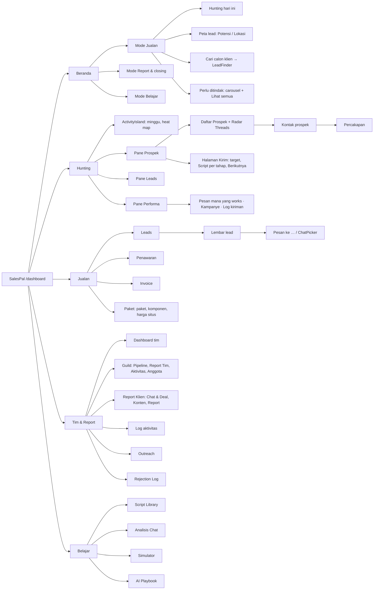

# A. Arsitektur informasi

Struktur yang sebenarnya dibangun oleh kode per 6 Nov 2026, termasuk perubahan PR #115. Sumber utamanya `components/SalesTracker.tsx` (`SECTIONS`, baris 69–75). Rujukan berbentuk `file:baris`.

## A1. Pohon navigasi

**Pintu global** (tersedia dari banyak tempat):

| Benda | Jenis | Dari mana |
|---|---|---|
| Lembar lead (`LeadPage`) | overlay penuh, portal | Beranda (kartu, Peta, Perlu ditindak), Hunting › Leads, Jualan › Leads, Follow-up beruntun, pencarian Hunting |
| Script pesan (`ScriptManager`) | sheet penuh | Hunting (tombol header, menu + "Script pesan baru" / "Kelola"), Pesan ke … → Kelola |
| Tambah lead | dialog | Beranda, Peta, Leads (header dan keadaan kosong) |
| Cari bisnis (`LeadFinder`) | dialog | **Hanya Beranda** |
| Import | dialog | Beranda, Peta, Leads, LeadFinder |
| Quick Pitch | tombol melayang + dialog | Semua tab kecuali Hunting |
| Profil & Pengaturan | bottom sheet (HP) / popover (≥641px) | Avatar di header |
| Notifikasi | popover (bukan dialog) | Lonceng di header |
| Ruang kerja | `<select>` | Header, kalau anggota guild |

## A2. Jenis permukaan

| Jenis | Contoh | Asal tetap hidup di bawah? | Masuk history (Back)? | Bertahan setelah reload? |
|---|---|---|---|---|
| **Tab** (navigasi) | 15 tab di 5 tempat | Tidak, diganti | **Tidak** | Tidak, kecuali `?hunt` / `?guild` |
| **Halaman Kirim** Hunting | `Hunting.tsx:710` | Tidak, menggantikan daftar Prospek | Ya, `spPage: "kirim"` | Tidak |
| **Overlay penuh** | Lembar lead, kontak prospek, Percakapan, PDF (`PrintSheet`) | Ya | Ya (ModalA11y, satu entri per overlay) | Tidak |
| **Sheet penuh** | Script pesan, Pesan ke … | Ya, tertutup latar penuh | Ya | Tidak |
| **Bottom sheet** | Profil lead, ubah data, lokasi, langkah berikutnya, menu + Hunting, Lihat semua, pratinjau chat, Filter / aksi script, `ConfirmSheet` | Ya | Ya | Tidak |
| **Dialog tengah** | Tambah lead, Import, Follow-up beruntun, LeadFinder, DocEditor, bayar invoice, editor paket, dialog Guild dan Report Klien | Ya | Ya | Tidak |
| **Popover** | Lonceng, menu ⋯ lead, Status & aksi di Percakapan, Profil (≥641px) | Ya | Lonceng: **tidak**. Lainnya: ya | Tidak |
| **Toast** | Undo Hunting, "udah kekirim?", toast Script pesan (5 dtk), error berbagi | — | Tidak | Tidak |
| **Buka di tempat** | `
` Log kiriman, Analisis lengkap, chevron heat map, "Muat lagi" | — | Tidak | Tidak |
| **Eksternal** | wa.me, ig.me, profil Threads/IG, Google Maps, berbagi PDF (`navigator.share`) | App tetap terbuka di belakang | Tidak | — |

## A3. UI yang menetap

| Elemen | Kapan terlihat |
|---|---|
| Header (merek, nav di ≥768px, ruang kerja, lonceng, avatar) | Selalu |
| Nav bawah | Di bawah 768px |
| Baris subtab | Tempat dengan lebih dari satu tab: Jualan, Tim & Report, Belajar |
| HuntBar (sesi hunting) | Selama sesi hunting hidup, **di semua tab**. Disimpan di Firestore, jadi kembali setelah reload |
| ActivityIsland | Tab Hunting |
| Quick Pitch (tombol melayang) | Semua tab kecuali Hunting. Bersembunyi saat scroll ke bawah di HP |
| "‹ Kembali ke …" | Setelah lompatan (PR #115), sampai pengguna memilih tab sendiri |

## A4. Yang bertahan dan yang hilang

**Bertahan setelah reload:**
- `localStorage`: tema, ruang kerja, mode Beranda, tampilan Peta, filter brand di Pesan, teks pembuka LeadFinder, klien terakhir, guild terakhir, status push.
- Sesi hunting (di Firestore).
- Login.

**Hilang setelah reload:**
- Lembar lead yang terbuka, kontak prospek, Percakapan, pane dan target Hunting.
- "Kembali ke …", serta pencarian, filter, dan urutan di Leads.
- Semua dialog.
- Semua draf: Tambah lead (selamat kalau dialog ditutup, tapi hilang saat reload), editor script, isi Pesan.

**Kembali dari aplikasi lain** (WhatsApp, IG): dashboard tidak punya listener `visibilitychange`, `focus`, atau `pageshow`. Pertanyaan "udah kekirim?" sudah dipasang **sebelum** pengguna pergi, jadi tetap menunggu saat ia kembali. Kembalinya pengguna sendiri tidak memicu apa pun.

## A5. Temuan dari pemetaan

Masing-masing dibahas di [ambiguities.md](ambiguities.md).

1. Pindah tab tidak menambah history, sehingga Back di tab kedua keluar dari app (AMB-01).
2. `?guild` tidak pernah dibuang dari URL, sehingga setiap reload membuka Guild lagi (AMB-02).
3. Ada tiga cara berbeda untuk "lembar penuh" (overlay `LeadPage`, `Sheet full`, halaman Kirim yang menggantikan daftar), dan Back-nya berbeda-beda (AMB-03).
4. LeadFinder hanya bisa dibuka dari Beranda, padahal tugasnya mencari lead (AMB-04).
5. Lonceng tidak masuk history, sehingga Back saat lonceng terbuka meninggalkan halaman (AMB-05).
6. Tidak ada yang terjadi saat pengguna kembali dari WhatsApp (AMB-06).
