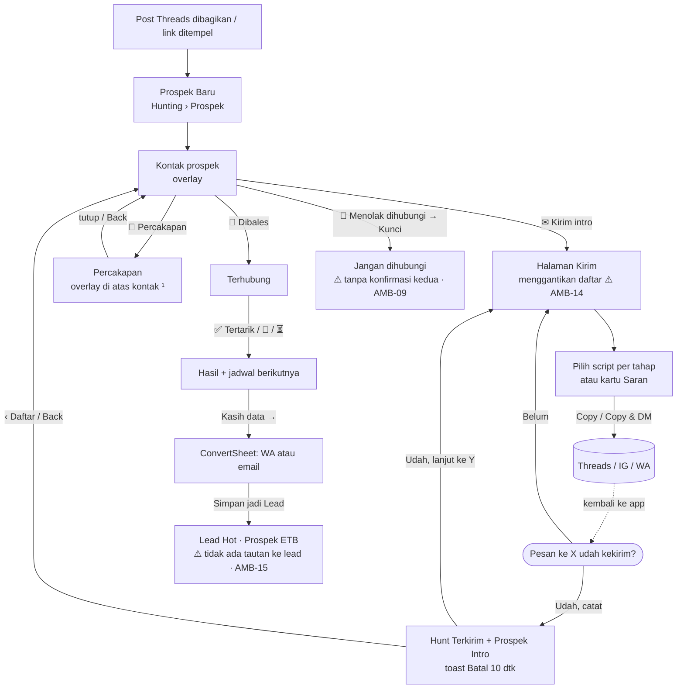
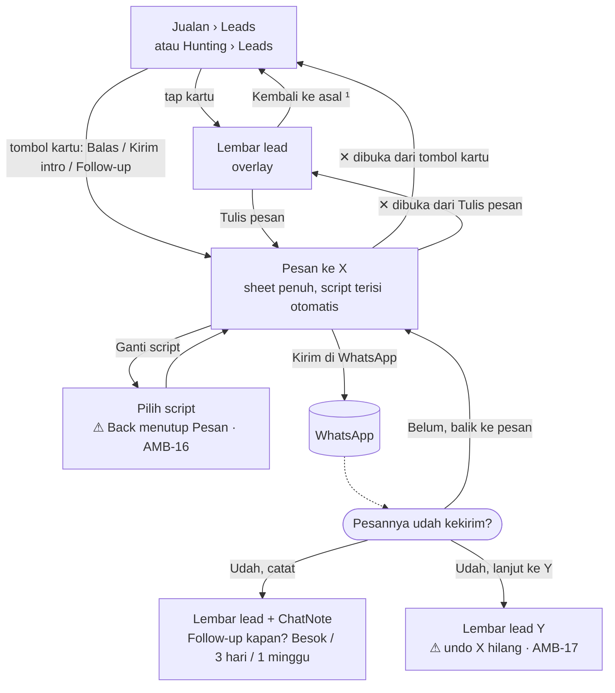
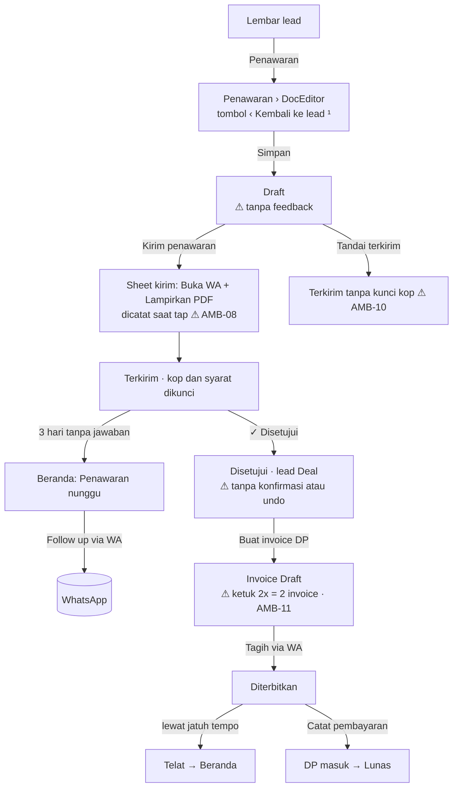
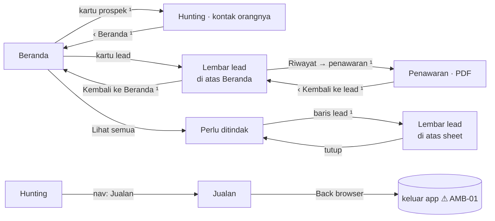
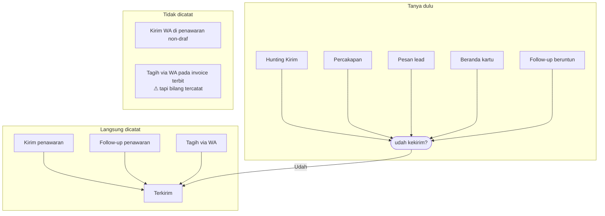
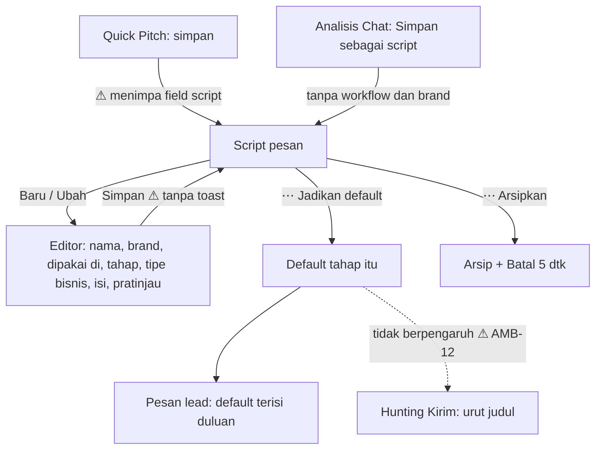

# B. Alur pengguna

Semua diagram menggambarkan perilaku kode per 6 Nov 2026, **termasuk PR #115** (navigasi balik). Langkah yang baru benar setelah PR #115 ditandai ¹.

- Garis putus-putus = keluar dari app.
- Kotak bersudut tumpul = pertanyaan.
- **⚠** = perilaku yang bermasalah, dengan rujukan ke [ambiguities.md](ambiguities.md).

## B1. Prospek: dari post sampai jadi Lead

**Belum dimodelkan:** apa yang disarankan SalesPal setelah **balasan** masuk (harga? portofolio? belum sekarang?). Sekarang penjual menandai hasil sendiri, lalu memilih script tahap berikutnya sendiri. Rancangannya ada di [script-chat.md](script-chat.md).

## B2. Lead: dari daftar sampai pesan terkirim

## B3. Penawaran sampai uang masuk

## B4. Navigasi dan konteks balik

## B5. Kirim: semua jalan ke "Terkirim"

## B6. Script: dari dibuat sampai dipakai

