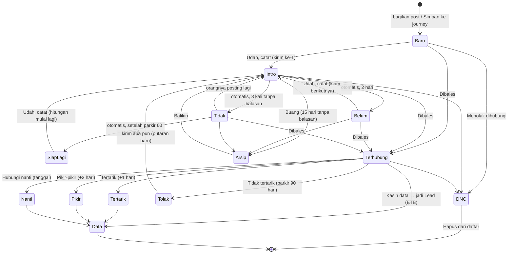
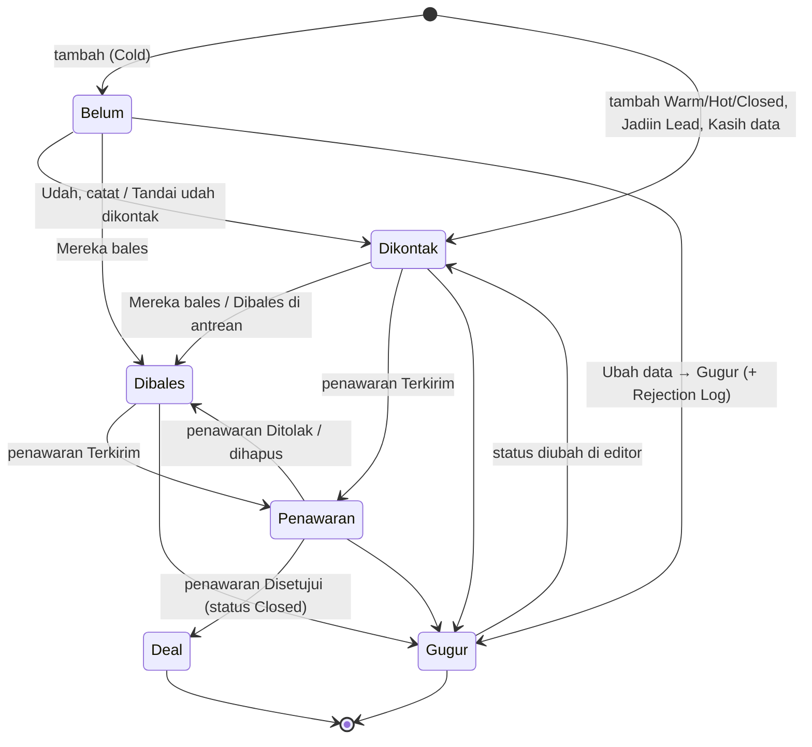
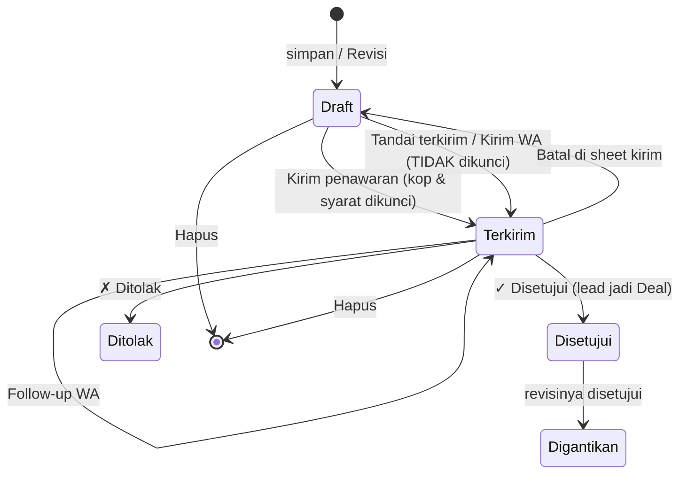
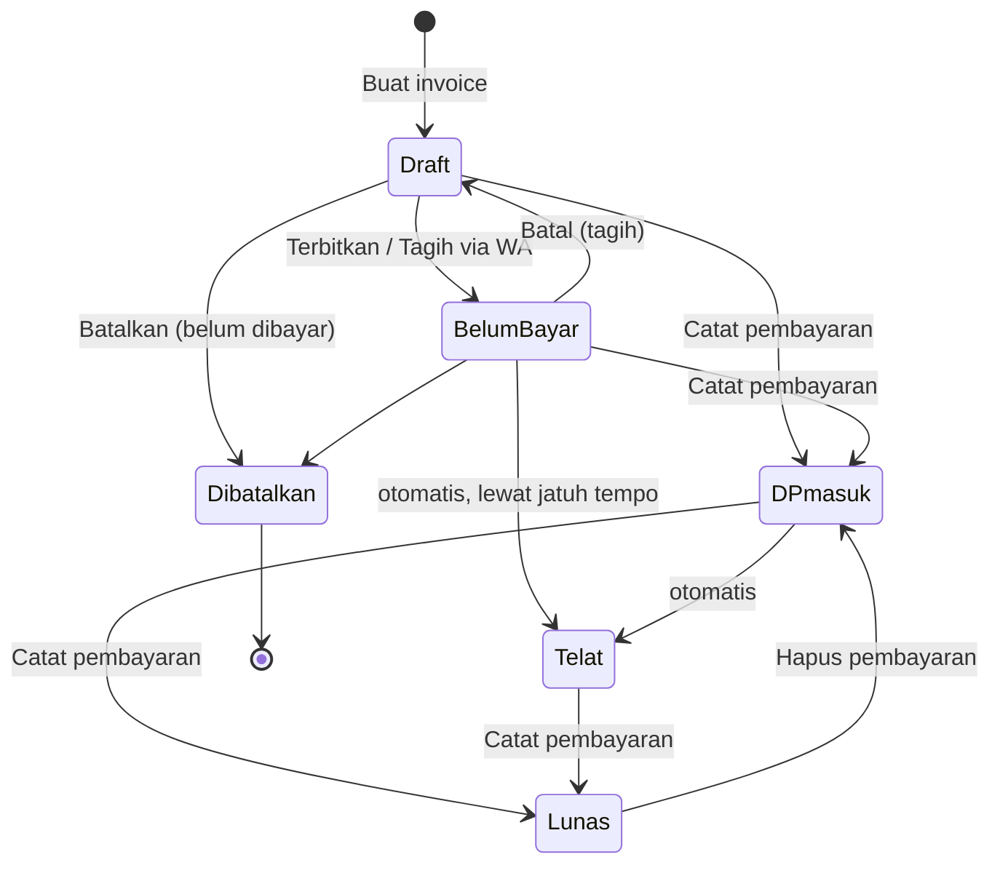

# C. Model state

State yang sebenarnya dibangun kode per 6 Nov 2026. Diagram hanya memuat transisi yang memang ada di kode. Kalau perilakunya salah atau tidak konsisten, catatannya ada di bagian **Masalah** dan keputusannya di [ambiguities.md](ambiguities.md).

## C1. Prospek (Hunting)

**Yang disimpan:** `contact` (baru, intro, terhubung, dnc) · `result` (tertarik, pikir, nanti, tolak, data, null) · `segment` (NTB/ETB) · `attempts` · `lastSentAt`, `lastReplyAt`, `nextAt`, `parkedUntil` · `closed`, `archivedAt`, `convertedAt`, `leadId`, `dncAt` · `history[]`.

**Strategi bawaan** (`lib/prospects.ts:81`, bisa diubah di pengaturan Hunting): maksimal 3 kirim, jeda 2 lalu 5 hari, parkir 60 hari, "tidak tertarik" diparkir 90 hari, pikir-pikir 3 hari, siap dibuang setelah 15 hari tanpa balasan.

| Yang dilihat pengguna | Kondisi |
|---|---|
| Baru | `contact=baru` |
| Intro terkirim | `contact=intro`, kurang dari 2 hari sejak kirim |
| Belum respon | `contact=intro`, sudah 2 hari atau lebih, `attempts < 3` |
| Tidak terhubung | `attempts ≥ 3`, sedang diparkir |
| Siap dihubungi lagi | `attempts ≥ 3`, masa parkir lewat |
| Terhubung | `contact=terhubung`, belum ada hasil |
| Tertarik / Pikir-pikir / Hubungi nanti / Tidak tertarik / Kasih data | `contact=terhubung` + `result` |
| Jangan dihubungi | `contact=dnc`, `closed` |
| Dibuang (Arsip) | `closed`, `archivedAt` |



**Masalah:**
1. **DNC tidak sampai ke log DM.** `dncPatch` menghapus tautan hunt sebelum `syncHunt` sempat menulis "Ditolak".
2. "Tidak tertarik" yang masih diparkir langsung mulai putaran baru kalau dikirimi pesan. Komentar kodenya berkata sebaliknya.
3. Parkir "Tidak terhubung" 62 hari, tetapi "Siap dibuang" muncul di hari ke-15. Prospek yang sedang diparkir jadi muncul di Siap dibuang.
4. "Balikin" dari Arsip langsung menjadi "Siap dibuang" lagi, karena 15 harinya tidak direset.
5. Mengubah status di log DM ke Terkirim atau Ghosting tidak mengubah journey, sehingga log dan journey tidak sinkron.
6. Status yang sama memakai **empat set label** berbeda: label status, langkah journey, grup antrean, dan filter daftar.
7. Kontak prospek dan Percakapan menawarkan hasil yang berbeda (lihat D2).

## C2. Lead

Lead punya **dua sumbu** yang terpisah:

- **Posisi**, dibaca dari yang beneran terjadi (`lib/leadStand.ts`): Belum dikontak → Dikontak → Dibales → Penawaran terkirim → Deal / Gugur.
- **Status**, penilaian penjual: Cold, Warm, Hot, Closed, Lost ("Gugur").



**Sub-state pengingat:**

```
tidak ada → terjadwal (Jadwal / Besok / 3 hari / 1 minggu) → jatuh tempo ("Follow-up hari ini") → telat ("Telat")
```

Dari jatuh tempo atau telat, pengingat bergeser +3 hari (Udah, catat), bergeser +1 hari (Tunda), atau dihapus (Selesai / Dibales / Gugur).

**Giliran kita** (aksi "Balas"): posisi Dibales dan balasan terakhir lebih baru dari kontak terakhir.

**Masalah:**
1. **Kasih data menimpa lead yang sudah ada.** Status jadi Hot, nilai 0, dan kategori F&B. Lead yang Deal atau Gugur bisa kembali jadi Hot dengan nilai 0 (`ConvertSheet.tsx:31-37`).
2. Tahap script di Pesan (`leadStage`) dibaca dari Status, bukan Posisi. Akibatnya lead Cold yang sudah membalas tetap mendapat script Follow-up, dan lead Gugur masih mendapat "Pesan berikutnya".
3. "✓ Selesai" di lembar lead mencatat Outreach "Sent" walaupun tidak ada yang dikirim.
4. "Dibales" di Follow-up beruntun mengisi `lastContact` tanpa `contactedAt`, sehingga "giliran kita" bisa terbalik.
5. Lead Warm, Hot, atau Closed hasil import langsung terbaca "Dikontak hari ini" (cap tanggal saat import), padahal glossary bilang cap itu bukan bukti kontak.
6. Penawaran "✗ Ditolak" tidak menyentuh lead. Posisinya turun diam-diam ke Dibales atau Dikontak.

## C3. Kiriman: Hunt dan Outreach

```mermaid
stateDiagram-v2
  state "Tertunda (belum disimpan)" as P
  [*] --> P: Copy / Buka WA / Copy & DM
  P --> [*]: Belum
  P --> Terkirim: Udah, catat
  Terkirim --> [*]: Batal (10 dtk; Kampanye 5 dtk)
  Terkirim --> Dibales: Ubah jadi / dari journey
  Terkirim --> Tertarik
  Terkirim --> Ditolak
  Terkirim --> Ghosting: Ubah jadi "Ga dibales" (manual)
  Dibales --> Terkirim: Ubah jadi "Belum dibales"
  Terkirim --> [*]: Hapus
```



- **Outreach (lead)** hanya punya satu state, "Sent", yang dibuat oleh `logContact`. Satu lead hanya dihitung sekali per hari.
- **"Tertunda" tidak disimpan di mana pun.** Kalau layarnya ditutup, tab dipindah, atau app dimuat ulang, kiriman itu hilang (AMB-06).

**Masalah:** badge menulis "Ghosting" tetapi tombolnya "Ga dibales". Perubahan dari journey tidak memperbarui `statusAt`.

## C4. Penawaran



"Kedaluwarsa" hanya badge hitungan (`validUntil < hari ini`). Statusnya tidak pernah berubah karena itu.

**Masalah:**
1. **Mengedit penawaran yang sudah terkirim menghapus kop, syarat, SPK/NDA, dan tanggal follow-up** (`setDoc` tanpa merge, `Quotes.tsx:126-140`).
2. Ada dua jalan ke "Terkirim" dengan efek berbeda (AMB-10).
3. "N hari tanpa jawaban" di kartu menghitung dari `sentAt`, sedangkan Beranda menghitung dari follow-up terakhir.
4. Penawaran yang kedaluwarsa masih bisa disetujui, dan "Kedaluwarsa" ikut muncul di yang Digantikan.
5. Disetujui dan Ditolak tidak punya konfirmasi maupun undo, padahal Disetujui mengubah lead jadi Deal.

## C5. Invoice

Label diurutkan berdasarkan prioritas: Dibatalkan → Draft → Lunas → Telat → DP masuk → Belum bayar.



**Masalah:**
1. **"Tagih via WA" pada invoice yang sudah terbit tidak menulis apa-apa,** tetapi tetap bilang "tercatat terkirim".
2. Telat mengalahkan "DP masuk", sehingga invoice yang sudah dibayar sebagian dan telat hanya terbaca Telat.
3. Invoice bernilai 0 tidak pernah Lunas.

## C6. Script

```mermaid
stateDiagram-v2
  [*] --> Aktif: Baru / Pakai contoh / Quick Pitch
  Aktif --> Default: Jadikan default (yang lain di tahap itu dilepas)
  Default --> Aktif: script lain jadi default
  Aktif --> Arsip: Arsipkan
  Default --> Arsip: Arsipkan (default dilepas)
  Arsip --> Default: Batal dalam 5 dtk
  Arsip --> Aktif: Balikin
  Arsip --> [*]: Hapus permanen
  Aktif --> [*]: Quick Pitch "Hapus template" (tanpa arsip)
```

**Masalah:**
1. **Simpan dari Quick Pitch menimpa script:** workflow, brand, kategori, default, dan arsip hilang. Quick Pitch juga menampilkan script yang diarsipkan.
2. Default berpengaruh di Pesan lead, tetapi tidak di Hunting (AMB-12).
3. Memindahkan script default ke tahap lain membuat satu tahap punya dua default.
4. Tahap "Closing" dijelaskan sebagai "Pikir-pikir / Hubungi nanti", tetapi untuk lead dipakai saat ada penawaran yang terkirim.
5. Script tidak punya **tujuan**, **respons yang diharapkan**, atau **aksi berikutnya**. Rancangannya ada di [script-chat.md](script-chat.md).
