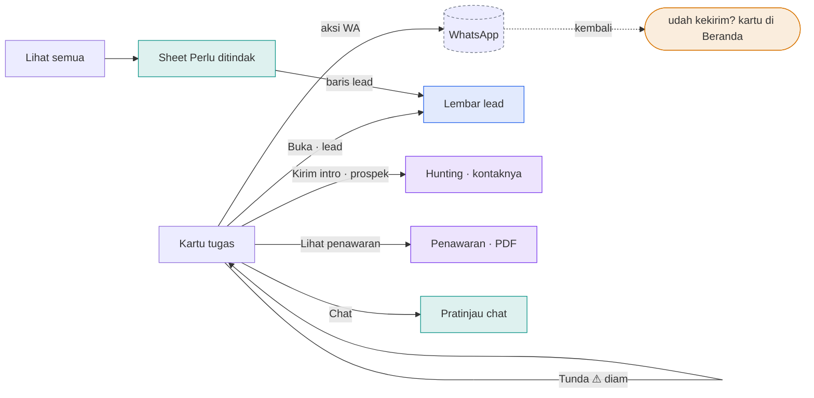
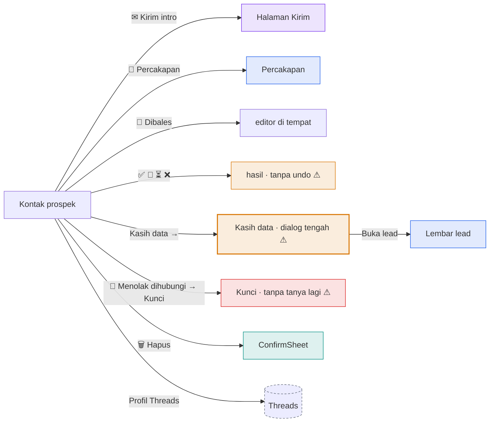
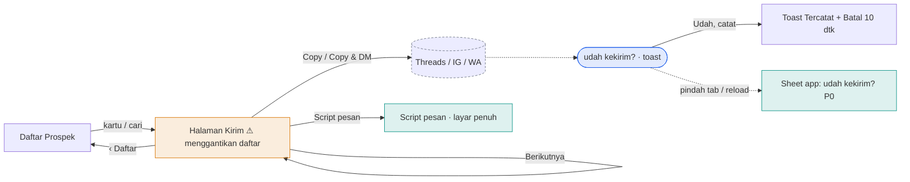
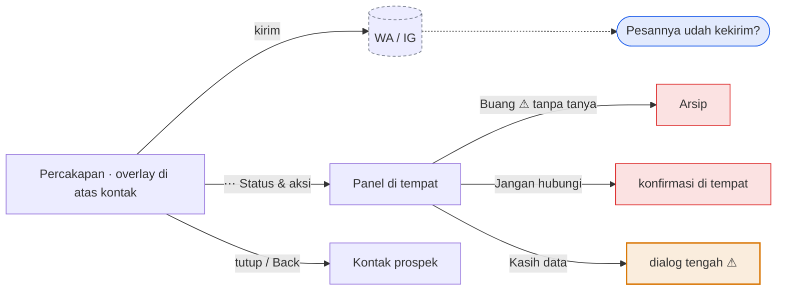
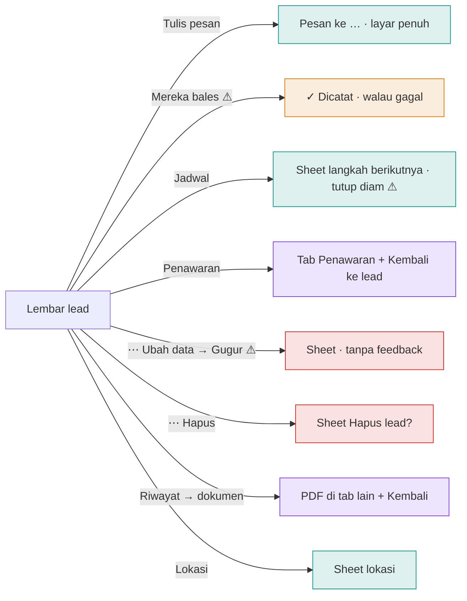
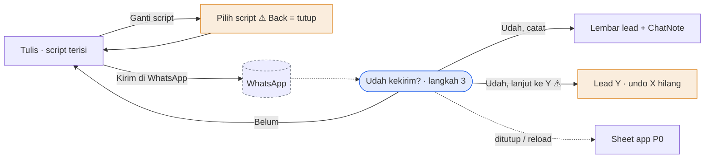
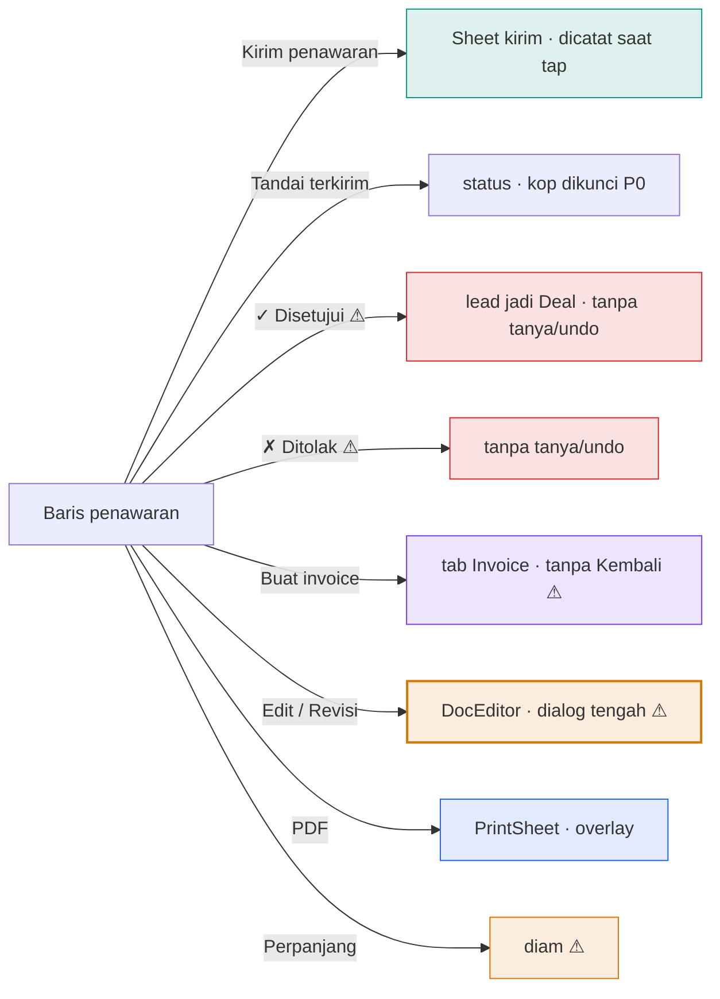
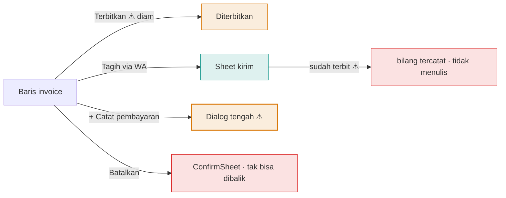
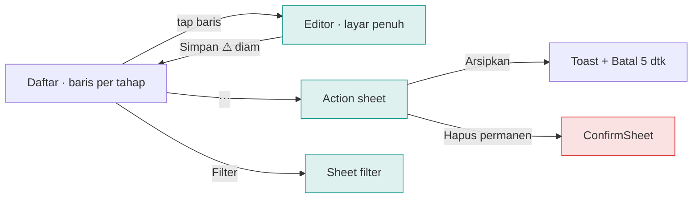

# G. Peta tombol (audit 6 Nov 2026)

Audit per tombol: ditap ke mana, dibuka dengan pola apa, feedback-nya, dan penilaiannya. Ini **bahan**, bukan desain: alasan, state, dan keputusan setiap feature ada di [features/](features/), pola di [patterns.md](patterns.md), keputusan di [decisions.md](decisions.md).

> Dibaca dari kode setelah PR #115. Bagian **Kontak prospek** di bawah menggambarkan halaman *sebelum* PR #116; masalahnya sudah diperbaiki (lihat [features/kontak-prospek.md](features/kontak-prospek.md)). Versi interaktif: artifact "Peta Tombol SalesPal".

## Beranda · Perlu ditindak

Tujuan: apa yang dikerjakan sekarang · Aksi utama: tombol kartu teratas

| Tombol | Membuka | Feedback | Penilaian | Usulan |
|---|---|---|---|---|
| Aksi kartu (WA) | WhatsApp | Kartu "udah kekirim?" di Beranda | ⚠ Pertanyaan muncul sebelum pergi; kalau pindah tab, hilang (kartu Beranda belum ikut antrean P0) | Pakai antrean kiriman tertunda yang sama dengan Hunting |
| Tunda | — | Tidak ada | ⚠ Kartu tetap terlihat, hanya tanggal yang berubah, tanpa tanda | Kartu bergeser keluar + toast "Ditunda ke besok · Batal" |
| Buka / Chat / Lihat semua | Overlay / sheet | — | OK Ditumpuk; tutup kembali ke Beranda | — |
| 3 tombol per kartu | — | — | ⚠ Aksi, Tunda, Buka, Chat bersaing sama besar di kartu sempit | Satu tombol utama; Tunda dengan geser kartu, sisanya di ⋯ |

## Kontak prospek

Overlay di atas daftar · 13 tombol terlihat sekaligus

| Tombol | Membuka | Feedback | Penilaian | Usulan |
|---|---|---|---|---|
| 13 tombol setara | — | — | ⚠ Kirim, Percakapan, Dibales, Catatan, 4 hasil, Kasih data, Menolak, Hapus semuanya chip berukuran sama. Tidak ada satu aksi utama | Satu tombol besar di bawah sesuai status ("Kirim follow-up"). "Dia bales…" membuka sheet hasil (Tertarik / Pikir / Nanti / Tidak / Kasih data). Hapus & Jangan hubungi di ⋯ |
| Emoji sebagai ikon | — | — | ⚠ design.md: emoji bukan ikon; tombolnya terlihat seperti chat, bukan kontrol | Ikon garis dari Icon.tsx + label |
| Hasil (✅ 🤔 ⏳ ❌) | Tulis langsung | Hanya tombol tertekan | ⚠ Salah tap "Tidak tertarik" = parkir 90 hari, tanpa Batal | Toast "Ditandai Tidak tertarik · Batal" 10 dtk (AMB-09) |
| Kasih data → | Dialog di tengah | ✓ di sheet + Buka lead (P0) | ⚠ Form 4 isian di dialog tengah; keyboard iPhone menutupinya | Bottom sheet yang naik di atas keyboard, Simpan di atas |
| Menolak dihubungi → Kunci | Editor di tempat | — | ⚠ Menghapus riwayat selamanya, tanpa pertanyaan kedua; letaknya di antara hasil biasa | Pindah ke ⋯, merah, lewat ConfirmSheet |
| Percakapan / Kirim | Overlay / halaman | — | OK Tutup kembali ke kontak (PR #115) | — |

## Hunting · Halaman Kirim

Menggantikan daftar Prospek · Aksi utama: Copy & … pada script

| Tombol | Membuka | Feedback | Penilaian | Usulan |
|---|---|---|---|---|
| Kartu script (Copy + Copy & …) | Keluar app | Toast tanya, lalu Tercatat + Batal | ⚠ 8 kartu script per tahap; penjual memilih sendiri. Default diabaikan (AMB-12) | "Pesan buat {nama}": satu kartu besar terisi, sisanya dilipat (PRD-025 B) |
| Masuk dari daftar | Menggantikan daftar | — | ⚠ Scroll dan batas 30 kartu hilang saat kembali (AMB-14) | Halaman Kirim jadi overlay di atas daftar |
| "Udah dijawab? Tandai…" | Hasil di tempat | Teks | ⚠ Hasil yang sama dengan kontak, label & efek berbeda | Satu sheet hasil untuk semua tempat |

## Percakapan prospek

| Tombol | Membuka | Feedback | Penilaian | Usulan |
|---|---|---|---|---|
| ⋯ Status & aksi | Panel di header | — | ⚠ Hasilnya berbeda dari kontak: tidak ada Pikir-pikir/Hubungi nanti, "Nolak" tanpa alasan | Action sheet hasil yang sama dengan kontak |
| 🗑 Buang | Langsung | Error tertelan | ⚠ Tanpa konfirmasi; kalau gagal, pesan error tidak sempat terlihat | ConfirmSheet, lalu toast "Dibuang · Batal" |

## Lembar lead

Overlay di atas tempat asal · Aksi utama: dari Posisi (Balas / Kirim intro / Follow-up)

| Tombol | Membuka | Feedback | Penilaian | Usulan |
|---|---|---|---|---|
| Mereka bales | — | "✓ Dicatat" 2,5 dtk | ⚠ Muncul sebelum tersimpan, tanpa catch: bisa bohong | Tunggu tulisan (cepat lewat persistensi), error bisa diulang, + Batal |
| Gugur (di Ubah data lead) | Sheet form | Sheet tertutup diam | ⚠ Keputusan besar disembunyikan di dalam form edit; tanpa konfirmasi atau undo | Aksi sendiri di ⋯ "Tandai gugur…" → sheet alasan → toast + Batal |
| Jadwal | Sheet | Tertutup diam | ⚠ Tidak ada konfirmasi tanggal yang tersimpan | Toast "Follow-up Kam 12 Nov · Batal"; tanggal terlihat di lembar |
| Penawaran / Riwayat | Pindah tab | "Kembali ke {lead}" | OK Setelah PR #115 | — |

## Pesan ke lead

| Tombol | Membuka | Feedback | Penilaian | Usulan |
|---|---|---|---|---|
| Ganti script | Langkah 2 di sheet | — | ⚠ Back menutup seluruh Pesan, bukan kembali ke tulis (AMB-16) | Back per langkah |
| Udah, lanjut ke Y | Lead berikutnya | ChatNote X hilang | ⚠ Salah konfirmasi tidak bisa dibatalkan (AMB-17) | Toast app yang bertahan saat pindah orang |

## Penawaran (baris dokumen)

Sampai 8 tombol per baris

| Tombol | Membuka | Feedback | Penilaian | Usulan |
|---|---|---|---|---|
| Deretan tombol | — | — | ⚠ Kirim, Disetujui, Ditolak, Tandai terkirim, Perpanjang, Buat invoice, Copy, PDF, Edit sejajar di setiap baris | Baris = satu aksi utama sesuai status; tap baris membuka dokumen (layar penuh) dengan aksi lain di ⋯ |
| ✓ Disetujui / ✗ Ditolak | Langsung | Tidak ada | ⚠ Mengubah lead jadi Deal dan nilai omzet dalam satu tap (AMB-24) | Toast "{lead} jadi Deal Rp X · Batal" |
| Edit / Revisi (DocEditor) | Dialog tengah | "Buang perubahan?" | ⚠ Form panjang (item, biaya, termin) di dialog; di HP sudah dibuat tinggi penuh, tapi tetap pola dialog | Layar penuh dengan Batal/Simpan di atas, ringkasan total menempel di bawah |
| Buat invoice | Pindah tab | — | ⚠ Tidak ada "Kembali ke Penawaran" | Lompatan dengan Kembali, seperti dari lead |

## Invoice

| Tombol | Membuka | Feedback | Penilaian | Usulan |
|---|---|---|---|---|
| Tagih via WA (sudah terbit) | Sheet kirim | "tercatat terkirim" | ⚠ Tidak ada yang ditulis; pengingat Beranda tetap muncul (AMB-08) | Selalu isi remindedAt |
| + Catat pembayaran | Dialog tengah | Tertutup diam | ⚠ Dua isian di dialog tengah, tanpa konfirmasi jumlah | Bottom sheet dengan jumlah besar + toast "Rp X masuk · sisa Rp Y" |
| Terbitkan | Langsung | Tidak ada | ⚠ Status berubah tanpa tanda | Toast + Batal |

## Script pesan

> Sudah mengikuti pola yang benar (redesign 5 Nov): baris, action sheet, filter di sheet, editor layar penuh. Sisa: Simpan tanpa toast; undo 5 dtk dibanding 10 dtk di tempat lain.

## Semua dialog di tengah layar

Sekitar 40 dialog di 15 komponen memakai pola dialog tengah (modalBox). Di iPhone, pola ini paling terasa tidak native: jauh dari jempol, tertutup keyboard, dan tidak bisa digeser turun.

| Jenis isi | Contoh | Pola sekarang | Pola native |
|---|---|---|---|
| Form panjang | Tambah lead, DocEditor, Paket, Komponen, Kop bisnis, dialog Guild & Report Klien | Dialog tengah | Layar penuh: Batal kiri atas, Simpan kanan atas, Back = Batal (dengan "Buang perubahan?") |
| Form pendek (1–3 isian) | Kasih data, Catat pembayaran, Target harian, Default kalau kosong | Dialog tengah | Bottom sheet yang naik di atas keyboard |
| Daftar / alur | Follow-up beruntun, Import, Cari bisnis | Dialog tengah | Layar penuh dengan langkah dan Back per langkah |
| Pertanyaan singkat | Hapus?, Buang perubahan?, Batalkan invoice? | ConfirmSheet (bawah) | OK sudah benar |

> Satu komponen Sheet sudah ada dengan mode bawah dan layar penuh, plus Back yang benar. Usulnya: semua dialog di atas pindah ke Sheet, bertahap per kelompok, setiap kelompok dengan flow tes di 390/375/1440.
