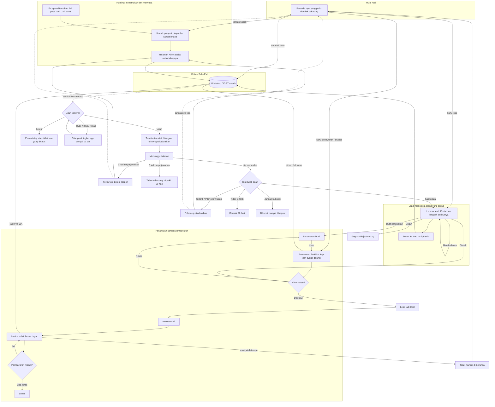

# SalesPal sebagai satu sistem — arsitektur interaksi global

Dokumen ini menunjukkan SalesPal sebagai **satu perjalanan penjual**, bukan kumpulan halaman. Setiap feature di [features/](features/) adalah satu ruas dari perjalanan ini.

## 1. Why satu sistem

Penjual tidak berpikir "sekarang saya di tab Hunting". Ia berpikir: *siapa yang harus saya hubungi sekarang, apa yang harus saya bilang, dan apa yang terjadi setelahnya*. Kalau setiap halaman punya aturan sendiri soal kirim, hasil, Back, dan feedback, penjual harus belajar ulang di setiap tempat, dan data yang mengalir antar ruas (prospek → lead → penawaran → invoice) bocor di sambungannya.

Tiga hal yang membuat SalesPal satu sistem:

1. **Satu benang orang.** Orang yang sama bergerak dari Prospek ke Lead ke klien. Riwayatnya ikut (`prospect.leadId`, `quote.leadId`, `invoice.quoteId`).
2. **Satu kontrak kirim.** Semua pesan keluar lewat app lain dan dicatat hanya setelah penjual mengonfirmasi ([DEC-001](decisions.md#dec-001), [DEC-002](decisions.md#dec-002)).
3. **Satu aturan kembali dan satu aturan feedback.** Tutup selalu ke tempat asal ([DEC-007](decisions.md#dec-007)); setiap perubahan memberi tahu hasilnya dan cara membatalkannya ([DEC-004](decisions.md#dec-004), [DEC-005](decisions.md#dec-005)).

## 2. Tujuan penjual sepanjang sistem

> "Saya ingin tahu siapa yang harus saya hubungi hari ini, mengirim pesan yang tepat untuk tahap orang itu, dan tidak kehilangan satu pun orang atau rupiah di antara chat, penawaran, dan pembayaran."

## 3. Perjalanan global



## 4. Titik keputusan global

```
Siapa yang saya hubungi sekarang?            (penjual, dibantu Beranda)
├── Ada tugas yang jatuh tempo     → kartu Beranda, urut uang terbesar dulu
└── Tidak ada                      → Hunting: cari prospek baru

Orang ini sudah pernah dihubungi?            (sistem, dari journey/Posisi)
├── Belum                          → Intro
├── Sudah, belum dibalas           → Follow-up (2, lalu 5 hari)
├── Sudah 3× tanpa jawaban         → Parkir 60 hari
└── Sudah dibalas                  → Gali kebutuhan / Penawaran

Pesan sudah terkirim?                        (hanya penjual yang tahu)
├── Udah   → Terkirim tercatat, hitungan sesi naik, follow-up dijadwalkan
├── Belum  → tidak ada yang dicatat
└── Tidak dijawab → tetap ditanya (antrean kiriman tertunda)

Dia jawab apa?                               (penjual, sheet "{nama} jawab apa?")
├── Tertarik / Pikir-pikir / Hubungi nanti → follow-up +1 / +3 / tanggal
├── Tidak tertarik                         → parkir 90 hari
├── Kasih data                             → Lead (ETB), digabung bila sudah ada
└── Jangan hubungi                         → dikunci selamanya (tanya dulu)

Lead siap ditawari?                          (penjual)
├── Ya    → Penawaran Draft → Terkirim (kop & syarat dikunci)
└── Tidak → Gugur, dengan alasan, ke Rejection Log

Klien setuju?                                (penjual menandai)
├── Disetujui → lead jadi Deal, nilai masuk omzet      ⚠ tanpa undo (GAP-QUO)
├── Ditolak   → lead kembali ke Dibales                 ⚠ tanpa undo
└── Minta ubah → Revisi (versi lama Digantikan)

Uang sudah masuk?                            (penjual mencatat)
├── Sebagian → DP masuk, sisa tetap ditagih
├── Semua    → Lunas
└── Belum, lewat jatuh tempo → Telat, muncul di Beranda
```

## 5. State yang menembus feature

| State | Arti bagi penjual | Disimpan di | Dibaca oleh |
|---|---|---|---|
| Journey prospek (`contact`, `result`, `nextAt`, `history`) | Sampai mana saya dengan orang ini | Firestore `prospects` | Hunting, Kontak, Percakapan, Beranda |
| Log DM (`hunts`) | Pesan apa yang saya kirim, script mana | Firestore `hunts` | Hunting (riwayat, angka template) |
| Sesi hunting (`huntSessions.counts`) | Target hari ini, sudah berapa | Firestore `huntSessions` | Bar sesi |
| Lead (Posisi, Status, `nextAt`) | Orang serius dan langkah berikutnya | Firestore `leads` | Leads, Lembar lead, Beranda, Pesan |
| Penawaran (`status`, `issuer`, `terms`, `supersededBy`) | Janji yang sudah saya kirim | Firestore `quotes` | Penawaran, Lembar lead, Beranda |
| Invoice (`payments`, jatuh tempo) | Uang yang masih di luar | Firestore `invoices` | Invoice, Beranda |
| Kiriman tertunda | "Tadi udah kekirim?" yang belum dijawab | `sessionStorage` `sp-pending-sends` (12 jam) | PendingSends, layar pengirim |
| Asal lompatan (`cameFrom`, `leaveTo`, `backTo`) | Tempat saya tadi | Memori React | Tombol "Kembali ke …" |
| Tulisan offline | Perubahan yang belum sampai server | Cache Firestore lokal (IndexedDB) | Semua |
| **Hanya di kepala penjual** | Pesan benar-benar terkirim; isi balasan di WhatsApp | Tidak ada, sampai penjual mengonfirmasi atau menempel | — |

## 6. Sambungan antar feature (tempat yang paling sering rusak)

| Sambungan | Yang harus ikut | Status |
|---|---|---|
| Beranda → Kontak / Lead / Penawaran | Asal, supaya Tutup kembali ke Beranda | ✅ #115 |
| Kontak → Halaman Kirim → kembali | Orang yang sama, daftar dan scroll | 🟡 daftar dibongkar (AMB-14) |
| Kirim → WhatsApp → kembali | Pertanyaan "udah kekirim?" | ✅ Hunting/Percakapan/Pesan · ❌ Beranda/penawaran |
| Kasih data → Lead | Riwayat dan kontak, tanpa menimpa | ✅ #116 |
| Lead → Penawaran → kembali | "Kembali ke {lead}" | ✅ #115 |
| Penawaran → Invoice | "Kembali ke Penawaran" | ❌ |
| Disetujui → Deal | Undo bila salah tap | ❌ (AMB-24) |
| Reload iOS di tengah | Permukaan teratas dibuka lagi | ❌ (AMB-25) |

## 7. Indeks feature

| Feature | File | Ruas perjalanan |
|---|---|---|
| Beranda | [features/beranda.md](features/beranda.md) | Mulai hari, apa yang perlu ditindak |
| Hunting | [features/hunting.md](features/hunting.md) | Menemukan prospek, menyiapkan dan mengirim pesan |
| Kontak prospek | [features/kontak-prospek.md](features/kontak-prospek.md) | Satu orang: cerita, langkah berikutnya, hasil |
| Percakapan | [features/percakapan.md](features/percakapan.md) | Membaca dan membalas seperti di chat |
| Lembar lead | [features/lembar-lead.md](features/lembar-lead.md) | Orang serius: Posisi, jadwal, dokumen |
| Pesan ke lead | [features/pesan-ke-lead.md](features/pesan-ke-lead.md) | Mengirim dengan script terisi dan mencatatnya |
| Penawaran | [features/penawaran.md](features/penawaran.md) | Janji tertulis kepada klien |
| Invoice | [features/invoice.md](features/invoice.md) | Menagih dan mencatat uang masuk |
| Script pesan | [features/script-pesan.md](features/script-pesan.md) | Apa yang dikatakan di setiap tahap |
