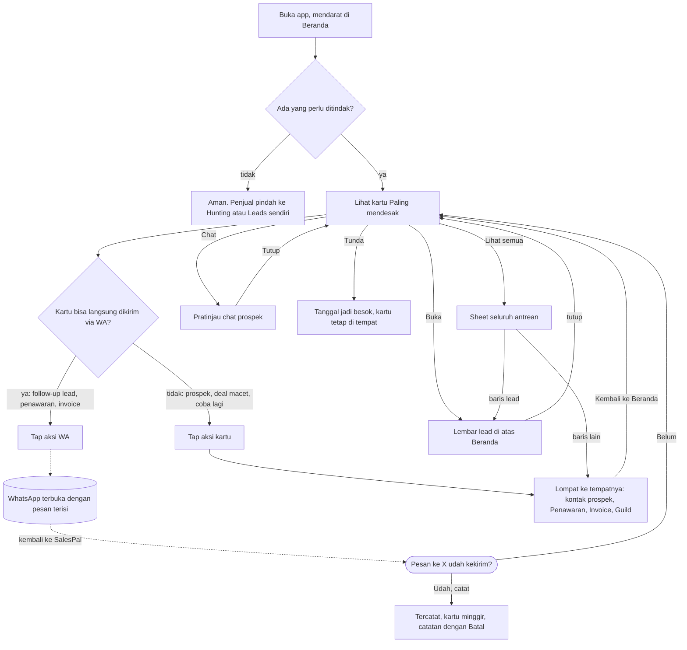

# Beranda: arsitektur interaksi

**Kode:** `components/Beranda.tsx`, `components/SalesTracker.tsx` (daftar tugas, `jump`/`cameFrom`/`goBack`, `PendingSends`), `components/PendingSends.tsx`, `lib/pendingSend.ts` · **Artefak lama:** E1, D1, B4, B5, peta tombol `#beranda` (HTML audit 6 Nov, belum ada di repo) · **Pola:** [P1](../patterns.md#p1-primary-action), [P2](../patterns.md#p2-secondary-action), [P5](../patterns.md#p5-bottom-sheet), [P8](../patterns.md#p8-toast), [P9](../patterns.md#p9-undo), [P10](../patterns.md#p10-retry), [P11](../patterns.md#p11-external-app-handoff), [P13](../patterns.md#p13-back-behavior), [P14](../patterns.md#p14-loading--pending), [P15](../patterns.md#p15-error) · **Keputusan:** [DEC-001](../decisions.md#dec-001), [DEC-002](../decisions.md#dec-002), [DEC-004](../decisions.md#dec-004), [DEC-005](../decisions.md#dec-005), [DEC-006](../decisions.md#dec-006), [DEC-007](../decisions.md#dec-007), [DEC-008](../decisions.md#dec-008), [DEC-015](../decisions.md#dec-015); [AMB-06, AMB-07, AMB-13, AMB-22](../ambiguities.md), [PRD-026](../../prd/PRD-026-navigasi-balik.md), PRD-008 §1 · **Terkait:** [kontak-prospek.md](kontak-prospek.md), [lembar-lead.md](lembar-lead.md), [penawaran.md](penawaran.md), [invoice.md](invoice.md), [hunting.md](hunting.md)

Dokumen ini membahas mode **Jualan** di Beranda: bagian "Perlu ditindak" dan semua jalan keluar darinya. Mode Report & closing, Belajar, peta lead, dan angka ringkas hanya disebut sejauh memengaruhi alur itu.

## 1. Why

- **Masalah yang diselesaikan.** Kerja jualan tersebar di lima tempat: follow-up lead, prospek Hunting yang jatuh tempo, penawaran yang belum dijawab, deal macet, dan invoice yang hampir telat. Tanpa satu daftar, penjual membuka tiap tab satu per satu, atau mengandalkan ingatan. Yang paling sering terlewat justru yang paling mahal: tagihan Rp 10 jt yang telat dua hari.
- **Kenapa di SalesPal.** Hanya SalesPal yang tahu tanggal follow-up, status penawaran, sisa tagihan, dan posisi prospek sekaligus. WhatsApp tahu chat-nya, tapi tidak tahu siapa yang harus disapa hari ini.
- **Yang ingin diselesaikan pengguna di sini:** tahu satu hal yang harus dikerjakan sekarang, lalu mengerjakannya tanpa mencari.
- **Yang BUKAN tugas Beranda.**
  - Menulis pesan yang panjang atau memilih script. Itu tugas Pesan lead (ChatPicker) dan halaman Kirim di Hunting.
  - Menandai hasil (Tertarik, Tidak tertarik). Itu tugas kontak prospek dan lembar lead.
  - Mengelola daftar. Beranda menampilkan antrean, bukan tabel yang bisa disaring.

## 2. User goal

> "Saya ingin buka app pagi-pagi dan langsung tahu siapa yang harus saya chat duluan, lalu chat dia dari situ, tanpa harus ingat-ingat sendiri atau buka tab satu-satu."

Tujuan sampingan:

> "Kalau sudah saya chat, saya ingin itu tercatat, dan kartunya minggir sampai memang waktunya lagi."

> "Kalau hari ini belum sempat, saya ingin menundanya ke besok tanpa kehilangan pengingatnya."

## 3. User state

| State | Apa yang benar saat ini | Persisten | Siapa yang mengubahnya |
|---|---|---|---|
| Ada tugas jatuh tempo | `when <= hari ini` untuk satu atau lebih kartu. Judul: "{N} hal perlu ditindak hari ini" | Firestore (diturunkan dari lead, prospek, hunt, penawaran, invoice, deal, rejection) | Sistem, dari tanggal yang ditulis aksi lain |
| Tidak ada tugas | Daftar kosong: "Aman. Ga ada follow-up…" | Turunan | Sistem |
| **Data belum datang** | Daftar kosong karena snapshot belum tiba, **tampil sama dengan "Aman"** | Tidak | Sistem ⚠ GAP-BER-14 |
| Kartu teratas | Tugas jatuh tempo dengan rupiah terbesar ("Paling mendesak"), sisanya urut tanggal | Turunan, tiap render | Sistem |
| WhatsApp dibuka dari kartu | Kartu masuk daftar `asking`: "Pesan ke {nama} udah kekirim?" | **Tidak.** State React di Beranda saja | Penjual (tap) ⚠ GAP-BER-3 |
| **Pesan sudah terkirim di WhatsApp** | Hanya penjual yang tahu. wa.me tidak melapor balik | Hanya di kepala penjual | Penjual |
| Kiriman dicatat | Kartu hilang dari daftar sampai tanggal berikutnya. Catatan "✓ {apa yang dicatat}" + Batal | Firestore (tulisan) + state React (catatan) | Penjual (Udah, catat) |
| Tugas ditunda | `nextActionDate` = besok. Kartu tetap terlihat, hanya teks tanggalnya berubah | Firestore | Penjual (Tunda) ⚠ GAP-BER-1 |
| Lompat ke tempat lain | `cameFrom = { tab, label }`. Tab tujuan menampilkan "‹ Kembali ke Beranda" | Tidak (state SalesTracker) | Sistem, saat lompatan |
| Sedang melihat sheet | Lihat semua atau pratinjau Chat terbuka | Tidak | Penjual |
| Mode Beranda | Jualan / Report & closing / Belajar | `localStorage` (`sp-beranda-mode`) | Penjual |

## 4. Experience flow



Momen paling rapuh adalah **kembali dari WhatsApp**. Penjual sudah mengirim, tapi sistem belum tahu. Kalau ia sempat pindah tab atau iOS memuat ulang PWA, pertanyaan "udah kekirim?" milik Beranda lenyap dan kiriman itu tidak pernah tercatat (GAP-BER-3). Momen kedua adalah **Tunda**: penjual menekan tombol dan tidak ada yang berubah selain teks tanggal kecil, sehingga ia ragu apakah tombolnya jalan (GAP-BER-1). Lompatan ke Hunting atau Penawaran terasa aman karena ada "‹ Kembali ke Beranda", tapi sheet Lihat semua yang tadi terbuka tidak ikut kembali (GAP-BER-10).

## 5. Decision flow

**Penjual: kartu mana dulu?**
```
Kartu mana yang saya kerjakan?
├── Kartu pertama (Paling mendesak) → sistem sudah memilih: rupiah terbesar di antara yang jatuh tempo
├── Kartu lain di carousel (HP: 10, desktop: 4) → penjual memilih sendiri
└── Tidak kelihatan → Lihat semua (sheet, semua tugas)
```
Siapa: sistem memilih kartu pertama (`SalesTracker.tsx:672-673`), penjual memilih sisanya. UI membantu dengan label "Paling mendesak", warna jenis tugas, dan "Telat N hari". Alasan pemilihan (rupiah) tidak disebut di kartu; penjual hanya melihat hasilnya.

**Penjual: kerjakan, tunda, atau lihat dulu?**
```
Apa yang saya lakukan dengan kartu ini?
├── Kerjakan sekarang
│   ├── Kartu WA → buka WhatsApp → nanti ditanya "udah kekirim?"
│   └── Kartu lain → lompat ke tempatnya
├── Lihat konteks dulu
│   ├── Buka (lead dengan WA) → lembar lead di atas Beranda
│   └── Chat (prospek) → pratinjau 6 pesan terakhir
└── Belum sempat
    ├── Tunda (hanya kartu follow-up lead) → besok ⚠ GAP-BER-1, GAP-BER-2
    └── Kartu lain tidak punya Tunda → penjual hanya bisa mengabaikannya
```
Siapa: penjual. UI membantu, tapi empat tombol bersaing sama besar di kartu sempit (GAP-BER-11).

**Penjual: pesannya benar-benar terkirim?**
```
Pesan ke X udah kekirim?
├── Udah, catat → tulis catatan (follow-up / nudge penawaran / pengingat invoice)
│   ├── Berhasil → "✓ {logged}" + Batal
│   └── Gagal → "WhatsApp kebuka, tapi gagal dicatat. Cek koneksi." tanpa ulang ⚠ GAP-BER-4
├── Belum → kartu tanya hilang, tidak ada yang ditulis
└── Tidak dijawab (pindah tab, lompat, reload) → pertanyaan hilang, tidak tercatat ⚠ GAP-BER-3
```
Siapa: penjual, karena wa.me tidak bisa melapor. Keputusan "tidak dijawab" saat ini **diambil sistem tanpa sepengetahuan penjual**: pertanyaannya dibuang.

**Sistem: kapan kartu muncul dan hilang?**
```
Apakah tugas ini masuk Perlu ditindak?
├── Follow-up lead: nextActionDate ≤ hari ini + 3, status masih jalan → masuk
├── Prospek Hunting: inQueue (jatuh tempo, belum siap dibuang) → masuk
├── Hunt "Tertarik" tanpa lead dan tanpa journey → masuk
├── Penawaran Terkirim, ≥ 3 hari sejak kirim atau nudge terakhir → masuk
├── Deal macet (STALL_DAYS) → masuk
├── Rejection dengan followUpDate ≤ +3 hari dan ≥ −14 hari → masuk
└── Invoice bersisa, jatuh tempo ≤ +3 hari, tidak diingatkan kemarin/hari ini → masuk
```
Siapa: sistem (`SalesTracker.tsx:616-667`). Penjual tidak melihat aturan ini, tapi efeknya bisa ditebak lewat catatan setelah kirim ("muncul lagi {tanggal} kalau belum dijawab").

**Sistem: setelah lompatan, ke mana Back?**
```
Penjual menekan "Kembali ke Beranda"?
├── Ya → tab Beranda, cameFrom dihapus (kalau asalnya lead: lembar lead dibuka lagi)
├── Tap nav/subnav → cameFrom dihapus, tanpa tombol kembali (PRD-026 prinsip 4)
└── Kartu prospek → kontak ditutup → otomatis kembali ke Beranda
```
Siapa: sistem, sesuai PRD-026. `huntFocus` tidak dihapus saat nav ditekan, sehingga lompatan berikutnya ke Hunting bisa membuka orang yang salah (⚠ GAP-BER-9).

## 6. Interaction flow

```
AKSI        Aksi WA di kartu (Chat / Follow up via WA / Kirim pengingat)
WHY         Tugasnya memang satu chat; menyiapkan pesan di Beranda menghemat tiga langkah
STATE       Kartu follow-up lead yang punya nomor (≥ 8 digit), penawaran Terkirim dengan nomor,
            invoice bersisa dengan nomor. Tidak untuk prospek (Hunting) dan deal macet
DECISION    Kerjakan sekarang
INTERACTION Tautan <a href=wa.me> target _blank. Sekaligus menambah kartu "udah kekirim?" di atas daftar
CONSTRAINT  wa.me tidak melapor apakah pesan dikirim. iOS bisa memuat ulang PWA saat ditinggal
CONSEQUENCE Pertanyaan harus bertahan sampai dijawab, termasuk saat pindah tab dan reload (AMB-06)
FEEDBACK    Kartu "Pesan ke {nama} udah kekirim?" [Udah, catat] [Belum]
RECOVERY    Saat ini: pertanyaan hanya di state Beranda; hilang saat Beranda dibongkar ⚠ GAP-BER-3
```

```
AKSI        Udah, catat
WHY         Terkirim = dikonfirmasi penjual (GLOSSARY). Tanpa ini, follow-up berikutnya salah tanggal
STATE       Ada kartu "udah kekirim?" untuk tugas ini
DECISION    Pesannya benar-benar terkirim
INTERACTION Tap. Kartu tanya hilang seketika, tulisan berjalan di belakang
CONSTRAINT  Tulisan Firestore bisa gagal atau menggantung saat offline
CONSEQUENCE Perlu status menunggu dan jalan ulang kalau gagal
FEEDBACK    Setelah tulisan selesai: "✓ Follow-up ke {nama} dicatat · berikutnya {tanggal}" (atau versi
            penawaran/invoice). Sebelum selesai: tidak ada apa-apa ⚠ GAP-BER-5
RECOVERY    Batal membalik tulisan ("Dibatalin, ga dicatat."). Gagal: teks error, tanpa tombol ulang,
            dan kartu tanya sudah hilang ⚠ GAP-BER-4
```

```
AKSI        Tunda
WHY         Penjual belum sempat hari ini dan tidak mau kartunya terus mengganggu
STATE       Hanya kartu follow-up lead (`snooze` hanya di sana)
DECISION    Belum sempat, ingatkan besok
INTERACTION Tap, tanpa sheet
CONSTRAINT  Tulisan bisa gagal. Kartu dengan tanggal ≤ +3 hari tetap masuk daftar
CONSEQUENCE Penjual perlu tahu kartunya pindah ke mana, dan bisa membatalkan
FEEDBACK    Tidak ada. Kartu tetap di tempat, teks tanggalnya berubah ⚠ GAP-BER-1
RECOVERY    Tidak ada undo. Tanggal lama hilang; kalau tanggal lama lebih jauh dari besok, follow-up
            malah dimajukan ⚠ GAP-BER-2
```

```
AKSI        Aksi kartu prospek (Kirim intro / Follow-up)
WHY         Prospek yang jatuh tempo hidup di Hunting; Beranda hanya pintunya
STATE       Kartu Hunting dari queue(prospects)
DECISION    Kerjakan orang ini sekarang
INTERACTION Lompatan: setHuntFocus(id) + jump("Hunting"). Hunting terbuka dengan kontak prospek orang itu
CONSTRAINT  Halaman Kirim tinggal di Hunting, bukan di Beranda
CONSEQUENCE Label tombol harus menyebut tujuan yang benar
FEEDBACK    Kontak prospek terbuka, tombol tutupnya bertuliskan "‹ Beranda"
RECOVERY    Tutup kontak → kembali ke Beranda (PRD-026). Labelnya menjanjikan "Kirim", padahal yang terbuka
            kontaknya; kirim butuh satu tap lagi ⚠ GAP-BER-7
```

```
AKSI        Chat (pratinjau)
WHY         Sebelum follow-up, penjual perlu ingat apa yang terakhir dibicarakan
STATE       Kartu prospek dengan riwayat chat (journey.chat tidak kosong)
DECISION    Perlu follow-up atau tidak, dan apa isinya
INTERACTION Sheet bawah: langkah journey, 6 pesan terakhir, [Buka profil] [aksi kartu]. Tutup, scrim
CONSTRAINT  Riwayat hanya berisi yang dicatat di SalesPal
CONSEQUENCE Tidak ada
FEEDBACK    Sheet terbuka
RECOVERY    Tutup atau ketuk scrim, kembali ke kartu
```

| Aksi kecil | Membuka | Jenis | Catatan |
|---|---|---|---|
| Buka (kartu WA) | Lembar lead / Penawaran / Invoice | Overlay (lead) atau Lompatan | Hanya ada kalau aksi utamanya WA |
| Lihat semua | Sheet "Perlu ditindak {N}" | Overlay | Baris lead: lembar lead di atas sheet (`inPlace`). Baris lain: sheet ditutup lalu lompat |
| Kartu "+N" di akhir carousel | Sheet yang sama | Overlay | Hanya di HP (`.sp-task-end` disembunyikan di desktop) |
| Mulai hunting / Sesi jalan · buka Hunting | Tab Hunting | Navigasi | Tanpa "Kembali ke Beranda". Mulai menunggu tulisan sesi dulu ⚠ GAP-BER-13 |
| Atur target | Dialog target closing | Overlay | Batal/Simpan, sibuk, error di tempat |
| Mode Jualan / Report / Belajar | Panel lain | Tab | Diingat di `localStorage` |

## 7. Component map

```
Beranda (mode Jualan)                          components/Beranda.tsx
├── Antrean tugas
│   ├── Sumber dan urutan                      components/SalesTracker.tsx (todo, top)
│   ├── Kartu tugas (carousel HP / grid desk)  Beranda.tsx (.sp-task)
│   ├── Langkah tugas pada kartu               Beranda.tsx stepsOf / SalesTracker journeyOf → lib/prospects JOURNEY_STEPS
│   └── Seluruh antrean                        Beranda.tsx (sheet "Perlu ditindak")
├── Aksi utama
│   ├── WA dari kartu                          Beranda.tsx (<a href=waLink>) · lib/billing waLink
│   └── Lompatan ke tempat tugas               SalesTracker.tsx jump / setOpenDoc / setHuntFocus
├── Konfirmasi kiriman
│   ├── Pertanyaan di Beranda                  Beranda.tsx (asking)
│   ├── Catatan kiriman + Batal                Beranda.tsx (sent, takeBack)
│   ├── Tulisan per jenis tugas                SalesTracker.tsx followedUp / nudgedQuote / remindedInvoice / logContact
│   └── Antrean tertunda app (tidak dipakai Beranda)  lib/pendingSend.ts · components/PendingSends.tsx
├── Konteks sebelum bertindak
│   ├── Pratinjau chat prospek                 Beranda.tsx (chatOf)
│   └── Lembar lead                            components/LeadPage (dibuka oleh SalesTracker openLead)
├── Penundaan                                  SalesTracker.tsx snooze (lead saja)
├── Konteks balik
│   ├── cameFrom / goBack                      SalesTracker.tsx
│   └── "‹ Kembali ke {asal}"                  SalesTracker.tsx (.sp-return)
└── Pintu ke Hunting                           Beranda.tsx (HuntingStrip) · lib/prospectStore useHuntSession
```

## 8. Navigation map

**Datang dari:** buka app (tab bawaan), nav "Beranda", logo, "‹ Kembali ke Beranda" setelah lompatan.

**Pergi ke:**

| Dari | Ke | Jenis | Permukaan |
|---|---|---|---|
| Aksi WA kartu | WhatsApp | Eksternal | Aplikasi lain |
| Buka (lead), peta lead, baris lead di sheet | Lembar lead | Overlay | Layar penuh di atas Beranda |
| Kartu prospek | Hunting, kontak prospek | Lompatan | Dialog layar penuh di tab Hunting |
| Kartu "Tertarik di Hunting" | Hunting (daftar) | Lompatan | Tab, tanpa fokus ⚠ GAP-BER-8 |
| Kartu penawaran / invoice (bukan WA) | Penawaran / Invoice, dokumen terbuka | Lompatan | Tab |
| Kartu deal macet | Guild atau Report Klien | Lompatan | Tab |
| Kartu coba lagi | Rejection Log | Lompatan | Tab |
| Chat | Pratinjau chat | Overlay | Sheet bawah |
| Lihat semua / "+N" | Sheet antrean | Overlay | Sheet bawah (desktop: lebar maks 480px, tetap di bawah) |
| Mulai hunting | Hunting | Navigasi | Tab |

**Kembali:**

- Overlay (lembar lead, pratinjau, sheet): tutup kembali ke Beranda dengan carousel dan mode utuh. Dari lembar lead yang dibuka dari sheet, sheet masih di bawahnya.
- Lompatan: "‹ Kembali ke Beranda" (`SalesTracker.tsx:887-889`) atau tutup kontak prospek. Beranda dibangun ulang dari nol: **sheet Lihat semua, kartu "udah kekirim?", dan catatan Batal hilang** (GAP-BER-3, GAP-BER-6, GAP-BER-10). Posisi geser carousel juga kembali ke awal.
- Eksternal (WhatsApp): kembali ke Beranda yang sama selama PWA tidak dimuat ulang. Kalau dimuat ulang, pertanyaan hilang (GAP-BER-3).

## 9. Feedback & recovery

| Aksi | Pending | Sukses | Error | Undo / retry / pemulihan | Masalah |
|---|---|---|---|---|---|
| Aksi WA kartu | Kartu "udah kekirim?" | (lihat Udah, catat) | Tidak ada | Belum = tidak ada yang ditulis | Pertanyaan tidak bertahan ⚠ GAP-BER-3 |
| Udah, catat | Tidak ada indikator | "✓ {logged}" + Batal, sampai ditutup | "WhatsApp kebuka, tapi gagal dicatat. Cek koneksi." | Batal ada. Retry tidak ada | ⚠ GAP-BER-4, GAP-BER-5, GAP-BER-6 |
| Batal (catatan) | Tombol disabled | "Dibatalin, ga dicatat." | "Gagal batalin. Cek koneksi lalu coba lagi." + Batal tetap ada | Bisa diulang | OK |
| Tunda | Tidak ada | Tidak ada (tanggal di kartu berubah) | Tidak ada (`updateDoc` tanpa catch) | Tidak ada | ⚠ GAP-BER-1, GAP-BER-2 |
| Mulai hunting | Tidak ada | Pindah ke Hunting setelah tulisan selesai | Tidak ada (tanpa catch) | Tidak ada | ⚠ GAP-BER-13 |
| Lompatan ke tab lain | Tidak perlu | Tab tujuan + "‹ Kembali ke Beranda" | Tidak ada | Kembali ke Beranda | State sheet dan catatan hilang ⚠ GAP-BER-6, GAP-BER-10 |
| Simpan target closing | "Menyimpan…" | Dialog tertutup, angka berubah | Teks di tempat | Ulang dari dialog | OK |

## 10. Design rationale

- **Kenapa antrean kartu dengan satu aksi utama, bukan tabel?** State penjual di pagi hari adalah "apa dulu?", bukan "cari siapa". Satu kartu teratas yang dipilih sistem menjawab keputusan pertama di §5 tanpa beban. Batas 10 kartu di HP dan 4 di desktop menjaga Beranda tetap antrean; sisanya di sheet.
- **Kenapa "Paling mendesak" memakai rupiah, lalu tanggal?** Tagihan telat dan penawaran besar merugikan paling banyak kalau terlewat. Sisanya urut tanggal supaya follow-up hari ini tetap masuk empat kartu desktop (`SalesTracker.tsx:668-671`).
- **Kenapa WA dibuka dari kartu dan ditanya sesudahnya?** wa.me tidak bisa melapor (§6 CONSTRAINT). Satu-satunya cara jujur untuk *Terkirim* adalah bertanya. **Pola yang benar** adalah antrean kiriman tertunda milik app (`lib/pendingSend.ts`), sama seperti Hunting, bukan state lokal Beranda. Beranda belum memakainya (GAP-BER-3). Fungsi `record` di `PendingSends` untuk jenis `lead` sekarang hanya memanggil `logContact` (`SalesTracker.tsx:1112-1115`), jadi Beranda butuh jenis yang menjalankan tulisan kartunya sendiri (follow-up +3 hari, `followUpAt`, `remindedAt`).
- **Kenapa lembar lead dibuka di atas Beranda, tapi prospek melompat ke Hunting?** Lembar lead adalah overlay app-wide yang tidak butuh tab-nya. Kontak prospek dan halaman Kirim tinggal di dalam Hunting, jadi harus lompatan dengan asal yang disebut namanya (PRD-026 prinsip 3).
- **Kenapa Tunda harus memberi feedback dan undo?** Tunda mengubah tanggal yang terlihat di Leads dan di Beranda besok. Menurut aturan AMB-13 aksi yang bisa dibalik mendapat toast "{apa yang terjadi}" + Batal 10 detik. **Pola yang benar:** kartu bergeser keluar dari posisi jatuh tempo, lalu toast "Ditunda ke {tanggal} · Batal". Tunda juga tidak boleh memajukan tanggal yang sudah lebih jauh (GAP-BER-2).
- **Kenapa catatan "✓ dicatat" sekarang bertahan sampai ditutup?** Itu bukan keputusan; aturan AMB-13 menetapkan 10 detik dan toast milik app. Catatan di Beranda sekarang milik layar, sehingga hilang saat lompatan (GAP-BER-6).

## 11. Current implementation

Per 6 Nov 2026, termasuk PR #116.

- **Isi antrean** dibangun di `SalesTracker.tsx:616-667`: follow-up lead (≤ hari ini + 3), prospek `queue()`, hunt Tertarik tanpa lead, penawaran nunggu (≥ 3 hari), deal macet, coba lagi setelah ditolak, invoice jatuh tempo. Diurutkan menurut `when`, lalu tugas jatuh tempo dengan `amount` terbesar dipindah ke depan (`:672-673`).
- **Tampilan:** HP carousel 10 kartu dengan scroll-snap (`Beranda.tsx:59`, `:233`), desktop grid 4 kartu (`:143`). "Lihat semua" muncul kalau ada lebih dari satu tugas (`:432`). Kartu "+N" di akhir carousel kalau lebih dari 10 (`:491-496`).
- **Langkah pada kartu:** prospek memakai `JOURNEY_STEPS` (Baru, Intro, Follow-up, Dibales, Data) lewat `journeyOf` (`SalesTracker.tsx:603-612`). Jenis lain memakai `stepsOf` (`Beranda.tsx:73-81`); hunt Tertarik memakai Intro, Follow-up, Tertarik, Lead.
- **WA dari kartu:** `<a href={waLink(...)}>` menambah kartu ke `asking` (`Beranda.tsx:482`). `asking` adalah `useState` lokal (`:290`). Beranda tidak mengimpor `lib/pendingSend`.
- **Udah, catat:** `sendOf` membuang kartu tanya dulu, lalu menjalankan `t.onSent()` (`:294-301`). Tulisannya `followedUp` (kontak hari ini + follow-up +3 hari), `nudgedQuote` (`followUpAt` + kontak lead), `remindedInvoice` (`remindedAt`) (`SalesTracker.tsx:491-514`). Ketiganya mengembalikan fungsi undo.
- **Catatan kiriman:** satu slot `sent` dengan Batal dan ✕, tanpa batas waktu (`Beranda.tsx:441-447`). Batal: `takeBack` (`:302-308`).
- **Tunda:** hanya kartu follow-up lead, `updateDoc(... { nextActionDate: besok })` tanpa `await`, `catch`, atau feedback (`SalesTracker.tsx:622`, tombol `Beranda.tsx:484`).
- **Pratinjau chat:** sheet `chatOf` dengan 6 pesan terakhir, Buka profil, dan aksi kartu (`Beranda.tsx:499-524`).
- **Sheet Lihat semua:** semua tugas sebagai baris; baris hanya menjalankan `open()`, tanpa WA atau Tunda (`:525-549`).
- **Lompatan:** `jump(tab)` menyimpan `cameFrom` dan pindah tab (`SalesTracker.tsx:394-397`). `goBack` kembali dan membuka lagi lead kalau asalnya lead (`:398-405`). Nav dan subnav menghapus `cameFrom` (`:823`, `:872`), tapi tidak menghapus `huntFocus` (`:222`). Kartu prospek: `setHuntFocus(p.id); jump("Hunting")` (`:629`). Hunting menerima `focus` hanya kalau `huntFocus && cameFrom` (`:1009`).
- **Mulai hunting:** `await huntSession.start(); setActiveTab("Hunting")` (`SalesTracker.tsx:895`).
- **Kosong:** "Aman. Ga ada follow-up…" (`Beranda.tsx:448-451`). Tidak ada state memuat atau gagal memuat.
- **Antrean app:** `PendingSends` dipasang sekali di `SalesTracker.tsx:1107-1116`. Ia hanya menerima pertanyaan dari Hunting, Percakapan, dan Pesan lead (`grep addPending`).

## 12. Known gaps

| ID | Gap | Akibat bagi penjual | Arah perbaikan | Rujukan (AMB / DEC / PR) |
|---|---|---|---|---|
| GAP-BER-1 | ✅ (PR #118: Tunda: toast "{nama} ditunda ke besok" + Batal) Tunda tanpa feedback, tanpa undo, tanpa penanganan error | Tidak tahu tombolnya jalan; salah tap tidak bisa dibalik; gagal diam-diam | Toast app "Ditunda ke {tanggal} · Batal" 10 dtk; error di tempat dengan ulang | AMB-13, peta tombol #beranda |
| GAP-BER-2 | Tunda selalu ke besok, walau tanggal lama lebih jauh (kartu masuk daftar sejak H−3) | Follow-up yang dijadwalkan lusa malah dimajukan ke besok | Tunda = tanggal lama + 1 hari, atau tidak ditawarkan untuk kartu yang belum jatuh tempo | Belum ada AMB |
| GAP-BER-3 | ✅ (PR #118: kartu memakai antrean kiriman (jenis todo); ditanya app-wide setelah reload) "Udah kekirim?" di Beranda tidak memakai `lib/pendingSend` | Kiriman nyata hilang kalau pindah tab, lompat, atau iOS memuat ulang PWA; follow-up muncul lagi besok | Daftarkan ke antrean app dengan jenis yang menjalankan `onSent` kartunya; `PendingSends.record` menangani follow-up, penawaran, invoice | AMB-06 ("Belum: kartu Beranda"), AMB-08 |
| GAP-BER-4 | ✅ (PR #118: gagal catat: pertanyaan kembali + toast error) Gagal catat tanpa retry: kartu tanya sudah dibuang sebelum tulisan | Penjual harus mengingat dan mencatat manual dari lembar lead | Pertanyaan muncul lagi saat gagal (seperti Hunting `confirmSent`) | D1, AMB-13 |
| GAP-BER-5 | Tidak ada status menunggu setelah "Udah, catat"; offline, janji tulisan Firestore menunggu server sehingga catatan tidak pernah muncul (dari pembacaan kode, belum dites di perangkat) | Di sinyal jelek tidak ada tanda apa pun bahwa tap diterima | Anggap tersimpan lokal: catatan langsung, ditandai "menunggu sinyal" | AMB-07 ("Belum: tombol yang menunggu server") |
| GAP-BER-6 | ✅ (PR #118: catatan kartu diganti toast app 10 dtk) Catatan "✓ … Batal" milik Beranda, tanpa batas waktu, hilang saat lompatan | Salah konfirmasi tidak bisa dibatalkan setelah pindah tab; aturan durasi beda dari tempat lain | Toast milik app, 10 dtk | AMB-13, AMB-17 |
| GAP-BER-7 | Tombol kartu prospek bertuliskan "Kirim intro" / "Follow-up", padahal membuka kontak prospek | Penjual mengira pesan siap dikirim, lalu harus tap lagi | Label menyebut tujuan, atau lompat langsung ke halaman Kirim dengan kontak di bawahnya | PRD-026, E1 |
| GAP-BER-8 | Kartu "Tertarik di Hunting" → "Jadiin lead" melompat ke daftar Hunting tanpa fokus; tombol Jadiin Lead ada di Performa › Log kiriman yang terlipat | Penjual mendarat di tempat yang tidak berisi aksi yang dijanjikan | Lompat ke baris log yang terbuka, atau jalankan Jadiin lead dari kartu | Belum ada AMB |
| GAP-BER-9 | `huntFocus` tidak dihapus saat nav ditekan; lompatan berikutnya ke Hunting (kartu Tertarik) bisa membuka kontak orang lain (dari pembacaan kode, belum dites) | Kontak yang salah terbuka | Hapus `huntFocus` bersama `cameFrom`; idealnya satu tumpukan konteks | AMB-03 |
| GAP-BER-10 | Lompatan dari sheet Lihat semua: kembali ke Beranda tanpa sheet | Penjual harus membuka sheet lagi dan mencari posisinya | Tumpukan konteks mengingat sheet sebagai permukaan asal | AMB-03, AMB-25 |
| GAP-BER-11 | Sampai empat tombol setara di kartu sempit (aksi, Tunda, Buka, Chat) | Aksi utama tidak menonjol; salah tap | Satu tombol utama; Tunda dan sisanya sekunder | Peta tombol #beranda |
| GAP-BER-12 | Langkah pada kartu memakai dua set label (Dibales/Data vs Tertarik/Lead) | Tahap yang sama terbaca beda di dua kartu | Satu set langkah untuk semua kartu prospek dan hunt | C1 masalah 6 |
| GAP-BER-13 | "Mulai hunting" menunggu tulisan sesi sebelum pindah, tanpa sibuk dan tanpa catch | Offline atau gagal: tombol terasa mati | Pindah dulu, tulis sesi di belakang; error di Hunting | AMB-07 |
| GAP-BER-14 | Tidak ada state memuat dan gagal memuat; data yang belum datang tampil sebagai "Aman" | Penjual mengira tidak ada kerja hari ini | Kerangka saat memuat, pesan koneksi saat gagal | AMB-22 |
| ✅ | Lompatan dari Beranda menyebut asalnya ("‹ Kembali ke Beranda", "‹ Beranda" di kontak) | Tidak tersesat setelah lompat | Sudah | PR #115 (PRD-026) |
| ✅ | Firestore memakai persistensi IndexedDB dan baris "Offline…" di atas app | Tulisan tidak hilang saat reload offline | Sudah; sisa di GAP-BER-5 | PR #116 (AMB-07) |
