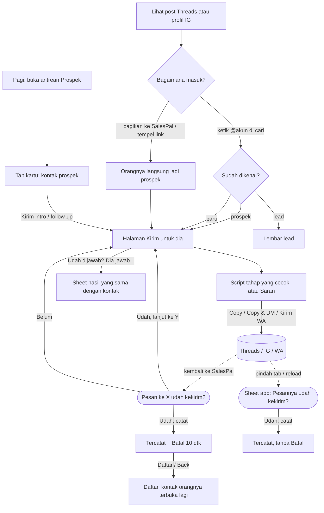

# Hunting: arsitektur interaksi

**Kode:** `components/Hunting.tsx`, `components/ProspectList.tsx` (bagian daftar), `components/TemplateBoard.tsx`, `lib/prospects.ts`, `lib/prospectStore.ts`, `lib/pendingSend.ts`, `components/PendingSends.tsx`, `components/ProspectOutcome.tsx`, `components/Campaigns.tsx` · **Artefak lama:** E2, E4, C1, C3, D1, D2, B1, B5, peta tombol `#kirim` (HTML audit 6 Nov, belum ada di repo) · **Pola:** [P1](../patterns.md#p1-primary-action), [P4](../patterns.md#p4-action-sheet), [P5](../patterns.md#p5-bottom-sheet), [P6](../patterns.md#p6-full-screen-form), [P7](../patterns.md#p7-confirm-sheet), [P8](../patterns.md#p8-toast), [P9](../patterns.md#p9-undo), [P10](../patterns.md#p10-retry), [P11](../patterns.md#p11-external-app-handoff), [P13](../patterns.md#p13-back-behavior), [P14](../patterns.md#p14-loading--pending), [P15](../patterns.md#p15-error) · **Keputusan:** [DEC-001](../decisions.md#dec-001), [DEC-002](../decisions.md#dec-002), [DEC-004](../decisions.md#dec-004), [DEC-005](../decisions.md#dec-005), [DEC-006](../decisions.md#dec-006), [DEC-007](../decisions.md#dec-007), [DEC-008](../decisions.md#dec-008), [DEC-009](../decisions.md#dec-009), [DEC-014](../decisions.md#dec-014), [DEC-015](../decisions.md#dec-015) · **Terkait:** [kontak-prospek.md](kontak-prospek.md), [percakapan.md](percakapan.md), [script-pesan.md](script-pesan.md), [beranda.md](beranda.md) · **AMB:** [AMB-03, AMB-06, AMB-08, AMB-09, AMB-12, AMB-14, AMB-17](../ambiguities.md), [PRD-009](../../prd/PRD-009-hunting-session-journey.md), [PRD-025](../../prd/PRD-025-otak-pesan.md), [PRD-026](../../prd/PRD-026-navigasi-balik.md)

Dokumen ini mencakup pane **Prospek** di Hunting: menemukan orang (tempel link, cari, daftar dengan tampilan), sesi dan target harian, dan **halaman Kirim**. Kontak prospek (dialog satu orang, dok "Dia jawab…" / "Kirim intro", ⋯ Lainnya) dibahas di [kontak-prospek.md](kontak-prospek.md); di sini hanya disebut sebagai pintu masuk dan tujuan kembali. Pane Leads dan Performa disebut sejauh menyentuh alur kirim (Kampanye, Log kiriman).

## 1. Why

- **Masalah yang diselesaikan.** Penjual menemukan calon klien di Threads dan IG ("ada yang open jasa foto katalog?"). Tanpa Hunting, orang itu hanya ada di tab browser. Setelah satu DM, tidak ada yang ingat kapan harus follow-up, berapa kali sudah dicoba, atau apa isi post-nya. Pesan yang dikirim tidak bisa diukur: script mana yang dibalas?
- **Kenapa di SalesPal.** Threads dan IG tidak punya antrean follow-up, tidak menyimpan post asal sebagai konteks, dan tidak tahu bahwa orang yang sama sudah minta jangan dihubungi. SalesPal memisahkan **orang** (prospek, satu journey) dari **pesan** (hunt, satu kiriman) (PRD-009 §1).
- **Yang ingin diselesaikan pengguna di sini:** dari post atau @akun, kirim satu pesan yang pas, catat bahwa terkirim, lalu lanjut ke orang berikutnya.
- **Yang BUKAN tugas Hunting.**
  - Mengirim dari dalam app. Threads, IG, dan WA tidak punya API kirim untuk akun pribadi; SalesPal hanya menyalin dan membuka.
  - Menebak bahwa pesan terkirim. *Terkirim* = dikonfirmasi penjual (GLOSSARY).
  - Mengelola lead. Begitu orangnya memberi data, ia jadi Lead dan dikerjakan di lembar lead.
  - Menulis dan mengatur script. Itu Script pesan (PRD-024); Hunting hanya memakai.

## 2. User goal

> "Saya ingin dari post yang barusan saya lihat, langsung kirim DM yang nyambung sama post-nya, tanpa ngetik ulang username dan tanpa lupa mencatatnya."

Tujuan sampingan:

> "Saya ingin tiap pagi tahu siapa yang harus di-follow-up hari ini, dan menghabiskan antrean itu satu per satu tanpa balik ke daftar tiap kali."

> "Saya ingin tahu berapa pesan yang sudah saya kirim hari ini dibanding target, dan sesi mana yang produktif."

## 3. User state

| State | Apa yang benar saat ini | Persisten | Siapa yang mengubahnya |
|---|---|---|---|
| Belum ada target | Kolom cari kosong, daftar tampil | Tidak | Penjual |
| Target diketik, belum ada di journey | "{@akun} belum ada di journey" + "＋ Simpan ke journey" | Tidak (state Hunting) | Penjual |
| Post Threads ditempel | Prospek dibuat atau post ditambahkan ke journey **langsung**, tanpa kirim | Firestore `prospects` | Penjual (tempel), sistem (tulis) |
| Target diblokir (DNC) | Pesan dimatikan, peringatan merah | Firestore (`contact: dnc`) | Sistem membaca |
| Prospek: Baru / Intro terkirim / Belum respon / Tidak terhubung / Siap dihubungi lagi / Terhubung + hasil / Jangan dihubungi / Arsip | Lihat C1. Berubah otomatis oleh waktu (2/5 hari, parkir 60/90 hari, buang 15 hari) | Firestore + turunan `view()` | Sistem (waktu) dan penjual (kirim, hasil) |
| Di antrean | Jatuh tempo, belum siap dibuang, belum ditutup (`inQueue`) | Turunan | Sistem |
| Halaman Kirim terbuka | Satu orang, script per tahap, saluran kirim | Tidak. Entri history `spPage: "kirim"` | Penjual |
| Antrean "Berikutnya" | Sisa orang dari tampilan asal (`queued.ids`) | Tidak (state Hunting) | Penjual (masuk dari kontak) |
| Pesan diserahkan | Disalin dan/atau app luar dibuka. Toast "Pesan ke X udah kekirim?" | `sessionStorage` (`sp-pending-sends`, 12 jam) + state Hunting | Penjual (tap) |
| **Pesan sudah terkirim di IG / Threads / WA** | Hanya penjual yang tahu | Hanya di kepala penjual | Penjual |
| Tercatat | Hunt `Terkirim` + langkah journey + hitungan sesi. Toast "Tercatat … · Batal" 10 dtk | Firestore + state Hunting (toast) | Penjual (Udah, catat) |
| Sesi berjalan | `huntSessions/{id}` tanpa `endedAt`, aksi terakhir < 30 menit lalu. Bar sesi di semua tab | Firestore | Penjual (Mulai/Akhiri), sistem (berakhir otomatis setelah 30 menit diam) |
| Target harian | `settings/hunting.dailyGoal`; "{n}/{goal} terkirim hari ini" | Firestore | Leader/Officer di guild, pemilik di ruang Pribadi (`canEditCatalog`) |
| Tampilan daftar | Antrian, Follow-up hari ini, Baru, Nunggu, Terhubung, Diem 7+, Siap dibuang, Parkir, ETB, DNC, Arsip | State Hunting (hilang saat pindah tab) | Penjual |

## 4. Experience flow



Saat yang paling menentukan adalah **kembali dari IG**. Penjual baru saja mengetik atau menempel DM di app lain; begitu kembali, toast "udah kekirim?" sudah menunggu di tempat jempol. Kalau ia sempat ke tab lain, pertanyaannya tidak hilang lagi: Hunting melepasnya ke antrean app, dan sheet `PendingSends` menanyakannya (PR #116). Saat kedua adalah **menghabiskan antrean**: "Udah, lanjut ke @berikutnya" membuat satu tap mencatat dan membuka orang berikutnya. Saat ketiga adalah **kembali ke daftar**: daftar dibangun ulang, sehingga posisi scroll dan "Tampilkan 30 lagi" hilang (GAP-HUN-1), dan Batal untuk kiriman terakhir ikut hilang (GAP-HUN-4).

## 5. Decision flow

**Penjual: siapa sekarang?**
```
Siapa yang saya hubungi?
├── Orang dari post yang barusan dilihat → tempel/bagikan link → halaman Kirim
├── Antrean hari ini → tampilan Antrian (urut jatuh tempo) → kartu → kontak → Kirim
├── Kelompok tertentu → pilih tampilan (Baru, Nunggu, Terhubung, ETB, …) di pemilih Tampilan
│   └── Jumlah per tampilan tidak terlihat di pemilih ⚠ GAP-HUN-13
└── Nama tertentu → cari (nama, @akun, ID)
    └── Prospek di Arsip/DNC tidak ketemu kecuali tampilan itu pernah dibuka ⚠ GAP-HUN-10
```
Siapa: penjual. Sistem membantu lewat urutan Antrian dan badge "perlu follow-up" di tab Prospek.

**Sistem: apa arti yang diketik di kolom cari?**
```
Teks di kolom cari, lalu Enter / tempel?
├── Mengandung http(s) → link post Threads? → unfurl, buat/perbarui prospek, buka Kirim
│                       → link profil? → isi target + platform, buka Kirim (belum ditulis)
├── @akun = handle prospek yang ada → buka Kirim untuk dia
├── Nama sama persis dengan satu lead, atau cocok dengan tepat satu lead → buka lembar lead
├── Cocok dengan beberapa lead → tidak ada aksi; daftar "Ada di Leads" di bawah kolom
└── Lainnya → target baru, buka Kirim
```
Siapa: sistem (`Hunting.tsx:477-496`). UI membantu dengan baris "Kirim ke “{teks}”" dan "Ada di Leads (N)" sebelum Enter.

**Sistem: boleh dikirimi?**
```
Target ini minta jangan dihubungi?
├── Ya (contact = dnc) → peringatan merah, semua tombol script dimatikan
└── Tidak → lanjut
```
Siapa: sistem, dengan `getDoc` tertunda 400 ms untuk target yang belum dimuat (`Hunting.tsx:198-207`).

**Penjual: pesan yang mana?**
```
Script mana yang saya kirim?
├── Ada Saran (post-nya memberi konteks dan Saran mengubah sesuatu) → kartu Saran, bisa diedit
├── Tahap yang cocok (●, dipilih sistem dari posisi prospek) → N kartu script urut judul
│   └── Script default dan angka balasan tidak memengaruhi urutan ⚠ GAP-HUN-2
├── Tahap lain → tap chip tahap
└── Tidak ada script di tahap ini → "+ Pakai contoh" / "Tulis sendiri" (hanya yang boleh mengedit)
```
Siapa: sistem memilih tahap, **penjual memilih script sendiri** dari kartu yang setara. Ini keputusan yang paling sering diambil dan yang paling sedikit dibantu.

**Penjual: lewat mana?**
```
Saluran kirim?
├── WA → Kirim WA (wa.me dengan teks)
├── Ada post dan "Balas di post" dipilih → Copy & buka post
├── Threads / IG dengan handle → Copy & DM (ig.me/m/{handle})
├── Ada link profil → Copy & buka profil
└── Copy saja → salin, tanpa membuka apa pun
```
Siapa: sistem dari platform dan saluran (`Hunting.tsx:361-366`), penjual bisa mengganti "Kirim lewat" kalau ada post.

**Penjual: sudah terkirim?**
```
Pesan ke X udah kekirim?
├── Udah, catat / Udah, lanjut ke Y → recordSend (hunt + journey + sesi)
│   ├── Berhasil → toast "Tercatat: DM ke X" + Batal 10 dtk (+ Berikutnya kalau ada antrean)
│   └── Gagal → pertanyaan muncul lagi + "Pesan belum kecatat. Cek koneksi lalu tap Udah lagi."
├── Belum → pertanyaan dibuang, tidak ada yang ditulis
└── Tidak dijawab, Hunting ditinggal / reload → sheet app menanyakan saat kembali
    └── Sheet ditutup (✕ / Back / scrim) → semua pertanyaan dianggap Belum (AMB-16)
```
Siapa: penjual. Sejak PR #116 sistem tidak lagi membuang pertanyaan diam-diam.

**Penjual: dia sudah jawab tanpa saya kirim?**
```
Udah dijawab? (hanya prospek yang sudah dikontak dan bukan DNC)
├── Dia jawab… → sheet "{nama} jawab apa?": Tertarik, Pikir-pikir, Hubungi nanti…, Tidak tertarik…,
│                Cuma bales…, Dia kasih nomor → Kasih data
└── Catatan → editor catatan di sheet yang sama
```
Siapa: penjual. Sheet sama dengan kontak prospek (`useOutcome`). Percakapan dan Log DM masih memakai daftar hasilnya sendiri ⚠ GAP-HUN-3.

**Sistem: kapan orang pindah tampilan sendiri?**
```
Waktu berjalan tanpa balasan?
├── 2 hari setelah kirim → Belum respon, jatuh tempo (masuk Antrian)
├── 3 kali tanpa balasan → Tidak terhubung, diparkir 60 hari
├── 15 hari diam sejak kirim terakhir → Siap dibuang
└── Balikin dari Arsip → langsung Siap dibuang lagi ⚠ GAP-HUN-11
```
Siapa: sistem (`lib/prospects.ts:113-133`, `:152-156`), **tanpa memberi tahu penjual**. Yang terlihat hanya kartu yang berpindah tampilan.

**Sistem: kapan sesi berakhir?**
```
Sesi berjalan, 30 menit tanpa aksi?
├── Ya → endedAt = aksi terakhir, bar sesi hilang ⚠ GAP-HUN-14
└── Tidak → bar sesi tetap, hitungan bertambah per kirim/prospek/balasan/konversi
```
Siapa: sistem (`lib/prospectStore.ts:110-114`, `lib/prospects.ts:536-540`), tanpa sepengetahuan penjual.

## 6. Interaction flow

```
AKSI        Tempel link / bagikan post
WHY         Mengetik ulang username adalah alasan utama orang tidak dicatat (PRD-009 §1.5)
STATE       Kolom cari daftar, kolom target di halaman Kirim, tombol "Tempel" (touch), menu + , ?hunt&url=…
DECISION    "Orang ini layak dihubungi"
INTERACTION Paste atau tombol Tempel (clipboard.readText). Post Threads: unfurl via /api/hunt/unfurl
CONSTRAINT  Clipboard bisa ditolak browser; unfurl bisa gagal; orangnya bisa DNC
CONSEQUENCE Selalu ada jalan manual, dan DNC dicek sebelum tulis
FEEDBACK    "Membuka post…", lalu halaman Kirim terisi. Gagal: "Link-nya ga kebaca" / "Ga nyambung ke server.
            Isi username-nya manual" / "Browser ga izinkan baca clipboard. Tahan kolom Target lalu Tempel."
RECOVERY    Target bisa diketik tangan. Post yang gagal di-unfurl tetap jadi sumber kalau handle terbaca dari URL
```

```
AKSI        Buka halaman Kirim
WHY         Satu orang, satu pesan: tempat semua konteks dan script untuk dia
STATE       Dari kontak (Kirim intro/follow-up/pesan), cari, tempel, Radar, menu +, "Lanjut ke {target}"
DECISION    Mulai menulis untuk orang ini
INTERACTION Layar penuh **menggantikan** daftar di pane Prospek; pushState spPage "kirim"; Back, Escape,
            "‹ Daftar" kembali. Dari kontak: antrean "Berikutnya" diisi orang sesudahnya di tampilan asal
CONSTRAINT  Daftar di-unmount (open ? halaman Kirim : daftar)
CONSEQUENCE Kembali harus memulihkan posisi daftar
FEEDBACK    "Dari antrian {tampilan} · N lagi · Selesai"
RECOVERY    Kembali: daftar dibangun ulang; kalau datang dari kontak, kontaknya dibuka lagi. Scroll dan batas
            30 kartu hilang ⚠ GAP-HUN-1
```

```
AKSI        Copy / Copy & DM / Copy & buka post / Kirim WA (kartu script, kartu Saran, kartu Kampanye)
WHY         Pesan hanya bisa keluar dari app lain; SalesPal menyiapkan teks dan membukakan pintunya
STATE       Ada target (kalau kosong: lihat RECOVERY), bukan DNC
DECISION    Script ini, lewat saluran ini
INTERACTION Satu tap: salin ke clipboard lalu window.open di tap yang sama (popup sesudahnya diblokir)
CONSTRAINT  Threads tidak punya tautan DM publik (lewat ig.me); clipboard bisa gagal; IG/WA tidak melapor balik
CONSEQUENCE Tanya sesudahnya, simpan pertanyaannya di luar layar (AMB-06)
FEEDBACK    "✓ Tersalin" di tombol 1,8 dtk; toast "Pesan ke {who} udah kekirim?" [Belum] [Udah, catat]
RECOVERY    Salin gagal: "Gagal menyalin. Pilih teks di atas, lalu salin manual." tetapi app luar tetap dibuka
            ⚠ GAP-HUN-7. Target kosong: pesan sudah disalin/dibuka, baru diberi tahu "Isi target dulu biar
            kecatat." ⚠ GAP-HUN-8
```

```
AKSI        Udah, catat / Udah, lanjut ke {berikutnya}
WHY         Tanpa konfirmasi, angka harian, jadwal follow-up, dan skor script salah
STATE       Toast tanya terbuka (di daftar maupun di halaman Kirim)
DECISION    Pesannya terkirim
INTERACTION Tap. Optimistis: toast tanya hilang dulu
CONSTRAINT  Tulisan batch (hunt + prospek) bisa gagal
CONSEQUENCE Kalau gagal, pertanyaan dikembalikan ke layar dan ke antrean app
FEEDBACK    Toast "Tercatat: DM ke {who}" / "balasan di post" / "WA" + Batal + (Berikutnya →) + ✕, 10 dtk
RECOVERY    Batal menghapus hunt dan mengembalikan dokumen prospek. Toast hilang dengan "‹ Daftar" dan dengan
            tombol "Berikutnya →" ⚠ GAP-HUN-4
```

```
AKSI        Sheet app "Pesannya udah kekirim?" (PendingSends)
WHY         Penjual pindah tab, menutup halaman, atau iOS memuat ulang PWA saat ia di IG
STATE       Ada pertanyaan di sessionStorage yang tidak dimiliki layar mana pun (400 ms setelah dilepas,
            atau saat app kembali terlihat)
DECISION    Per kiriman: Udah atau Belum
INTERACTION Sheet bawah, satu baris per kiriman dengan potongan teksnya
CONSTRAINT  sessionStorage hilang kalau tab ditutup; pertanyaan > 12 jam dibuang
CONSEQUENCE Tulisan sama dengan halaman Kirim (recordSend)
FEEDBACK    "Menyimpan…", lalu toast "✓ Tercatat: pesan ke {who}". Gagal: "Belum kecatat. Cek koneksi lalu tap Udah lagi."
RECOVERY    Ulang dengan tap Udah lagi. Tidak ada Batal setelah tercatat ⚠ GAP-HUN-6. Menutup sheet = Belum untuk semua
```

```
AKSI        Udah dijawab? → Dia jawab… / Catatan (di halaman Kirim)
WHY         Follow-up yang terbuka untuk orang yang sudah bilang tidak, sebelumnya tidak bisa ditandai dari sini
STATE       Prospek sudah dikontak (bukan Baru, bukan DNC)
DECISION    Apa hasil percakapannya
INTERACTION Sheet "{nama} jawab apa?" dari useOutcome, sama dengan kontak prospek (lihat kontak-prospek.md)
CONSTRAINT  Hasil mengubah jadwal (Tertarik +1 hari, Pikir-pikir +3, Tidak tertarik parkir 90 hari)
CONSEQUENCE Setiap hasil yang bisa dibalik punya undo
FEEDBACK    Toast "✓ {nama}: {hasil} · follow-up {tanggal}" + Batal 10 dtk
RECOVERY    Batal mengembalikan persis field yang berubah. Toast dirender di dalam halaman Kirim, jadi "‹ Daftar"
            menyembunyikannya ⚠ GAP-HUN-5
```

```
AKSI        Mulai hunting / Akhiri sesi
WHY         Mengukur lama sesi, intro per jam, dan sesi yang produktif (PRD-009 §1.4)
STATE       Header Hunting; juga dari Beranda dan bar sesi di semua tab
DECISION    "Saya sedang berburu sekarang"
INTERACTION Tap, tanpa konfirmasi
CONSTRAINT  Penjual sering lupa mengakhiri
CONSEQUENCE Sesi berakhir sendiri setelah 30 menit tanpa aksi, dihitung sampai aksi terakhir
FEEDBACK    Bar sesi muncul; setelah berakhir: "Sesi terakhir: N menit · x intro · y dibales · z data · r intro/jam"
RECOVERY    Mulai lagi. Berakhir otomatis tidak diberitahukan ⚠ GAP-HUN-14
```

| Aksi kecil | Membuka | Jenis | Feedback / catatan |
|---|---|---|---|
| Pilih tampilan | Daftar tersaring | Di tempat | Kontak yang terbuka ditutup. Batas kembali ke 30 |
| Tap kartu | Kontak prospek | Overlay | Lihat [kontak-prospek.md](kontak-prospek.md) |
| ↗ di kartu | Profil Threads/IG | Eksternal | Tanpa pertanyaan (bukan kiriman) |
| Tampilkan 30 lagi | Kartu berikutnya | Di tempat | Hilang saat halaman Kirim dibuka (GAP-HUN-1) |
| Buang semua (Siap dibuang) | ConfirmSheet | Overlay | "{N} prospek dibuang ke Arsip." Gagal sebagian tanpa rincian ⚠ GAP-HUN-12 |
| ↩ Balikin (Arsip) | Di tempat | Di tempat | "{handle} dibalikin ke journey." |
| Gabungin jadi journey | Di tempat | Di tempat | "{N} journey dibuat dari {M} DM lama." / "Gagal menggabungkan. Coba lagi." |
| ＋ Simpan ke journey | Di tempat | Di tempat | "Menyimpan…"; gagal: "Gagal nyimpen prospek. Cek koneksi." |
| Chip tahap | Kartu script tahap itu | Di tempat | ● menandai tahap yang cocok |
| Berikutnya / Selesai | Orang berikutnya / keluar antrean | Di tempat | Berikutnya membuang toast Batal (GAP-HUN-4) |
| × di kolom target | Target kosong | Di tempat | Fokus kembali ke kolom |
| Kampanye buat dia | Kartu kampanye dengan script terisi | Di tempat | Kirim lewat `pick`, sama dengan script |
| Mulai antrian (Performa › Kampanye) | Satu orang per giliran | Di tempat | Pertanyaan sendiri, tidak masuk antrean app, undo 5 dtk ⚠ GAP-HUN-9 |
| Ubah target pesan/hari | Dialog | Overlay | Batal/Simpan, "Menyimpan…", error di tempat. Hanya yang boleh mengedit |
| + menu (Tambah) | Sheet: target, Radar, script, default | Overlay | Tutup / scrim |

## 7. Component map

```
Hunting › Prospek                                   components/Hunting.tsx
├── Menemukan orang
│   ├── Kolom cari + tempel link                     Hunting.tsx (commitSearch, apply, openPost, pasteLink)
│   ├── Unfurl post Threads                          lib/prospectStore.ts unfurl → app/api/hunt/unfurl
│   ├── Cek DNC                                      Hunting.tsx (blocked)
│   ├── Radar Threads                                components/ThreadsRadar.tsx
│   └── Link dari bar / share                        lib/prospectStore.ts sendToHunting / useHuntInbox
├── Daftar
│   ├── Tampilan dan saringan                        components/ProspectList.tsx (FILTERS, inFilter)
│   ├── Status dan langkah per orang                 lib/prospects.ts (view, statusLabel, journeyStep, queue)
│   ├── Kartu prospek                                ProspectList.tsx (.sp-pcard)
│   ├── Buang / Balikin / Gabungin                   ProspectList.tsx (drop, restore, backfill)
│   └── Kontak prospek                               ProspectList.tsx (contact) → kontak-prospek.md
├── Persiapan pesan (halaman Kirim)
│   ├── Target, platform, saluran                    Hunting.tsx (target, platform, channel, sendOut)
│   ├── Konteks post                                 components/CustomerContext.tsx
│   ├── Script per tahap + Saran                     components/TemplateBoard.tsx · lib/templates.ts · lib/scriptFit
│   └── Kampanye buat dia                            Hunting.tsx (curCampaigns)
├── Aksi utama
│   └── Serahkan pesan (salin + buka)                Hunting.tsx pick
├── Konfirmasi kiriman
│   ├── Toast "udah kekirim?"                        Hunting.tsx (waiting, confirmSent)
│   ├── Antrean tertunda                             lib/pendingSend.ts (addPending, release, removePending, orphans)
│   ├── Sheet app                                    components/PendingSends.tsx (dipasang di SalesTracker.tsx)
│   └── Tulisan kirim + undo                         lib/prospectStore.ts recordSend
├── Hasil tanpa kirim                                components/ProspectOutcome.tsx useOutcome
├── Pemulihan
│   ├── Toast Tercatat + Batal                       Hunting.tsx (undo, takeBack)
│   └── Toast hasil + Batal                          ProspectOutcome.tsx (done)
├── Antrean kerja
│   ├── Berikutnya                                   Hunting.tsx (queued, takeNext, nextIn)
│   └── Kampanye (Performa)                          components/Campaigns.tsx
├── Sesi dan target
│   ├── Sesi                                         lib/prospectStore.ts useHuntSession, bump
│   ├── Bar sesi semua tab                           components/HuntBar.tsx
│   ├── Hari ini dalam satu baris                    components/ActivityIsland.tsx
│   └── Target harian                                Hunting.tsx (goalDraft, saveGoal)
└── Konteks balik
    ├── Halaman Kirim ↔ daftar                       Hunting.tsx (open, backTo, fromContact, spPage history)
    ├── Kontak dibuka lagi                           ProspectList.tsx (focusId, reopening)
    └── Dari Beranda                                 Hunting.tsx focus · ProspectList.tsx leaveTo · SalesTracker.tsx huntFocus
```

## 8. Navigation map

**Datang dari:**

| Pintu | Mendarat di |
|---|---|
| Nav Hunting / subnav | Pane Prospek, tampilan Antrian (bawaan) |
| Kartu prospek di Beranda | Kontak orang itu, tombol tutup "‹ Beranda" (lompatan, PRD-026) |
| Kartu "Tertarik di Hunting" di Beranda | Daftar, tanpa fokus (lihat beranda.md GAP-BER-8) |
| Mulai hunting / bar sesi / Sesi jalan | Pane Prospek |
| Bagikan post / bookmarklet (`/dashboard?hunt&url=…`) | Halaman Kirim terisi; parameter dibuang dari URL |
| Tombol tempel di bar | Halaman Kirim (link) atau daftar Antrian (antrean) |

**Pergi ke:**

| Dari | Ke | Jenis | Permukaan |
|---|---|---|---|
| Kartu | Kontak prospek | Overlay | Dialog layar penuh |
| Kontak → Kirim | Halaman Kirim | **Menggantikan daftar** (seharusnya overlay, AMB-14) | Layar penuh di pane |
| Cari / tempel / Radar / menu + | Halaman Kirim | Menggantikan daftar | Layar penuh di pane |
| Copy & DM / buka post / profil / Kirim WA | IG, Threads, WA | Eksternal | App lain |
| Hasil cari = lead | Lembar lead | Overlay | Layar penuh app |
| Dia jawab… / Catatan | Sheet hasil | Overlay | Sheet bawah |
| Script pesan / menu + | ScriptManager | Overlay | Layar penuh |
| Bikin kampanye | Pane Performa › Kampanye | Di tempat (pane) | Tab dalam Hunting |
| Log aktivitas (ActivityIsland) | Tab Log aktivitas | Navigasi | Tab |

**Kembali:**

- Halaman Kirim → "‹ Daftar", Back browser (entri `spPage`), Escape (bukan saat mengetik, kecuali di kolom target), atau tap tab Prospek lagi. Daftar dibangun ulang: **tampilan dan kata cari bertahan** (state Hunting), **scroll dan batas "Tampilkan lagi" hilang** (GAP-HUN-1). Kalau halaman Kirim dibuka dari kontak, kontak orang itu dibuka lagi setelah langkah history selesai (`ProspectList.tsx:123-140`). Toast tanya "udah kekirim?" tetap ada; toast Tercatat dan toast hasil hilang (GAP-HUN-4, GAP-HUN-5).
- Kontak → lihat [kontak-prospek.md](kontak-prospek.md). Dari Beranda, menutupnya kembali ke Beranda.
- Pindah tab dari Hunting: Hunting dibongkar. Pertanyaan terbuka dilepas ke antrean app (`Hunting.tsx:102`); entri history `spPage` dibuang (`:267`). Tampilan dan target hilang.
- Eksternal → kembali ke layar yang sama selama PWA hidup. Setelah reload: Hunting mulai dari daftar, sheet app menanyakan kiriman yang tertunda (`PendingSends.tsx:22-31`).

## 9. Feedback & recovery

| Aksi | Pending | Sukses | Error | Undo / retry / pemulihan | Masalah |
|---|---|---|---|---|---|
| Tempel post Threads | "Membuka post…" | Halaman Kirim terisi, prospek tersimpan | Teks di tempat | Isi manual | Prospek ditulis tanpa ditanya (sesuai PRD-009); tidak ada undo kalau salah tempel |
| ＋ Simpan ke journey | "Menyimpan…" | Konteks prospek muncul | "Gagal nyimpen prospek. Cek koneksi." | Tap lagi | Tanpa undo (bisa dihapus dari ⋯ kontak) |
| Copy / Copy & … | Tidak perlu | "✓ Tersalin" + toast tanya | "Gagal menyalin…" | Salin manual | App luar tetap dibuka saat salin gagal ⚠ GAP-HUN-7; target kosong ⚠ GAP-HUN-8 |
| Udah, catat | Optimistis | Toast Tercatat + Batal 10 dtk | Tanya lagi + "Pesan belum kecatat…" | Batal; ulang Udah | Batal hilang dengan Daftar / Berikutnya ⚠ GAP-HUN-4 |
| Batal catat | Toast hilang dulu | Tidak ada teks | Tidak ditangkap (`takeBack` tanpa catch) | Tidak ada | Tanpa konfirmasi "Dibatalin" dan gagal diam-diam ⚠ GAP-HUN-4 |
| Udah (sheet app) | "Menyimpan…" | "✓ Tercatat: pesan ke X" | "Belum kecatat. Cek koneksi lalu tap Udah lagi." | Ulang | Tanpa Batal ⚠ GAP-HUN-6 |
| Tutup sheet app | Tidak perlu | Sheet hilang | Tidak ada | Tidak ada | Semua dianggap Belum (keputusan AMB-16); untuk banyak kiriman tanpa ditanya |
| Hasil (Dia jawab…) | "Menyimpan…" di tombol | Toast + Batal 10 dtk | "Gagal nyimpen. Cek koneksi lalu coba lagi." | Batal | Toast hilang dengan Daftar ⚠ GAP-HUN-5 |
| Hasil di Percakapan / Log DM | Tidak ada / Tidak ada | Tidak ada toast | Log DM: tidak ditangkap | Tidak ada undo | ⚠ GAP-HUN-3 |
| Buang semua | ConfirmSheet "Membuang…" | "{N} prospek dibuang ke Arsip." | "Gagal nyimpen…" tanpa jumlah yang sudah terbuang | Balikin satu per satu dari Arsip | ⚠ GAP-HUN-12 |
| Balikin | Tombol disabled | "{handle} dibalikin ke journey." | "Gagal nyimpen…" | Tidak ada undo | Langsung Siap dibuang lagi ⚠ GAP-HUN-11 |
| Kirim kampanye (antrian) | Tidak ada | "Tersalin & tercatat: …" + Batal 5 dtk | "Gagal nyatet. Coba lagi." | Batal 5 dtk | Tidak masuk antrean app; durasi lain ⚠ GAP-HUN-9 |
| Mulai / Akhiri sesi | Tidak ada | Bar sesi muncul / hilang | Tidak ditangkap | Mulai lagi | Berakhir otomatis tanpa kabar ⚠ GAP-HUN-14 |
| Simpan target harian | "Menyimpan…" | Dialog tertutup | "Gagal nyimpen. Di guild, target diatur Leader atau Officer." | Ulang | OK |

## 10. Design rationale

- **Kenapa "salin lalu buka" di satu tap, lalu tanya?** IG dan Threads tidak menerima teks lewat URL DM, dan browser memblokir popup yang dibuka setelah `await`. Satu tap harus menyalin dan membuka sekaligus (`Hunting.tsx:376-378`). Karena app luar tidak melapor, *Terkirim* hanya bisa lahir dari jawaban penjual (§5). Kalau salin gagal, membuka IG dengan clipboard kosong justru merugikan; pola yang benar adalah tidak membuka app luar dan menampilkan teks untuk disalin manual (GAP-HUN-7).
- **Kenapa pertanyaan disimpan di `sessionStorage` dan dimiliki layar?** Penjual meninggalkan app tepat di saat pertanyaan paling dibutuhkan. Layar yang bertanya "memiliki" pertanyaannya supaya tidak ditanya dua kali; saat layar hilang atau app dimuat ulang, sheet app mengambil alih (`lib/pendingSend.ts:8-11`). Ini menjawab state "pesan sudah terkirim, hanya penjual yang tahu" tanpa menebak. Pola yang sama harus berlaku untuk Kampanye (GAP-HUN-9) dan Beranda (beranda.md GAP-BER-3).
- **Kenapa toast tanya ada di atas halaman Kirim maupun daftar?** Setelah IG, penjual bisa kembali ke mana saja di Hunting. Toast tanya dipasang di luar cabang `open ? … : …` (`Hunting.tsx:655-663`), jadi ia selalu terlihat. Toast Tercatat dan toast hasil **seharusnya** mengikuti pola yang sama, atau menjadi toast milik app (AMB-13, AMB-17). Sekarang keduanya milik halaman Kirim (GAP-HUN-4, GAP-HUN-5).
- **Kenapa "Udah, lanjut ke Y"?** Menghabiskan antrean adalah tujuan sampingan di §2. Mencatat dan membuka orang berikutnya dalam satu tap mengurangi perjalanan bolak-balik ke daftar, dan undo X tetap ada karena toast dipasang sesudah `takeNext` (`Hunting.tsx:411-415`).
- **Kenapa halaman Kirim seharusnya overlay?** Keputusan AMB-14 dan AMB-03: tempat asal tidak boleh dibongkar (PRD-026 prinsip 2). Pola sekarang (menggantikan daftar) membuat posisi kerja penjual di antrean panjang hilang setiap kali kembali, dan kartu di luar 30 pertama tidak bisa di-scroll-kan lagi oleh `focusId` karena tidak dirender (GAP-HUN-1).
- **Kenapa satu sheet hasil?** Hasil yang sama harus punya label, efek jadwal, hitungan sesi, dan undo yang sama di mana pun penjual menandainya (AMB-09). Kontak dan halaman Kirim sudah memakai `useOutcome` (PR #116). Percakapan dan Log DM belum, sehingga "Tidak tertarik" di satu tempat memarkir 90 hari dengan alasan dan Batal, sedangkan "Nolak" di Percakapan tanpa alasan dan tanpa Batal (GAP-HUN-3).
- **Kenapa satu pesan yang disarankan, bukan banyak kartu setara?** Keputusan "script mana" diambil puluhan kali per sesi. PRD-025 dan AMB-12 menetapkan satu pemilih yang memakai default dan peringkat, dengan satu kartu terisi dan sisanya dilipat. Sekarang kartu diurutkan judul (`Hunting.tsx:91`) dan `isDefault` tidak dibaca di Hunting (GAP-HUN-2).
- **Kenapa prospek dari post langsung ditulis?** PRD-009: post asal adalah bukti niat beli dan sumber pengukuran. Menyimpannya sebelum ada pesan memastikan orang itu tidak hilang kalau penjual batal mengirim. Akibatnya salah tempel juga tersimpan; yang dibutuhkan adalah jalan hapus yang mudah, bukan konfirmasi di depan.

## 11. Current implementation

Per 6 Nov 2026, termasuk PR #116.

- **Pane:** Prospek, Leads, Performa (`Hunting.tsx:46-47`). Tab Prospek menampilkan jumlah follow-up jatuh tempo (`:691`). Tinggi tab 40px (`:696`).
- **Daftar** (`ProspectList.tsx`, `embedded`): tampilan dari `FILTERS` (`:26`) dipilih lewat `<select>` di Hunting (`Hunting.tsx:859-865`); chip berjumlah hanya untuk mode tidak tertanam (`ProspectList.tsx:354-364`). Bawaan Antrian (`Hunting.tsx:103`). Saringan di `inFilter` (`ProspectList.tsx:158-171`): Nunggu = intro + belum respon; Terhubung = terhubung tanpa data dan tidak diparkir; ETB = `segment`; DNC/Arsip dimuat terpisah lewat `loadClosed` saat tampilan itu dipilih (`:153-155`). 30 kartu per halaman (`:28`, `:383`, `:415`). Ganti tampilan menutup kontak (`:142-147`).
- **Cari:** kolom milik Hunting, diteruskan sebagai `query`; cocok dengan ID, handle, atau nama di semua journey terbuka plus `closed` yang sudah dimuat (`ProspectList.tsx:173-176`). Enter menjalankan `commitSearch` (`Hunting.tsx:477-490`).
- **Tempel:** `apply` membedakan post Threads (`openPost`, tulis langsung) dan profil (`parseProfile`, isi target) (`Hunting.tsx:146-195`).
- **Halaman Kirim** menggantikan daftar: `{open ? <halaman Kirim> : <daftar>}` (`Hunting.tsx:733`, `:853`). History: `pushState({spPage:"kirim"})`, Back dan Escape → `backToList` (`:233-267`). `backToList` mengatur `backTo` hanya kalau datang dari kontak, menghapus `undo`, `outcomeMsg`, dan menutup sheet hasil (`:467-472`).
- **Saluran:** `sendOut` (`Hunting.tsx:361-366`). **Serahkan:** `pick` menyalin/membuka, lalu mendaftarkan `addPending` dan `setWaiting` (`:369-398`). Target kosong dicek sesudah salin/buka (`:382-386`).
- **Konfirmasi:** toast di luar cabang halaman (`Hunting.tsx:655-663`). `confirmSent` membuang pertanyaan, menjalankan `recordSend`, lalu `takeNext` dan toast Tercatat 10 dtk; gagal → `addPending` lagi dengan id yang sama (`:402-423`). `recordSend` menulis hunt + prospek dalam satu batch, menambah `counts.intros`/`prospects`, dan mengembalikan undo (`lib/prospectStore.ts:223-257`).
- **Antrean app:** `lib/pendingSend.ts` (kunci `sp-pending-sends`, 12 jam, `owned` di memori). `PendingSends` menunggu 400 ms setelah perubahan dan saat `visibilitychange`, lalu menampilkan pertanyaan yang tidak dimiliki (`PendingSends.tsx:22-31`). Udah → `record` (`SalesTracker.tsx:1107-1111`); toast selesai tanpa Batal (`PendingSends.tsx:49-55`). Tutup = hapus semua (`:47`).
- **Script:** `TemplateBoard` menampilkan chip tahap (tahap cocok ditandai ●), kartu Saran kalau `suggestForPost` mengubah sesuatu, lalu semua script tahap itu (`TemplateBoard.tsx:86-87`, `:105-118`, `:166-200`). Script diurutkan judul (`Hunting.tsx:91`). `isDefault` hanya dibaca di `ScriptManager.tsx:90`. Tombol kartu 40px (`TemplateBoard.tsx:191-195`).
- **Udah dijawab?** Bagian "Udah dijawab? Tandai tanpa kirim pesan" dengan [Dia jawab…] [Catatan] untuk prospek yang sudah dikontak (`Hunting.tsx:785-794`) memakai `useOutcome` (`:216`). Toast hasil dirender lewat `{outcome.sheet}` di dalam halaman Kirim (`:851`).
- **Berikutnya:** antrean diisi dari kontak (`onCompose`, `Hunting.tsx:911`), dijalankan `takeNext` (`:457-464`). "Udah, lanjut ke X" hanya muncul kalau pertanyaan milik orang yang sedang tampil (`:627`).
- **Kampanye:** di halaman Kirim (`Hunting.tsx:795-814`, lewat `pick`). Di Performa, `Campaigns.tsx` punya antrean sendiri: salin saja, pertanyaan di state lokal, undo 5 dtk (`Campaigns.tsx:45-69`).
- **Sesi:** `useHuntSession` (`lib/prospectStore.ts:100-130`): Mulai menulis sesi baru, Akhiri mengisi `endedAt`; sesi yang diam lebih dari 30 menit (`lib/prospects.ts:536-540`) ditutup otomatis di `:110-114`. Hitungan lewat `bump`, gagal ditelan (`:134-137`). Ringkasan sesi terakhir di header (`Hunting.tsx:668-673`).
- **Target harian:** `settings/hunting.dailyGoal`, dialog dengan Batal/Simpan (`Hunting.tsx:606-623`, `:1122-1139`).
- **Buang / Balikin:** `drop` berurutan per prospek (`ProspectList.tsx:220-229`), `restore` (`:230-235`). `restorePatch` tidak mengubah `lastSentAt` (`lib/prospects.ts:166-171`), sedangkan `dropReady` menghitung dari situ (`:152-156`).
- **Log DM** (Performa, terlipat): "Ubah jadi" dengan status hunt, `updateDoc` tanpa catch, sinkron ke journey lewat `syncProspect` (`Hunting.tsx:541-555`, `:1018-1028`).

## 12. Known gaps

| ID | Gap | Akibat bagi penjual | Arah perbaikan | Rujukan (AMB / DEC / PR) |
|---|---|---|---|---|
| GAP-HUN-1 | Halaman Kirim menggantikan daftar: scroll, batas 30 kartu, dan daftar DNC/Arsip yang dimuat hilang; kartu di luar 30 pertama tidak bisa di-scroll-kan oleh `focusId` | Di antrean panjang, penjual kehilangan tempatnya setiap kali kembali | Halaman Kirim jadi overlay di atas daftar (minimal `hidden`, bukan dibongkar) | AMB-14, AMB-03 |
| GAP-HUN-2 | Banyak kartu script setara per tahap, urut judul; script default dan angka balasan diabaikan | Penjual memilih sendiri puluhan kali per sesi; default dari Script pesan tidak terasa | Satu pemilih: satu "Pesan buat {nama}" terisi (default, lalu peringkat), sisanya dilipat | AMB-12, PRD-025 Fase B |
| GAP-HUN-3 | Hasil berbeda antar tempat: kontak dan halaman Kirim memakai `useOutcome`; Percakapan memakai `act` sendiri (Dia bales, Tertarik, Nolak, Buang tanpa konfirmasi dan tanpa undo); Log DM "Ubah jadi" memakai status hunt tanpa undo dan tanpa catch | Arti dan akibat "Tidak tertarik" tergantung tempat tap; salah tap di Percakapan atau Log tidak bisa dibalik | Satu komponen hasil untuk Percakapan; Log DM membaca, bukan mengubah, atau memakai hasil yang sama | AMB-09 poin 1, D2, DEC-009, [percakapan.md](percakapan.md) |
| GAP-HUN-4 | Toast "Tercatat … Batal" milik halaman Kirim: hilang dengan "‹ Daftar" dan dengan tombol "Berikutnya →"; Batal tanpa teks "Dibatalin" dan tanpa catch | Salah konfirmasi tidak bisa dibatalkan setelah kembali ke daftar; gagal batal diam-diam | Toast milik app 10 dtk, bertahan saat pindah orang; "Dibatalin, ga dicatat." dan error di tempat | AMB-17, AMB-13, D1 |
| GAP-HUN-5 | Toast hasil (`useOutcome`) dirender di dalam halaman Kirim; "‹ Daftar" menyembunyikannya | Batal untuk hasil hilang begitu kembali ke daftar | Sama dengan GAP-HUN-4: toast app | AMB-13, AMB-17 |
| GAP-HUN-6 | Kiriman yang dicatat dari sheet app tidak punya Batal | Salah tap "Udah" setelah reload tidak bisa dibalik dari situ | Toast sheet memakai undo dari `recordSend` | AMB-13 |
| GAP-HUN-7 | Copy & DM membuka IG walau salin gagal, dan tetap memasang "udah kekirim?" | Penjual tiba di DM dengan clipboard kosong | Kalau salin gagal: jangan buka app luar, tampilkan teks terpilih untuk disalin manual | D1 |
| GAP-HUN-8 | Target kosong: pesan disalin/app dibuka dulu, baru "Isi target dulu biar kecatat." | Kiriman bisa terjadi tanpa pernah tercatat | Tombol kirim mati dengan alasannya sampai ada target | D1 ("Prasyarat") |
| GAP-HUN-9 | Kampanye di Performa: pertanyaan "udah kekirim?" di state lokal (tidak masuk antrean app), undo 5 dtk, "Copy pesan" tidak membuka app | Kiriman kampanye hilang saat pindah tab atau reload; aturan undo beda | Daftarkan ke `lib/pendingSend`; undo 10 dtk; saluran sama dengan `sendFor` | AMB-06, AMB-08, AMB-13 |
| GAP-HUN-10 | Cari "di semua journey" tidak memuat Arsip/DNC kecuali tampilan itu pernah dipilih | Orang yang diarsip tampak tidak ada; penjual bisa membuat target baru untuk orang lama | Cari memuat `closed` saat ada kata cari, atau teks hasil menyebut cakupannya | E2 |
| GAP-HUN-11 | Balikin dari Arsip tidak mereset hitungan diam, jadi langsung Siap dibuang lagi | Orang yang dibalikin muncul lagi di Siap dibuang dan bisa terbuang lagi | `restorePatch` memulai hitungan diam dari tanggal balikin | C1 masalah 4 |
| GAP-HUN-12 | Buang semua menulis satu per satu; gagal di tengah hanya "Gagal nyimpen…" tanpa jumlah; tidak ada undo massal | Penjual tidak tahu berapa yang sudah terbuang | Satu batch, atau pesan "{n} dari {N} terbuang"; Batal massal 10 dtk | AMB-13 |
| GAP-HUN-13 | Pemilih Tampilan (`<select>`) tidak menunjukkan jumlah per tampilan | Penjual tidak tahu tampilan mana yang berisi orang tanpa membukanya satu per satu | Jumlah di setiap opsi, memakai `count()` yang sudah ada | Belum ada AMB |
| GAP-HUN-14 | Sesi berakhir sendiri setelah 30 menit diam tanpa pemberitahuan; Mulai/Akhiri tanpa catch; hitungan sesi gagal ditelan | Penjual mengira sesi masih jalan; angka intro/jam salah tanpa tanda | Beri tahu saat sesi ditutup otomatis (di bar atau saat kembali); error Mulai di tempat | PRD-009 §4, AMB-13 |
| GAP-HUN-15 | Beberapa target sentuh di bawah 44pt: tab pane 40px, chip tahap 40px, tombol kartu script 40px, chip Log DM 36px (apakah audit `native` menangkapnya belum diverifikasi) | Salah tap di HP | 44pt sesuai docs/standards/native.md | PRD-010 |
| GAP-HUN-16 | Empat mekanisme konteks balik (`open`/`backTo`/`fromContact`, `focusId`/`reopening`, `leaveTo`, `huntFocus`/`cameFrom`) dengan jeda waktu (`setTimeout` 1500/3000 ms) menunggu history | Bug navigasi baru tiap fitur; di Safari lambat, kontak bisa tidak terbuka lagi | Satu tumpukan konteks di tingkat app | AMB-03, AMB-25 |
| GAP-HUN-17 | Toast tanya, toast Tercatat, toast hasil, dan toast sheet app memakai posisi `.sp-toast` yang sama dan bisa bertumpuk | Satu toast menutupi yang lain, termasuk Batal | Satu antrean toast app | AMB-13 |
| ✅ | "Udah kekirim?" di halaman Kirim dan Percakapan bertahan saat pindah tab, "‹ Daftar", dan reload (antrean app + sheet) | Kiriman nyata tidak hilang lagi | Sudah | PR #116 (AMB-06) |
| ✅ | Halaman Kirim memakai sheet "Dia jawab…" yang sama dengan kontak, dengan Batal 10 dtk | Hasil dari halaman Kirim sama dengan dari kontak | Sudah; sisa di GAP-HUN-3 dan GAP-HUN-5 | PR #116 (AMB-09) |
| ✅ | Menolak dihubungi ditanya dulu, merah, dari ⋯ (di kontak) | Tidak terkunci karena salah tap | Sudah | PR #116 (AMB-09), lihat kontak-prospek.md |
