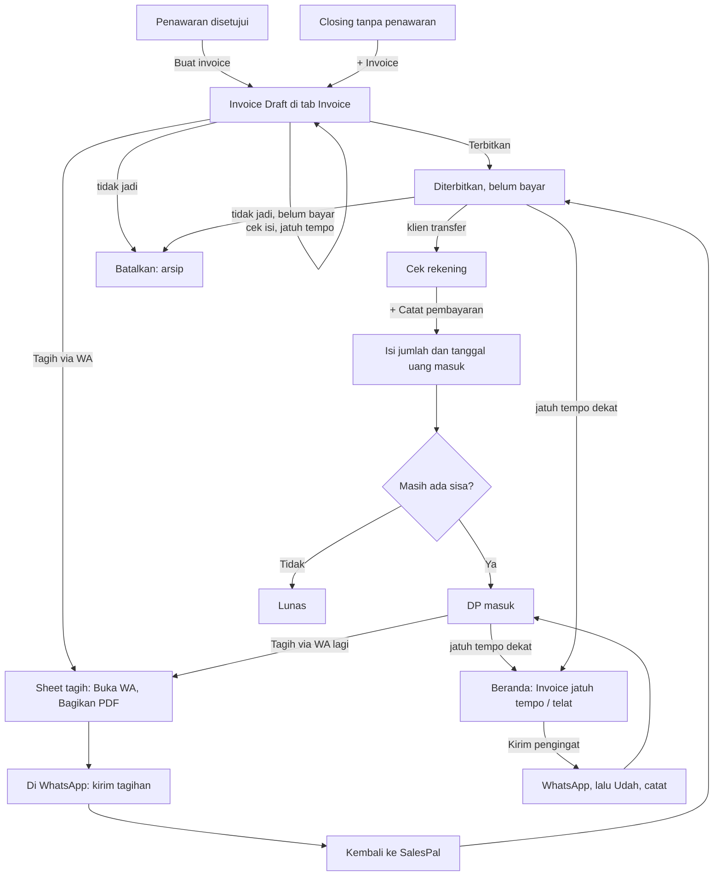

# Invoice: arsitektur interaksi

**Kode:** `components/Invoices.tsx`, `components/DocEditor.tsx`, `components/WaSendSheet.tsx`, `components/PrintSheet.tsx`, `components/ConfirmSheet.tsx`, `lib/billing.ts`, `components/SalesTracker.tsx` (pengingat Beranda) · **Artefak lama:** E9, D4, C5, B3 · **Pola:** [patterns.md](../patterns.md)#p11-external-app-handoff, #p5-bottom-sheet, #p7-confirm-sheet, #p8-toast, #p9-undo · **Keputusan:** [decisions.md](../decisions.md)#dec-001, #dec-003, #dec-004, #dec-005

## 1. Why

- **Masalah yang diselesaikan:** setelah deal, uang datang bertahap (DP, termin, pelunasan) dan lewat transfer yang tidak tercatat di mana pun. Penjual lupa siapa yang belum bayar, menagih terlalu cepat atau terlambat, dan tidak tahu berapa uang yang benar-benar masuk bulan ini.
- **Kenapa di SalesPal:** invoice di sini dibuat dari penawaran yang disetujui dengan item dan harga yang sama, membawa kop yang dikunci, tahu termin mana yang ditagihnya, dan muncul di Beranda saat jatuh tempo. Spreadsheet atau catatan HP tidak menyambungkan tagihan ke penawaran dan ke lead, dan WhatsApp tidak mengingatkan.
- **Yang ingin diselesaikan penjual di sini:** menagih tepat waktu dan mencatat setiap rupiah yang masuk, pada tanggal uang itu benar-benar masuk.
- **Yang BUKAN tugas feature ini:**
  - Menerima pembayaran online atau mengecek mutasi bank. Pembayaran selalu dicatat tangan oleh penjual.
  - Menentukan harga dan termin. Itu diputuskan di [penawaran.md](penawaran.md).
  - Pembukuan dan pajak. Invoice hanya menghitung pajak yang tertulis di dokumen.
  - Mengubah status lead. Deal sudah terjadi saat penawaran disetujui; "Deal belum tentu lunas" (GLOSSARY).

## 2. User goal

> "Saya ingin menagih Bu Sari sesuai termin yang disepakati, lalu mencatat DP Rp 2.250.000 yang dia transfer, tanpa harus mengingat sendiri siapa yang belum lunas."

Tujuan sampingan:

> "Saya ingin tahu uang yang masuk bulan ini, dihitung dari tanggal transfernya, bukan tanggal invoice."

> "Saya ingin diingatkan saat ada tagihan jatuh tempo, tanpa diingatkan lagi untuk tagihan yang baru saja saya tagih."

## 3. User state

| State | Apa yang benar saat ini | Persisten | Siapa yang mengubahnya |
|---|---|---|---|
| Draft | Tagihan sudah disusun, klien belum menerimanya. Tidak dihitung di "Belum tertagih" | Firestore `invoices/{id}` `issue: Draft` | Sistem (Buat invoice dari penawaran), penjual (+ Invoice) |
| Diterbitkan, belum bayar | Klien dianggap sudah punya tagihan. Dihitung sebagai piutang | Firestore `issue: Diterbitkan`, `issuedAt` | Penjual (Terbitkan), sistem (tap di sheet Tagih, atau Catat pembayaran pada Draft) |
| WhatsApp kebuka | Chat tagihan dibuka. **Hanya ada di kepala penjual** apakah pesan dan PDF benar-benar terkirim | Tidak | Penjual, di WhatsApp |
| Sudah ditagih ulang | Penjual mengingatkan klien | Hanya tercatat kalau dari Beranda (`remindedAt`). Dari tab Invoice tidak tercatat | Penjual |
| Uang sudah masuk | Transfer ada di rekening. **Hanya ada di kepala penjual** (atau di aplikasi bank) sampai dicatat | Tidak | Klien |
| DP masuk | Sebagian sudah dibayar, belum jatuh tempo | Turunan dari `payments[]` | Penjual (Catat pembayaran) |
| Telat | Lewat `dueDate` dan belum lunas. Menimpa "DP masuk" | Turunan | Waktu |
| Lunas | Total pembayaran ≥ total invoice, dan total > 0 | Turunan | Penjual |
| Dibatalkan | Arsip, tidak dihitung di tagihan dan laporan. Hanya bisa kalau belum ada pembayaran | Firestore `issue: Dibatalkan` | Penjual (Batalkan) |
| Diingatkan Beranda | Muncul di Beranda kalau ada sisa, jatuh tempo ≤ 3 hari lagi, dan tidak diingatkan kemarin atau hari ini | Turunan dari `dueDate`, `remindedAt` | Waktu, penjual |

## 4. Experience flow



Penjual paling ragu di dua tempat. Pertama, setelah menagih ulang dari tab Invoice: sheet bilang "tercatat terkirim", tetapi tidak ada yang tersimpan, dan besok Beranda tetap mengingatkan tagihan yang sama. Kedua, setelah Simpan pembayaran: dialog menutup tanpa kalimat, jadi penjual harus membaca ulang badge dan angka "sisa" untuk tahu uangnya masuk. Ringkasan "Masuk {bulan}" memberi rasa aman karena dihitung dari tanggal transfer dan tanggalnya bisa dibetulkan di tempat.

## 5. Decision flow

**Penjual: invoice ini datang dari mana?**
```
Ada penawaran yang disetujui?
├── Ya → Buat invoice di Penawaran: satu Draft per termin, item atau baris termin terisi
└── Tidak → + Invoice: isi klien dan item di DocEditor, DP 50%, jatuh tempo +7 hari (Invoices.tsx:119-122)
```

**Penjual: kapan klien dianggap punya tagihan?**
```
Draft
├── Terbitkan → Diterbitkan, diam ⚠ GAP-INV-3
├── Tagih via WA → tap pertama di sheet menerbitkan (Batal selama sheet terbuka) ⚠ GAP-INV-2
└── + Catat pembayaran → pembayaran masuk dan Draft diterbitkan tanpa disebut ⚠ GAP-INV-4
```

**Sistem: Tagih via WA mencatat apa?**
```
Invoice sudah terbit?
├── Tidak → issue Diterbitkan + issuedAt, dengan fungsi Batal (Invoices.tsx:92-96)
└── Ya → tidak menulis apa pun, tetapi sheet tetap bilang
         "Tagihan … tercatat terkirim" dan tanpa Batal ⚠ GAP-INV-1
         remindedAt tidak diisi → Beranda tetap mengingatkan
```
Diputuskan sistem tanpa sepengetahuan penjual.

**Penjual: berapa yang dibayar?**
```
+ Catat pembayaran
├── Belum ada pembayaran dan invoice punya DP% → saran jumlah = DP, keterangan "DP {n}%"
├── Lainnya → saran jumlah = sisa, keterangan "Pelunasan"
│   └── Invoice termin DP dari penawaran punya dpPercent 0 → keterangan "Pelunasan" ⚠ GAP-INV-6
├── Jumlah kosong → "Isi jumlahnya dulu."
├── Tanggal kosong → "Isi tanggal uang masuk dulu."
└── Jumlah > sisa → diterima tanpa peringatan ⚠ GAP-INV-5
Tanggal uang masuk?
└── Default hari ini, tidak bisa di masa depan; teks menyebut bulan hitungannya
```

**Sistem: state yang dibaca penjual**
```
Dibatalkan? → Dibatalkan
Draft dan belum dibayar? → Draft
Dibayar ≥ total dan total > 0? → Lunas  (invoice Rp 0 tidak pernah Lunas ⚠ GAP-INV-7)
Lewat jatuh tempo? → Telat  (menimpa DP masuk ⚠ GAP-INV-7)
Sudah ada bayaran? → DP masuk, kalau belum → Belum bayar
```
(`lib/billing.ts:369-376`)

**Penjual: tidak jadi?**
```
Ada pembayaran?
├── Tidak → Batalkan (ConfirmSheet) → arsip; termin di penawaran bisa ditagih lagi
└── Ya → tidak ada Batalkan; hanya Hapus (ConfirmSheet menyebut jumlah catatan pembayaran yang ikut hilang)
```

**Penjual: isi invoice salah?**
```
Edit (semua kecuali Dibatalkan, termasuk Diterbitkan dan Lunas)
└── DocEditor menulis ulang dokumen di tempat ⚠ GAP-INV-8
```

## 6. Interaction flow

```
AKSI        Terbitkan
WHY         Draft hanya rencana; terbit berarti klien punya tagihan dan masuk "Belum tertagih"
STATE       Draft (Invoices.tsx:293-299)
DECISION    "Isinya sudah benar, tagihan ini berlaku"
INTERACTION Tap langsung
CONSTRAINT  Tidak ada
CONSEQUENCE issue Diterbitkan + issuedAt (Invoices.tsx:80-83)
FEEDBACK    Badge berubah jadi Belum bayar; tombol berganti. Tidak ada kalimat
RECOVERY    Tidak ada undo ⚠ GAP-INV-3
```

```
AKSI        Tagih via WA
WHY         Tagihan dikirim lewat WhatsApp penjual sendiri, teks dulu lalu PDF
STATE       Draft, Belum bayar, DP masuk, Telat (Invoices.tsx:296, 303)
DECISION    Isi pesan tagihan
INTERACTION Sheet kirim (WaSendSheet): Buka WA atau Salin, lalu Bagikan PDF. Layar penuh di HP, dialog tengah di laptop
CONSTRAINT  wa.me tidak melapor; iOS hanya membagikan file dari tap
CONSEQUENCE Seharusnya: tanya saat kembali dan selalu mengisi remindedAt (AMB-08, DEC-001).
            Sekarang: Draft diterbitkan pada tap pertama; yang sudah terbit tidak menulis apa pun
FEEDBACK    Draft: "✓ Invoice INV-… diterbitkan dan tercatat terkirim." + Batal.
            Sudah terbit: "✓ Tagihan INV-… tercatat terkirim." tanpa Batal, padahal tidak ada tulisan ⚠ GAP-INV-1
RECOVERY    Batal selama sheet terbuka (hanya Draft) ⚠ GAP-INV-2
```

```
AKSI        + Catat pembayaran
WHY         Uang yang masuk harus tercatat pada tanggal transfernya, supaya hitungan bulan benar
STATE       Semua kecuali Lunas dan Dibatalkan (Invoices.tsx:293-305)
DECISION    Jumlah, tanggal uang masuk, keterangan (DP / Pelunasan / Termin 2)
INTERACTION Dialog (modalBox): layar penuh di HP lewat CSS, tengah di laptop. Batal, Simpan; × dari ModalA11y; scrim tidak menutup saat menyimpan
CONSTRAINT  Bukti transfer ada di app bank, di luar SalesPal
CONSEQUENCE Jumlah diformat ribuan saat diketik; tanggal tidak bisa di masa depan; teks menyebut bulan hitungannya (Invoices.tsx:333-339)
FEEDBACK    "Menyimpan…"; dialog tutup; badge, bar, dan "sisa" berubah. Tidak ada toast ⚠ GAP-INV-4
RECOVERY    Gagal: "Gagal nyimpen. Cek koneksi lalu coba lagi.", isian utuh (Invoices.tsx:71).
            Salah catat: × di baris pembayaran → "Hapus pembayaran?" (ConfirmSheet)
```

```
AKSI        Batalkan
WHY         Tagihan yang tidak jadi harus keluar dari hitungan tanpa menghapus jejaknya
STATE       Belum ada pembayaran, bukan Dibatalkan (Invoices.tsx:311)
DECISION    "Tagihan ini tidak berlaku"
INTERACTION ConfirmSheet "Batalkan invoice?" dengan aksi "Batalkan invoice" (Invoices.tsx:358-360)
CONSTRAINT  Tidak ada jalan kembali dari Dibatalkan di UI
CONSEQUENCE Konfirmasi dulu (P7), karena tidak bisa dibalik
FEEDBACK    "Membatalkan…"; badge Dibatalkan; alat lain hilang kecuali Hapus
RECOVERY    Tidak ada (dikatakan lewat "tetap tersimpan sebagai arsip"). Gagal: error di sheet
```

```
AKSI        Kirim pengingat (Beranda)
WHY         Tagihan jatuh tempo tidak boleh bergantung pada ingatan penjual
STATE       Sisa > 0, jatuh tempo ≤ 3 hari lagi, tidak diingatkan kemarin/hari ini (SalesTracker.tsx:659)
DECISION    Kirim sekarang atau buka invoice-nya
INTERACTION Kartu Beranda → wa.me; saat kembali "Udah, catat / Belum" (Beranda.tsx:434-438)
CONSTRAINT  wa.me tidak melapor
CONSEQUENCE Ditanya dulu (P11); Udah mengisi remindedAt (SalesTracker.tsx:509-514)
FEEDBACK    "✓ Pengingat INV-… dicatat · muncul lagi {tanggal} kalau belum lunas" + Batal
RECOVERY    Batal menghapus remindedAt
```

Aksi kecil:

| Aksi | State | Interaksi | Feedback | Catatan |
|---|---|---|---|---|
| Jatuh tempo / Tanggal acara di baris | Semua | Field tanggal, tulis tiap perubahan | Nilai berubah | Tanpa feedback dan error ⚠ GAP-INV-9 |
| Ganti tanggal pembayaran | Ada pembayaran | Field tanggal + Simpan/Batal di tempat; Enter/Escape | Tanggal berubah | Tanpa error ⚠ GAP-INV-9 |
| Hapus pembayaran (×) | Ada pembayaran | ConfirmSheet "Sisa tagihan naik lagi." | Baris hilang | Error di sheet |
| Masuk {bulan} | Selalu | Kartu yang membuka rincian | "lihat/tutup rincian" | Dihitung dari tanggal pembayaran |
| Copy teks | Bukan Dibatalkan | Tap | "✓ Tersalin"; gagal: pesan 3 dtk | |
| PDF | Bukan Dibatalkan | Overlay PrintSheet | "PDF dikirim." | |
| Edit | Bukan Dibatalkan | DocEditor (kind="invoice"), "Buang perubahan?" | Editor tutup | ⚠ GAP-INV-8 |
| Hapus | Semua | ConfirmSheet, menyebut jumlah pembayaran yang hilang | Baris hilang | |
| Saring | Ada invoice | Chip Draft, Belum bayar, DP masuk, Telat, Lunas, Dibatalkan | Daftar tersaring | |

## 7. Component map

```
Daftar
├── Ringkasan: Belum tertagih, Telat bayar ..................... Invoices.tsx:168-178
├── Masuk {bulan} + rincian, ganti tanggal ...................... Invoices.tsx:179-206
├── Saring state (chip) ......................................... Invoices.tsx:208-217
└── Baris invoice ............................................... Invoices.tsx:234-317
    ├── Identitas: nomor, tanggal, klien, project, termin, sales (guild)
    ├── Tanggal: jatuh tempo, tanggal acara ..................... Invoices.tsx:248-259
    ├── Uang: total, sisa, hari telat, state, bar ............... Invoices.tsx:261-273
    ├── Pembayaran: tanggal (ganti), jumlah, × .................. Invoices.tsx:275-290
    ├── Aksi utama (.sp-doc-main) sesuai state .................. Invoices.tsx:293-305
    └── Alat (.sp-doc-tools): Copy, PDF, Edit, Batalkan, Hapus .. Invoices.tsx:306-314
Mencatat uang
└── Dialog Catat pembayaran ..................................... Invoices.tsx:328-347
Menagih (handoff)
└── WaSendSheet "Tagih INV-…" ................................... Invoices.tsx:350-355
Menyusun
└── DocEditor (kind="invoice") .................................. Invoices.tsx:349
Dokumen
└── PrintSheet .................................................. Invoices.tsx:356
Pemulihan
└── ConfirmSheet: Batalkan, Hapus invoice, Hapus pembayaran ..... Invoices.tsx:357-367
Pengingat (di luar tab)
├── Kartu Beranda "Invoice jatuh tempo / telat" ................. SalesTracker.tsx:658-666
└── Push harian: jumlah invoice lewat jatuh tempo ............... lib/digest.ts:44-50
Penghitung (lib)
└── paid, balance, owed, isIssued, invoiceState, dpAmount ....... lib/billing.ts:347-376
```

## 8. Navigation map

**Datang dari:**
- Subtab Invoice (Navigasi, tab).
- Penawaran → Buat invoice: tab berganti tanpa asal (lihat GAP-QUO-11 di [penawaran.md](penawaran.md)).
- Riwayat lead → satu invoice: Lompatan, PDF invoice terbuka, "‹ Kembali ke {lead}" (SalesTracker.tsx:1101).
- Beranda → kartu invoice → "Lihat invoice": Lompatan dengan "‹ Kembali ke Beranda", PDF terbuka (SalesTracker.tsx:665).

**Pergi ke:**

| Tujuan | Jenis | Permukaan | Kembali |
|---|---|---|---|
| Catat pembayaran | Overlay | Layar penuh (HP), dialog tengah (laptop) | Batal, ×, Back, scrim (kecuali saat menyimpan). Isian hilang tanpa tanya |
| Sheet tagih | Overlay | Layar penuh (HP), dialog tengah (laptop) | Tutup/Selesai, Back |
| WhatsApp, share sheet | Eksternal | App lain / sheet sistem | Kembali ke sheet yang masih terbuka |
| DocEditor | Overlay | Layar penuh (HP), dialog lebar (laptop) | ×, Batal, Back; "Buang perubahan?" |
| PrintSheet | Overlay | Layar PDF | Tutup, Back |
| ConfirmSheet | Overlay | Sheet bawah | Batal, ×, Back |

Saringan, rincian "Masuk {bulan}", dan jumlah baris ada di state komponen: bertahan saat overlay dibuka-tutup, kembali ke awal saat pindah tab.

## 9. Feedback & recovery

| Aksi | Pending | Sukses | Error | Undo / retry / pemulihan | Masalah |
|---|---|---|---|---|---|
| Terbitkan | Tidak ada | Badge | Tidak terlihat | Tidak ada | Diam, tanpa undo (GAP-INV-3) |
| Tagih via WA, Draft | Tidak ada; dicatat saat tap | Status di sheet + Batal | "Gagal dicatat…" | Batal selama sheet terbuka | Dicatat sebelum terkirim (GAP-INV-2) |
| Tagih via WA, sudah terbit | Tidak ada | "tercatat terkirim" | Tidak berlaku | Tidak ada | Feedback tanpa tulisan apa pun (GAP-INV-1) |
| Catat pembayaran | "Menyimpan…" | Dialog tutup | Pesan di dialog, isian utuh | Hapus pembayaran (ConfirmSheet) | Tanpa toast; Draft terbit diam-diam; lebih bayar diterima (GAP-INV-4, GAP-INV-5) |
| Hapus pembayaran | "Menghapus…" | Baris hilang | Error di sheet | Catat ulang | |
| Ganti tanggal pembayaran | Tidak ada | Tanggal berubah | Tidak terlihat | Ganti lagi | GAP-INV-9 |
| Jatuh tempo / tanggal acara | Tidak ada | Nilai berubah | Tidak terlihat | Ganti lagi | GAP-INV-9 |
| Edit invoice | "Menyimpan…" | Editor tutup | Pesan di editor | Retry | Dokumen terbit berubah di tempat, `remindedAt` hilang (GAP-INV-8) |
| Batalkan | "Membatalkan…" | Badge Dibatalkan | Error di sheet | Tidak bisa dibalik (dikatakan) | |
| Hapus invoice | "Menghapus…" | Baris hilang | Error di sheet | Tidak bisa dibalik (dikatakan) | |
| Tutup Catat pembayaran berisi | Tidak ada | Dialog tutup | Tidak berlaku | Tidak ada | Isian hilang tanpa "Buang perubahan?" (GAP-INV-10) |

## 10. Design rationale

- **Kenapa terbit adalah langkah sendiri?** Draft memberi waktu mengecek isi dan jatuh tempo; terbit membuat angka "Belum tertagih" dan pengingat Beranda jujur. `owed` sengaja 0 untuk Draft dan Dibatalkan (`lib/billing.ts:363-365`). Polanya benar. Yang kurang: Terbitkan harus memberi toast + Batal karena bisa dibalik (P8, P9, GAP-INV-3).
- **Kenapa pembayaran dicatat dengan tanggal uang masuk?** Laporan bulanan menghitung uang pada bulan uang itu datang, bukan bulan invoice dibuat. Tanggal default hari ini dengan kalimat "Masuk hitungan bulan …" dan tempat membetulkannya di rincian bulan menjawab kesalahan paling umum (transfer kemarin dicatat hari ini).
- **Kenapa Catat pembayaran masih dialog?** Tidak ada alasan interaksi. Dua sampai tiga isian dengan konteks invoice di belakang adalah P5 (bottom sheet), dan dialog tengah adalah pola yang ditinggalkan (DEC-003). Di HP CSS sudah membuatnya layar penuh, yang menutupi baris invoice yang sedang dibayar (GAP-INV-4).
- **Kenapa Batalkan memakai ConfirmSheet, padahal Terbitkan tidak?** Batalkan tidak punya jalan kembali di UI, jadi P7 berlaku. Terbitkan bisa dibalik secara data, jadi seharusnya Undo, bukan konfirmasi.
- **Kenapa Tagih via WA lewat sheet?** Sama dengan penawaran: teks dulu lalu PDF, dan iOS hanya membagikan file dari tap. Pencatatannya seharusnya P11: tanya saat kembali dan selalu mengisi `remindedAt`, supaya tab Invoice dan Beranda punya satu arti "sudah ditagih" (AMB-08). Kartu Beranda sudah bertanya; tab Invoice belum (GAP-INV-1, GAP-INV-2).
- **Kenapa pembayaran tidak mengubah lead?** Lead sudah Deal saat penawaran disetujui, dan GLOSSARY menyebut Deal belum tentu lunas. Pembayaran tetap terlihat di Riwayat lead (`lib/activity.ts:130`) dan laporan per lead (`lib/report.ts:43`). Ini keputusan yang konsisten, bukan GAP.
- **Kenapa Batalkan hanya tanpa pembayaran?** Uang yang sudah masuk tidak boleh lenyap dari hitungan bersama tagihannya. Tagihan berbayar yang salah harus dihapus pembayarannya dulu, dengan kalimat yang menyebut sisa tagihan naik lagi.

## 11. Current implementation

Per 6 Nov 2026, termasuk PR #116.

- Daftar diurutkan tanggal lalu nomor, 10 per halaman, disaring per `invoiceState` (`Invoices.tsx:44-45, 208-217, 320-324`).
- Belum tertagih = jumlah `owed`; Telat bayar = jumlah dan sisa yang Telat; Masuk {bulan} = pembayaran yang tanggalnya di bulan ini (`Invoices.tsx:46-51`).
- `startPayment`: kalau belum ada bayaran dan ada `dpPercent`, saran = `dpAmount` dengan "DP {n}%"; selain itu saran = sisa dengan "Pelunasan" (`Invoices.tsx:54-58`). Invoice dari penawaran selalu `dpPercent: 0` (`Quotes.tsx:203`).
- `savePayment`: validasi jumlah dan tanggal; menambah ke `payments` dan menerbitkan Draft; tidak ada batas atas (`Invoices.tsx:60-73`).
- `issue`, `cancel`, `setDue`, `setEvent`, `movePayment`, `undoPayment`: `updateDoc` tanpa catch dan tanpa feedback (`Invoices.tsx:75-110`). `undoPayment` dipanggil lewat ConfirmSheet, jadi error-nya terlihat di sheet.
- `markBilled`: invoice yang sudah terbit langsung `return` tanpa menulis; Draft diterbitkan dengan fungsi undo (`Invoices.tsx:92-96`). Label sheet memilih "tercatat terkirim" atau "diterbitkan dan tercatat terkirim" (`Invoices.tsx:353`). `remindedAt` hanya ditulis di `SalesTracker.tsx:509-514`.
- `saveInvoice`: `setDoc` tanpa merge; membawa `payments`, `issuer`, `issue`, `issuedAt`, `term`, `quoteId`; `remindedAt` tidak dibawa (`Invoices.tsx:124-140`).
- Aksi utama: Draft → Terbitkan, Tagih via WA, + Catat pembayaran; Belum bayar/DP masuk/Telat → + Catat pembayaran, Tagih via WA; Lunas dan Dibatalkan tanpa aksi utama (`Invoices.tsx:292-305`). Batalkan hanya kalau belum ada pembayaran (`Invoices.tsx:311`).
- Dialog Catat pembayaran: `.modal-overlay` + `modalBox`, scrim tidak menutup saat `payBusy`, tanpa cek isian berubah (`Invoices.tsx:328-347`).
- `invoiceState`: Dibatalkan → Draft (tanpa bayaran) → Lunas (total > 0) → Telat → DP masuk → Belum bayar (`lib/billing.ts:369-376`).
- Beranda: invoice dengan sisa, jatuh tempo ≤ hari ini + 3, dan `remindedAt` bukan kemarin/hari ini; urutan teratas ke tugas dengan uang terbesar (`SalesTracker.tsx:601, 658-674`). Push harian menghitung invoice yang lewat jatuh tempo (`lib/digest.ts:33-50`, `app/api/cron/digest/route.ts`).
- PrintSheet memakai `issuer` invoice (dikunci sejak dibuat) dan catatan "dikunci sejak dibuat" (`PrintSheet.tsx:78-82`).

## 12. Known gaps

| ID | Gap | Akibat bagi penjual | Arah perbaikan | Rujukan |
|---|---|---|---|---|
| GAP-INV-1 | Tagih via WA pada invoice yang sudah terbit tidak menulis apa pun (`markBilled` langsung return, `remindedAt` tidak diisi), tetapi sheet bilang "Tagihan … tercatat terkirim" tanpa Batal | Feedback bohong; Beranda tetap mengingatkan tagihan yang baru ditagih | Selalu mengisi `remindedAt`, dengan Batal | AMB-08 (diputuskan, belum dibangun), C5 #1 |
| GAP-INV-2 | Tagih via WA mencatat saat tap, sebelum penjual tahu terkirim; Batal hilang saat sheet ditutup; tidak memakai `lib/pendingSend` | Draft bisa terbit padahal tagihan tidak pernah sampai | Tanya saat kembali (P11) | AMB-08, DEC-001 |
| GAP-INV-3 | Terbitkan diam, tanpa undo, error tidak terlihat | "Jadi atau nggak?"; salah tap tidak bisa dibalik | Toast + Batal 10 dtk | AMB-13, DEC-004 |
| GAP-INV-4 | Catat pembayaran: dialog `modalBox`, menutup tanpa toast, dan menerbitkan Draft tanpa menyebutnya | Tidak ada kepastian "Rp X masuk · sisa Rp Y"; status tagihan berubah diam-diam | Bottom sheet (P5) + toast yang menyebut jumlah, sisa, dan terbitnya | DEC-003, DEC-005, peta tombol |
| GAP-INV-5 | Jumlah pembayaran tidak dibatasi sisa; lebih bayar diterima | Salah ketik nol membuat Lunas dan "Masuk {bulan}" membengkak | Belum diputuskan: peringatan atau batas | `Invoices.tsx:60-65` |
| GAP-INV-6 | Invoice termin DP dari penawaran punya `dpPercent: 0`, jadi Catat pembayaran mengisi keterangan "Pelunasan" | Riwayat dan laporan menyebut DP sebagai pelunasan | Keterangan dari `term.label` kalau ada | `Invoices.tsx:55-57`, `Quotes.tsx:203` |
| GAP-INV-7 | Telat menimpa DP masuk; invoice Rp 0 tidak pernah Lunas | Tagihan yang sudah dibayar sebagian terbaca sama dengan yang belum dibayar | Belum diputuskan | C5 #2, #3 |
| GAP-INV-8 | Edit tersedia untuk invoice Diterbitkan dan Lunas, menulis ulang di tempat; `setDoc` tanpa merge membuang `remindedAt` | Dokumen yang dipegang klien berubah tanpa jejak; pengingat Beranda muncul lagi setelah Edit | Belum diputuskan: aturan seperti AMB-10 untuk invoice; minimal bawa `remindedAt` | `Invoices.tsx:124-140`, AMB-10 |
| GAP-INV-9 | Jatuh tempo, tanggal acara, dan ganti tanggal pembayaran menulis tanpa feedback dan tanpa error | Penjual tidak tahu perubahan tanggal gagal; jatuh tempo bisa tergeser tak sengaja | Error di tempat (P15) | AMB-13 |
| GAP-INV-10 | Menutup Catat pembayaran yang sudah diisi tidak bertanya | Jumlah dan tanggal yang diketik hilang saat geser Back | "Buang perubahan?" (P12) | P12 |
