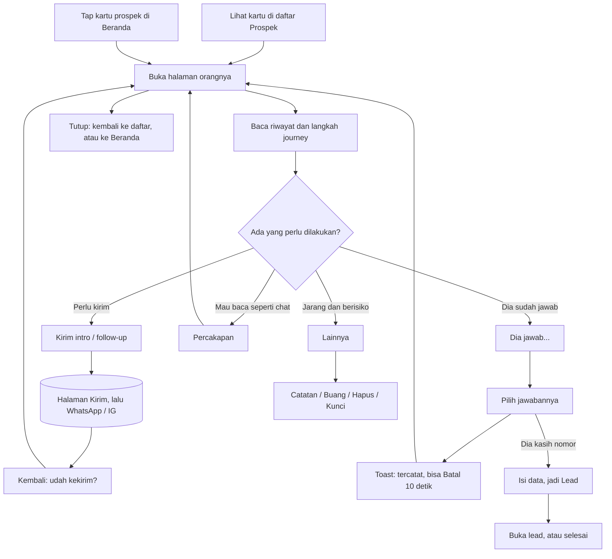

# Kontak prospek: arsitektur interaksi

**Kode:** `components/ProspectList.tsx` (blok `contact`), `components/ProspectOutcome.tsx`, `components/ConvertSheet.tsx`, `lib/prospects.ts`, `lib/prospectStore.ts` · **Artefak lama:** E3, D2, C1, B1, F (ProspectList), peta tombol #kontak (6 Nov, menggambarkan halaman lama) · **Pola:** jenis perpindahan di [README](../README.md#tiga-jenis-perpindahan), aturan feedback [AMB-13](../ambiguities.md) · **Keputusan:** [AMB-09](../ambiguities.md), AMB-15, AMB-03, AMB-25, [PRD-026](../../prd/PRD-026-navigasi-balik.md), [PRD-009](../../prd/PRD-009-hunting-session-journey.md) §6

## 1. Why

- **Masalah yang diselesaikan:** penjual mendekati puluhan Prospek lewat DM di beberapa platform. Tanpa halaman per orang, ia tidak tahu orang ini sudah disapa berapa kali, apa yang sudah ia jawab, dan apa langkah berikutnya. Akibatnya orang yang sama dikirimi intro dua kali, atau orang yang sudah bilang "boleh kak" terlupakan.
- **Kenapa di SalesPal:** WhatsApp dan Instagram tidak tahu apa arti sebuah balasan bagi funnel. SalesPal yang mengubah "dia jawab tertarik" menjadi jadwal follow-up, parkir 90 hari, atau Lead Hot, dan menghitungnya di sesi Hunting.
- **Yang ingin diselesaikan pengguna di sini:** melihat seluruh cerita satu Prospek, lalu melakukan satu langkah berikutnya (kirim, atau catat jawabannya).
- **Yang BUKAN tugas feature ini:**
  - Menulis dan mengirim pesan. Itu halaman Kirim (Hunting) atau [Percakapan](percakapan.md).
  - Mengelola Lead setelah Kasih data. Itu lembar lead.
  - Mengelola banyak orang sekaligus (Buang semua, saringan). Itu daftar Prospek.

## 2. User goal

> "Saya ingin tahu di mana posisi @tokokue sekarang dan mencatat apa jawabannya dalam satu tap, tanpa takut salah tap menghapus riwayatnya."

Tujuan sampingan:
- "Saya ingin langsung kirim follow-up yang pas untuk Bu Sari tanpa mencari dia lagi di daftar."
- "Kalau dia kasih nomor, saya ingin dia langsung masuk Leads tanpa jadi dua lead."
- "Kalau dia minta jangan dihubungi, saya ingin itu dihormati selamanya."

## 3. User state

| State | Apa yang benar saat ini | Persisten | Siapa yang mengubahnya |
|---|---|---|---|
| Baru | Post disimpan, belum pernah dikirimi (`contact: "baru"`) | Firestore `prospects` | Share post / tempel link / Radar |
| Intro terkirim | Sudah dikirimi, belum lewat `gaps[0]` hari | Firestore (dihitung dari `lastSentAt` oleh `view`) | Konfirmasi "Udah, catat" di Kirim/Percakapan |
| Belum respon / Siap dihubungi lagi | Diam lewat batas hari, atau parkir selesai | Dihitung, tidak disimpan | Waktu (sistem) |
| Tidak terhubung | `maxAttempts` kali tanpa jawaban, diparkir | Dihitung | Waktu (sistem) |
| Terhubung + hasil | Dia menjawab; hasil Tertarik / Pikir-pikir / Hubungi nanti / Tidak tertarik, dengan `nextAt` atau `parkedUntil` | Firestore | Penjual, lewat sheet "{nama} jawab apa?" |
| ETB | Kasih data: `result: "data"`, `segment: "ETB"`, `leadId` | Firestore (prospek + lead) | Penjual, lewat ConvertSheet |
| Arsip | `closed: true`, `archivedAt`; riwayat utuh | Firestore, hanya dimuat saat saringan Arsip/DNC dibuka | Penjual (Buang) |
| Jangan dihubungi (DNC) | `contact: "dnc"`, `closed: true`; isi riwayat dihapus | Firestore | Penjual (Kunci). Tidak ada jalan balik |
| Sheet hasil terbuka / editor alasan | Sedang memilih jawaban | Tidak (state React) | Penjual |
| Toast "✓ … · Batal" | 10 detik untuk membatalkan hasil terakhir | Tidak (state `useOutcome`) | Sistem |
| **Hanya di kepala penjual:** "dia sudah bales di IG" | Sistem tidak tahu sampai penjual menekan "Dia jawab…" | Tidak ada | Penjual |
| **Hanya di kepala penjual:** "pesannya sudah terkirim" | Baru benar bagi sistem setelah "Udah, catat" (GLOSSARY: Terkirim) | `sessionStorage` sampai dijawab ([Percakapan](percakapan.md)) | Penjual |

## 4. Experience flow



Halaman ini terasa seperti "profil kontak" di app chat: nama besar, status berwarna, langkah journey, lalu riwayat. Dua hal yang paling sering dilakukan ditaruh di bawah, dekat jempol: kirim sesuai status, dan "Dia jawab…". Momen paling rawan ada setelah memilih jawaban. Penjual baru sadar salah tap setelah sheet tertutup, jadi toast Batal 10 detik menjadi jaring pengaman. Momen kedua adalah keluar ke WhatsApp. Halaman kontak ditutup dulu, dan baru muncul lagi saat penjual kembali dari halaman Kirim. Kalau dibuka dari Beranda, tutup membawa kembali ke Beranda dan tombolnya menyebut "Beranda".

## 5. Decision flow

**Penjual: apa langkah berikutnya untuk orang ini?**
```
Dia sudah menjawab di luar SalesPal?
├── Belum / tidak tahu → tombol kirim di dok (label dari status)
│   ├── Baru → "Kirim intro"
│   ├── Belum respon → "Kirim follow-up"
│   └── lainnya (Intro terkirim, Terhubung, ETB, Tidak terhubung) → "Kirim pesan"
└── Sudah → "Dia jawab…" → "{nama} jawab apa?"
    ├── Tertarik → follow-up besok
    ├── Pikir-pikir → follow-up thinkDays hari lagi
    ├── Hubungi nanti… → pilih tanggal (default +7 hari)
    ├── Tidak tertarik… → pilih alasan, parkir declinedParkDays hari
    ├── Cuma bales, belum mutusin… → tempel balasan, jadi Terhubung tanpa hasil
    └── Dia kasih nomor → Kasih data → ConvertSheet
```
Diputuskan penjual. UI membantu: tiap baris menyebut akibatnya ("Follow-up besok", "diparkir 90 hari"), dan hasil yang sedang berlaku ditandai "· sekarang" (`aria-pressed`).

- Label "Kirim pesan" dipakai untuk Tidak terhubung (masih diparkir) juga. UI tidak bilang bahwa mengirim akan memulai putaran baru (`sentPatch`). Keputusan ini tidak dibantu. **⚠ GAP-KON-20**
- "Kasih data" tetap ditawarkan untuk orang yang sudah ETB. **⚠ GAP-KON-10**

**Penjual: orang ini perlu disingkirkan?**
```
Kenapa?
├── Diam lama (dropReady) → ⋯ Buang ke Arsip → ConfirmSheet → Arsip (bisa Balikin)
├── Salah input / dobel → ⋯ Hapus journey → ConfirmSheet → dokumen dihapus, log DM tetap
└── Dia minta jangan dihubungi → ⋯ Dia minta jangan dihubungi… → penjelasan merah + Kunci → DNC selamanya
```
"Buang ke Arsip" hanya muncul kalau `dropReady` (diam ≥ `dropDays` dan bukan Tertarik/ETB). Hapus dan Kunci selalu ada. UI menjelaskan akibat di subjudul tiap baris.
- DNC tidak bisa dibalik. Satu-satunya jalan keluar adalah "Hapus dari daftar", yang menghapus kunci itu sendiri. **⚠ GAP-KON-16**

**Sistem: apa yang ikut berubah saat hasil dicatat?**
```
Hasil disimpan (saveProspect berhasil)?
├── Gagal → onMsg ke baris status daftar (tertutup overlay) ⚠ GAP-KON-9
└── Berhasil
    ├── syncHunt: log DM terakhir ikut (Dibales / Tertarik / Ditolak)
    │   └── DNC → huntId sudah dibuang dncPatch → log DM tidak berubah ⚠ GAP-KON-8
    ├── bump counts.replies kalau ini jawaban pertama (sesi Hunting)
    └── toast + Batal 10 dtk (kecuali DNC)
        └── Batal → field dikembalikan persis
            ├── Sebelumnya sudah Terhubung → log DM ikut kembali
            └── Sebelumnya belum Terhubung → log DM tetap "Dibales"/"Tertarik"/"Ditolak" ⚠ GAP-KON-7
```
Diputuskan sistem tanpa sepengetahuan penjual.

**Sistem: Kasih data untuk orang yang sudah punya lead?**
```
p.leadId ada dan dokumennya ada?
├── Ya → isi field kosong saja + tambah catatan (AMB-15). Status, nilai, kategori tidak disentuh
└── Tidak → lead baru Hot, skor 85, nilai 0, kategori F&B
```
Diputuskan sistem; hasilnya disebut di sheet ("ditambahin ke lead-nya" atau "masuk Leads sebagai Hot"). Lead yang sama tanpa `leadId` (mis. nomor yang sama sudah ada di Leads) tidak dicocokkan, jadi bisa dobel (belum diverifikasi apakah ada pencocokan di tempat lain).

**Sistem: ke mana halaman ini kembali?**
```
Dibuka dari Beranda (leaveTo.id === p.id)?
├── Ya → tombol "‹ Beranda", tutup = away.go()
└── Tidak → tombol "‹ Prospek", tutup = daftar
Kembali dari halaman Kirim (focusId)?
└── Tunggu popstate (maks 3000 ms), lalu buka lagi halaman orang itu ⚠ GAP-KON-19
```

## 6. Interaction flow

```
AKSI        Kirim intro / Kirim follow-up / Kirim pesan (dok bawah, tombol utama)
WHY         langkah yang paling sering, di tempat jempol
STATE       semua kecuali Arsip dan DNC; label dari view().status
DECISION    "kirim sekarang" vs "catat jawaban"
INTERACTION tap → halaman kontak ditutup (Back di history), lalu halaman Kirim
            dibuka dengan antrean = orang-orang sesudahnya di daftar yang sama
CONSTRAINT  dialog yang ditutup memundurkan history; halaman Kirim harus menunggu
            langkah mundur itu supaya tidak dianggap "Back dari Kirim"
CONSEQUENCE afterClose menunggu popstate atau 1500 ms
FEEDBACK    halaman Kirim muncul dengan nama orangnya
RECOVERY    "‹ Daftar" di Kirim membuka lagi halaman kontak ini (fromContact)
```

```
AKSI        Dia jawab… → "{nama} jawab apa?"
WHY         satu pintu untuk semua jawaban, supaya tidak ada 13 chip setara
STATE       semua kecuali Arsip dan DNC (termasuk Baru dan ETB)
DECISION    jawaban apa, dan apa akibatnya pada jadwal
INTERACTION sheet bawah; Tertarik/Pikir-pikir langsung simpan; tiga baris "…"
            membuka editor di dalam sheet; Back/scrim di editor = kembali ke daftar
            jawaban (onBack), "Kembali" juga; Batal/× menutup semuanya
CONSTRAINT  tidak bisa dibaca dari WhatsApp/IG; penjual yang melapor
CONSEQUENCE tiap jawaban menyebut akibatnya sebelum dipilih; undo 10 dtk sesudahnya
FEEDBACK    sheet tertutup, toast "✓ Bu Sari: Tertarik · follow-up Kam, 7 Nov"
RECOVERY    Batal di toast → field dikembalikan, toast "Dibatalin"
            (lihat GAP-KON-7 untuk log DM)
```

```
AKSI        Dia kasih nomor → Kasih data (ConvertSheet)
WHY         Prospek yang memberi WA/email adalah konversi; ia pindah ke Leads
STATE       dari sheet jawaban; ditampilkan juga untuk ETB (GAP-KON-10)
DECISION    nama bisnis, WA, email, catatan; Simpan mati sampai WA atau email terisi
INTERACTION dialog tengah (modalBox) di atas kontak
CONSTRAINT  orang yang sama tidak boleh jadi dua lead, dan lead Deal tidak boleh
            tertimpa (AMB-15)
CONSEQUENCE lead yang sudah ada hanya diisi bagian kosong
FEEDBACK    di dalam dialog: "✓ {nama} masuk Leads sebagai Hot, sekarang ETB."
            dengan [Selesai] [Buka lead]
RECOVERY    error: "Gagal nyimpen lead. Coba lagi." di dialog, isian tetap.
            Tidak ada undo setelah berhasil (GAP-KON-11)
```

```
AKSI        ⋯ Lainnya → Dia minta jangan dihubungi…
WHY         menghormati permintaan orang (PRD-009 §6.4, UU PDP)
STATE       semua kecuali Arsip dan DNC
DECISION    kunci selamanya, isi percakapan dihapus
INTERACTION sheet Lainnya → editor "Menolak dihubungi?" di sheet yang sama:
            teks merah tebal "Riwayat percakapannya dihapus … ga bisa dibatalin",
            alasan opsional, [Batal] [Kunci] merah
CONSTRAINT  tidak bisa dibalik (dncPatch membuang isi riwayat)
CONSEQUENCE ditanya sekali, di ⋯, terpisah dari jawaban biasa
FEEDBACK    halaman kontak tertutup (onLocked), toast "{nama} dikunci: ga akan
            dihubungi lagi" tanpa Batal
RECOVERY    tidak ada (GAP-KON-16)
```

```
AKSI        ⋯ Lainnya → Buang ke Arsip
WHY         orang yang diam lama keluar dari antrean, riwayat tetap
STATE       hanya kalau dropReady
DECISION    singkirkan sementara, bukan hapus
INTERACTION sheet Lainnya → ConfirmSheet "Buang {nama}?" [Batal] [Buang]
CONSTRAINT  drop() menangkap error sendiri, jadi ConfirmSheet selalu tertutup
CONSEQUENCE pesan hasil (sukses/gagal) ditulis ke baris status daftar
FEEDBACK    halaman kontak hilang (prospek keluar dari daftar terbuka),
            "1 prospek dibuang ke Arsip." di daftar
RECOVERY    saringan Arsip → buka orangnya → "↩ Balikin" (GAP-KON-13, GAP-KON-14)
```

Aksi kecil:

| Aksi | State | Interaksi | Feedback | Recovery |
|---|---|---|---|---|
| ‹ Prospek / ‹ Beranda | selalu | tap, Back HP, Escape, tap di luar | halaman tertutup | buka lagi kartunya |
| Profil {platform} ↗ | ada `profileOf(p)` | tab baru (eksternal) | n/a | kembali ke app |
| Buka post ↗ / Buka profil ↗ | ada URL post/profil, bukan Arsip/DNC | tab baru | n/a | kembali ke app |
| Percakapan | ada `onOpen`, bukan DNC | overlay di atas kontak ([Percakapan](percakapan.md)) | chat terbuka | tutup → kontak |
| ⋯ Tambah catatan | bukan Arsip/DNC | editor di sheet, Simpan mati-hidup lewat isi | toast "Catatan disimpan" + Batal | Batal di toast |
| ⋯ Hapus journey | bukan Arsip/DNC | ConfirmSheet "Hapus journey {nama}?" | halaman hilang, tanpa toast (GAP-KON-13) | tidak ada; log DM tetap |
| ↩ Balikin | Arsip | tap langsung | halaman tertutup, "{handle} dibalikin ke journey." di daftar | Buang lagi |
| Hapus dari daftar | DNC | ConfirmSheet, menjelaskan dia bisa masuk lagi sebagai baru | halaman hilang | tidak ada |

## 7. Component map

```
Halaman kontak (overlay)                    ProspectList.tsx, blok contact
├── Orientasi
│   ├── Bar atas: ‹ Prospek / ‹ Beranda, Profil ↗      .sp-pcontact-bar
│   ├── Identitas: inisial, nama, status, platform     .sp-pcontact-id
│   └── Langkah journey (Baru → Data)                  Steps, JOURNEY_STEPS (lib/prospects.ts)
├── Cerita
│   ├── Ringkasan: ID, jumlah pesan, kontak terakhir   Summary
│   ├── Konteks post (butuh, kapan, di mana)            p.context
│   └── Riwayat (gelembung + baris status)              Bubble
├── Status penutup (menggantikan aksi)
│   ├── Arsip: tanggal + alasan, ↩ Balikin, Percakapan
│   └── DNC: sejak kapan, Hapus dari daftar             useConfirm (ConfirmSheet.tsx)
├── Jalan lain (satu baris)                             .sp-pcontact-links
│   ├── Percakapan → ProspectThread                    (percakapan.md)
│   ├── Buka post / Buka profil ↗
│   └── ⋯ Lainnya → Sheet                              Sheet.tsx
├── Aksi utama (dok bawah)                              .sp-pcontact-dock
│   ├── Dia jawab… → useOutcome().ask                  ProspectOutcome.tsx
│   └── Kirim intro / follow-up / pesan → onCompose    Hunting.tsx (halaman Kirim)
├── Pencatatan hasil                                    ProspectOutcome.tsx (useOutcome)
│   ├── Sheet "{nama} jawab apa?" (choices)
│   ├── Editor di sheet: balasan, catatan, tanggal, alasan, Kunci (form)
│   └── Kasih data → ConvertSheet                      ConvertSheet.tsx
├── Pemulihan
│   ├── Toast "✓ … · Batal" 10 dtk                     useOutcome (done)
│   └── ConfirmSheet untuk Buang / Hapus               ConfirmSheet.tsx
└── Data
    ├── Patch: resultPatch, replyPatch, notePatch,
    │   dncPatch, convertPatch, archivePatch, restorePatch   lib/prospects.ts
    └── Tulis: saveProspect, removeProspect, syncHunt, bump  lib/prospectStore.ts
```

## 8. Navigation map

**Datang dari:**
- Kartu di daftar Prospek (Hunting › Prospek). Overlay.
- Kartu prospek di Beranda. Lompatan: `SalesTracker` menyetel `huntFocus` lalu pindah ke Hunting; `Hunting` meneruskan `focus` sebagai `focusId` dan `leaveTo`.
- Kembali dari halaman Kirim, hanya kalau halaman Kirim dibuka dari kontak ini (`fromContact` → `backTo`).
- Hasil pencarian di daftar (ID, @akun, nama), termasuk Arsip dan DNC yang sudah dimuat.

**Pergi ke:**

| Tujuan | Jenis | Permukaan |
|---|---|---|
| Halaman Kirim | Navigasi di dalam Hunting (menggantikan daftar, AMB-14) | halaman |
| Percakapan | Overlay di atas kontak | layar penuh (portal) |
| Sheet jawaban, sheet Lainnya | Overlay | sheet bawah |
| ConvertSheet | Overlay | dialog tengah |
| Lembar lead (Buka lead) | Lompatan | lembar lead (belum diverifikasi apakah ia terbuka di atas kontak atau menggantikannya) |
| Profil / post | Eksternal | tab / app lain |
| Beranda (kalau datang dari sana) | Lompatan balik | tab Beranda |

**Kembali:**
- "‹ Prospek", Back HP, Escape, tap di luar → daftar, scroll dan saringan tetap (daftar tidak dibongkar selama kontak terbuka).
- Mengganti saringan menutup halaman kontak (`ProspectList.tsx:142-147`).
- Halaman tetap terbuka walau aksi memindahkan orangnya ke saringan lain, karena dicari dari semua baris (`ProspectList.tsx:253`). Kecuali kalau orangnya keluar dari daftar terbuka (Buang, Kunci, Hapus): halaman hilang.
- Setelah reload PWA, halaman kontak tidak dibuka lagi (AMB-25 belum dibangun, GAP-KON-18).

## 9. Feedback & recovery

| Aksi | Pending | Sukses | Error | Undo / retry / pemulihan | Masalah |
|---|---|---|---|---|---|
| Tertarik / Pikir-pikir / Nanti / Tidak tertarik | baris sheet `disabled`, tombol Simpan "Menyimpan…" | toast setelah tulisan berhasil | `onMsg` ke status daftar, sheet tetap terbuka tanpa pesan | Batal 10 dtk | GAP-KON-7, GAP-KON-9, GAP-KON-17 |
| Cuma bales (balasan) | "Menyimpan…" | toast "Balasan {nama} dicatat" | sama | Batal 10 dtk | GAP-KON-7, GAP-KON-9 |
| Tambah catatan | "Menyimpan…" | toast "Catatan disimpan" | sama | Batal 10 dtk | GAP-KON-9 |
| Kunci (DNC) | "Menyimpan…" | toast tanpa Batal, kontak tertutup | sama | tidak ada | GAP-KON-8, GAP-KON-16 |
| Kasih data | "Menyimpan…" | ✓ di dialog + Buka lead | `role=alert` di dialog, isian tetap | retry di tempat; tidak ada undo | GAP-KON-10, GAP-KON-11, GAP-KON-12 |
| Buang ke Arsip | ConfirmSheet "Membuang…" | halaman hilang, pesan di daftar | pesan di daftar, di bawah overlay | Balikin dari saringan Arsip | GAP-KON-9, GAP-KON-13 |
| Hapus journey | ConfirmSheet "Menghapus…" | halaman hilang, tanpa pesan | ConfirmSheet "Gagal. Cek koneksi…" + ulang | tidak ada | GAP-KON-13 |
| ↩ Balikin | tombol `disabled` | halaman tertutup, pesan di daftar | pesan di daftar | Buang lagi | GAP-KON-14 |
| Hapus dari daftar (DNC) | ConfirmSheet | halaman hilang | ConfirmSheet error + ulang | tidak ada | n/a |
| Kirim … (keluar ke halaman Kirim) | n/a | halaman Kirim | n/a | ‹ Daftar membuka lagi kontak | GAP-KON-17, GAP-KON-19 |

## 10. Design rationale

- **Kenapa halaman sendiri (overlay), bukan kartu yang mengembang?** Owner (23 Okt): "bukan berbentuk pop up card baru". Konteks daftar harus tetap hidup di bawah (jenis Overlay di README), dan halaman dicari dari semua baris supaya tidak hilang saat jawaban memindahkan orangnya ke saringan lain.
- **Kenapa satu dok dengan dua tombol?** Keputusan nomor satu di halaman ini adalah "kirim atau catat jawaban" (§5). Peta tombol menemukan 13 chip setara tanpa aksi utama. Sekarang tombol kirim adalah yang utama dan labelnya mengikuti status, sehingga penjual tidak perlu menerjemahkan status menjadi tindakan.
- **Kenapa jawaban di sheet, satu baris per jawaban dengan akibatnya?** Jawaban yang berbeda punya akibat jadwal yang berbeda (besok, 3 hari, 90 hari parkir). Menulis akibatnya di bawah label membantu keputusan sebelum tap. Editor tanggal/alasan tinggal di sheet yang sama dengan Back ke daftar jawaban, sehingga salah pilih bisa dikoreksi tanpa menutup.
- **Kenapa toast Batal 10 detik, bukan konfirmasi?** Jawaban bisa dibalik dan sering. Konfirmasi di setiap jawaban memperlambat; undo menangani salah tap sesudahnya (AMB-13: bisa dibalik = toast + Batal). Polanya benar, tapi pemulihannya belum lengkap untuk log DM (GAP-KON-7) dan toast hilang kalau daftar dibongkar (GAP-KON-17).
- **Kenapa Jangan dihubungi di ⋯, merah, dengan penjelasan?** Ini satu-satunya aksi yang menghapus isi riwayat dan tidak bisa dibalik (PRD-009 §6.4). Menaruhnya terpisah dari jawaban biasa menurunkan salah tap. AMB-09 meminta ConfirmSheet; yang dibangun adalah editor di sheet dengan Batal dan Kunci merah. Fungsinya sama (ditanya sekali), wujudnya berbeda dari pola `ConfirmSheet` di native.md. Belum dicatat sebagai keputusan.
- **Kenapa Kasih data menyimpan di dialog dan menampilkan hasilnya di sana?** Dialog itu duduk di atas kontak; hasil dan "Buka lead" di tempat yang sama memberi langkah berikutnya (AMB-15). Wujud dialog tengah masih bermasalah dengan keyboard iPhone (GAP-KON-12); pola yang benar adalah sheet bawah yang naik di atas keyboard.
- **Kenapa status Arsip dan DNC mengganti dok?** Pada kedua state, kirim dan jawaban tidak berlaku. Yang tersisa hanya jalan keluar dari state itu (Balikin, Hapus dari daftar).

## 11. Current implementation

Per 6 Nov 2026 (working tree):

- Halaman kontak dirender di `ProspectList.tsx:251-327`, di luar daftar tersaring, mencari orangnya di baris terbuka + `closed` yang sudah dimuat (`:253`). Overlay `.modal-overlay` dengan `role=dialog`, ditangani `ModalA11y` (Escape, Back HP).
- Bar atas dan label balik: `:264-267`; `leaveTo` dari Beranda: `:259-260`, diisi `Hunting.tsx:912` dari `focus` (`SalesTracker.tsx:629`, `:1009`).
- Riwayat: `Summary` `:77-95`, `Bubble` `:57-73`, konteks post `:276-280`.
- Arsip: `:287-292` (Balikin `restore` `:230-235`). DNC: `:293-297` (Hapus dari daftar → `removeProspect`).
- Baris tautan `:301-305`; dok `:307-310`: label `v.status === "baru" ? "Kirim intro" : v.status === "belum" ? "Kirim follow-up" : "Kirim pesan"`; Kirim lewat `afterClose` `:240-246` (popstate atau 1500 ms) lalu `onCompose` dengan id sesudahnya.
- ⋯ Lainnya `:311-320`: Tambah catatan (`o.edit(p,"note")`), Buang ke Arsip (hanya `dropReady`, ConfirmSheet → `drop` `:220-229`), Hapus journey (ConfirmSheet → `removeProspect`), Dia minta jangan dihubungi… (`o.edit(p,"dnc")`).
- Buka lagi setelah Kirim: `:123-140` (menunggu popstate, maks 3000 ms).
- `useOutcome` (`ProspectOutcome.tsx:33-202`): `act` `:58-84` menyimpan, `syncHunt`, `bump`, menutup sheet, lalu toast dengan undo yang mengembalikan nilai lama tiap field (`deleteField` kalau dulu kosong) `:65-76`. Error → `onMsg` `:79`. Pilihan jawaban `:98-119`; editor `:122-169`; DNC `:130` (`undoable=false`, lalu `onLocked`). Sheet dengan `onBack` untuk editor dari daftar `:177-178`. Toast `:186-197`, `zIndex 140`, 10 dtk `:49-53`.
- Patch di `lib/prospects.ts`: `replyPatch` `:330-343`, `resultPatch` `:347-367` (Tertarik +1 hari, Pikir +`thinkDays`, Nanti +7 default, Tolak parkir `declinedParkDays`), `convertPatch` `:369-383`, `dncPatch` `:386-404` (riwayat hanya `{at, kind}` untuk sent/reply, `huntId` hilang), `notePatch` `:406-408`, `archivePatch`/`restorePatch` `:159-171`, `view` `:113-133`, `dropReady` `:152-156`.
- `syncHunt` (`lib/prospectStore.ts:207-212`) menulis status log DM dari `huntStatusFor` (`lib/prospects.ts:413-419`); tidak menulis apa pun kalau `huntStatusFor` null (belum Terhubung) atau `lastHuntId` kosong. Error ditelan (`.catch(() => undefined)`).
- `ConvertSheet.tsx`: lead yang ada diisi bagian kosong `:40-51`; lead baru `:52-57`; `convertPatch` + `syncHunt` + `bump replies/converted` `:58-63`; hasil + Buka lead `:77-84`; dialog `modalBox` `:74-75`.
- Daftar terbuka hanya `closed == false` (`lib/prospectStore.ts:38-48`); Arsip/DNC lewat `loadClosed` `:50-53` saat saringan itu dibuka (`ProspectList.tsx:153-155`).

## 12. Known gaps

| ID | Gap | Akibat bagi penjual | Arah perbaikan | Rujukan (AMB / DEC / PR) |
|---|---|---|---|---|
| GAP-KON-1 | ✅ 13 tombol setara (Kirim, Percakapan, Dibales, Catatan, 4 hasil, Kasih data, Menolak, Hapus) tanpa aksi utama | Dulu: tidak tahu harus tap apa | Dibangun: dok dengan tombol kirim berlabel status + "Dia jawab…"; jarang dan berisiko di ⋯ | peta tombol #kontak, PR #116 |
| GAP-KON-2 | ✅ Hasil tanpa undo | Dulu: salah tap "Tidak tertarik" = parkir 90 hari tanpa jalan balik | Dibangun: toast "✓ … · Batal" 10 dtk | AMB-09 poin 2, PR #116 |
| GAP-KON-3 | ✅ Menolak dihubungi di antara hasil biasa, Kunci tanpa tanya kedua | Dulu: riwayat terhapus selamanya dengan satu salah tap | Dibangun: pindah ke ⋯, merah, penjelasan + Kunci. Wujudnya editor di sheet, bukan ConfirmSheet | AMB-09 poin 3, PR #116 |
| GAP-KON-4 | ✅ Emoji sebagai ikon di tombol kontak | Dulu: tombol terlihat seperti chat | Dibangun: ikon `Icon.tsx` + label | peta tombol, design.md, PR #116 |
| GAP-KON-5 | ✅ Kasih data menimpa lead yang ada dan tidak menautkan ke lead | Dulu: lead Deal kembali jadi Hot Rp 0 | Dibangun: isi bagian kosong saja, ✓ + Buka lead | AMB-15 (PR P0 setelah #115, nomor belum diverifikasi) |
| GAP-KON-6 | ✅ Menutup Percakapan mendarat di daftar, kontak hilang | Dulu: kehilangan tempat | Dibangun: Percakapan di-portal di atas kontak | PRD-026 N1, PR #115 |
| GAP-KON-7 | ✅ (PR #116, diperbaiki saat dokumentasi ini ditulis: undo menulis "Terkirim" ke DM terakhir kalau orangnya belum Terhubung) Batal pada hasil tidak mengembalikan log DM kalau orangnya belum Terhubung sebelumnya: `syncHunt(space, p)` keluar tanpa menulis karena `huntStatusFor` null (`ProspectOutcome.tsx:73`, `prospectStore.ts:209-210`). Kalau sebelumnya Tolak lalu dibatalkan ke hasil lain, `note` alasan di log tetap | Log DM tetap "Dibales/Tertarik/Ditolak" padahal journey kembali "Intro terkirim"; angka script per template salah | Undo menulis ulang status log DM sebelumnya ("Terkirim") dan catatannya | AMB-09, C1 #5 |
| GAP-KON-8 | DNC tidak sampai ke log DM: `dncPatch` membuang `huntId` dari riwayat sebelum `syncHunt` mencarinya | Log DM tetap "Terkirim/Dibales"; DNC rate dan angka template salah | `syncHunt` memakai `lastHuntId` dari prospek sebelum patch | C1 #1 |
| GAP-KON-9 | Error simpan dari sheet jawaban dan dari Buang ditulis ke baris status daftar, yang tertutup overlay kontak (`ProspectOutcome.tsx:79`, `ProspectList.tsx:227`). Sheet jawaban tetap terbuka tanpa pesan | Penjual tidak tahu tulisan gagal; bisa mengira tersimpan | Error tampil di permukaan teratas (`role=alert` di sheet) + aksi ulang | AMB-13 (Gagal = teks di tempat) |
| GAP-KON-10 | "Dia kasih nomor → Kasih data" tetap ditawarkan untuk ETB. Kasih data kedua menambah event convert dan menaikkan `counts.converted` lagi (`ConvertSheet.tsx:62-63`) | Angka konversi sesi dobel | Sembunyikan atau ubah jadi "Tambah data ke lead" untuk ETB, tanpa hitungan baru (Percakapan sudah menyembunyikannya: `!p.convertedAt`) | D2 |
| GAP-KON-11 | Kasih data tidak punya undo. Salah simpan meninggalkan lead Hot dan prospek ETB | Harus hapus lead manual di Leads; prospek tidak bisa kembali dari ETB | Keputusan owner: undo 10 dtk yang menghapus lead baru dan mengembalikan prospek, atau tetap tanpa undo | AMB-13 |
| GAP-KON-12 | ConvertSheet masih dialog tengah (`modalBox`); keyboard iPhone menutupi isian (belum diverifikasi di perangkat setelah PR #116) | Tidak melihat tombol Simpan saat mengetik nomor | Sheet bawah yang naik di atas keyboard, sesuai Sheet.tsx | peta tombol #kontak |
| GAP-KON-13 | Buang ke Arsip dan Hapus journey tidak memberi feedback di permukaan yang terlihat; halaman hanya hilang. Buang tidak punya undo walau bisa dibalik | Tidak yakin aksinya jalan; balik dari Buang harus lewat saringan Arsip | Buang: toast "Dibuang · Batal". Hapus: toast tanpa Batal (aturan AMB-13) | AMB-13 |
| GAP-KON-14 | Balikin dari Arsip tidak mereset hari diam, jadi orangnya langsung "Siap dibuang" lagi (`restorePatch` tidak menyentuh `lastSentAt`) | Orang yang baru dibalikin muncul lagi di saringan Siap dibuang | Keputusan owner: Balikin memulai hitungan baru | C1 #4 |
| GAP-KON-15 | Di halaman Arsip, tombol "Percakapan" tidak membuka apa pun: `Hunting.tsx:705` mencari orangnya hanya di prospek terbuka (`closed == false`) | Tap tanpa reaksi | Percakapan menerima prospek dari daftar tertutup juga, atau tombolnya tidak ditampilkan | n/a |
| GAP-KON-16 | DNC tidak bisa dibalik. Salah Kunci hanya bisa "dipulihkan" dengan Hapus dari daftar, yang menghapus kunci dan riwayatnya sudah hilang | Salah tap = kehilangan riwayat untuk selamanya | Sengaja permanen (PRD-009 §6.4). Yang bisa dijaga: pertanyaan sekali yang jelas (sudah), dan label yang sama di semua tempat (GAP-KON-21) | AMB-09, PRD-009 §6.4 |
| GAP-KON-17 | Toast Batal milik `ProspectList`. Menekan Kirim dalam 10 dtk membongkar daftar (halaman Kirim menggantikannya), jadi toast dan undonya hilang | Salah jawaban tidak bisa dibatalkan lagi | Toast milik app (AMB-17), atau halaman Kirim sebagai overlay (AMB-14) | AMB-14, AMB-17 |
| GAP-KON-18 | Setelah iOS memuat ulang PWA, halaman kontak tidak dibuka lagi | Penjual kembali dari WhatsApp ke Beranda, harus mencari orangnya lagi | Simpan permukaan teratas di sessionStorage | AMB-25 |
| GAP-KON-19 | Konteks balik bergantung pada timer popstate (1500 ms di `afterClose`, 3000 ms di buka-lagi) | Di Safari yang lambat, halaman Kirim atau kontak bisa terpental | Satu tumpukan konteks app | AMB-03, PRD-026 N9 |
| GAP-KON-20 | "Kirim pesan" untuk Tidak terhubung yang masih diparkir tidak bilang bahwa kiriman memulai putaran baru | Penjual memutus parkir tanpa sadar | Label atau subjudul yang menyebut akibatnya | C1 #2 |
| GAP-KON-21 | Satu state, empat nama: "Dia minta jangan dihubungi…" (⋯), "Menolak dihubungi?" (judul editor), "Jangan dihubungi" (status), "Jangan hubungi" (Percakapan) | Penjual ragu apakah ini aksi yang sama | Satu istilah di GLOSSARY, dipakai di semua tempat | C1 #6 |
