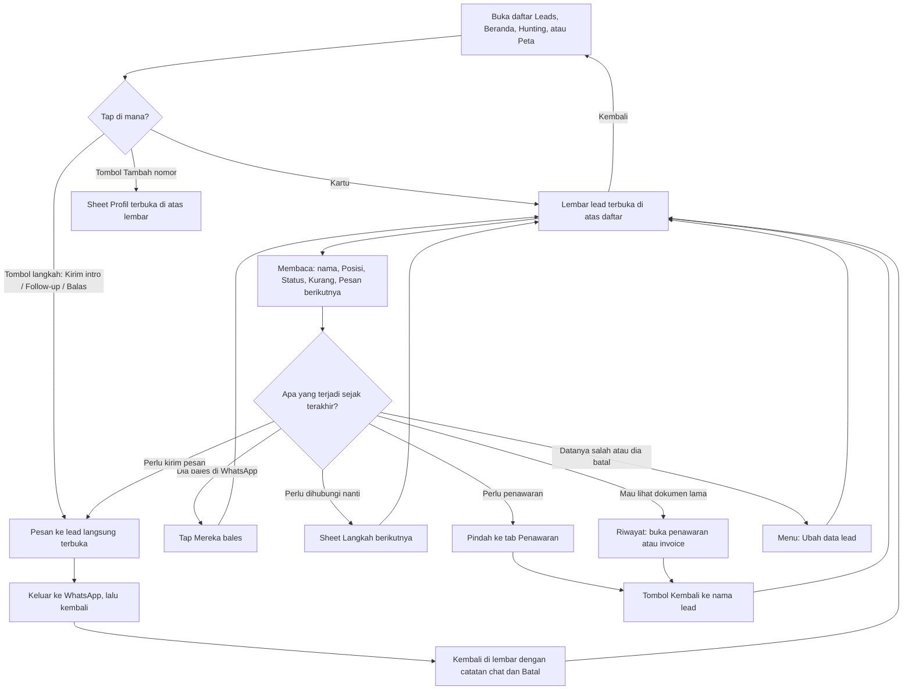

# Lembar lead: arsitektur interaksi

**Kode:** `components/LeadDetail.tsx` (LeadPage), `components/LeadCard.tsx`, `components/LeadHistory.tsx`, `components/SalesTracker.tsx` (daftar Leads, `openLead`, `leadActions`, `jump`/`goBack`, `cameFrom`), `lib/leadStand.ts` · **Artefak lama:** E6, D3, B2, B4, C2, F (LeadPage) · **Pola:** [patterns.md](../patterns.md) · **Keputusan:** [DEC-004, DEC-005, DEC-007, DEC-012](../decisions.md); AMB-13, AMB-17, AMB-23, AMB-03 di [ambiguities.md](../ambiguities.md), PRD-021, PRD-026

## 1. Why

- **Masalah yang diselesaikan:** penjual memegang puluhan sampai ratusan calon customer. Tanpa satu lembar per lead, cerita satu orang tersebar di chat WhatsApp, catatan HP, dan ingatan: siapa yang sudah disapa, siapa yang sudah membalas, siapa yang menunggu penawaran, kapan harus follow-up. Yang terlupa adalah lead yang hilang.
- **Kenapa di SalesPal:** WhatsApp tahu isi chat, tapi tidak tahu Posisi di funnel, nilai deal, penawaran dan invoice yang sudah keluar, atau jadwal follow-up. Lembar lead menggabungkan semua itu dan membaca Posisi dari yang beneran terjadi (PRD-021), bukan dari tanggal yang dicap form.
- **Yang ingin diselesaikan pengguna di sini:** tahu di mana orang ini berdiri dan melakukan satu langkah berikutnya yang tepat.
- **Yang BUKAN tugas feature ini:**
  - Menulis dan mengirim pesan. Itu tugas [Pesan ke lead](pesan-ke-lead.md); lembar hanya membukanya dan menampung catatan sesudahnya.
  - Membuat atau mengedit penawaran dan invoice. Lembar hanya melompat ke sana.
  - Menyimpan isi chat. Brief dan Pola chat adalah ringkasan dari ekspor WhatsApp, bukan kotak masuk.
  - Mengelola banyak lead sekaligus. Daftar Leads dan Follow-up beruntun yang melakukannya.

## 2. User goal

> "Saya ingin buka satu lead, langsung paham dia sudah sampai mana dan apa yang harus saya lakukan sekarang, lalu melakukannya tanpa harus mengingat-ingat."

Tujuan sampingan:
- "Saya ingin mencatat kejadian di luar app (dia bales, saya sudah telepon) supaya daftar saya tetap jujur."
- "Saya ingin menjadwalkan kapan saya harus menghubungi dia lagi."
- "Saya ingin memperbaiki data dia (nomor, nilai, status) atau menyatakan dia gugur, tanpa takut salah tekan."
- "Saya ingin melihat penawaran atau invoice dia, lalu kembali ke lembarnya."

## 3. User state

| State | Apa yang benar saat ini | Persisten | Siapa yang mengubahnya |
|---|---|---|---|
| Lead ada di daftar | Kartu menampilkan Posisi, Kurang, jadwal, dan satu tombol langkah (`nextMove`) | Firestore `leads` | Tambah lead, import, website |
| Posisi: Belum dikontak | Tidak ada bukti kontak (Outreach, balasan, `contactedAt`, dokumen) | Dihitung (`standId`), tidak disimpan | Sistem, dari data |
| Posisi: Dikontak | `lastContact` ada dan didukung bukti | Dihitung dari Firestore | `logContact`, `markContacted` |
| Posisi: Dibales | `lastReplyAt` ada | Dihitung dari Firestore | "Mereka bales", import WA, Follow-up beruntun |
| Giliran kita | Dibales, dan balasan lebih baru dari kiriman kita (`ourTurn`) | Dihitung | Sistem |
| Posisi: Penawaran | Ada penawaran Terkirim atau Disetujui | Dihitung dari `quotes` | Tab Penawaran |
| Posisi: Deal / Gugur | Status Closed / Lost | Firestore `leads.status` | Form Ubah data, Penawaran Disetujui |
| Terjadwal | `nextAction` + `nextActionDate` | Firestore | Jadwal, ChatNote "Follow-up kapan?" |
| Lembar terbuka | Overlay di atas tab asal | Tidak (state React `pageOpen`, `selectedLead`) | Penjual |
| Catatan chat (ChatNote) dengan Batal | Undo kiriman terakhir masih bisa dipakai | Tidak (state lembar) | Pesan ke lead |
| Sedang melompat | `cameFrom` menyimpan tab asal dan lead | Tidak (state React) | Penawaran, Riwayat |
| **Hanya di kepala penjual:** "dia sudah bales di WhatsApp" | Sistem tidak tahu sampai penjual menekan "Mereka bales" atau menarik ekspor WA | - | Penjual |
| **Hanya di kepala penjual:** "saya sudah telepon dia" | `tel:` tidak melapor balik; tidak ada yang tercatat | - | Penjual |
| **Hanya di kepala penjual:** "dia sebenarnya sudah deal / sudah pasti batal" | Sampai Status diubah di form | - | Penjual |

## 4. Experience flow



Saat lembar terbuka, penjual tidak kehilangan daftar: lembar menumpuk di atasnya, dan menutupnya mendarat di tempat yang sama. Momen terpenting adalah membaca Posisi di bagian atas, karena dari situlah langkah berikutnya dipilih; tetapi tombol langkah dari Posisi hanya ada di kartu daftar, sementara di lembar langkahnya diwakili kotak "Pesan berikutnya". Momen kedua adalah kembali dari WhatsApp: penjual mendarat di lembar yang sama, dengan catatan "✓ Dicatat" yang bisa dibatalkan. Saat melompat ke Penawaran, lembar ditutup dan tab berganti; tombol "Kembali ke {nama lead}" di atas tab baru adalah satu-satunya benang ke lembar tadi. Kejadian di luar app (dia membalas, saya menelepon) hanya masuk kalau penjual ingat menandainya.

## 5. Decision flow

**Penjual: apa langkah berikutnya untuk orang ini?** (dibantu sistem lewat `nextMove`, `lib/leadStand.ts:102-109`)

```
Posisi lead?
├── Deal atau Gugur → kartu: "Buka" (tidak ada pesan)
│     └── lembar tetap menampilkan "Pesan berikutnya" + Tulis pesan  ⚠ GAP-LEAD-7
├── Penawaran → kartu: "Lihat penawaran"
│     └── yang terbuka lembar lead, bukan penawarannya  ⚠ GAP-LEAD-8
├── Tidak ada nomor, bukan lead DM, tanpa email → "Tambah nomor" → sheet Profil
├── Dibales dan balasan lebih baru dari kiriman kita → "Balas" → Pesan
├── Belum dikontak → "Kirim intro" → Pesan
└── Lainnya → "Follow-up" → Pesan
```

Siapa: sistem menyarankan, penjual memutuskan. UI membantu di kartu. Di lembar, bantuan itu hanya kotak "Pesan berikutnya" yang tahapnya dibaca dari Status, bukan Posisi (lihat [pesan-ke-lead.md](pesan-ke-lead.md) GAP-PSN-8).

**Penjual: dia sudah membalas?**

```
Dia bales di WhatsApp?
├── Ya, dan saya mau catat → "Mereka bales"
│     ├── Sistem menulis lastReplyAt dan lastContact = hari ini
│     ├── "✓ Dicatat" tampil seketika, sebelum tulisan selesai  ⚠ GAP-LEAD-1
│     └── Salah tekan? Tidak ada Batal; tanggal balasan lama tertimpa  ⚠ GAP-LEAD-1
├── Ya, dan saya mau isi profil juga → Tarik dari WhatsApp (ekspor chat)
└── Tidak tahu → tidak ada yang berubah; Posisi tetap
```

**Penjual: kapan saya hubungi lagi?**

```
Perlu jadwal?
├── Ya → Jadwal → pilih Besok / 3 hari / 1 minggu / tanggal → Simpan jadwal
│     └── Sheet tertutup diam; tidak ada konfirmasi atau Batal  ⚠ GAP-LEAD-3
├── Jadwal lama sudah beres → ✓ Selesai
│     └── Sistem juga mencatat Outreach "Sent" walau tidak ada yang dikirim  ⚠ GAP-LEAD-4
└── Tidak → Batal
```

**Penjual: dia batal?** (keputusan besar)

```
Dia gugur?
├── Ya → ⋯ → Ubah data lead → chip Status "Gugur" → isi alasan (boleh kosong) → Coba lagi? → Simpan
│     ├── Sistem: status Lost, jadwal dihapus, satu baris Rejection Log, dalam satu commit
│     ├── Keputusan tersembunyi di dalam form edit, tanpa konfirmasi, tanpa toast, tanpa Batal  ⚠ GAP-LEAD-2
│     └── Mengembalikan status ke Warm tidak menghapus baris Rejection Log dan tidak memulihkan jadwal  ⚠ GAP-LEAD-2
└── Tidak → tidak ada yang berubah
```

**Penjual: dia deal?**

```
Dia deal?
├── Lewat Penawaran Disetujui → lead jadi Deal (di luar feature ini)
└── Lewat form: chip Status "Closed" → Posisi langsung Deal tanpa penawaran  ⚠ GAP-LEAD-6
```

**Penjual: saya sudah menghubunginya di luar app?**

```
Kontak di luar app?
├── Telepon dari lembar (tel:) → tidak tercatat, tidak ditanya  ⚠ GAP-LEAD-9
├── Posisi masih Belum dikontak → ⋯ Tandai udah dikontak → catatan + Batal
└── Posisi sudah Dikontak atau lebih → menu itu hilang; tidak ada cara mencatat kontak hari ini  ⚠ GAP-LEAD-9
```

**Penjual: hapus lead?**

```
Hapus?
├── ⋯ Hapus lead → sheet "Hapus lead?" (Batal fokus duluan) → Hapus
│     ├── Gagal → teks error, tombol Hapus bisa diulang
│     └── Berhasil → lembar tertutup tanpa pesan apa pun  ⚠ GAP-LEAD-10
└── Batal → kembali ke lembar
```

**Sistem: ke mana menutup lembar mendarat?**

```
Lembar dibuka dari mana?
├── Kartu (Leads, Beranda, Hunting, Peta, Perlu ditindak) → tutup = tab asal, utuh
│     └── Labelnya "Kembali ke {tab}" hanya ada sebagai aria-label ikon  ⚠ GAP-LEAD-12
├── Tombol langkah kartu (Pesan dibuka langsung) → menutup Pesan juga menutup lembar
└── "Kembali ke {lead}" setelah Penawaran / Riwayat → lembar dibuka ulang, urutan lanjut-ke hilang  ⚠ GAP-LEAD-13
```

**Sistem: catatan chat (undo) bertahan sampai kapan?**

```
Lembar berganti atau tertutup?
├── Tidak → ChatNote menetap sampai ✕
└── Ya (tutup, lompat ke Penawaran/Riwayat, lanjut ke lead berikutnya) → Batal hilang  ⚠ GAP-LEAD-11
```

## 6. Interaction flow

```
AKSI        Buka lembar dari kartu
WHY         Seluruh cerita satu lead ada di satu tempat
STATE       Selalu, dari kartu Leads, Beranda, Hunting › Leads, Peta, Perlu ditindak, Follow-up beruntun
DECISION    "Orang ini sudah sampai mana?"
INTERACTION Tap kartu → overlay layar penuh (HP) / kolom tengah (laptop), portal ke body
CONSTRAINT  Lembar harus bisa dibuka di atas tab mana pun tanpa melepas tab itu
CONSEQUENCE Overlay, bukan navigasi. ModalA11y memberinya entri history, jadi Back dan Escape menutupnya
FEEDBACK    Lembar muncul dengan Posisi, Status, Kurang di atas
RECOVERY    Tombol kiri atas, Back, Escape, atau tap scrim kembali ke asal dengan scroll dan filter utuh
```

```
AKSI        Tombol langkah di kartu (Kirim intro / Follow-up / Balas / Tambah nomor / Lihat penawaran / Buka)
WHY         Satu langkah yang paling masuk akal, tanpa membaca lembar dulu
STATE       Selalu satu tombol; labelnya dari nextMove
DECISION    Langkah berikutnya (lihat §5)
INTERACTION Tap → lembar terbuka dengan start "chat" (Pesan langsung di atasnya) atau "edit" (sheet Profil)
CONSTRAINT  Lembar di bawah Pesan belum pernah dilihat penjual
CONSEQUENCE Menutup Pesan juga menutup lembar (useChatLog `direct`, PRD-026 N7)
FEEDBACK    Pesan atau Profil terbuka
RECOVERY    ✕ / Back kembali ke daftar. "Lihat penawaran" membuka lembar, bukan penawaran (GAP-LEAD-8)
```

```
AKSI        Tulis pesan (kotak Pesan berikutnya) dan Balas (Yang mereka tanya)
WHY         Pesan berikutnya selalu satu ketukan dari lembar
STATE       Selalu tampil, juga untuk lead Deal dan Gugur (GAP-LEAD-7). Balas hanya untuk pertanyaan yang belum dijawab
DECISION    Script mana; detailnya di pesan-ke-lead.md
INTERACTION Sheet penuh di atas lembar
CONSTRAINT  WhatsApp tidak melapor balik
CONSEQUENCE Pertanyaan "udah kekirim?", lalu ChatNote di lembar
FEEDBACK    ChatNote "✓ Dicatat: chat hari ini" + Batal, dan "Follow-up kapan?"
RECOVERY    Batal di ChatNote, selama lembar yang sama masih terbuka (GAP-LEAD-11)
```

```
AKSI        Mereka bales
WHY         Balasan adalah tanda terkuat lead masih hidup (PRD-008); sistem tidak bisa membacanya dari WhatsApp
STATE       Selalu tampil di baris aksi cepat
DECISION    "Dia sudah membalas" dinyatakan penjual
INTERACTION Satu tap, tanpa sheet
CONSTRAINT  Tulisan Firestore bisa gagal atau menunggu sinyal
CONSEQUENCE Feedback harus menunggu tulisan dan punya Batal (AMB-13)
FEEDBACK    "✓ Dicatat" 2,5 detik, ditampilkan seketika tanpa menunggu dan tanpa catch (GAP-LEAD-1)
RECOVERY    Tidak ada. Tanggal balasan sebelumnya tertimpa
```

```
AKSI        Jadwal (sheet Langkah berikutnya)
WHY         Lead yang tidak dijadwalkan dilupakan
STATE       Selalu. "✓ Selesai" hanya kalau sudah ada jadwal
DECISION    Kapan menghubungi lagi, dan apa
INTERACTION Sheet bawah: teks tindakan, chip Besok / 3 hari / 1 minggu, tanggal, Batal / Simpan jadwal
CONSTRAINT  Tanpa tanggal tidak bisa disimpan (tombol nonaktif + alasan)
CONSEQUENCE Pesan "Pilih tanggalnya dulu" di bawah chip
FEEDBACK    "Menyimpan…", lalu sheet tertutup diam. Satu-satunya jejak: baris "Berikutnya" di Brief, di bawah lipatan (GAP-LEAD-3)
RECOVERY    Error di tempat + ulangi. Tidak ada Batal setelah tersimpan. "✓ Selesai" mencatat Outreach palsu (GAP-LEAD-4)
```

```
AKSI        Penawaran
WHY         Dari lead yang tertarik ke dokumen harga
STATE       Selalu
DECISION    "Saatnya kirim harga"
INTERACTION Lompatan: lembar ditutup, tab Penawaran terbuka dengan editor untuk lead ini
CONSTRAINT  Editor penawaran adalah tab, bukan overlay
CONSEQUENCE cameFrom menyimpan tab asal + leadId; tombol "Kembali ke {nama lead}" di atas tab
FEEDBACK    Tab berganti, editor terisi nama lead
RECOVERY    "Kembali ke {nama lead}" membuka tab asal dan lembarnya lagi. Pindah tab lewat nav menghapus jalan balik itu (pilihan sadar, AMB-01)
```

```
AKSI        Riwayat → dokumen
WHY         Semua yang sudah terjadi dengan orang ini, dan dokumennya bisa dibuka
STATE       Baris dengan docId (penawaran, invoice) bisa diketuk; chat dan DM hanya catatan
DECISION    Tidak ada; ini membaca
INTERACTION Lompatan ke tab Penawaran / Invoice dengan dokumen terbuka (openDoc)
CONSTRAINT  Sama dengan Penawaran
CONSEQUENCE Sama: cameFrom + "Kembali ke {nama lead}"
FEEDBACK    Dokumennya terbuka
RECOVERY    "Kembali ke {nama lead}". ChatNote yang masih terbuka hilang (GAP-LEAD-11)
```

```
AKSI        Ubah data lead (⋯ menu atau tap chip Status) termasuk Gugur
WHY         Data yang salah merusak skor dan pipeline; Gugur menutup lead dengan alasan
STATE       Selalu
DECISION    Status (Cold/Warm/Hot/Closed/Gugur), nilai, kontak, sumber, kategori, catatan
INTERACTION Sheet bawah dengan form. Memilih Gugur memunculkan "Kenapa gugur?" dan "Coba lagi" di dalam form
CONSTRAINT  Gugur menulis dua dokumen (lead + Rejection Log) dalam satu commit
CONSEQUENCE Harus jelas bahwa ini keputusan, dan bisa dibalik
FEEDBACK    "Menyimpan…", lalu sheet tertutup diam. Status chip di lembar berubah (GAP-LEAD-2, GAP-LEAD-5)
RECOVERY    Error di tempat + Simpan lagi. Tidak ada Batal untuk Gugur. Mengubah balik tidak membersihkan Rejection Log
```

```
AKSI        Hapus lead
WHY         Lead dobel atau salah masuk
STATE       Selalu, di ⋯ (merah)
DECISION    Hapus permanen
INTERACTION ⋯ → sheet "Hapus lead?" dengan teks "Ini ga bisa dibatalkan", Batal fokus duluan
CONSTRAINT  Tidak bisa dibalik
CONSEQUENCE Konfirmasi dulu (sudah ada)
FEEDBACK    "Menghapus…", lalu lembar tertutup tanpa pesan (GAP-LEAD-10)
RECOVERY    Error di tempat + Hapus lagi. Batal menutup sheet saja
```

Aksi kecil:

| Aksi | Interaksi | Feedback | Catatan |
|---|---|---|---|
| Telepon / Tambah no. | `tel:` (eksternal) / sheet Profil | Tidak ada / sheet tertutup | Telepon tidak tercatat (GAP-LEAD-9) |
| ⋯ Tandai udah dikontak | Satu tap, hanya Posisi Belum dikontak | ChatNote "✓ Ditandai udah dikontak" + Batal | Tanpa Outreach, sengaja (PRD-022 Q2) |
| ⋯ Ubah profil / Isi manual | Sheet Profil (nomor, kebutuhan, pain, keberatan, tipe) | Sheet tertutup diam | GAP-LEAD-5 |
| Tarik dari WhatsApp | Sheet WaImport | Milik WaImport (belum diverifikasi di sini) | Juga dari share sheet HP |
| Lokasi: Atur / Ubah | Sheet "Lokasi lead" (PlaceEditor) | Sheet tertutup; baris Lokasi berubah | Error di tempat |
| Lokasi: Rute | Link Maps (eksternal, tab baru) | - | - |
| Kenapa {skor} | Buka-tutup di tempat | Isi tampil | - |
| Buka script {tipe} | Buka-tutup, Copy, Tulis pesan | "✓ Tersalin" / "Gagal copy" | Tulis pesan membawa draft ke Pesan |

## 7. Component map

```
Daftar (pintu masuk)
├── Leads: cari, urutkan, tampilan cepat, Muat lagi           SalesTracker.tsx
├── Kartu lead: Posisi, Kurang, jadwal, satu tombol langkah   LeadCard.tsx (LeadCard, LeadRow)
├── Follow-up beruntun (antrean, membuka lembar di atasnya)   FollowUpRun.tsx
└── Pemilik lembar: openLead, leadActions, nextUp             SalesTracker.tsx

Orientasi (di mana orang ini)
├── Posisi, Status (chip ke Ubah data), Kurang                LeadDetail.tsx (LeadPage, StatusBadge), lib/leadStand.ts
├── Brief, Kontak, Pola chat, Tipe customer, Yang mereka tanya LeadDetail.tsx
└── Potensi + Kenapa                                          LeadDetail.tsx (Why), lib/score

Aksi utama
├── Pesan berikutnya → Tulis pesan                            ChatPicker.tsx (NextMessage)
└── Pesan ke lead (sheet penuh)                                LeadDetail.tsx (useChatLog), ChatPicker.tsx

Aksi cepat
├── Mereka bales, Telepon, Penawaran, Jadwal                  LeadDetail.tsx (nav Aksi cepat)
└── Langkah berikutnya (sheet)                                LeadDetail.tsx (FollowUp)

Catatan dan pemulihan
├── ChatNote: ✓ Dicatat + Batal + Follow-up kapan?            LeadDetail.tsx (ChatNote)
└── Hapus lead? (konfirmasi)                                  LeadDetail.tsx (Menu)

Ubah
├── ⋯ menu                                                     LeadDetail.tsx (Menu)
├── Ubah data lead + Gugur                                     LeadDetail.tsx (LeadEditor), SalesTracker.tsx (saveLead)
├── Profil + nomor                                             LeadDetail.tsx (ProfileEditor)
├── Lokasi                                                     LeadDetail.tsx (LocationRow), PlaceEditor.tsx
└── Tarik dari WhatsApp                                        WaImport.tsx

Lompatan
├── Riwayat → dokumen                                          LeadHistory.tsx, SalesTracker.tsx (onOpenDoc)
└── Kembali ke {asal}                                          SalesTracker.tsx (cameFrom, goBack, .sp-return)

Infrastruktur dialog
└── Back, Escape, fokus, history                               ModalA11y.tsx, Sheet.tsx
```

## 8. Navigation map

**Datang dari:**
- Kartu di Jualan › Leads dan Hunting › Leads (tap kartu, atau tombol langkah dengan `start` "chat" / "edit").
- Beranda (Perlu ditindak, kartu lead), Peta, hasil cari Hunting, Tambah lead ("Lead ini udah ada", "Buka lead" setelah Kasih data).
- Follow-up beruntun ("buka lead", antrean tetap terbuka di bawahnya).
- Share sheet HP (ekspor chat WhatsApp → pilih lead → lembar dengan WaImport terbuka).
- "Kembali ke {nama lead}" setelah Penawaran atau Riwayat.
- "Udah, lanjut ke {Y}" dari Pesan ke lead X: lembar Y menggantikan lembar X.

**Pergi ke:**

| Tujuan | Jenis | Permukaan |
|---|---|---|
| Pesan ke lead | Overlay | Sheet layar penuh |
| Langkah berikutnya, Ubah data lead, Profil, Lokasi lead, Hapus lead?, WaImport | Overlay | Sheet bawah |
| Kelola script (dari Pesan) | Overlay | Milik ScriptManager |
| Tab Penawaran (editor baru) | Lompatan | Tab |
| Tab Penawaran / Invoice (dokumen dari Riwayat) | Lompatan | Tab, dokumen terbuka |
| WhatsApp, email, telepon, Maps (Rute) | Eksternal | App lain |

**Kembali:**
- Tutup lembar (ikon kiri atas, Back, Escape, scrim): tab asal tetap utuh karena lembar hanya menumpuk. Filter, kata cari, dan scroll daftar dipertahankan (lembar tidak me-unmount daftar). Label tujuan hanya dibacakan pembaca layar (GAP-LEAD-12).
- Sheet di atas lembar: Back / Escape / scrim menutup sheet, lembar tetap. Sheet yang sedang menyimpan menolak ditutup.
- Setelah lompatan: tombol "‹ Kembali ke {nama lead}" di atas tab tujuan membuka tab asal dan lembarnya. Isian sheet, Brief yang dibuka, dan ChatNote tidak kembali. Urutan "lanjut ke" juga direset ke daftar yang sedang tampil (GAP-LEAD-13). Mengetuk nav atau subnav menghapus jalan balik ini.
- Hapus berhasil: lembar tertutup, kembali ke tab asal.

## 9. Feedback & recovery

| Aksi | Pending | Sukses | Error | Undo / retry / pemulihan | Masalah |
|---|---|---|---|---|---|
| Mereka bales | Tidak ada | "✓ Dicatat" seketika, 2,5 dtk | Tidak ada (tanpa catch) | Tidak ada | Feedback sebelum tulisan berhasil; tanpa undo (GAP-LEAD-1) |
| Simpan jadwal | "Menyimpan…" | Sheet tertutup diam | Teks di tempat | Ulangi; tanpa Batal | Tanpa feedback sukses (GAP-LEAD-3) |
| ✓ Selesai (jadwal) | "Menyimpan…" | Sheet tertutup diam | Teks di tempat | Tanpa Batal | Mencatat Outreach "Sent" palsu (GAP-LEAD-4) |
| Gugur (Ubah data) | "Menyimpan…" | Sheet tertutup diam, chip jadi Gugur | Teks di tempat | Tanpa Batal; balik status tidak membersihkan Rejection Log | Perubahan besar tanpa konfirmasi dan undo (GAP-LEAD-2) |
| Ubah data (selain Gugur) | "Menyimpan…" | Sheet tertutup diam | Teks di tempat | Ulangi | Tanpa feedback sukses (GAP-LEAD-5) |
| Status Closed lewat form | "Menyimpan…" | Posisi jadi Deal | Teks di tempat | Ubah lagi | Deal tanpa penawaran (GAP-LEAD-6) |
| Ubah profil / nomor | "Menyimpan…" | Sheet tertutup diam | Teks di tempat | Ulangi | GAP-LEAD-5 |
| Lokasi | Milik PlaceEditor | Sheet tertutup, baris berubah | Teks di tempat | Ulangi | Terlihat langsung, cukup |
| Tandai udah dikontak | Tidak ada | ChatNote + Batal | ChatNote "Gagal menandai…" | Batal selama lembar terbuka | Undo milik lembar (GAP-LEAD-11) |
| Pesan dikonfirmasi | Tidak ada (lihat GAP-PSN-4) | ChatNote + Batal | ChatNote merah | Batal selama lembar terbuka | GAP-LEAD-11, AMB-17 |
| Hapus lead | "Menghapus…" | Lembar tertutup diam | Teks di tempat | Hapus lagi | Tanpa pesan sukses (GAP-LEAD-10) |
| Telepon | - | - | - | - | Keluar app tanpa catatan (GAP-LEAD-9) |
| Penawaran / Riwayat | - | Tab berganti | - | "Kembali ke {lead}" | ChatNote hilang (GAP-LEAD-11) |

## 10. Design rationale

- **Kenapa lembar adalah overlay, bukan halaman?** Lead dibuka dari enam tempat berbeda, dan penjual hampir selalu ingin kembali ke tempat itu (daftar dengan filter, Beranda, antrean). Overlay menjaga state asal tanpa menyimpannya ulang (README: Overlay). Ini benar, dan PRD-026 N1/N5/N6 sudah memperbaikinya.
- **Kenapa Posisi dihitung, bukan disimpan?** Glossary: Posisi dibaca dari yang beneran terjadi. Menyimpannya akan membuat dua kebenaran. Akibatnya, aksi yang mengubah Posisi (Mereka bales, Gugur) harus jujur soal hasil tulisannya, karena Posisi baru muncul dari data. Saat ini dua aksi itu tidak memenuhi syarat tersebut (GAP-LEAD-1, GAP-LEAD-2).
- **Kenapa satu tombol langkah di kartu, tapi bukan di lembar?** Kartu dipakai untuk bekerja cepat. Lembar dipakai untuk memahami. Yang belum benar: lembar tetap menawarkan pesan untuk lead Deal / Gugur, dan "Lihat penawaran" di kartu tidak membawa ke penawarannya (GAP-LEAD-7, GAP-LEAD-8).
- **Kenapa Mereka bales satu tap?** Kejadian di luar app harus murah dicatat, atau tidak akan dicatat. Satu tap benar. Polanya yang salah: menurut AMB-13 aksi yang bisa dibalik mendapat toast "{apa yang terjadi}" + Batal 10 detik **setelah** tulisan berhasil, dan error di tempat dengan aksi ulang.
- **Kenapa Gugur butuh alasan?** Glossary: Gugur = menolak atau hilang, *dengan alasannya tercatat*; Rejection Log dan "coba lagi" bergantung padanya. Keputusan sebesar ini sekarang tersembunyi sebagai satu chip di antara Cold/Warm/Hot, alasannya boleh kosong, dan tidak ada undo. Pola yang benar menurut AMB-13: aksi yang bisa dibalik mendapat toast + Batal yang membalik ketiga perubahan (status, jadwal, baris Rejection Log). Bentuk tombolnya (di form atau di ⋯) belum diputuskan; yang wajib adalah konfirmasi hasil dan undo (GAP-LEAD-2).
- **Kenapa Hapus memakai sheet konfirmasi?** Tidak bisa dibalik, jadi konfirmasi dulu (AMB-13, native.md: tanpa `confirm()` browser). Ini sudah benar; yang kurang hanya pesan sesudahnya.
- **Kenapa lompatan ke Penawaran menutup lembar?** Editor penawaran adalah tab, bukan overlay. Supaya tidak tersesat, tujuan diingat dan disebut namanya ("Kembali ke {lead}", README: Lompatan). Kekurangannya, konteks lembar yang lebih halus (ChatNote, urutan lanjut-ke) tidak ikut diingat (GAP-LEAD-11, GAP-LEAD-13). AMB-03 mengarahkan ke satu tumpukan konteks di tingkat app.
- **Kenapa undo kiriman harus milik app?** Penjual berpindah lead dan tab lebih cepat daripada ia sadar salah tekan. Undo yang hidup di lembar hilang tepat saat paling dibutuhkan (AMB-17).

## 11. Current implementation

Per 6 Nov 2026.

- **Daftar.** Kartu dirender di `SalesTracker.tsx:992` (`LeadCard`). Tombol langkah memanggil `onOpen(move.kind === "open" ? null : move.kind)` (`LeadCard.tsx:42-43`). Follow-up beruntun dibuka dari tombol di atas daftar (`SalesTracker.tsx:950-955`) dan merender `FollowUpRun` (`SalesTracker.tsx:1196-1203`).
- **Posisi dan langkah.** `standId` / `standOf` (`lib/leadStand.ts:59-83`), `missingOf` (`:88`), `ourTurn` (`:96-100`), `nextMove` (`:102-109`). Status ditampilkan dengan `statusWord` (Lost → "Gugur", `lib/leadEdit.ts:9`).
- **Buka lembar.** `openLead(lead, start, list)` menyimpan `runList`, `selectedLead`, `pageStart`, `pageOpen` (`SalesTracker.tsx:407-413`). LeadPage dimount di `SalesTracker.tsx:1097-1104` dengan `key` per lead, `next` (lead berikutnya yang langkahnya chat, `:593-595`), `history`, `onOpenDoc`, dan `backLabel = "Kembali ke " + TAB_WORD[activeTab]`.
- **Lembar.** Portal `.modal-overlay.sp-leadpage` (`LeadDetail.tsx:510-513`). ModalA11y tidak menambah × ke lembar (`ModalA11y.tsx:23`) tetapi tetap memberinya entri history dan Escape. Tombol tutup ikon dengan `aria-label={backLabel}` (`LeadDetail.tsx:518`). `start === "edit"` membuka Profil (`:476-478`); `start === "chat"` membuka Pesan langsung (`:475`, `useChatLog` `direct`, `:317-323`).
- **Aksi cepat.** Mereka bales: `actions.onReplied(); setNoted(true)` lalu "✓ Dicatat" 2,5 dtk (`LeadDetail.tsx:538`, `:543`). `onReplied` bertipe `() => void` (`:41`) dan menjalankan `markReplied` yang menulis `lastReplyAt` dan `lastContact` = hari ini (`SalesTracker.tsx:530-532`). Promise-nya tidak ditunggu. Telepon: `tel:` atau "Tambah no." ke Profil (`LeadDetail.tsx:539`). Penawaran: `onQuote` menyimpan `{tab, label: l.name, leadId}`, menutup lembar, `startQuote` pindah ke tab Penawaran, lalu `setCameFrom` (`SalesTracker.tsx:430`, `:534-538`). Jadwal: sheet "Langkah berikutnya" (`LeadDetail.tsx:541`, `:696`).
- **Jadwal.** `FollowUp` (`LeadDetail.tsx:76-105`): `run()` menunggu, lalu `onSaved` menutup sheet; error "Gagal menyimpan…" (`:82`). "✓ Selesai" memanggil `onDone` → `doneFollowUp(id)` dengan `sent = true`, yang menjalankan `logContact` (Outreach "Sent") lalu menghapus jadwal (`SalesTracker.tsx:522-527`).
- **Riwayat.** `LeadHistory` membuat baris dengan `docId` bisa diketuk (`LeadHistory.tsx:34-36`). `onOpenDoc` menutup lembar, mengisi `openDoc`, pindah ke Penawaran / Invoice, lalu `setCameFrom` (`SalesTracker.tsx:1101`).
- **Kembali ke.** Tombol `.sp-return` "Kembali ke {cameFrom.label}" tampil saat `cameFrom.tab !== activeTab` (`SalesTracker.tsx:886-889`). `goBack` mengosongkan `cameFrom`, kembali ke tab, dan memanggil `openLead(l)` tanpa `list` (`:398-405`). Nav dan subnav mengosongkan `cameFrom` (`:823`, `:872`).
- **Ubah data dan Gugur.** `LeadEditor` (`LeadDetail.tsx:171-268`). `losing = f.status === "Lost" && lead.status !== "Lost"` (`:181`) memunculkan "Kenapa gugur?" dan "Coba lagi" (`:215-230`). Alasan tidak wajib. Simpan menutup sheet (`:194-204`). `saveLead` menulis lead (+ mengosongkan jadwal) dan satu baris `rejections` dalam satu batch (`SalesTracker.tsx:442-451`); tidak ada jalur yang menghapus baris itu saat status dikembalikan.
- **Profil.** `ProfileEditor` (`LeadDetail.tsx:107-167`) menyimpan profil lalu nomor, menutup sheet.
- **Lokasi.** `LocationRow` (`LeadDetail.tsx:440-457`) membuka sheet `PlaceEditor`; sukses memanggil `onDone` menutup sheet (`PlaceEditor.tsx:36`).
- **Menu.** `Menu` (`LeadDetail.tsx:393-434`): Ubah data lead, Ubah profil, Tandai udah dikontak (hanya `stand.id === "belum"`, `:519`), Hapus lead. Sheet "Hapus lead?" dengan Batal autofocus dan error di tempat (`:419-431`). `onDelete` menghapus dokumen lalu menutup lembar (`SalesTracker.tsx:431`, `:387-389`).
- **ChatNote.** State `logged` di `useChatLog` (`LeadDetail.tsx:300-332`), dirender menetap di bawah lembar (`:691`). Teks dan Batal di `:340-352`; chip "Follow-up kapan?" saat tidak ada jadwal ke depan (`:355-365`).
- **Tes.** Flow `leads: add, filter, follow-up, delete` (`tests/flows/flows.mjs:435`) dan flow navigasi balik (PRD-026). Cakupan per aksi di dokumen ini belum diverifikasi.

## 12. Known gaps

| ID | Gap | Akibat bagi penjual | Arah perbaikan | Rujukan (AMB / DEC / PR) |
|---|---|---|---|---|
| GAP-LEAD-1 | ✅ (PR #118: toast setelah tulisan + Batal) "Mereka bales" menampilkan "✓ Dicatat" sebelum tulisan berhasil, tanpa catch, dan tanpa Batal; `lastReplyAt` lama tertimpa | Saat offline atau gagal, penjual mengira tercatat. Salah tekan mengubah Posisi jadi Dibales tanpa jalan balik | Tunggu tulisan, error di tempat dengan ulangi, toast + Batal yang mengembalikan tanggal lama | AMB-13, E6, D3 |
| GAP-LEAD-2 | ✅ (PR #118: toast Gugur + Batal (lead dan baris Rejection Log)) Gugur tersembunyi sebagai satu chip di form Ubah data: tanpa konfirmasi hasil, tanpa Batal, alasan boleh kosong, dan mengembalikan status tidak menghapus baris Rejection Log atau memulihkan jadwal | Lead hilang dari pekerjaan aktif karena salah tap, tanpa jejak yang bisa dibalik. Rejection Log berisi lead yang ternyata tidak gugur | Gugur sebagai keputusan yang terlihat, dengan toast + Batal yang membalik status, jadwal, dan baris Rejection Log | AMB-13, D3, peta tombol #lead |
| GAP-LEAD-3 | ✅ (PR #118: toast tanggal + Batal) Simpan jadwal menutup sheet diam-diam; jejaknya hanya baris "Berikutnya" di Brief | Penjual tidak yakin tanggal mana yang tersimpan | Toast "{tindakan} {tanggal}" + Batal yang mengembalikan jadwal lama | AMB-13, D3 |
| GAP-LEAD-4 | "✓ Selesai" di sheet jadwal mencatat Outreach "Sent" dan kontak hari ini walau tidak ada yang dikirim; tanpa Batal | Angka kirim harian dan Posisi Dikontak salah | Selesai hanya menghapus jadwal; kiriman tetap lewat kontrak "udah kekirim?" | C2 masalah 3, AMB-08 |
| GAP-LEAD-5 | ✅ (PR #118: toast "Data … disimpan") Simpan Ubah data, Profil, dan nomor menutup sheet tanpa pesan sukses | Penjual tidak tahu apakah perubahan tersimpan, terutama yang tidak terlihat di bagian atas lembar | Mengikuti aturan AMB-13: perubahan yang terlihat langsung cukup; yang tidak terlihat mendapat toast | AMB-13 |
| GAP-LEAD-6 | Chip Status "Closed" di form langsung membuat Posisi Deal tanpa penawaran Disetujui | Bertentangan dengan Glossary (Deal = penawaran Disetujui); omzet bisa terhitung tanpa dokumen | Putuskan apakah Closed boleh diisi manual; kalau boleh, beri tahu akibatnya | GLOSSARY Deal, PRD-021 |
| GAP-LEAD-7 | Lembar selalu menampilkan "Pesan berikutnya" + Tulis pesan, juga untuk lead Deal dan Gugur, sementara kartunya bilang "Buka" | Dua jawaban berbeda untuk "apa langkah berikutnya"; penjual bisa mengirim follow-up ke lead yang sudah menolak | Kotak pesan mengikuti Posisi; tidak ada pesan untuk Gugur | AMB-23, GAP-PSN-8 |
| GAP-LEAD-8 | Tombol kartu "Lihat penawaran" membuka lembar lead, bukan penawarannya | Label menjanjikan satu hal, layar memberi hal lain; perlu dua tap lagi lewat Riwayat | Label mengikuti tujuan, atau tujuan mengikuti label | E6 |
| GAP-LEAD-9 | Telepon (`tel:`) tidak tercatat dan tidak ditanya; "Tandai udah dikontak" hanya ada saat Posisi Belum dikontak | Kontak lewat telepon tidak pernah masuk; "Dikontak 5 hari lalu" padahal tadi pagi ditelepon | Kontrak keluar-app yang sama dengan kirim pesan (tanya saat kembali), atau penanda kontak yang selalu tersedia | AMB-08, PRD-022 Q2 |
| GAP-LEAD-10 | ✅ (PR #118: toast "Lead … dihapus") Hapus berhasil menutup lembar tanpa pesan | Penjual tidak yakin lead terhapus atau lembarnya hanya tertutup | Toast tanpa Batal setelah konfirmasi | AMB-13 |
| GAP-LEAD-11 | ChatNote (Batal kiriman) milik lembar: hilang saat lembar ditutup, saat melompat ke Penawaran / Riwayat, dan saat "lanjut ke" lead lain | Salah konfirmasi tidak bisa dibatalkan begitu penjual pindah | Undo milik app (toast global) yang bertahan saat pindah | AMB-17, AMB-13 |
| GAP-LEAD-12 | Label "Kembali ke {tab}" hanya aria-label pada tombol ikon; yang terlihat hanya panah atau × | Penjual yang melihat tidak tahu ke mana tombol itu membawa | Sesuai PRD-026 aturan 5 (label menyebut tujuan); bentuknya belum diputuskan | PRD-026 N10 |
| GAP-LEAD-13 | "Kembali ke {lead}" membuka lembar dengan `openLead(l)` tanpa daftar asal, jadi urutan "lanjut ke" direset | Setelah melihat penawaran, "Udah, lanjut ke Y" bisa menunjuk orang lain dari antrean yang tadi dikerjakan | `cameFrom` ikut menyimpan daftar asal | AMB-03, PRD-026 N4 |
| ✅ | Lembar menumpuk di atas asalnya; tutup kembali ke tab asal; "Kembali ke {lead}" setelah Penawaran / Riwayat; Pesan dari tombol kartu kembali ke daftar | - | Dibangun | PR #115 (PRD-026 N4-N7, N10) |
| ✅ | Pertanyaan "udah kekirim?" tidak hilang saat lembar ditutup atau app dimuat ulang | - | Dibangun | AMB-06, PR setelah #115 |
