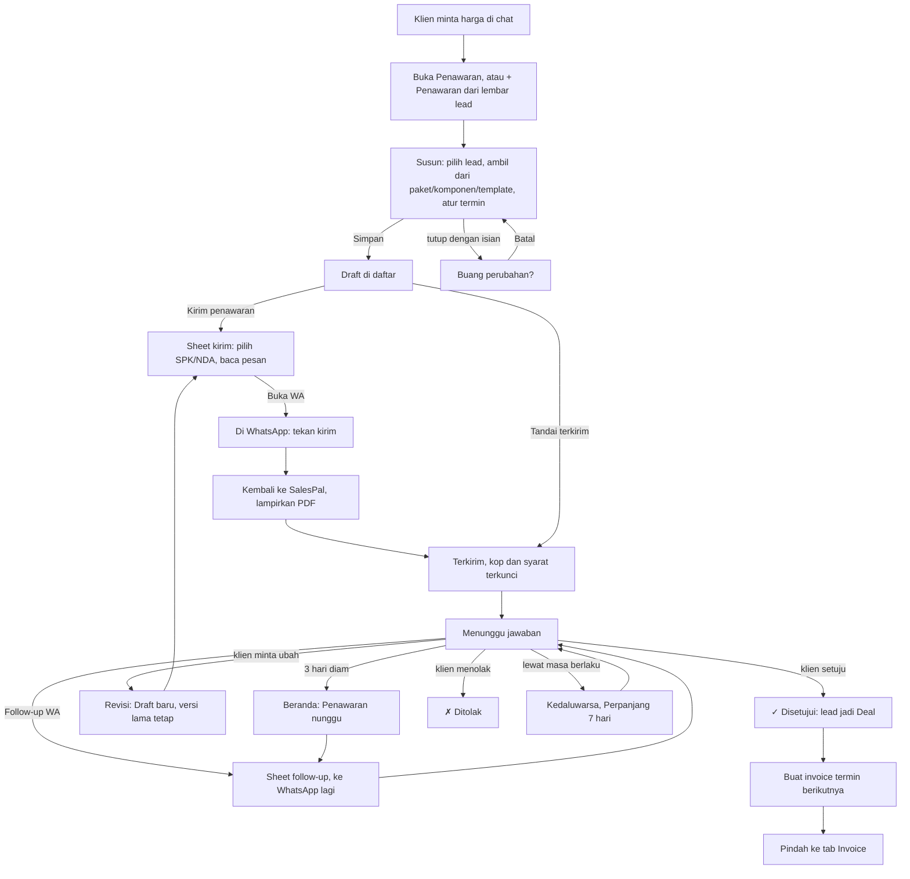

# Penawaran: arsitektur interaksi

**Kode:** `components/Quotes.tsx`, `components/DocEditor.tsx`, `components/SendQuoteSheet.tsx`, `components/WaSendSheet.tsx`, `components/PrintSheet.tsx`, `components/ConfirmSheet.tsx`, `lib/billing.ts`, `lib/pdfDoc.ts` · **Artefak lama:** E9, D4, C4, B3, B5 · **Pola:** [patterns.md](../patterns.md)#p11-external-app-handoff, #p6-full-screen-form, #p9-undo, #p7-confirm-sheet, #p12-unsaved-changes · **Keputusan:** [decisions.md](../decisions.md)#dec-001, #dec-003, #dec-004, #dec-005

## 1. Why

- **Masalah yang diselesaikan:** tanpa penawaran tertulis, harga yang disebut di chat hilang di antara pesan lain. Klien seperti Bu Sari bertanya lagi "jadi totalnya berapa, DP-nya kapan?", penjual menghitung ulang, dan angka yang kedua bisa beda dari yang pertama. Tidak ada yang tahu penawaran mana yang masih menunggu jawaban, dan uang yang sudah disepakati tidak tersambung ke invoice.
- **Kenapa di SalesPal:** penawaran di sini disusun dari paket dan komponen yang sudah ada harganya dan biaya modalnya (PRD-017), dikunci kop dan syaratnya saat dikirim (PRD-011 §4), mengubah lead jadi Deal saat disetujui, dan tiap baris jadwal bayarnya bisa jadi invoice. Catatan HP atau Notion tidak tahu satu pun dari itu, dan WhatsApp tidak tahu penawaran mana yang belum dijawab.
- **Yang ingin diselesaikan penjual di sini:** mengirim harga yang jelas ke klien, menunggu jawabannya tanpa lupa, lalu menagih sesuai yang disepakati.
- **Yang BUKAN tugas feature ini:**
  - Mengatur katalog harga. Paket, komponen, dan pricelist diurus di tab Paket; penawaran hanya mengambil salinannya.
  - Mencatat uang masuk. Itu tugas [invoice.md](invoice.md).
  - Mengirim lewat API WhatsApp. Kiriman selalu lewat WhatsApp penjual sendiri.
  - Tanda tangan elektronik. SPK dan NDA hanya ditandai "ditandatangani" oleh penjual.

## 2. User goal

> "Saya ingin kirim penawaran yang rapi ke Bu Sari dalam beberapa menit, tanpa menghitung ulang harga dan tanpa lupa menanyakan jawabannya."

Tujuan sampingan:

> "Saya ingin tahu berapa yang sudah disepakati, ditagih, dan diterima dari satu penawaran, tanpa membuka invoice satu per satu."

> "Saya ingin mengubah penawaran yang sudah dikirim tanpa diam-diam mengubah apa yang sudah dipegang klien."

## 3. User state

| State | Apa yang benar saat ini | Persisten | Siapa yang mengubahnya |
|---|---|---|---|
| Menyusun | Ada isian di DocEditor yang belum disimpan | Tidak (state komponen; hilang kalau editor ditutup tanpa Simpan) | Penjual |
| Draft | Penawaran tersimpan, belum keluar. Kop dan syarat mengikuti bisnis live | Firestore `quotes/{id}` `status: Draft` | Penjual (Simpan, Revisi) |
| WhatsApp kebuka | Chat dengan teks terisi sudah dibuka. **Hanya ada di kepala penjual** apakah pesannya benar-benar dikirim | Tidak | Penjual, di WhatsApp |
| Terkirim | Sistem menganggap klien sudah menerima. Kop (`issuer`) dan syarat (`terms`) dikunci, `sentAt` terisi | Firestore | Sistem saat tap Buka WA/Salin/Bagikan PDF di sheet kirim, atau penjual lewat "Tandai terkirim" |
| Menunggu jawaban | Terkirim, belum ada jawaban. Setelah 3 hari muncul di Beranda | Turunan dari `sentAt`/`followUpAt` | Waktu |
| Di-follow-up | Pengingat terakhir tercatat di `followUpAt` | Firestore | Sistem saat tap di sheet Follow-up |
| Jawaban klien diketahui | Klien bilang ya atau tidak. **Hanya ada di kepala penjual** sampai ia menekan ✓/✗ | Tidak | Klien, di WhatsApp |
| Disetujui | `acceptedAt` terisi. Lead jadi Closed (Deal) dengan nilai total penawaran | Firestore `quotes` + `leads` | Penjual (✓ Disetujui) |
| Ditolak | Status Ditolak. Lead **tidak** disentuh | Firestore | Penjual (✗ Ditolak) |
| Kedaluwarsa | `validUntil` sudah lewat. Hanya badge, status tidak berubah | Turunan | Waktu |
| Ada revisi | Draft baru `Q-…-rN` dengan `supersedes`. Versi lama tetap berlaku sampai revisi disetujui | Firestore | Penjual (Revisi) |
| Digantikan | Revisinya disetujui; versi ini hanya arsip | Firestore `status: Digantikan`, `supersededBy` | Sistem, saat revisi disetujui |
| Ditagih sebagian / semua | Ada invoice untuk sebagian atau semua baris jadwal bayar | Turunan dari `invoices` yang `quoteId`-nya ada di rantai revisi | Penjual (Buat invoice) |

## 4. Experience flow



Titik paling berat bagi penjual adalah saat kembali dari WhatsApp. Sheet kirim sudah mencatat "terkirim" sejak tap pertama, jadi penjual yang batal mengirim harus ingat menekan Batal sebelum menutup sheet. Titik kedua adalah ✓ Disetujui: satu tap mengubah lead jadi Deal dan angka omzet, tanpa kalimat apa pun yang memastikan apa yang baru terjadi. Masa menunggu terasa aman karena Beranda mengingatkan, tetapi hitungan harinya berbeda antara kartu dan Beranda. Setelah Buat invoice, penjual mendarat di tab lain tanpa jalan pulang yang menyebut "Penawaran".

## 5. Decision flow

**Penjual: penawaran ini untuk siapa?**
```
Datang dari mana?
├── Lembar lead → + Penawaran → editor sudah terisi lead itu (Quotes.tsx:101-103)
│   └── Ditutup / disimpan → mendarat di daftar Penawaran, bukan di lead ⚠ GAP-QUO-5
└── Tab Penawaran → + Penawaran → pilih lead, atau ketik nama klien bebas
```
Diputuskan penjual. UI membantu dengan pilihan lead; nama klien wajib (DocEditor.tsx:133).

**Penjual: isinya dari mana?**
```
Ada template?
├── Ya → Mulai dari template: item, termin, berlaku s/d terisi; klien dan acara tetap
└── Tidak → tambah dari paket / dari komponen / item manual
      └── Item manual dipakai lagi? → centang "Simpan ke katalog komponen"
Margin di bawah target?
└── Ringkasan internal menunjukkan margin dan harga minimal (DocEditor.tsx:308-313)
Jadwal bayar 100%?
├── Tidak → Simpan membawa ke bagian Jadwal pembayaran dengan pesan
└── Ya → boleh disimpan
```
Diputuskan penjual, dibantu UI (margin, harga minimal, pesan yang membawa ke isian yang kurang).

**Sistem: apa yang terjadi saat Simpan?**
```
Sedang Revisi?
├── Ya → dokumen baru, nomor {akar}-r{n}, tanggal hari ini, supersedes = versi lama (Quotes.tsx:120-136)
└── Tidak → tulis ulang Draft; kop, syarat, SPK/NDA, follow-up, invoiceIds dipertahankan (Quotes.tsx:137-142)
Nomor baru?
└── nextNumber dari daftar yang sudah dimuat di HP ini ⚠ GAP-QUO-14
```

**Penjual: cara kirimnya?**
```
Draft
├── Kirim penawaran → sheet kirim
│   ├── SPK/NDA ikut? → centang, isi bisa dibaca dan diubah
│   ├── Ada nomor WA → Buka WA (teks terisi dan disalin)
│   ├── Tidak ada nomor → Salin
│   └── Bagikan PDF → share sheet
│   Sistem: tap pertama mana pun = Terkirim + kop dikunci ⚠ GAP-QUO-6
├── Tandai terkirim (sudah dikirim di luar SalesPal) → Terkirim + kop dikunci, diam ⚠ GAP-QUO-9
└── Copy teks / PDF → tidak mengubah status
```
Pertanyaan "udah kekirim?" tidak pernah diajukan. Sistem memutuskan sendiri saat tap.

**Penjual: klien menjawab apa?**
```
Terkirim
├── Setuju → ✓ Disetujui
│   Sistem: status Disetujui, acceptedAt; versi yang direvisi → Digantikan;
│           lead → Closed, nilai = total, lastContact hari ini (Quotes.tsx:152-167)
│   ⚠ GAP-QUO-3: tanpa konfirmasi, feedback, atau Batal
├── Menolak → ✗ Ditolak
│   Sistem: status saja. Lead tidak disentuh, posisinya turun diam-diam ⚠ GAP-QUO-4
├── Minta ubah → Revisi (Draft baru) ⚠ GAP-QUO-12: dua versi sama-sama hidup
├── Diam → Follow-up WA (atau dari Beranda) ⚠ GAP-QUO-7, GAP-QUO-8
└── Lewat masa berlaku → Perpanjang 7 hari ⚠ GAP-QUO-9, GAP-QUO-10
```
Apakah penawaran kedaluwarsa boleh disetujui: tidak ada yang memutuskan. Tombolnya tetap ada tanpa peringatan (GAP-QUO-10).

**Penjual: ditagih bagaimana?**
```
Disetujui
├── Masih ada termin yang belum punya invoice → "Buat invoice {label} {persen}% →"
│   Sistem: satu invoice Draft untuk baris itu; tap kedua saat menyimpan diabaikan (✅ GAP-QUO-2)
│   lalu pindah ke tab Invoice ⚠ GAP-QUO-11
└── Semua termin sudah → "✓ Semua termin ditagih"
Invoice dibatalkan? → termin itu bisa ditagih lagi (Quotes.tsx:220)
```

**Penjual: hapus?**
```
Hapus (semua status) → ConfirmSheet "Hapus penawaran?"
└── Ya → dokumen hilang. Lead, invoice, dan versi lama tidak diubah ⚠ GAP-QUO-13
```

## 6. Interaction flow

```
AKSI        Kirim penawaran
WHY         Satu-satunya jalan yang mengirim penawaran beserta PDF dan perjanjiannya, dan mengunci apa yang dipegang klien
STATE       Draft saja (Quotes.tsx:310-311)
DECISION    SPK/NDA ikut atau tidak; isi pesan
INTERACTION Sheet kirim (WaSendSheet lewat SendQuoteSheet). Dialog: layar penuh di HP, tengah di laptop.
            Langkah 1 Buka WA (atau Salin tanpa nomor), langkah 2 Bagikan PDF lewat share sheet
CONSTRAINT  wa.me tidak melapor apakah pesan terkirim. iOS hanya membagikan file langsung dari tap, jadi PDF dibuat lebih dulu.
            WhatsApp di iPhone membuang teks yang dikirim bersama file, jadi teks dulu
CONSEQUENCE Seharusnya: tanya saat kembali (DEC-001). Sekarang: tap pertama mencatat Terkirim dan mengunci kop (WaSendSheet.tsx:46-58)
FEEDBACK    "✓ Penawaran Q-… tercatat terkirim; kop & syarat dikunci." di dalam sheet; centang di tiap langkah
RECOVERY    Batal di sheet membalik status, sentAt, kop, syarat, SPK, NDA (Quotes.tsx:73-75). Hilang begitu sheet ditutup ⚠ GAP-QUO-6
```

```
AKSI        Tandai terkirim
WHY         Penawaran yang dikirim di luar SalesPal (email, cetak) tetap harus masuk hitungan Menunggu jawaban
STATE       Draft
DECISION    "Sudah keluar, tapi bukan dari sini"
INTERACTION Tap langsung di baris
CONSTRAINT  Tidak ada bukti kiriman sama sekali
CONSEQUENCE Mengunci kop dan syarat seperti Kirim penawaran (Quotes.tsx:155-156, ✅ GAP-QUO-1)
FEEDBACK    Badge berubah jadi Terkirim. Tidak ada kalimat
RECOVERY    Tidak ada. Jalan balik satu-satunya: Revisi ⚠ GAP-QUO-9
```

```
AKSI        ✓ Disetujui / ✗ Ditolak
WHY         Mencatat jawaban klien, yang hanya diketahui penjual
STATE       Terkirim (Quotes.tsx:315-320)
DECISION    Ya atau tidak
INTERACTION Tap langsung
CONSTRAINT  Disetujui menulis sampai tiga dokumen berurutan (penawaran, versi lama, lead)
CONSEQUENCE Seharusnya: toast "{lead} jadi Deal Rp X · Batal" 10 detik yang membalik ketiganya (AMB-24)
FEEDBACK    Badge dan tombol berubah. Lead jadi Deal tanpa disebut
RECOVERY    Tidak ada ⚠ GAP-QUO-3. Error update lead ditelan (Quotes.tsx:165)
```

```
AKSI        Follow-up WA
WHY         Penawaran yang didiamkan klien biasanya lupa, bukan ditolak
STATE       Terkirim (Quotes.tsx:312-313)
DECISION    Isi pesan pengingat (teks pendek, bukan seluruh penawaran)
INTERACTION Sheet follow-up (WaSendSheet) dengan PDF penawaran siap dilampirkan
CONSTRAINT  Sama dengan Kirim penawaran
CONSEQUENCE Tap pertama mengisi followUpAt hari ini (Quotes.tsx:85-89)
FEEDBACK    "✓ Follow-up Q-… tercatat."; badge "follow-up {tanggal}" di baris
RECOVERY    Batal selama sheet terbuka ⚠ GAP-QUO-6. Kontak di lead tidak tercatat ⚠ GAP-QUO-7
```

```
AKSI        Edit / Revisi
WHY         Draft boleh diubah bebas; yang sudah keluar adalah janji harga, jadi perubahan jadi versi baru (AMB-10, PRD-011 §4)
STATE       Edit: Draft. Revisi: Terkirim, Disetujui, Ditolak. Tidak ada untuk Digantikan (Quotes.tsx:337-339)
DECISION    Mengubah isi, termin, masa berlaku
INTERACTION DocEditor: layar penuh di HP (globals.css:669-680), dialog lebar di laptop. Batal dan Simpan di bawah, × di atas
CONSTRAINT  Form panjang (item, biaya produksi, termin); geser Back di iPhone sering tidak sengaja
CONSEQUENCE Tutup dengan isian berbeda → "Buang perubahan?" (DocEditor.tsx:106-109, 587-591)
FEEDBACK    "Menyimpan…" di tombol; editor tutup; tidak ada toast ⚠ GAP-QUO-15
RECOVERY    Gagal: "Gagal nyimpen. Cek koneksi lalu coba lagi.", isian utuh (DocEditor.tsx:212)
```

```
AKSI        Buat invoice
WHY         Uang yang disepakati harus ditagih per termin, tanpa mengetik ulang item dan harga
STATE       Disetujui, selama masih ada baris jadwal yang belum punya invoice aktif (Quotes.tsx:323-330)
DECISION    Tidak ada: sistem memilih termin berikutnya
INTERACTION Tap, lalu pindah ke tab Invoice (SalesTracker.tsx:320)
CONSTRAINT  Dua tap cepat bisa membuat dua invoice
CONSEQUENCE Tombol sibuk (disabled, aria-busy); tap kedua diabaikan (Quotes.tsx:186-191, ✅ GAP-QUO-2)
FEEDBACK    Tab Invoice terbuka. Invoice baru tidak disorot atau disebut
RECOVERY    Tidak ada "‹ Kembali ke Penawaran"; gagal tulis tanpa pesan ⚠ GAP-QUO-11
```

Aksi kecil:

| Aksi | State | Interaksi | Feedback | Catatan |
|---|---|---|---|---|
| Copy teks | Semua | Tap | "✓ Tersalin" 1,8 dtk; gagal: "Gagal menyalin. Buka PDF atau Kirim WA aja." | Tidak mengubah status |
| PDF | Semua | Overlay PrintSheet, "Simpan / kirim PDF" lewat share sheet | "PDF dikirim." / "… tersimpan di Downloads." | Catatan "Kop dan syarat … dikunci" kalau ada `issuer` |
| Kirim WA | Disetujui, Ditolak | Membuka wa.me dengan seluruh teks penawaran | Tidak ada | Tidak dicatat apa pun ⚠ GAP-QUO-8 |
| Perpanjang 7 hari | Kedaluwarsa, bukan Digantikan | Tap | Badge Kedaluwarsa hilang | `validUntil` = hari ini + 7 ⚠ GAP-QUO-9 |
| Tandai SPK/NDA ditandatangani | Ada perjanjian yang belum ditandatangani | Tap | Badge berubah | Tanpa undo ⚠ GAP-QUO-9 |
| Hapus | Semua | ConfirmSheet | Baris hilang | Lihat GAP-QUO-13 |
| Saring status | Ada penawaran | Chip | Daftar tersaring; kosong: "Lihat semua" | Kembali ke 10 baris |
| Tampilkan 10 lagi | Lebih dari 10 | Tap | Sisa disebut | |

## 7. Component map

```
Daftar
├── Ringkasan: Menunggu jawaban, Disetujui, Win rate ............ Quotes.tsx:241-253
├── Saring status (chip) ........................................ Quotes.tsx:255-264
└── Baris penawaran ............................................ Quotes.tsx:283-368
    ├── Identitas: nomor, tanggal, klien, project, revisi dari/digantikan
    ├── Tanda: Kedaluwarsa, follow-up, N hari tanpa jawaban, status
    ├── Aksi utama sesuai status (.sp-doc-main) ................. Quotes.tsx:309-331
    ├── Alat (.sp-doc-tools): Copy teks, PDF, Edit/Revisi, Hapus  Quotes.tsx:332-341
    ├── Uang: Disepakati, Ditagih, Diterima, Sisa ............... Quotes.tsx:343-352
    └── Perjanjian: SPK/NDA + Tandai ditandatangani ............. Quotes.tsx:353-364
Menyusun
└── DocEditor (kind="quote") ................................... DocEditor.tsx
    ├── Mulai dari template, klien, item (paket/komponen/manual), biaya produksi
    ├── Harga & pembayaran, jadwal bayar 100%, catatan, simpan sebagai template
    ├── Ringkasan menempel: total, margin internal, Batal, Simpan
    └── Buang perubahan? (ConfirmSheet) ......................... DocEditor.tsx:587-591
Mengirim (handoff)
├── SendQuoteSheet: penawaran + SPK/NDA ........................ SendQuoteSheet.tsx
└── WaSendSheet: Buka WA / Salin, Bagikan PDF, Batal ........... WaSendSheet.tsx
Dokumen
└── PrintSheet (overlay PDF, Kop & logo) ....................... PrintSheet.tsx
Pemulihan
├── Batal di WaSendSheet (selama sheet terbuka) ................ WaSendSheet.tsx:76-82
└── ConfirmSheet Hapus ......................................... Quotes.tsx:388-392
Penghitung (lib)
└── total, scheduleOf, termAmounts, nextNumber, quoteText, waLink  lib/billing.ts:324-454
```

## 8. Navigation map

**Datang dari:**
- Subtab Penawaran (Navigasi, tab).
- Lembar lead → "+ Penawaran": Lompatan ke tab Penawaran dengan editor terbuka (`startQuote`, SalesTracker.tsx:533-537). Tidak menyimpan asal ⚠ GAP-QUO-5.
- Riwayat lead → satu penawaran: Lompatan, PDF penawaran terbuka, "‹ Kembali ke {lead}" membuka lead lagi (SalesTracker.tsx:1101, 398-405).
- Beranda → kartu "Penawaran nunggu" → "Lihat penawaran": Lompatan dengan "‹ Kembali ke Beranda" (`jump`, SalesTracker.tsx:394-397, 644).

**Pergi ke:**

| Tujuan | Jenis | Permukaan | Kembali |
|---|---|---|---|
| DocEditor | Overlay | Layar penuh (HP), dialog lebar (laptop) | ×, Batal, Back, scrim; "Buang perubahan?" kalau ada isian |
| Sheet kirim / follow-up | Overlay | Layar penuh (HP), dialog tengah (laptop) | Tutup/Selesai, Back. Batal kiriman hilang saat ditutup |
| WhatsApp | Eksternal | App lain | Kembali ke sheet yang masih terbuka (kalau iOS tidak memuat ulang PWA; kalau dimuat ulang, sheet hilang, catatan kirim tetap) |
| Share sheet PDF | Eksternal | Sheet sistem | Kembali ke sheet |
| PrintSheet | Overlay | Layar PDF | Tutup, Back |
| Tab Invoice (Buat invoice) | Lompatan tanpa asal | Tab | Hanya lewat subtab ⚠ GAP-QUO-11 |

Saringan dan jumlah baris hanya ada di state komponen: kembali dari overlay mempertahankannya, pindah tab mengembalikannya ke "Semua" dan 10 baris.

## 9. Feedback & recovery

| Aksi | Pending | Sukses | Error | Undo / retry / pemulihan | Masalah |
|---|---|---|---|---|---|
| Simpan penawaran | "Menyimpan…" | Editor tutup | Teks di editor, isian utuh | Retry | Tanpa toast (GAP-QUO-15) |
| Kirim penawaran | Tidak ada; dicatat saat tap | Status di sheet | "Gagal dicatat. Cek koneksi lalu coba lagi." | Batal selama sheet terbuka | Dicatat sebelum penjual tahu terkirim; Batal hilang saat tutup (GAP-QUO-6) |
| Follow-up WA | Sama | Sama | Sama | Sama | Plus lead tidak dicatat dikontak (GAP-QUO-7) |
| Kirim WA (Disetujui/Ditolak) | Tidak ada | Tidak ada | Tidak ada | Tidak ada | Meninggalkan app tanpa catatan (GAP-QUO-8) |
| Tandai terkirim | Tidak ada | Badge | Tidak terlihat | Tidak ada | Mengunci kop tanpa undo (GAP-QUO-9) |
| ✓ Disetujui | Tidak ada | Badge | Tidak terlihat; update lead ditelan | Tidak ada | Perubahan besar tanpa konfirmasi atau undo (GAP-QUO-3) |
| ✗ Ditolak | Tidak ada | Badge | Tidak terlihat | Tidak ada | Bisa dibalik secara data, tanpa undo (GAP-QUO-3) |
| Perpanjang 7 hari | Tidak ada | Badge hilang | Tidak terlihat | Tidak ada | GAP-QUO-9 |
| Tandai SPK/NDA ditandatangani | Tidak ada | Badge | Tidak terlihat | Tidak ada | GAP-QUO-9 |
| Buat invoice | Tombol redup, `aria-busy` | Pindah tab | Tidak terlihat (try/finally tanpa catch) | Tidak ada | GAP-QUO-11 |
| Copy teks | Tidak ada | "✓ Tersalin" | Pesan merah 3 dtk | Ulangi | |
| PDF | "Menyiapkan PDF…" | "PDF dikirim." | "PDF gagal dibuat. Coba tutup lalu buka lagi." | Buka ulang | |
| Hapus | "Menghapus…" | Sheet tutup, baris hilang | "Gagal. Cek koneksi, lalu coba lagi." | Tidak bisa dibalik (dikatakan di sheet) | Efek ke lead dan versi lama (GAP-QUO-13) |
| Tutup editor berisi | Tidak ada | "Buang perubahan?" | Tidak berlaku | Batal kembali ke isian | |

## 10. Design rationale

- **Kenapa hanya Draft yang bisa Edit?** Karena klien sudah memegang dokumen Terkirim. Mengubahnya di tempat membuat PDF di HP klien dan di SalesPal berbeda tanpa jejak. Revisi menjaga versi lama tetap terbaca dan baru menggantikannya setelah disetujui (AMB-10, PRD-011 §4). Polanya benar; yang kurang adalah tanda di versi lama bahwa ada revisi yang menunggu (GAP-QUO-12).
- **Kenapa kop dan syarat dikunci saat keluar?** Kop & logo bisnis bisa berubah besok. Dokumen yang sudah dikirim harus tetap menyebut rekening dan syarat yang berlaku saat dikirim. Semua jalan ke Terkirim sekarang mengunci (Quotes.tsx:155-156).
- **Kenapa kiriman lewat sheet, bukan langsung wa.me?** Karena kiriman penawaran punya dua bagian (teks lalu PDF) yang urutannya penting di iPhone, dan perjanjian harus bisa dibaca sebelum ikut. Pola yang benar untuk pencatatannya adalah P11: catat hanya setelah penjual menjawab "udah kekirim?" saat kembali, disimpan di `lib/pendingSend.ts` (DEC-001, DEC-002). Sheet ini masih mencatat saat tap (GAP-QUO-6).
- **Kenapa ✓/✗ tidak memakai konfirmasi?** Karena keduanya bisa dibalik secara data, dan konfirmasi untuk aksi yang bisa dibalik melatih penjual menekan "Ya" tanpa membaca (P7). Polanya seharusnya P8 + P9: toast yang menyebut akibatnya ("Bu Sari jadi Deal Rp 4.500.000") dengan Batal 10 detik (DEC-004). Sekarang tidak ada keduanya (GAP-QUO-3).
- **Kenapa satu aksi utama per status?** Karena di tiap state penjual hanya punya satu langkah berikutnya yang wajar: Draft → kirim, Terkirim → tanya atau catat jawaban, Disetujui → tagih (P1). Alat yang jarang dipakai (Copy, PDF, Edit/Revisi, Hapus) dipisah di `.sp-doc-tools`. Terkirim masih menampilkan tiga tombol utama sejajar (Follow-up, ✓, ✗); pengelompokan itu belum diputuskan dan tidak dicatat sebagai GAP.
- **Kenapa DocEditor layar penuh?** Penawaran punya daftar item, biaya produksi, dan termin: form P6. Di HP aturan CSS sudah membuatnya layar penuh dengan total dan Simpan menempel di bawah. Di laptop ia masih dialog `modalBox` (pola yang ditinggalkan, DEC-003) dan Batal/Simpan ada di bawah, bukan di kepala layar seperti P6 (GAP-QUO-16).
- **Kenapa Buat invoice membuat Draft, bukan langsung terbit?** Karena menerbitkan berarti klien punya tagihan. Penjual masih bisa mengecek tanggal jatuh tempo dan isi sebelum menagih ([invoice.md](invoice.md)).
- **Kenapa paket, komponen, dan pricelist hanya disalin?** Harga yang diubah besok tidak boleh mengubah penawaran yang sudah dibuat (PRD-017 §4). Item menyimpan `serviceId`/`componentId` dan biaya modal sebagai catatan internal yang tidak dicetak.

## 11. Current implementation

Per 6 Nov 2026, termasuk PR #116.

- Penawaran baru mengambil default bisnis: masa berlaku `validDays` (14), DP 50%, jadwal, pajak (`Quotes.tsx:22-33`).
- Daftar diurutkan tanggal lalu nomor, 10 per halaman, disaring per status (`Quotes.tsx:109-110, 255-264, 370-374`).
- Kedaluwarsa = bukan Disetujui/Ditolak dan `validUntil` < hari ini; jadi termasuk Digantikan (`Quotes.tsx:285`). "N hari tanpa jawaban" dihitung dari `sentAt`, mulai 3 hari (`Quotes.tsx:284, 303`).
- Simpan: Revisi membuat dokumen baru `{akar}-r{n}` dengan `supersedes`; Draft menulis ulang dengan `setDoc` sambil membawa kop, syarat, SPK/NDA, follow-up, invoiceIds (`Quotes.tsx:119-148`). Nomor dari `nextNumber` atas daftar yang dimuat (`lib/billing.ts:396-404`).
- `setStatus`: Terkirim mengisi `sentAt` dan mengunci `issuer`/`terms`; Disetujui mengisi `acceptedAt`, menandai versi lama Digantikan, dan menulis lead `status: Closed, value: total, lastContact: hari ini` dengan error ditelan (`Quotes.tsx:152-167`).
- `sendWA` membuka wa.me dengan seluruh `quoteText`; cabang Draft-nya tidak pernah tercapai karena Draft menampilkan Kirim penawaran (`Quotes.tsx:169-172, 310-314`).
- Sheet kirim: `markSent` menulis kop, syarat, SPK/NDA, status, `sentAt`, dan mengembalikan fungsi undo (`Quotes.tsx:62-76`). WaSendSheet mencatat pada tap pertama Buka WA, Salin, atau Bagikan PDF; Batal ada sampai sheet ditutup (`WaSendSheet.tsx:46-82, 119-124`).
- Follow-up WA: teks pendek dengan nomor, project, tanggal kirim, dan masa berlaku; tap mengisi `followUpAt` (`Quotes.tsx:80-89, 382-386`). Beranda memakai field yang sama dan juga mencatat kontak di lead (`SalesTracker.tsx:500-507`), dengan pertanyaan "Udah, catat" (`Beranda.tsx:294-301`). Beranda menghitung dari follow-up terakhir (`SalesTracker.tsx:615, 638`).
- Perpanjang: `validUntil` = hari ini + 7 (`Quotes.tsx:90-92`).
- Buat invoice: guard `making`; satu invoice Draft per baris jadwal, jatuh tempo +7 hari, `issuer` dari penawaran, `dpPercent: 0`, `term` untuk jadwal lebih dari satu baris; id ditambahkan ke `invoiceIds`; lalu `onInvoiceCreated` = `setActiveTab("Invoice")` (`Quotes.tsx:186-213`, `SalesTracker.tsx:320`).
- Uang per penawaran menelusuri rantai revisi; invoice Dibatalkan tidak dihitung, jadi terminnya bisa ditagih lagi (`Quotes.tsx:217-229`).
- DocEditor: `dirty` dari perbandingan JSON; semua jalan tutup lewat `close` → "Buang perubahan?"; Simpan membawa ke isian yang kurang; item manual "Simpan ke katalog" ditulis ke `components` dulu (`DocEditor.tsx:106-109, 133-135, 188-213`). Di HP layar penuh lewat `globals.css:669-680`; kotak tidak punya `role="dialog"` sendiri, ModalA11y yang memberi (belum diverifikasi untuk kotak `data-own-layout`).
- PrintSheet membuat PDF saat dibuka, membagikan lewat share sheet, tanpa print browser (`PrintSheet.tsx:41-57`).
- Hapus: ConfirmSheet, `deleteDoc` saja (`Quotes.tsx:180-182, 388-392`).

## 12. Known gaps

| ID | Gap | Akibat bagi penjual | Arah perbaikan | Rujukan |
|---|---|---|---|---|
| GAP-QUO-1 | ✅ Edit penawaran terkirim menghapus kop, syarat, SPK/NDA, follow-up; Tandai terkirim tidak mengunci kop | Dokumen yang dipegang klien berubah diam-diam | Dibangun: Edit hanya Draft, lainnya Revisi; semua jalan ke Terkirim mengunci | AMB-10, PR #116 |
| GAP-QUO-2 | ✅ Ketuk dua kali Buat invoice = dua invoice | Tagihan ganda ke klien | Dibangun: tombol sibuk, tap kedua diabaikan | AMB-11, PR #116 |
| GAP-QUO-3 | ✅ (PR #118: toast + Batal untuk Disetujui/Ditolak; update lead tidak lagi ditelan) ✓ Disetujui dan ✗ Ditolak tanpa konfirmasi, feedback, atau undo. Disetujui mengubah lead jadi Deal dan nilainya, dan menandai versi lama Digantikan; error update lead ditelan (`Quotes.tsx:165`) | Salah tap mengubah omzet; tidak tahu lead ikut berubah | Toast "{lead} jadi Deal Rp X · Batal" 10 dtk yang membalik ketiga tulisan; error terlihat | AMB-24 (diputuskan, belum dibangun), DEC-004 |
| GAP-QUO-4 | ✗ Ditolak tidak menyentuh lead; posisinya turun diam-diam ke Dibales/Dikontak | Lead yang menolak tetap terlihat hidup; tidak ada ajakan mencatat Gugur | Belum diputuskan: apakah Ditolak menawarkan Gugur + alasan | C2 #6 |
| GAP-QUO-5 | + Penawaran dari lembar lead memakai `setActiveTab`, bukan `jump`: tidak ada "‹ Kembali ke {lead}", setelah Simpan/Batal penjual ada di daftar Penawaran. B3 menulis sebaliknya | Kehilangan lead yang sedang dikerjakan | Simpan asal seperti Riwayat (`cameFrom` dengan `leadId`) | `SalesTracker.tsx:533-537`, P13 |
| GAP-QUO-6 | Kirim penawaran dan Follow-up WA dicatat saat tap, sebelum penjual tahu pesannya terkirim; Batal hilang saat sheet ditutup; tidak memakai `lib/pendingSend` | "Terkirim" bisa palsu; kalau iOS memuat ulang PWA, tidak ada jalan membatalkan | Satu kontrak: tanya saat kembali, antrean pending | AMB-08, DEC-001, P11 |
| GAP-QUO-7 | Follow-up WA dari tab tidak mencatat kontak di lead; dari Beranda mencatat | Lead yang di-follow-up dari tab tampak tidak dikontak | Satu fungsi follow-up untuk kedua pintu | `Quotes.tsx:85-89` vs `SalesTracker.tsx:500-507` |
| GAP-QUO-8 | "Kirim WA" di Disetujui/Ditolak membuka WhatsApp dengan seluruh penawaran tanpa sheet dan tanpa catatan | Kiriman ulang tidak terlihat di riwayat | Lewat kontrak kirim yang sama, atau dihapus bila tidak ada keputusan yang butuh | AMB-08 |
| GAP-QUO-9 | ✅ (PR #118: Tandai terkirim dan Perpanjang: toast + Batal (tandai SPK/NDA belum)) Tandai terkirim, Perpanjang 7 hari, Tandai SPK/NDA ditandatangani: diam, tanpa undo, error tidak terlihat. Perpanjang mengubah masa berlaku dokumen yang sudah dipegang klien tanpa pesan ke klien | Tidak yakin aksi jalan; salah tap tidak bisa dibalik | Toast + Batal (P8, P9); error di tempat (P15) | AMB-13 |
| GAP-QUO-10 | Badge Kedaluwarsa muncul di Digantikan; penawaran kedaluwarsa tetap bisa Disetujui tanpa peringatan | Arsip tampak bermasalah; harga lama disetujui tanpa sadar | Belum diputuskan | C4 #4 |
| GAP-QUO-11 | Buat invoice pindah ke tab Invoice tanpa "‹ Kembali ke Penawaran", tanpa menyebut invoice yang dibuat; gagal tulis tanpa pesan | Penjual mencari invoice baru dan jalan pulang | Lompatan dengan asal (P13) dan invoice baru terbuka/disorot; error di tombol | E9, peta tombol |
| GAP-QUO-12 | Revisi dari Terkirim: versi lama tetap Terkirim dengan ✓/✗, tetap diingatkan Beranda, tanpa tanda "ada revisi draft" | Penjual bisa menyetujui versi lama atau follow-up harga lama | Belum diputuskan: tanda di versi lama | PRD-011 §4 |
| GAP-QUO-13 | Hapus penawaran Disetujui tidak membalik lead (tetap Deal dengan nilainya). Menghapus revisi yang berlaku meninggalkan versi lama "Digantikan" tanpa Revisi (tombol disembunyikan untuk Digantikan) | Omzet tanpa dokumen; versi lama buntu | Belum diputuskan | `Quotes.tsx:180-182, 337-339` |
| GAP-QUO-14 | Nomor dihitung dari daftar yang dimuat di HP (`nextNumber`), bukan penghitung transaksi seperti PRD-011 §4. Di guild, dua penjual bisa mendapat nomor sama (belum diverifikasi terjadi) | Dua dokumen bernomor sama ke klien | Penghitung per ruang kerja | PRD-011 §4 |
| GAP-QUO-15 | Simpan penawaran menutup editor tanpa toast | "Tadi kesimpan nggak?" | Toast setelah tulisan berhasil (P6, DEC-005) | D4 |
| GAP-QUO-16 | DocEditor di laptop masih dialog `modalBox`; Batal/Simpan di bawah, bukan di kepala layar | Tidak konsisten dengan form P6 lain | Pindah ke `Sheet full` | DEC-003, P6 |
