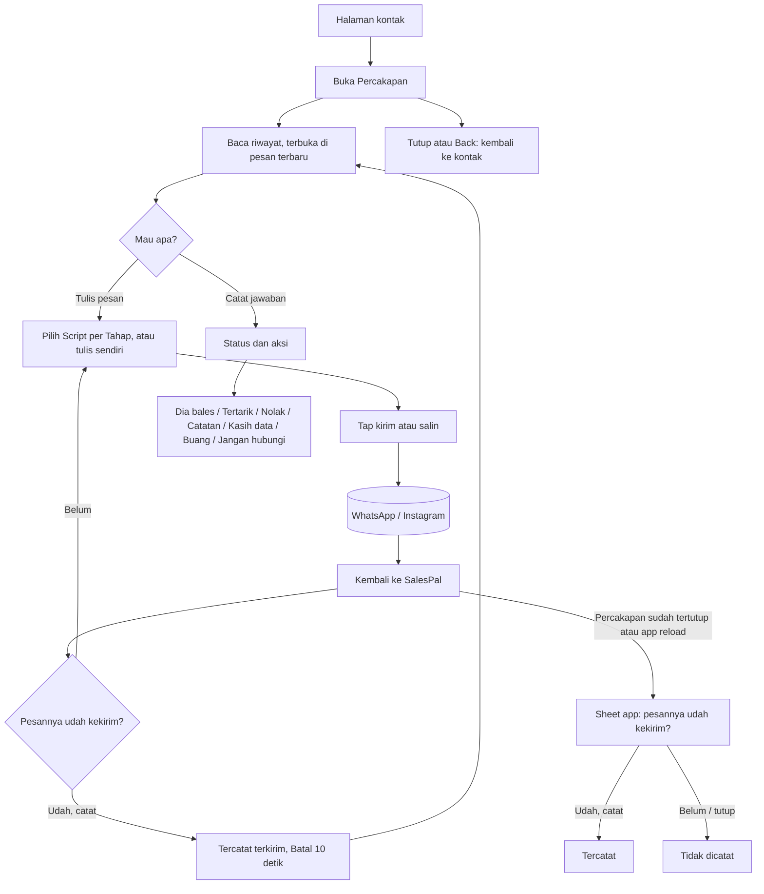

# Percakapan: arsitektur interaksi

**Kode:** `components/ProspectThread.tsx`, `lib/pendingSend.ts`, `components/PendingSends.tsx`, `components/Hunting.tsx` (`handOver`, `logTo`, `queueFor`, `sendFor`), `lib/prospectStore.ts` (`recordSend`) · **Artefak lama:** E5, D1, D2, B5, F (ProspectThread), peta tombol #percakapan · **Pola:** jenis Overlay dan Eksternal di [README](../README.md#tiga-jenis-perpindahan), aturan feedback [AMB-13](../ambiguities.md) · **Keputusan:** [AMB-06](../ambiguities.md), AMB-09, AMB-12, AMB-08, [PRD-026](../../prd/PRD-026-navigasi-balik.md) N1, [PRD-009](../../prd/PRD-009-hunting-session-journey.md)

## 1. Why

- **Masalah yang diselesaikan:** percakapan dengan satu Prospek tersebar di WhatsApp, DM Instagram, dan balasan Threads. Penjual tidak bisa melihat dalam satu layar apa yang sudah ia kirim, kapan, dengan Script apa, dan apa yang dibalas. Owner (23 Okt): "log DM bukan kaya chat WA yang bisa di-track".
- **Kenapa di SalesPal:** hanya SalesPal yang tahu Tahap orang ini, bisa mengisi Script dari post-nya, dan bisa mencatat Outreach sebagai Terkirim. WhatsApp dan Instagram tidak melapor balik.
- **Yang ingin diselesaikan pengguna di sini:** membaca riwayat seperti chat, lalu menulis dan mengirim pesan berikutnya tanpa kehilangan catatannya.
- **Yang BUKAN tugas feature ini:**
  - Mengirim pesan sendiri. Pesan selalu keluar lewat WhatsApp/IG oleh penjual.
  - Mengelola journey secara lengkap. Itu [Kontak prospek](kontak-prospek.md); Percakapan hanya punya pintasan status.
  - Membaca balasan secara otomatis. Balasan ditempel manual.
  - Kotak masuk semua orang. Tidak ada daftar Percakapan tersendiri (§8).

## 2. User goal

> "Saya ingin lihat obrolan saya dengan @tokokue dari awal, lalu kirim pesan berikutnya dari sini, tanpa lupa mencatat bahwa pesannya sudah terkirim."

Tujuan sampingan:
- "Kalau saya pindah ke WhatsApp lalu app-nya ke-reload, saya tetap ingin ditanya apakah pesannya sudah terkirim."
- "Saya ingin mencatat jawaban Bu Sari tanpa keluar dari chat."

## 3. User state

| State | Apa yang benar saat ini | Persisten | Siapa yang mengubahnya |
|---|---|---|---|
| Membaca | Riwayat terurut dari lama ke baru, dikelompokkan per hari | Firestore `prospects.history` | Sistem |
| Menulis | Teks di kotak pesan, Script dan Tahap terpilih | Tidak (state React); hilang saat ditutup | Penjual |
| Diserahkan ke WA/IG | Teks disalin dan/atau WA/IG dibuka | Pertanyaan tertunda di `sessionStorage` (`sp-pending-sends`), dimiliki layar ini | Penjual (tap) |
| **Hanya di kepala penjual:** pesan benar-benar terkirim | Sistem tidak tahu sampai penjual menjawab "Udah, catat" | n/a | Penjual |
| Pertanyaan tanpa pemilik | Percakapan sudah ditutup atau app dimuat ulang; pertanyaan menunggu sheet app | `sessionStorage`, maks 12 jam | Sistem (`release`), lalu `PendingSends` |
| Tercatat Terkirim | Hunt baru + langkah journey + hitungan sesi | Firestore `hunts` + `prospects` + `huntSessions` | `recordSend` |
| Undo kiriman tersedia | 10 detik setelah tercatat | Tidak | Sistem |
| Panel ⋯ terbuka / pemilih Script terbuka | Satu panel di bawah header, satu di atas kotak | Tidak | Penjual |
| Jangan dihubungi | Kotak pesan diganti teks "Orang ini minta ga dihubungi lagi." | Firestore | Penjual |

## 4. Experience flow



Percakapan terasa seperti app chat: gelembung kanan untuk pesan penjual, kiri untuk post dan balasan, garis hari di tengah. Teks tetap di kotak setelah tap kirim, supaya penjual bisa mengirim ulang kalau WA gagal terbuka (PRD-022 §4). Momen kritis adalah kembali dari WhatsApp. Kalau Percakapan masih terbuka, baris "Pesannya udah kekirim?" menunggu di atas kotak. Kalau sudah tertutup atau iOS memuat ulang app, pertanyaan yang sama muncul sebagai sheet di tingkat app. Status dan aksi di ⋯ adalah pintasan, dan perilakunya berbeda dari sheet di halaman kontak (§5, §12).

## 5. Decision flow

**Penjual: Script mana untuk pesan berikutnya?**
```
Tahap apa?
├── Sistem menyarankan stageFor(p, view) → ditandai "● " di pemilih
└── Penjual memilih Tahap lain → daftar Script ikut berganti
Ada Script untuk Tahap itu?
├── Ada → tap → kotak terisi fillTemplate(body, data post)
└── Tidak ada → "Belum ada template buat tahap X. Tulis langsung di bawah."
```
Diputuskan penjual, dibantu tanda Tahap yang disarankan. Script default tidak diisi otomatis; kotak selalu mulai kosong. **⚠ GAP-PCK-10**

**Penjual: kirim lewat mana?**
```
sendFor(p)
├── WA → "Buka WA" (wa.me dengan teks)
├── Baru + ada URL post → "Copy & buka post" (channel post)
├── Threads/IG + handle → "Copy & DM" (ig.me)
├── ada URL profil → "Copy & buka profil"
└── lainnya → "Buka WA"
Ikon salin → hanya menyalin
```
Diputuskan sistem; label tombol menyebut caranya (`aria-label`, `title`).

**Penjual: pesannya sudah terkirim?**
```
Percakapan masih terbuka?
├── Ya → baris "Pesannya udah kekirim?"
│   ├── Udah, catat → recordSend
│   │   ├── Berhasil → kotak kosong, "Tercatat terkirim." + Batal 10 dtk
│   │   └── Gagal → "Pesan belum kecatat. Cek koneksi lalu coba lagi.", pertanyaan tetap
│   └── Belum → pertanyaan dibuang, teks tetap di kotak
└── Tidak (ditutup, pindah tab, reload) → release → PendingSends (setelah 400 ms, dan saat app terlihat lagi)
    ├── Udah, catat → recordSend dengan prospek yang masih terbuka
    │   └── Prospek sudah tertutup (Arsip/DNC) → dianggap prospek baru ⚠ GAP-PCK-8
    ├── Belum → dibuang
    └── Tutup sheet (×, scrim, Back) → semua pertanyaan dibuang tanpa bilang ⚠ GAP-PCK-7
```

**Penjual: apa yang terjadi dengan dia? (⋯ Status & aksi)**
```
├── 💬 Dia bales → isian balasan di bawah → replyPatch
├── ✅ Tertarik → resultPatch tertarik, langsung
├── ❌ Nolak → resultPatch tolak tanpa alasan, langsung (parkir declinedParkDays) ⚠ GAP-PCK-1
├── 📝 Catatan → isian catatan → notePatch
├── Kasih data → (hanya kalau belum convertedAt) → ConvertSheet
├── 🗑 Buang → (hanya kalau dropReady) → archivePatch, langsung, tanpa tanya ⚠ GAP-PCK-4
└── 🚫 Jangan hubungi → konfirmasi di panel → dncPatch
Tidak ada: Pikir-pikir, Hubungi nanti ⚠ GAP-PCK-1
```
Diputuskan penjual, tetapi UI tidak menyebut akibat (jadwal, parkir), tidak ada undo, dan hitungan sesi tidak ikut. **⚠ GAP-PCK-1, GAP-PCK-2, GAP-PCK-3**

**Sistem: apa yang terjadi saat Percakapan ditutup?**
```
Ada pertanyaan "udah kekirim?" terbuka?
├── Ya → release(pendingId) → sheet app yang bertanya
└── Tidak → tidak ada yang tersisa
Ada teks di kotak?
└── Ya → hilang tanpa ditanya ⚠ GAP-PCK-9
```

## 6. Interaction flow

```
AKSI        Kirim (ikon panah, label dari sendOut) / Salin (ikon clipboard)
WHY         pesan keluar lewat app penjual; SalesPal menyiapkan dan mencatat
STATE       ada teks, bukan DNC, tidak sedang menyimpan
DECISION    kirim sekarang lewat saluran yang benar
INTERACTION tap → salin dan/atau buka WA/IG di tab baru (eksternal)
CONSTRAINT  WhatsApp dan Instagram tidak memberi tahu apakah pesan terkirim
CONSEQUENCE tidak dicatat saat tap; pertanyaan disimpan app-wide (addPending)
            dan ditanyakan di layar ini
FEEDBACK    baris "Pesannya udah kekirim?" [Belum] [Udah, catat]
RECOVERY    teks tetap di kotak; Belum = boleh kirim ulang
```

```
AKSI        Udah, catat
WHY         Terkirim = dikonfirmasi penjual (GLOSSARY)
STATE       ada pertanyaan terbuka
DECISION    benar terkirim atau tidak
INTERACTION tap; tombol disabled selama menyimpan
CONSTRAINT  tulisan bisa gagal (sinyal lapangan)
CONSEQUENCE pertanyaan hanya dibuang setelah berhasil
FEEDBACK    kotak kosong, "Tercatat terkirim." [Batal]; gelembung baru di log
RECOVERY    Batal 10 dtk → hunt dihapus, prospek kembali ke dokumen sebelum kirim.
            Gagal → teks error, pertanyaan tetap, tap lagi
```

```
AKSI        Sheet app "Pesannya udah kekirim?" (PendingSends)
WHY         pertanyaan tidak boleh hilang saat layar pergi atau app reload (AMB-06)
STATE       ada pertanyaan di sessionStorage untuk ruang kerja ini yang tidak
            dimiliki layar mana pun, umur < 12 jam
DECISION    per kiriman: Udah atau Belum
INTERACTION sheet bawah; satu baris per kiriman (label + 2 baris teks pesan)
CONSTRAINT  tidak tahu Script yang dipilih kecuali disimpan di pertanyaan (disimpan)
CONSEQUENCE dicatat dengan recordSend yang sama dengan Percakapan
FEEDBACK    toast "✓ Tercatat: pesan ke {nama}", atau "… ga bisa dicatat: datanya udah ga ada."
RECOVERY    gagal → "Belum kecatat. Cek koneksi lalu tap Udah lagi."; tidak ada Batal
            setelah tercatat dari sheet ini
```

```
AKSI        ⋯ Status & aksi (panel di bawah header)
WHY         mencatat jawaban tanpa keluar dari chat
STATE       bukan DNC
DECISION    lihat §5
INTERACTION panel dalam layar (bukan sheet); Escape menutup panel dulu;
            tap di log menutup panel; Back HP menutup seluruh Percakapan
CONSTRAINT  implementasi sendiri (act lokal), bukan useOutcome
CONSEQUENCE label, pilihan, hitungan, dan pemulihan berbeda dari halaman kontak
FEEDBACK    hanya baris status baru di log; error "Gagal nyimpen…" di kaki
RECOVERY    tidak ada undo
```

```
AKSI        🚫 Jangan hubungi
WHY         menghormati permintaan (PRD-009 §6.4)
STATE       bukan DNC
DECISION    kunci selamanya
INTERACTION panel berganti jadi pertanyaan "Hapus isi percakapan dan jangan hubungi
            @tokokue lagi? Ga bisa dibalikin." [Batal] [Ya, jangan hubungi] merah
CONSTRAINT  setelah tersimpan, prospek closed → keluar dari daftar terbuka
CONSEQUENCE Percakapan (dan kontak di bawahnya) hilang dari layar
FEEDBACK    tidak ada; layar hilang (GAP-PCK-5)
RECOVERY    tidak ada
```

```
AKSI        🗑 Buang
WHY         singkirkan yang diam lama
STATE       dropReady
DECISION    arsipkan
INTERACTION satu tap, tanpa tanya; lalu onClose()
CONSTRAINT  act() menangkap error dan menulis msg, lalu Percakapan ditutup
CONSEQUENCE error tidak pernah terlihat
FEEDBACK    Percakapan tertutup; kalau berhasil, kontak di bawahnya juga hilang
RECOVERY    saringan Arsip → Balikin
```

Aksi kecil:

| Aksi | State | Interaksi | Feedback | Recovery |
|---|---|---|---|---|
| ‹ Tutup | selalu | tap, Back HP, Escape (kalau panel tertutup), scrim | kembali ke kontak | buka lagi Percakapan; teks hilang |
| Pemilih Script | bukan DNC | panel; Tahap sebagai radio; tap Script = isi kotak + fokus | judul Script di tombol pemilih | ganti Script, atau edit teks |
| Kotak pesan | bukan DNC | textarea tumbuh sampai 140 px; fokus menutup panel | n/a | n/a |
| Belum | ada pertanyaan | tap | baris hilang, teks tetap | kirim ulang |
| Batal (kiriman) | 10 dtk setelah tercatat | tap | baris hilang, tanpa teks "Dibatalin" | n/a (GAP-PCK-6) |
| 💬 Dia bales / 📝 Catatan | panel | isian satu baris di kaki + Simpan + × | gelembung/baris baru di log | × membatalkan isian |
| Kasih data → | belum ETB | ConvertSheet di atas Percakapan; scrim hanya menutup dirinya | "✓ {pesan}" hijau di kaki | lihat [Kontak prospek](kontak-prospek.md) GAP-KON-11 |

## 7. Component map

```
Percakapan (portal ke body, di atas kontak)      ProspectThread.tsx
├── Orientasi
│   ├── Header: ‹, inisial, nama, platform · status · diem N hari · follow-up hari ini
│   └── ⋯ Status & aksi (disembunyikan untuk DNC)
├── Cerita
│   └── Log: garis hari + Bubble (post, terkirim, balasan, baris status)   role=log
├── Pintasan status (panel menu)                  ProspectThread act()
│   ├── Dia bales, Tertarik, Nolak, Catatan       lib/prospects.ts (replyPatch, resultPatch, notePatch)
│   ├── Kasih data → ConvertSheet                 ConvertSheet.tsx
│   ├── Buang                                     archivePatch
│   └── Jangan hubungi (konfirmasi di panel)      dncPatch
├── Persiapan pesan
│   ├── Pemilih Tahap + Script (panel pick)       lib/templates.ts (STAGES, stageFor, fillTemplate)
│   └── Kotak pesan                               .sp-thread-compose
├── Aksi utama
│   └── Salin / Kirim → onHandOver                Hunting.tsx handOver, sendFor
├── Konfirmasi kiriman
│   ├── Baris "Pesannya udah kekirim?"            ProspectThread confirmSent
│   ├── Pencatat                                  Hunting.tsx logTo → prospectStore.recordSend
│   └── Antrean tertunda                          lib/pendingSend.ts (addPending, release, removePending, orphans)
├── Pemulihan
│   ├── "Tercatat terkirim." + Batal 10 dtk       ProspectThread undo
│   └── Sheet app untuk pertanyaan tanpa pemilik  PendingSends.tsx (dipasang di SalesTracker.tsx)
└── Data
    └── saveProspect, syncHunt                    lib/prospectStore.ts
```

## 8. Navigation map

**Datang dari:**
- Tombol "Percakapan" di halaman kontak, untuk prospek terbuka (`ProspectList.tsx:302`). Overlay di atas kontak.
- Tombol "Percakapan" di halaman kontak Arsip (`ProspectList.tsx:291`): tidak membuka apa pun (lihat [Kontak prospek](kontak-prospek.md) GAP-KON-15).
- Tidak ada pane atau daftar Percakapan di Hunting. Pane Hunting hanya Prospek, Leads, Performa (`Hunting.tsx:47`). Daftar "Percakapan" lama digabung ke satu daftar Prospek (owner, 23 Okt; `ProspectList.tsx:24-26`). Komentar `lib/prospects.ts:207-208` masih menyebut "Percakapan badge" (sisa lama, belum diverifikasi apakah badge itu ada).

**Pergi ke:**

| Tujuan | Jenis | Permukaan |
|---|---|---|
| WhatsApp / Instagram / post Threads | Eksternal | app lain / tab baru |
| ConvertSheet | Overlay | dialog tengah |
| Lembar lead (Buka lead) | Lompatan | belum diverifikasi apakah ia tampil di atas Percakapan |
| Buka post ↗ di gelembung | Eksternal | tab baru |
| Sheet app "udah kekirim?" | Overlay app | sheet bawah, di mana pun penjual berada |

**Kembali:**
- ‹, Back HP, scrim, Escape → kontak di bawahnya, utuh (PRD-026 N1). Escape menutup panel dulu kalau terbuka; Back HP langsung menutup Percakapan.
- Teks di kotak, Script terpilih, dan isian balasan tidak dipertahankan (GAP-PCK-9). Pertanyaan "udah kekirim?" dipertahankan lewat sheet app.
- Setelah Jangan hubungi atau Buang berhasil, Percakapan dan kontak sama-sama hilang karena prospeknya keluar dari daftar terbuka (`Hunting.tsx:705-706`). Penjual mendarat di daftar Prospek.
- Setelah reload PWA, Percakapan tidak dibuka lagi (AMB-25); hanya pertanyaannya yang kembali.

## 9. Feedback & recovery

| Aksi | Pending | Sukses | Error | Undo / retry / pemulihan | Masalah |
|---|---|---|---|---|---|
| Kirim / Salin | n/a (keluar app) | pertanyaan muncul | n/a | teks tetap; Belum | Pertanyaan muncul saat tap, bukan saat kembali (sesuai PRD-022 §4) |
| Udah, catat (di Percakapan) | tombol disabled | kotak kosong + "Tercatat terkirim." | `role=alert` + pertanyaan tetap | Batal 10 dtk | GAP-PCK-6 |
| Udah, catat (sheet app) | "Menyimpan…" | toast "✓ Tercatat: …" | `role=alert` + ulang | tidak ada Batal | GAP-PCK-8, GAP-PCK-11 |
| Belum / tutup sheet app | n/a | pertanyaan dibuang | n/a | tidak ada | GAP-PCK-7 |
| Batal kiriman | n/a | baris hilang | tidak ditangani (`await u()` tanpa try) | n/a | GAP-PCK-6 |
| Dia bales / Catatan | Simpan disabled | isian tertutup, baris baru di log | "Gagal nyimpen…" di kaki | tidak ada undo | GAP-PCK-2, GAP-PCK-3 |
| Tertarik / Nolak | baris disabled | baris status di log | "Gagal nyimpen…" di kaki | tidak ada undo | GAP-PCK-1, GAP-PCK-2, GAP-PCK-3 |
| Buang | n/a | Percakapan + kontak hilang | tertelan (Percakapan langsung ditutup) | Balikin dari Arsip | GAP-PCK-4 |
| Jangan hubungi | tombol disabled | Percakapan + kontak hilang, tanpa pesan | "Gagal nyimpen…" di kaki (kalau layar masih ada) | tidak ada | GAP-PCK-5 |
| Kasih data | "Menyimpan…" | ✓ di dialog, lalu "✓ …" di kaki | di dialog | tidak ada undo | lihat GAP-KON-11, GAP-KON-12 |
| Tutup dengan teks di kotak | n/a | teks hilang | n/a | tidak ada | GAP-PCK-9 |

## 10. Design rationale

- **Kenapa wujud chat?** State yang paling penting di sini adalah urutan: apa yang dikirim, lalu apa yang dibalas. Gelembung kiri-kanan dan garis hari membuat urutan itu terbaca tanpa label. Log terbuka di pesan terbaru.
- **Kenapa di-portal di atas kontak, bukan menggantikannya?** Percakapan adalah Overlay: menutupnya harus kembali ke kontak dengan state utuh. Sebelum PR #115, kontak ditutup dulu sehingga Back mendarat di daftar (PRD-026 N1).
- **Kenapa teks tetap di kotak setelah tap kirim?** WA bisa gagal terbuka, atau penjual memilih "Belum". Mengosongkan kotak hanya setelah "Udah, catat" mencegah pesan tercatat dua kali dan memungkinkan kirim ulang.
- **Kenapa pertanyaan "udah kekirim?" disimpan di tingkat app?** WhatsApp tidak melapor balik, dan iOS sering memuat ulang PWA saat ditinggal. Pertanyaan yang hanya tinggal di layar hilang bersama layarnya, sehingga Outreach yang terjadi tidak tercatat (AMB-06). Antrean di `sessionStorage` dengan konsep "pemilik" membiarkan layar yang masih terbuka bertanya sendiri, dan app mengambil alih saat layar pergi. Menutup sheet app saat ini sama dengan "Belum" untuk semua, tanpa memberi tahu (GAP-PCK-7).
- **Kenapa ⋯ Status & aksi berupa panel, bukan sheet?** Belum ada alasan tercatat. AMB-09 memutuskan satu komponen hasil untuk kontak dan Percakapan; yang benar adalah memakai sheet "{nama} jawab apa?" dari `useOutcome` di sini juga, dengan undo dan hitungan yang sama. Panel saat ini adalah GAP-PCK-1 sampai GAP-PCK-5, bukan desain.
- **Kenapa Jangan hubungi ditanya di panel?** Aksi ini tidak bisa dibalik, jadi ditanya sekali dengan teks yang menyebut apa yang hilang. Polanya benar; yang kurang adalah feedback sesudahnya dan nama yang sama dengan halaman kontak.

## 11. Current implementation

Per 6 Nov 2026 (working tree):

- Dirender oleh `Hunting.tsx:704-709` kalau `threadId` ada dan prospeknya ada di `prospects` (hanya `closed == false`, `SalesTracker.tsx:294`, `prospectStore.ts:38-48`). `onOpen` dari `ProspectList` menyetel `threadId` (`Hunting.tsx:910`).
- Portal ke `document.body` (`ProspectThread.tsx:116-119`), `.modal-overlay` dengan `role=dialog`; Escape menutup panel dulu (`:122-123`).
- Header `:124-135`; log `role=log` dengan garis hari `:137-148`, gulir ke bawah saat jumlah event berubah `:99-100`.
- Panel ⋯ `:151-173`: Dia bales `:164`, Tertarik `:165`, Nolak `:166` (`resultPatch(p,"tolak",{})`, tanpa alasan), Catatan `:167`, Kasih data hanya kalau `!p.convertedAt` `:168`, Buang hanya kalau `dropReady` `:169` (`await act(archivePatch…); onClose()`), Jangan hubungi `:170` → konfirmasi `:153-162` (alasan tetap "Minta ga dihubungi lagi").
- `act` lokal `:87-95`: `saveProspect` + `syncHunt`, error ke `msg`; tidak memanggil `bump`, tidak ada undo, tidak ada `onLocked`.
- Pemilih `:176-196`: `STAGES` sebagai radio, "● " untuk `stageFor(p, v)`, Script disaring `stageOf(t) === stage` (`:63`). Kotak `:232-238`, tumbuh sampai 140 px (`:109`).
- Kirim `send` `:69-75`: `onHandOver` lalu `setAsking` dengan `pendingId` dari `onQueue` (`Hunting.tsx:453-454` → `addPending`). Cara kirim dari `sendFor` (`Hunting.tsx:426-434`), penyerahan di `handOver` (`:436-441`).
- `confirmSent` `:77-85`: `onLog` (`Hunting.tsx:447-451` → `recordSend`, `null` kalau gagal); berhasil → `removePending`, kosongkan, undo 10 dtk. Baris pertanyaan `:199-205`; undo `:206-211` (`await u()` tanpa penanganan error).
- Lepas pertanyaan saat unmount: `:56-59` (`release`).
- `recordSend` (`prospectStore.ts:223-257`): satu batch hunt + prospek; undo menghapus hunt dan menulis ulang prospek lama (`set`), atau menghapus prospek baru.
- `lib/pendingSend.ts`: `sessionStorage` `sp-pending-sends`, `MAX_AGE` 12 jam (`:26`), `owned` di memori (`:27`), `addPending`/`removePending`/`release`/`orphans` `:45-65`.
- `PendingSends.tsx`: sinkron 400 ms setelah perubahan dan saat `visibilitychange` `:22-31`; Udah `:35-45`; Belum `:46`; tutup = buang semua `:47`. Dipasang di `SalesTracker.tsx:1107-1116`; `record` untuk hunt memanggil `recordSend` dengan `prospects.find(…)` (hanya prospek terbuka).
- ConvertSheet di dalam pembungkus yang menghentikan klik scrim `:242-246`; `onDone` menulis `note` hijau di kaki.

## 12. Known gaps

| ID | Gap | Akibat bagi penjual | Arah perbaikan | Rujukan (AMB / DEC / PR) |
|---|---|---|---|---|
| GAP-PCK-1 | Pilihan hasil berbeda dari sheet kontak: tidak ada Pikir-pikir dan Hubungi nanti; "Nolak" tanpa alasan (parkir 90 hari langsung); label lain ("Dia bales" vs "Cuma bales…"); emoji sebagai ikon. AMB-09 poin 1 belum dibangun | Jawaban yang sama tercatat berbeda tergantung tempat; "pikir-pikir" tidak bisa dicatat dari chat | Panel memanggil `useOutcome().ask(p)` | AMB-09, D2, peta tombol #percakapan |
| GAP-PCK-2 | Hasil dari Percakapan tanpa undo dan tanpa feedback selain baris di log | Salah tap Nolak = parkir 90 hari tanpa jalan balik | Ikut sheet kontak: toast + Batal 10 dtk | AMB-09 poin 2, AMB-13 |
| GAP-PCK-3 | `act` tidak menaikkan `counts.replies` untuk jawaban pertama | Angka balasan sesi Hunting lebih kecil dari kenyataan | Ikut `useOutcome` (`firstAnswer`) | D2 |
| GAP-PCK-4 | Buang tanpa konfirmasi, tanpa undo, dan errornya tertelan: `act` menulis `msg`, lalu `onClose()` menutup layar (`ProspectThread.tsx:169`) | Tidak tahu Buang gagal; salah tap harus dicari di Arsip | ConfirmSheet atau toast "Dibuang · Batal", error di permukaan yang tetap terlihat | AMB-09 poin 3, peta tombol, D2 |
| GAP-PCK-5 | Jangan hubungi: setelah tersimpan, Percakapan dan kontak hilang tanpa pesan apa pun; alasan selalu teks tetap; label "Jangan hubungi" beda dari kontak. Log DM juga tidak ikut (GAP-KON-8) | Penjual tidak yakin kunci sudah jalan | Toast "{nama} dikunci" tanpa Batal di tingkat app, satu istilah (GAP-KON-21) | AMB-13, C1 #1 |
| GAP-PCK-6 | Batal kiriman: error tidak ditangani (`await u()` tanpa try/catch), dan tidak ada teks "Dibatalin" setelahnya | Batal yang gagal terlihat berhasil | try/catch + teks error; "Dibatalin, ga dicatat." (D1) | D1, AMB-13 |
| GAP-PCK-7 | Menutup sheet app "udah kekirim?" (×, scrim, Back) membuang semua pertanyaan, sama dengan Belum untuk semuanya, tanpa bilang (`PendingSends.tsx:47`) | Kiriman yang benar terjadi tidak tercatat karena satu tutup | Keputusan owner: tutup = tanya lagi nanti, atau tutup menyebut "N pesan ga dicatat" | AMB-06, AMB-16 (Back = Belum untuk satu pesan) |
| GAP-PCK-8 | Sheet app mencatat lewat `prospects.find` yang hanya berisi prospek terbuka. Kalau prospek sudah ditutup (Buang atau Jangan hubungi setelah tap kirim), `recordSend` menganggapnya baru dan `set` menimpa dokumennya (`prospectStore.ts:226-243`). Belum dites | Orang yang sudah DNC bisa kembali jadi "Intro terkirim" dengan riwayat baru | `record` membaca dokumen prospek langsung dan menolak DNC | AMB-06, PRD-009 §6.4 |
| GAP-PCK-9 | Teks di kotak hilang saat Percakapan ditutup atau Back, tanpa ditanya | Pesan panjang yang sedang ditulis hilang | `useDiscard` ("Buang perubahan?") atau simpan draf per prospek | native.md (FormGuard), AMB-16 |
| GAP-PCK-10 | Script default tidak diisi otomatis; Script diurutkan menurut judul (`Hunting.tsx:91`). UI menyebutnya "Template" padahal GLOSSARY memakai Script | Default yang diatur owner tidak terasa; istilah tidak konsisten | Satu pemilih dengan ChatPicker (PRD-025 Fase B); label "Script" | AMB-12, GLOSSARY |
| GAP-PCK-11 | Kiriman yang dicatat dari sheet app tidak punya Batal | Salah "Udah" tidak bisa dibatalkan | Toast app + Batal 10 dtk (aturan AMB-13) | AMB-13, AMB-17 |
| GAP-PCK-12 | ✅ Pertanyaan "udah kekirim?" hilang saat Percakapan ditutup, pindah tab, atau reload | Dulu: Outreach yang terjadi tidak tercatat | Dibangun: antrean `sessionStorage` + sheet app | AMB-06 (PR P0 setelah #115, nomor belum diverifikasi) |
| GAP-PCK-13 | ✅ Menutup Percakapan mendarat di daftar, bukan di kontak | Dulu: kehilangan tempat | Dibangun: portal di atas kontak | PRD-026 N1, PR #115 |
| GAP-PCK-14 | Percakapan tidak dibuka lagi setelah reload PWA; hanya pertanyaannya yang kembali | Penjual kembali dari WhatsApp ke Beranda, harus mencari orangnya lagi | Simpan permukaan teratas di sessionStorage | AMB-25 |
