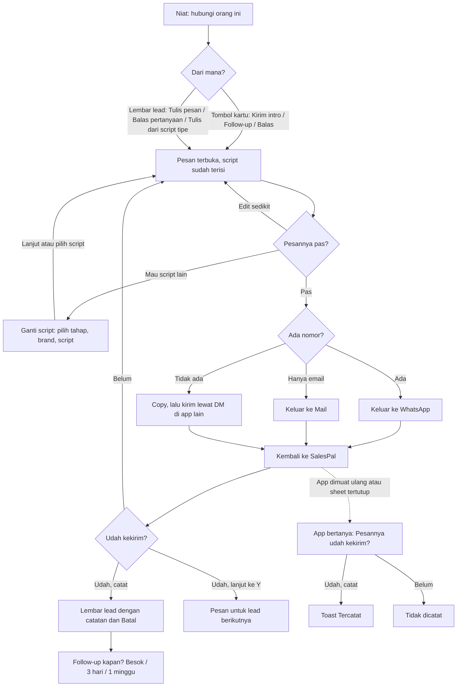

# Pesan ke lead: arsitektur interaksi

**Kode:** `components/ChatPicker.tsx` (ChatPicker, NextMessage, `leadStage`), `components/LeadDetail.tsx` (`useChatLog`, `ChatNote`, `chatLead`), `lib/pendingSend.ts`, `components/PendingSends.tsx`, `components/SalesTracker.tsx` (`logContact`, `record` untuk PendingSends), `lib/templates.ts` (`fillTemplate`, `leadData`), `lib/scriptPick.ts` (`rankScripts`) · **Artefak lama:** E7, D1, D5, B2, B5, C3 · **Pola:** [patterns.md](../patterns.md) · **Keputusan:** [DEC-001, DEC-002, DEC-004, DEC-012](../decisions.md); AMB-06, AMB-08, AMB-13, AMB-16, AMB-17, AMB-23 di [ambiguities.md](../ambiguities.md), [script-chat.md](../script-chat.md), PRD-024, PRD-025

## 1. Why

- **Masalah yang diselesaikan:** penjual mengetik pesan yang sama berulang-ulang, lupa menyebut kebutuhan orangnya, dan setelah mengirim lewat WhatsApp tidak ada catatan bahwa orang itu sudah dihubungi. Tanpa catatan, follow-up tidak terjadwal dan daftar lead berbohong.
- **Kenapa di SalesPal:** WhatsApp bisa mengirim, tapi tidak tahu tahap percakapan, script mana yang cocok untuk tipe bisnis orang itu, dan tidak melapor balik bahwa pesan terkirim. SalesPal menyiapkan pesan dari script sendiri, terisi data lead, lalu bertanya "udah kekirim?" supaya *Terkirim* berarti dikonfirmasi (Glossary).
- **Yang ingin diselesaikan pengguna di sini:** mengirim pesan yang pas ke orang ini, secepat mungkin, dan memastikan kirimannya tercatat.
- **Yang BUKAN tugas feature ini:**
  - Membuat atau mengedit script. Itu Script pesan (Kelola).
  - Mengirim dari dalam app. WhatsApp tetap yang mengirim.
  - Membaca balasan atau maksudnya (AMB-19, script-chat.md §3).
  - Mengirim penawaran PDF atau tagihan; itu jalan kirim lain (AMB-08).

## 2. User goal

> "Saya ingin kirim pesan yang sudah terisi dan cocok buat dia, tinggal cek sedikit lalu kirim di WhatsApp, tanpa harus mencatat sendiri bahwa saya sudah menghubunginya."

Tujuan sampingan:
- "Saya ingin ganti ke script lain kalau yang dipilihkan kurang pas, tanpa kehilangan yang sudah saya tulis."
- "Saya ingin langsung lanjut ke lead berikutnya setelah kirim."
- "Kalau saya salah bilang 'udah', saya ingin membatalkannya."
- "Kalau saya pergi ke WhatsApp dan app-nya tertutup, saya tidak mau kirimannya hilang."

## 3. User state

| State | Apa yang benar saat ini | Persisten | Siapa yang mengubahnya |
|---|---|---|---|
| Menulis (langkah 1) | Teks terisi dari script terbaik untuk tahap ini, atau draft yang dibawa | Tidak (state ChatPicker) | Sistem mengisi, penjual mengedit |
| Teks sudah disentuh | `touched`: penjual mengetik atau memilih script sendiri; isi otomatis berhenti | Tidak (ref) | Penjual. Direset oleh tap Tahap dan ganti Brand |
| Memilih script (langkah 2, HP) | Daftar script tahap ini, chip Tahap, Brand, Cari | Brand di `localStorage` (`sp-script-brand`); sisanya tidak | Penjual |
| **Hanya di kepala penjual:** pesan terkirim di WhatsApp | WhatsApp tidak melapor balik | - | Penjual |
| Menunggu jawaban "udah kekirim?" (langkah 3) | Satu pertanyaan tertunda, dimiliki layar ini | `sessionStorage` `sp-pending-sends`, maksimal 12 jam | ChatPicker (`addPending`) |
| Pertanyaan yatim | Layar penanya hilang (ditutup, reload, pindah lead); app yang bertanya | `sessionStorage` | `release`, lalu PendingSends |
| Terkirim (dikonfirmasi) | `lastContact` + `contactedAt` = hari ini, satu baris Outreach "Sent" | Firestore `leads`, `outreach` | `logContact` |
| Sudah dihitung hari ini | Kiriman kedua di hari yang sama tidak menulis apa pun | Firestore `contactedAt` + ref sesi | `logContact` |
| Catatan chat dengan Batal | Undo kiriman tersedia | Tidak (state lembar lead) | `useChatLog` |
| Dibatalkan | Lead dan Outreach kembali seperti sebelum konfirmasi | Firestore | Batal di ChatNote |

## 4. Experience flow



Penjual membuka Pesan dan langsung melihat pesan jadi, dengan alasan singkat kenapa script itu dipilih. Kebanyakan hanya mengedit sedikit lalu menekan Kirim di WhatsApp. Saat itu SalesPal ditinggal: penjual berada di WhatsApp, mungkin lama, dan iOS bisa memuat ulang app. Kembali ke SalesPal, pertanyaan "Pesannya udah kekirim?" sudah menunggu, di layar Pesan yang sama atau, kalau layar itu sudah hilang, di sheet app. Setelah "Udah, catat", penjual melihat catatan "✓ Dicatat" dengan Batal dan pilihan kapan follow-up. Kalau ia memilih lanjut ke lead berikutnya, catatan dan Batal untuk lead sebelumnya tidak ikut (AMB-17).

## 5. Decision flow

**Sistem: tahap apa yang cocok?** (`leadStage`, `ChatPicker.tsx:30-36`)

```
Status lead?
├── Closed → ETB
├── Ada penawaran Terkirim / Disetujui → Closing
├── Hot → Penawaran
├── Warm → Gali kebutuhan
└── Lainnya (Cold, Lost) → sudah ada lastContact? Follow-up : Intro
      ├── Cold yang sudah membalas → Follow-up, bukan Gali  ⚠ GAP-PSN-8
      └── Gugur (Lost) → tetap dapat Intro / Follow-up  ⚠ GAP-PSN-8
```

Siapa: sistem, tanpa memberi tahu dasar tahapnya selain titik "●" pada chip tahap. AMB-23 sudah memutuskan tahap mengikuti Posisi; belum dibangun.

**Sistem: script mana yang dipasang?** (`useScripts`, `ChatPicker.tsx:41-50`; `rankScripts`, `lib/scriptPick.ts:47-72`)

```
Script yang boleh dipakai?
├── Diarsip → keluar
├── Workflow Hunting → keluar
├── Brand dipilih dan script punya brand lain → keluar
├── Ditandai untuk tipe bisnis lain → keluar
└── Sisanya, di tahap ini → urut: default dulu, lalu skor (tipe bisnis, kata kebutuhan/pain)
      ├── Ada → script teratas diisi + "Dipilih otomatis …: {alasan}"
      └── Tidak ada → teks "Halo {nama}, " + "Belum ada script {tahap} buat Leads"
```

Siapa: sistem, sampai penjual menulis atau memilih sendiri. UI membantu dengan alasan pilihan dan label "Paling cocok".

**Sistem: isi script dengan apa?** (`leadData`, `lib/templates.ts:168-170`; `fillTemplate`, `:98`)

```
Variabel di script?
├── {nama} → nama kontak, atau nama bisnis
├── {kebutuhan} → profil.need dari lead; kosong kalau dia belum bilang (tidak pernah diisi dari tawaran kita)
├── {tawaran} → tagline bisnis kita
├── {bisnis} → nama bisnis kita
├── {waktu}, {lokasi}, {post} → kosong di Leads
└── Variabel kosong di dalam [ ] → potongan itu hilang; di luar [ ] → kalimatnya hilang
```

**Penjual: pesannya pas?**

```
Pas?
├── Ya → Kirim
├── Perlu diubah sedikit → edit di kotak (isi otomatis berhenti)
└── Perlu script lain
      ├── HP: Ganti script → langkah 2 → pilih script / Lanjut → langkah 1
      │     └── Back / Escape / scrim di langkah 2 → seluruh Pesan tertutup, tulisan hilang  ⚠ GAP-PSN-1
      ├── Laptop: daftar ada di samping kotak
      └── Tap chip Tahap atau ganti Brand → teks yang sudah diketik diganti tanpa ditanya  ⚠ GAP-PSN-7
```

**Penjual: kirim lewat apa?** (ditentukan sistem dari data lead)

```
Data kontak?
├── Ada nomor → "Kirim di WhatsApp" (tab baru) → langkah 3 langsung saat tap
│     └── Copy saja, lalu tempel sendiri di WA → tidak ada pertanyaan, tidak tercatat  ⚠ GAP-PSN-13
├── Hanya email → "Kirim lewat email" (mailto) → langkah 3
│     └── Tercatat sebagai Outreach tipe "WhatsApp"  ⚠ GAP-PSN-12
└── Tidak ada → "Belum ada nomor: copy, lalu kirim lewat DM" → Copy berhasil → langkah 3
```

**Penjual: udah kekirim?** (langkah 3)

```
Udah kekirim?
├── Udah, catat (atau "Udah, selesai dulu" kalau ada lead berikutnya)
│     ├── Pertanyaan dihapus dari antrean, sheet tertutup seketika
│     ├── Tulisan berjalan tanpa tanda apa pun di layar  ⚠ GAP-PSN-4
│     ├── Berhasil → ChatNote "✓ Dicatat: chat hari ini" + Batal
│     ├── Sudah dihitung hari ini → ChatNote "✓ Kontak hari ini udah kecatat" tanpa Batal; pesan ini tidak masuk Riwayat  ⚠ GAP-PSN-9
│     └── Gagal → ChatNote merah, tanpa tombol ulangi; pertanyaannya sudah hilang  ⚠ GAP-PSN-4
├── Udah, lanjut ke Y
│     └── Lembar X diganti lembar Y + Pesan Y; catatan, Batal, dan error X hilang  ⚠ GAP-PSN-3
├── Belum, balik ke pesan → pertanyaan dihapus, kembali ke langkah 1 dengan teks utuh
└── Back / Escape / ✕ → sheet tertutup tanpa jawaban
      └── Pertanyaan dilepas; ~400 ms kemudian sheet app menanyakan lagi  ⚠ GAP-PSN-2
```

**Penjual: pertanyaan dari app (PendingSends)**

```
Pesan ke X udah kekirim? (sheet app, juga setelah reload)
├── Udah, catat → logContact → toast "✓ Tercatat: pesan ke X" tanpa Batal  ⚠ GAP-PSN-5
│     ├── Lead sudah dihapus → "… ga bisa dicatat: datanya udah ga ada."
│     └── Gagal → "Belum kecatat. Cek koneksi lalu tap Udah lagi." (ulangi tersedia)
├── Belum → dihapus
└── Tutup sheet (× / scrim / Back) → semua pertanyaan dihapus, sama dengan Belum, tanpa pesan  ⚠ GAP-PSN-6
```

**Sistem: kapan pertanyaan ditanyakan?**

```
Kapan langkah 3 muncul?
├── Saat tap Kirim di WhatsApp / email / Copy (sebelum penjual pergi)  ⚠ GAP-PSN-10
└── Saat kembali ke app (visibilitychange) hanya untuk pertanyaan yatim
```

## 6. Interaction flow

```
AKSI        Buka Pesan
WHY         Pesan berikutnya harus satu ketukan dari tempat penjual memutuskan
STATE       Dari tombol kartu (start "chat"), Tulis pesan di Pesan berikutnya, Balas pada pertanyaan, Tulis pesan dari script tipe customer
DECISION    Tidak ada; sistem sudah memilih tahap dan script
INTERACTION Sheet layar penuh "Pesan ke {nama}" di atas lembar lead
CONSTRAINT  Dari tombol kartu, lembar di bawahnya belum pernah dilihat
CONSEQUENCE Menutup Pesan yang dibuka langsung juga menutup lembar (`direct`)
FEEDBACK    Teks terisi + "Dipilih otomatis buat {tipe}: {alasan}"
RECOVERY    ✕ / Back: ke lembar, atau ke daftar kalau dibuka dari kartu
```

```
AKSI        Edit teks
WHY         Script adalah titik awal, bukan pesan final
STATE       Langkah 1 (HP) atau kolom kanan (laptop)
DECISION    "Apa yang perlu disesuaikan untuk dia?"
INTERACTION Textarea 16px, autofocus hanya di laptop
CONSTRAINT  Isi otomatis jalan lagi saat tahap atau brand berganti
CONSEQUENCE Mengetik mematikan isi otomatis (`touched`) dan menghapus label "Dipilih otomatis"
FEEDBACK    Teks berubah
RECOVERY    Tidak ada undo; tap Tahap atau Brand menimpa tulisan (GAP-PSN-7)
```

```
AKSI        Ganti script (langkah 2, HP)
WHY         Script yang dipilihkan tidak selalu pas
STATE       Langkah 1 di HP. Di laptop daftar selalu tampil di samping
DECISION    Tahap, brand, script
INTERACTION Tombol "Ganti script" → langkah 2 di sheet yang sama: chip Tahap (● = tahap yang cocok), Brand, Kelola, Cari (>3 script), daftar; "Lanjut" atau tap script → langkah 1
CONSTRAINT  Langkah adalah state internal ChatPicker; Sheet tidak diberi `onBack`
CONSEQUENCE Back, Escape, dan scrim menutup seluruh Pesan, bukan kembali ke langkah 1 (AMB-16)
FEEDBACK    Script terpilih bergaris biru, "Paling cocok" pada yang teratas dengan skor
RECOVERY    Hanya "Lanjut" atau tap script. Back membuang tulisan (GAP-PSN-1)
```

```
AKSI        Kirim di WhatsApp / Kirim lewat email
WHY         WhatsApp yang mengirim; SalesPal hanya menyiapkan
STATE       Ada nomor (WhatsApp) atau hanya email; tombol nonaktif kalau teks kosong
DECISION    "Kirim sekarang"
INTERACTION Link eksternal (wa.me di tab baru / mailto), langkah 3 dipasang saat tap
CONSTRAINT  WhatsApp tidak melapor balik; iOS bisa memuat ulang PWA saat ditinggal
CONSEQUENCE Pertanyaan disimpan di antrean sessionStorage sejak langkah 3 tampil (AMB-06)
FEEDBACK    App lain terbuka; saat kembali, "Pesannya udah kekirim?"
RECOVERY    Belum → kembali ke teks. Kalau layar hilang, sheet app bertanya
```

```
AKSI        Copy
WHY         Lead DM tanpa nomor, atau penjual mau tempel sendiri
STATE       Selalu, kalau teks tidak kosong
DECISION    Tidak ada
INTERACTION Clipboard
CONSTRAINT  Clipboard bisa ditolak browser
CONSEQUENCE "Gagal copy" di tombol
FEEDBACK    "✓ Tersalin" 2 dtk. Tanpa nomor: langsung langkah 3
RECOVERY    Ulangi. Dengan nomor, Copy tidak pernah menanyakan "udah kekirim?" (GAP-PSN-13)
```

```
AKSI        Udah, catat / Udah, selesai dulu
WHY         Terkirim = dikonfirmasi penjual (Glossary, AMB-08)
STATE       Langkah 3
DECISION    "Pesan ini benar-benar keluar"
INTERACTION Tap → pertanyaan dihapus, sheet tertutup, tulisan berjalan di belakang
CONSTRAINT  logContact sekali per lead per hari; tulisan bisa gagal atau menunggu sinyal
CONSEQUENCE ChatNote baru muncul setelah tulisan selesai
FEEDBACK    ChatNote "✓ Dicatat: chat hari ini" + Batal + Follow-up kapan?
RECOVERY    Batal membalik lead dan Outreach. Error tanpa ulangi dan pertanyaannya sudah hilang (GAP-PSN-4)
```

```
AKSI        Udah, lanjut ke {Y}
WHY         Bekerja beruntun tanpa kembali ke daftar
STATE       Langkah 3, kalau ada lead berikutnya yang langkahnya chat di daftar yang sama
DECISION    "Sudah, lanjut"
INTERACTION Catat X, lalu `openLead(Y, "chat", runList)`: lembar Y + Pesan Y
CONSTRAINT  LeadPage diberi key per lead, jadi lembar X dibuang
CONSEQUENCE Catatan X (undo dan error) tidak punya tempat lagi
FEEDBACK    Pesan Y terbuka; tidak ada tanda X tercatat
RECOVERY    Tidak ada untuk X (GAP-PSN-3, AMB-17)
```

```
AKSI        Belum, balik ke pesan
WHY         WhatsApp gagal terbuka, atau penjual berubah pikiran
STATE       Langkah 3
DECISION    "Belum terkirim"
INTERACTION Tap → langkah 1
CONSTRAINT  -
CONSEQUENCE Pertanyaan dihapus; teks dipertahankan
FEEDBACK    Kotak pesan kembali
RECOVERY    Kirim lagi memasang pertanyaan baru
```

```
AKSI        Batal di ChatNote
WHY         Salah bilang "udah"
STATE       Selama ChatNote tampil dan lembar yang sama terbuka; tidak ada kalau hari ini sudah dihitung
DECISION    "Itu belum terkirim"
INTERACTION Tap di catatan menetap
CONSTRAINT  Undo menulis dua dokumen
CONSEQUENCE Tombol nonaktif selama menulis
FEEDBACK    "Dibatalin, ga dicatat."
RECOVERY    Error di tempat + ulangi. Jadwal yang dipasang lewat "Follow-up kapan?" tidak ikut dibatalkan
```

```
AKSI        Follow-up kapan? (Besok / 3 hari / 1 minggu)
WHY         Setelah kirim, langkah berikutnya adalah menunggu dengan tanggal
STATE       ChatNote, kalau tidak ada jadwal di depan dan tidak ada error
DECISION    Kapan menindaklanjuti
INTERACTION Satu tap, menulis nextAction "Follow-up" + tanggal
CONSTRAINT  -
CONSEQUENCE Baris berubah jadi "Follow-up berikutnya {tanggal}"
FEEDBACK    Perubahan baris itu (terlihat langsung, sesuai AMB-13)
RECOVERY    Error di tempat. Tanpa Batal; ubah lewat Jadwal
```

```
AKSI        Jawab sheet app (PendingSends)
WHY         Pertanyaan yang layarnya hilang tidak boleh hilang juga (AMB-06)
STATE       Ada pertanyaan yatim di ruang kerja ini, saat app terlihat
DECISION    Udah / Belum per pesan
INTERACTION Sheet bawah "Pesannya udah kekirim?" atau "{n} pesan belum dikonfirmasi"
CONSTRAINT  Layar asal tidak ada, jadi ChatNote tidak bisa dipakai
CONSEQUENCE Feedback lewat toast app
FEEDBACK    "✓ Tercatat: pesan ke X", tanpa Batal (GAP-PSN-5)
RECOVERY    Error dengan "tap Udah lagi". Menutup sheet = Belum untuk semua (GAP-PSN-6)
```

## 7. Component map

```
Pintu masuk
├── Pesan berikutnya (tahap + script teratas + Tulis pesan)      ChatPicker.tsx (NextMessage)
├── Tombol kartu (start "chat")                                  LeadCard.tsx, SalesTracker.tsx (openLead)
└── Balas pertanyaan, Tulis dari script tipe                     LeadDetail.tsx

Persiapan pesan
├── Tahap untuk lead                                             ChatPicker.tsx (leadStage)
├── Daftar dan peringkat script                                  ChatPicker.tsx (useScripts), lib/scriptPick.ts (rankScripts)
├── Isi variabel                                                 lib/templates.ts (leadData, fillTemplate)
├── Data lead untuk pesan                                        LeadDetail.tsx (chatLead)
└── Langkah 2: Tahap, Brand, Kelola, Cari, daftar                ChatPicker.tsx

Aksi utama
├── Kotak pesan                                                  ChatPicker.tsx
└── Kirim di WhatsApp / email / Copy                             ChatPicker.tsx, lib/billing (waLink)

Konfirmasi
├── Langkah 3: Udah, catat / lanjut ke Y / selesai dulu / Belum  ChatPicker.tsx
├── Antrean pertanyaan (sessionStorage, milik layar)             lib/pendingSend.ts
└── Sheet app untuk pertanyaan yatim                             PendingSends.tsx, SalesTracker.tsx (record)

Pencatatan
└── Kontak hari ini + Outreach, dengan undo                      SalesTracker.tsx (logContact)

Pemulihan
├── Pemilik sheet Pesan, ChatNote state, `direct`                LeadDetail.tsx (useChatLog)
└── ChatNote: Batal, Follow-up kapan?                            LeadDetail.tsx (ChatNote)

Infrastruktur dialog
└── Sheet full, onBack (tidak dipakai di sini), Back/Escape      Sheet.tsx, ModalA11y.tsx
```

## 8. Navigation map

**Datang dari:**
- Lembar lead: Tulis pesan (Pesan berikutnya), Balas pada "Yang mereka tanya" (draft "Halo {nama}, "), Tulis pesan di script tipe customer (draft script keberatan).
- Tombol kartu Leads (Jualan, Hunting › Leads): lembar dibuka dengan Pesan langsung di atasnya.
- "Udah, lanjut ke {Y}" dari Pesan lead sebelumnya.

**Pergi ke:**

| Tujuan | Jenis | Permukaan |
|---|---|---|
| Langkah 2 (pilih script) | Langkah di dalam sheet | Sheet penuh yang sama |
| Langkah 3 (udah kekirim?) | Langkah di dalam sheet | Sheet penuh yang sama |
| Kelola script | Overlay | ScriptManager di atas Pesan |
| WhatsApp (wa.me) | Eksternal | Tab / app baru |
| Mail (mailto) | Eksternal | App Mail |
| Lead berikutnya | Overlay diganti | Lembar Y + Pesan Y |
| Sheet app "udah kekirim?" | Overlay app | Sheet bawah, di atas apa pun |

**Kembali:**
- ✕ di judul sheet, Back, Escape, scrim: menutup seluruh Pesan dari langkah mana pun. Ke lembar lead, atau ke daftar kalau Pesan dibuka dari tombol kartu. Teks yang ditulis hilang (GAP-PSN-1).
- Dari langkah 3 tanpa jawaban: pertanyaan dilepas dan ditanyakan sheet app (GAP-PSN-2).
- Dari WhatsApp: SalesPal yang sama, di langkah 3. Kalau iOS memuat ulang app, Pesan dan lembar lead tidak kembali; yang kembali hanya pertanyaannya, lewat sheet app (sessionStorage).
- Brand yang dipilih diingat di `localStorage`; tahap, pencarian, dan teks tidak.

## 9. Feedback & recovery

| Aksi | Pending | Sukses | Error | Undo / retry / pemulihan | Masalah |
|---|---|---|---|---|---|
| Kirim di WhatsApp / email | - | Langkah 3 seketika | WA gagal terbuka: tidak terdeteksi | Belum → teks | Pertanyaan muncul sebelum pergi (GAP-PSN-10) |
| Copy | - | "✓ Tersalin" 2 dtk | "Gagal copy" | Ulangi | Dengan nomor, tidak ditanya dan tidak tercatat (GAP-PSN-13) |
| Udah, catat | Tidak terlihat (sheet sudah tertutup) | ChatNote + Batal | ChatNote merah, tanpa ulangi | Batal selama lembar terbuka | Error tanpa retry, pertanyaan sudah hilang (GAP-PSN-4) |
| Udah (sudah dihitung hari ini) | Tidak terlihat | "✓ Kontak hari ini udah kecatat" | - | - | Pesan ini tidak masuk Riwayat (GAP-PSN-9) |
| Udah, lanjut ke Y | Tidak terlihat | Pesan Y terbuka | Hilang | Tidak ada | Undo dan error X hilang (GAP-PSN-3) |
| Belum, balik ke pesan | - | Langkah 1, teks utuh | - | Kirim lagi | Benar |
| Tutup di langkah 3 | - | Sheet app bertanya lagi | - | Jawab di sheet app | Ditanya dua kali, bukan "Belum" (GAP-PSN-2) |
| Back di langkah 2 | - | Pesan tertutup | - | Buka lagi, tulis ulang | Tulisan hilang (GAP-PSN-1) |
| Tap Tahap / ganti Brand | - | Teks baru | - | Tidak ada | Tulisan diganti tanpa ditanya (GAP-PSN-7) |
| Batal di ChatNote | Tombol nonaktif | "Dibatalin, ga dicatat." | Teks di tempat | Ulangi | Jadwal follow-up tidak ikut dibatalkan |
| Follow-up kapan? | Tombol nonaktif | Baris jadi "Follow-up berikutnya {tanggal}" | Teks di tempat | Ubah lewat Jadwal | Cukup (terlihat langsung) |
| Udah, catat di sheet app | "Menyimpan…" | Toast "✓ Tercatat: …" | "Belum kecatat … tap Udah lagi" | Ulangi | Tanpa Batal (GAP-PSN-5) |
| Tutup sheet app | - | Sheet hilang | - | Tidak ada | Semua jadi Belum, diam (GAP-PSN-6) |
| Semua tulisan saat offline | Tidak terlihat | Belum diverifikasi | - | - | ChatNote menunggu commit dari server (GAP-PSN-11) |

## 10. Design rationale

- **Kenapa Pesan langsung terbuka di langkah tulis dengan script terisi?** Keputusan paling sering adalah "kirim yang ini". Membuka di daftar script memaksa satu keputusan yang biasanya sudah dibuat sistem. Benar, dengan syarat tahapnya benar; sekarang tahap dibaca dari Status (GAP-PSN-8, AMB-23).
- **Kenapa isi otomatis berhenti saat penjual menulis?** Tulisan penjual lebih berharga daripada tebakan sistem. Pola ini benar, tetapi tap Tahap dan ganti Brand mereset `touched`, sehingga melihat-lihat tahap lain menghapus tulisan (GAP-PSN-7). Pola yang benar: isi otomatis hanya mengganti teks yang belum disentuh.
- **Kenapa "udah kekirim?" ditanyakan, bukan diasumsikan?** WhatsApp tidak melapor balik, dan Glossary mendefinisikan Terkirim sebagai dikonfirmasi penjual. Mencatat saat tap akan menghitung pesan yang tidak jadi dikirim (AMB-08). Benar.
- **Kenapa pertanyaannya disimpan di sessionStorage?** Penjual meninggalkan app untuk mengirim, dan iOS sering memuat ulang PWA. Pertanyaan yang hidup di layar hilang bersama layarnya (AMB-06). Benar dan sudah dibangun. Kekurangannya ada di tepi: menutup sheet app menghapus semua tanpa bilang (GAP-PSN-6), dan jawaban di sheet app tidak bisa dibatalkan (GAP-PSN-5).
- **Kenapa langkah-langkah di dalam satu sheet?** Di HP, satu layar penuh dengan satu tugas lebih mudah daripada sheet bertumpuk. Tapi langkah di dalam sheet harus punya Back sendiri: pilih → tulis, tulis → tutup, udah kekirim? → Belum (AMB-16). `Sheet` sudah mendukung `onBack`; ChatPicker belum memakainya (GAP-PSN-1, GAP-PSN-2).
- **Kenapa feedback kiriman berupa catatan menetap dengan Batal?** Salah "udah" mengubah angka harian dan Posisi, jadi harus bisa dibalik (AMB-13). Catatan menetap benar untuk lembar yang sama. Masalahnya, catatan itu milik lembar: "lanjut ke Y" membuangnya (GAP-PSN-3), dan jawaban lewat sheet app tidak punya Batal sama sekali (GAP-PSN-5). AMB-17 memutuskan undo milik app.
- **Kenapa sekali per hari?** Satu kontak per hari adalah unit yang dibaca Posisi dan Dashboard tim. Masuk akal untuk angka, tapi Riwayat kehilangan pesan kedua (GAP-PSN-9).
- **Kenapa sheet tertutup sebelum tulisan selesai?** Supaya terasa cepat. Pola yang benar menurut AMB-13: kalau gagal, teks di tempat + aksi yang bisa diulang. Karena pertanyaan sudah dihapus dan sheet sudah tertutup, tidak ada yang bisa diulang (GAP-PSN-4).

## 11. Current implementation

Per 6 Nov 2026.

- **Pemilik sheet.** `useChatLog` (`LeadDetail.tsx:300-332`) menyimpan `writing` (draft atau `true`), `direct` (dibuka dari tombol kartu), `managing`, dan `logged`. Sheet `full` berjudul "Pesan ke {kontak atau nama}" tanpa `onBack`; `onClose` menutup dan, kalau `direct`, juga menutup lembar (`:323`). `onSend` memanggil `chatted(what)` lalu menutup sheet (`:325`). `chatted` menunggu `onContacted` dan baru mengisi `logged` (`:302-307`).
- **Data untuk pesan.** `chatLead` (`LeadDetail.tsx:291-298`): kategori dari WA dulu, `need` dan `pain` dari profil.
- **Tahap.** `leadStage` dari Status dan `quoted` (`ChatPicker.tsx:30-36`). NextMessage di lembar memakai fungsi yang sama dan brand tersimpan (`:199-216`).
- **Script.** `useScripts` menyaring arsip, workflow Hunting, dan brand, lalu `rankScripts` per tahap dan membuang `out`; default diurut pertama (`ChatPicker.tsx:41-50`). `fill` = `fillTemplate(body, leadData(lead, business))` (`:48`). `leadData` mengisi `nama`, `kebutuhan` (need lead), `tawaran` (tagline), `bisnis` (`lib/templates.ts:168-170`). Variabel kosong menghapus potongannya (`lib/templates.ts:93-98`, FALLBACK `:90`).
- **Isi otomatis.** `touched` ref (`ChatPicker.tsx:81`); efek memasang script terbaik pada perubahan `stage`, `brand`, jumlah script, nama bisnis (`:82-88`). Chip Tahap menyetel `touched.current = false` (`:137`); `pickBrand` juga (`:99-102`). Mengetik menyetel `touched = true` (`:175`).
- **Langkah.** `step` mulai di "write" (`:70`). HP: "Ganti script" → "pick" (`:173`), "Lanjut" atau tap script → "write" (`:169`, `:78`). Laptop: dua kolom berdampingan (`:124-133`).
- **Kirim.** WhatsApp: `<a href={waLink(phone, text)} target="_blank" onClick={() => setStep("sent")}>` (`:183`). Email: `mailto` → "sent" (`:186`). Tanpa kontak: Copy berhasil → "sent" hanya bila tidak ada nomor (`:178`).
- **Antrean.** Masuk "sent" → `addPending({kind: "lead", label, space, leadId, what})` (`ChatPicker.tsx:93-96`); unmount → `release` (`:97`). Antrean: `sessionStorage` `sp-pending-sends`, kedaluwarsa 12 jam (`lib/pendingSend.ts:25-26`), `addPending` / `removePending` / `release` / `orphans` (`:45-65`).
- **Langkah 3.** `answered()` menghapus pertanyaan (`ChatPicker.tsx:112`). "Udah, lanjut ke {Y}" = `answered(); onSend(what); next?.go()` (`:117`). "Udah, selesai dulu" hanya kalau ada `next` (`:118`). "Belum, balik ke pesan" (`:119`). `what` = judul script, judul draft, atau "Chat WhatsApp" (`:92`).
- **Lead berikutnya.** `nextUp` = lead setelah ini di `runList` atau daftar yang tersaring, yang `nextMove`-nya chat (`SalesTracker.tsx:593-595`); `go` = `openLead(nextUp, "chat", runList)` (`:1099`). LeadPage diberi `key` per lead (`:1098`).
- **Pencatatan.** `logContact` (`SalesTracker.tsx:456-477`): keluar tanpa menulis bila `contactedAt` hari ini atau sudah dihitung di sesi; kalau tidak, batch `lastContact` + `contactedAt` dan Outreach `{type: "WhatsApp", subject: what, status: "Sent"}`; undo mengembalikan keduanya.
- **ChatNote.** `LeadDetail.tsx:334-368`: teks (`:340`), Batal bila ada undo (`:352`), "Follow-up kapan?" atau "Follow-up berikutnya {tanggal}" (`:355-365`), disembunyikan saat error atau setelah Batal.
- **Sheet app.** `PendingSends` (`components/PendingSends.tsx`) mengambil pertanyaan yatim 400 ms setelah perubahan dan saat app terlihat lagi (`:91-100`); "Udah, catat" → `record` → toast (`:104-114`); "Belum" (`:115`); tutup menghapus semua (`:116`). `record` untuk lead memanggil `logContact(l, p.what)` dan membuang undo-nya (`SalesTracker.tsx:1107-1116`).
- **Back dan Escape.** ModalA11y mengklik overlay teratas untuk Escape dan Back (`ModalA11y.tsx`, `onKey`, `onPop`); `Sheet` memanggil `onBack || onClose` (`Sheet.tsx:18`).
- **Belum diverifikasi:** perilaku tepat saat offline (apakah `batch.commit()` menggantung sampai sinyal kembali dengan persistensi IndexedDB); apakah flow tes mencakup "lanjut ke Y" dan sheet app untuk lead.

## 12. Known gaps

| ID | Gap | Akibat bagi penjual | Arah perbaikan | Rujukan (AMB / DEC / PR) |
|---|---|---|---|---|
| GAP-PSN-1 | Back, Escape, dan scrim di langkah "Ganti script" menutup seluruh Pesan; Sheet tidak diberi `onBack` per langkah | Swipe-back saat memilih script membuang pesan yang sedang ditulis | `onBack`: pilih → tulis, tulis → tutup | AMB-16 (diputuskan, belum dibangun), PRD-026 R3 |
| GAP-PSN-2 | Back / ✕ di langkah 3 menutup tanpa jawaban; sheet app menanyakan lagi ~400 ms kemudian | Pertanyaan yang sama muncul dua kali di dua bentuk | Back di langkah 3 = Belum, sesuai keputusan | AMB-16 |
| GAP-PSN-3 | "Udah, lanjut ke Y" mengganti lembar X; catatan X, Batal-nya, dan error-nya hilang | Salah konfirmasi di X tidak bisa dibatalkan; kalau X gagal tercatat, tidak ada yang tahu | Undo dan error milik app, bertahan saat pindah orang | AMB-17 |
| GAP-PSN-4 | "Udah, catat" menghapus pertanyaan dan menutup sheet sebelum tulisan selesai; tidak ada tanda menyimpan; gagal = teks merah tanpa ulangi | Kiriman yang benar terjadi tidak tercatat, dan satu-satunya jalan mengulang adalah membuka Pesan lagi dan menjawab ulang | Pertanyaan baru dihapus setelah tulisan berhasil; error dengan aksi ulangi | AMB-13, AMB-06 |
| GAP-PSN-5 | Jawaban "Udah, catat" di sheet app memberi toast tanpa Batal, padahal `logContact` mengembalikan undo | Salah konfirmasi setelah reload tidak bisa dibalik | Toast app dengan Batal 10 dtk | AMB-13, AMB-17 |
| GAP-PSN-6 | Menutup sheet app (×, scrim, Back) menghapus semua pertanyaan, sama dengan Belum, tanpa pesan | Kiriman yang belum dijawab hilang karena satu gesture | Menutup menunda, bukan menjawab; atau bilang apa yang terjadi | AMB-06 |
| GAP-PSN-7 | Tap chip Tahap atau ganti Brand mereset `touched` dan mengganti teks yang sudah ditulis | Melihat-lihat tahap lain menghapus pesan yang sudah disesuaikan, tanpa undo | Isi otomatis hanya mengganti teks yang belum disentuh | script-chat.md |
| GAP-PSN-8 | Tahap dibaca dari Status, bukan Posisi | Lead Cold yang sudah membalas mendapat script Follow-up; lead Gugur masih mendapat Intro / Follow-up | Tahap mengikuti Posisi (tabel AMB-23) | AMB-23 (diputuskan, belum dibangun), C2 masalah 2 |
| GAP-PSN-9 | Kiriman kedua di hari yang sama tidak menulis Outreach | Riwayat dan Log aktivitas tidak menunjukkan pesan kedua | Putuskan: hitung kontak sekali per hari, tapi tetap catat pesannya | C3 |
| GAP-PSN-10 | Langkah 3 dipasang saat tap Kirim, sebelum penjual pergi, bukan saat kembali | Penjual yang kembali tanpa mengirim tetap melihat "udah kekirim?" (bisa dijawab Belum) | Sesuai AMB-06 poin 2: tanya saat app terlihat lagi | AMB-06, D1 |
| GAP-PSN-11 | Saat offline, ChatNote menunggu commit server; tidak ada tanda bahwa kiriman tersimpan di HP (belum diverifikasi di emulator) | Penjual tidak tahu apakah kirimannya tercatat | Anggap tersimpan lokal dan tandai menunggu sinyal | AMB-07 ("Belum") |
| GAP-PSN-12 | Outreach selalu bertipe "WhatsApp", juga untuk email dan Copy ke DM; subjeknya judul script walau teks ditulis ulang | Log aktivitas salah menyebut saluran dan isi | Saluran dan ringkasan isi ikut dicatat | AMB-08, PRD-024 langkah 5 (`channel`) |
| GAP-PSN-13 | Copy pada lead yang punya nomor tidak pernah menanyakan "udah kekirim?" | Penjual yang menempel sendiri di WhatsApp tidak tercatat | Copy mengikuti kontrak kirim yang sama | AMB-08 |
| ✅ | Pertanyaan "udah kekirim?" bertahan saat sheet ditutup, pindah tab, atau iOS memuat ulang PWA (antrean + sheet app) | - | Dibangun | AMB-06, PR setelah #115 |
| ✅ | Pesan yang dibuka dari tombol kartu kembali ke daftar saat ditutup | - | Dibangun | PRD-026 N7, PR #115 |
