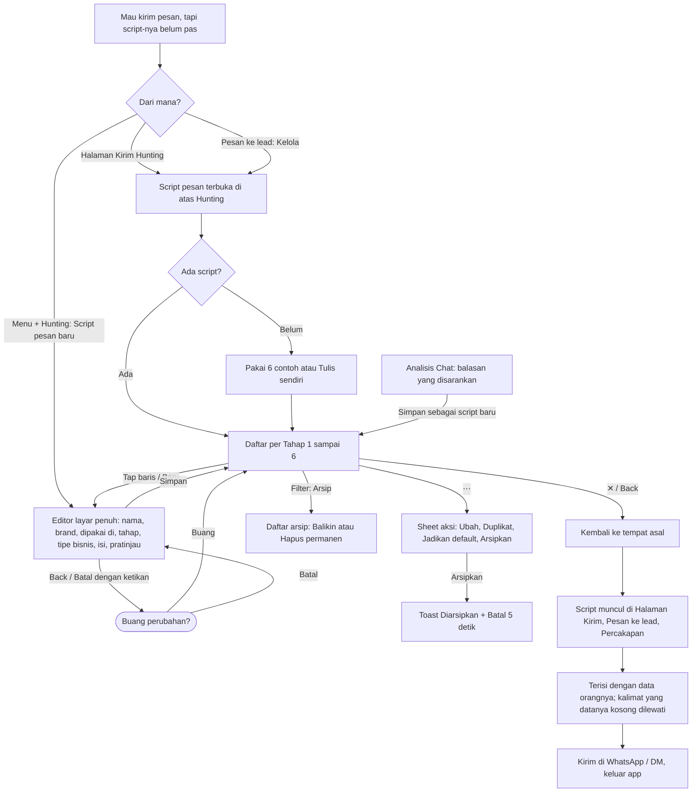

# Script pesan: arsitektur interaksi

**Kode:** `components/ScriptManager.tsx` (daftar + `ScriptEditor`), `lib/templates.ts` (tahap, variabel, `fillTemplate`, `dataFor`, `leadData`), pemakai: `components/TemplateBoard.tsx`, `components/ChatPicker.tsx`, `components/ProspectThread.tsx`, `components/QuickPitch.tsx`, `components/ChatAnalysis.tsx`, pemilih: `lib/scriptPick.ts`, `lib/scriptFit.ts` · **Artefak lama:** E8, D5, D6, D7, B6, C6, A (tabel permukaan) · **Pola:** [P4 Action sheet, P6 Full-screen form, P7 Confirm, P9 Undo, P12 Unsaved changes](../patterns.md) · **Keputusan:** [DEC-012, DEC-013, DEC-014](../decisions.md); [ambiguities.md](../ambiguities.md) AMB-12, AMB-18 sampai AMB-21, AMB-23; PRD-024 §10; PRD-025 §8; usulan [script-chat.md](../script-chat.md)

## 1. Why

- **Masalah yang diselesaikan:** penjual mengirim puluhan pesan pembuka, follow-up, dan penawaran setiap hari. Tanpa Script, setiap pesan diketik ulang atau disalin dari catatan HP, isinya berubah-ubah, dan tidak ada yang bisa diukur ("pesan mana yang dibalas?").
- **Kenapa di SalesPal:** Script di sini tahu **Tahap** percakapan, **Brand**, dan **Workflow**, lalu diisi dengan data orang yang sedang dibuka (nama, yang dia bilang dia cari, yang kita tawarkan). Catatan HP atau Notion tidak bisa mengisi `{nama}` dan tidak tahu orang ini sedang di tahap mana. Angka kirim dan balasan per script juga hanya ada di sini.
- **Yang ingin diselesaikan penjual di sini:** menyimpan dan merapikan pesan siap pakai per tahap, supaya saat mengirim, pesan yang tepat sudah ada.
- **Yang BUKAN tugas feature ini:**
  - Mengirim pesan. Itu tugas Halaman Kirim (Hunting), Pesan ke lead, dan Percakapan.
  - Mencatat hasil atau balasan. Itu tugas Prospek dan Lead.
  - Script keberatan per arketipe di tab Belajar (`components/ScriptLibrary.tsx`). Itu dataset bawaan terpisah, belum masuk koleksi (PRD-024 langkah 6).
  - Menulis pesan dengan AI. Ditunda sampai ada budget (PRD-024 §10 keputusan 4).

## 2. User goal

> "Saya ingin punya satu set pesan per tahap yang tinggal saya kirim ke @tokokue atau Bu Sari dengan nama dan kebutuhannya sudah terisi, tanpa takut pesannya mengarang hal yang mereka tidak pernah bilang."

Tujuan sampingan:
- "Saya ingin menyingkirkan script lama tanpa kehilangan angkanya."
- "Saya ingin satu script jadi pilihan utama di tahap tertentu, dan tahu di mana pilihan itu berlaku."
- "Saya ingin menyimpan balasan bagus dari Analisis Chat jadi script."

## 3. User state

| State | Apa yang benar saat ini | Persisten | Siapa yang mengubahnya |
|---|---|---|---|
| Belum punya script | Koleksi `pitchTemplates` kosong di ruang kerja ini | Firestore | Penjual (Pakai 6 contoh / Tulis sendiri). Quick Pitch juga menanam 2 contoh sendiri di ruang kerja pribadi (`QuickPitch.tsx:58-61`) |
| Menjelajah daftar | Tahap terpilih, kata cari, filter Brand / Dipakai di / Aktif-Arsip | Tidak (state komponen, hilang saat Script pesan ditutup) | Penjual |
| Mengedit, belum disimpan | Ada ketikan yang berbeda dari script asal | Tidak (`dirty` ref) | Penjual |
| Menyimpan | Tulisan sedang dikirim ke Firestore; editor tidak dianggap "ada perubahan" | Tidak | Sistem |
| Script aktif | `archived` kosong; ditawarkan di tempat kirim sesuai Workflow | Firestore | Penjual |
| Script default tahap | `isDefault: true`; urutan pertama di daftar dan di Pesan ke lead | Firestore | Penjual (Jadikan default), sistem (dilepas saat diarsipkan) |
| Baru diarsipkan, undo masih ada | Toast "Diarsipkan" + Batal | Tidak (toast 5 detik) | Penjual |
| Script arsip | `archived: true`; tidak ditawarkan di Hunting, Pesan, Analisis Chat; **masih muncul di Quick Pitch** | Firestore | Penjual |
| Dihapus permanen | Dokumen hilang; angka kirim yang sudah tercatat tetap ada | Firestore | Penjual, lewat ConfirmSheet |
| **Hanya di kepala penjual:** "script mana yang akan muncul untuk orang ini" | Sistem memutuskan dengan aturan berbeda per tempat (§5), tanpa menunjukkannya di Script pesan | Tidak ada | Tidak ada (⚠ GAP-SCR-4) |
| **Hanya di kepala penjual:** "pesan ini sudah terkirim" | WhatsApp dan DM tidak melapor balik. Di luar feature ini; ditangani "Udah kekirim?" di tempat kirim | Tidak | Penjual |

## 4. Experience flow



Penjual biasanya datang ke sini **di tengah kerja kirim**, bukan sebagai tugas sendiri. Karena itu jalan pulang ke asal penting: ✕ dan Back di daftar menutup Script pesan dan mengembalikan Halaman Kirim atau Pesan ke lead seperti semula. Momen paling rawan adalah editor: ketikan panjang bisa hilang, jadi setiap jalan keluar bertanya dulu. Sesudah menyimpan, penjual kembali ke daftar tanpa tanda apa pun (⚠ GAP-SCR-1), lalu kembali ke tempat kirim dan berharap script barunya muncul di sana. Di Hunting, script yang baru dibuat tidak terpilih otomatis (⚠ GAP-SCR-13), dan script default tidak didahulukan (⚠ GAP-SCR-3).

## 5. Decision flow

**Penjual: perlu script baru atau ubah yang ada?**
```
Pesannya kurang pas untuk orang ini?
├── Hanya untuk orang ini → ubah teks di tempat kirim (kotak pesan / Saran), script tidak berubah
└── Untuk semua orang di tahap ini
    ├── Isinya berubah sedikit → Ubah script
    └── Isinya berubah banyak → Duplikat lalu ubah, supaya angka evaluasi tidak tercampur
        (hanya editor TemplateBoard yang mengingatkan ini, TemplateBoard.tsx:267; ScriptEditor tidak)
```
Diputuskan penjual. UI membantu sebagian: pratinjau terisi, tapi saran "bikin baru kalau berubah banyak" tidak ada di editor utama.

**Penjual: script lama dibuang bagaimana?**
```
Script tidak dipakai lagi?
├── Mungkin dipakai lagi / angkanya mau disimpan → Arsipkan (Batal 5 detik)
└── Pasti tidak → harus Arsipkan dulu, lalu Filter: Arsip → ⋯ → Hapus permanen → ConfirmSheet
```
Diputuskan penjual, dibantu UI (keterangan "Disembunyiin, angkanya tetap", Hapus hanya dari Arsip). Jalan pintas yang melanggar ini: ikon hapus di Quick Pitch dan tombol Hapus di editor kartu Hunting menghapus permanen tanpa arsip (⚠ GAP-SCR-7, ⚠ GAP-SCR-8).

**Penjual: jadikan default?**
```
Script ini pilihan utama di tahapnya?
├── Ya → Jadikan default → default lama di tahap itu dilepas
│   ├── Pesan ke lead → didahulukan dan terisi otomatis
│   ├── Halaman Kirim Hunting → ⚠ diabaikan, urut judul (GAP-SCR-3)
│   ├── Saran (kartu biru Hunting) → ⚠ diabaikan
│   └── Percakapan → ⚠ diabaikan
└── Tidak → urutan judul
```
Keterangan di tombol bilang "Dipakai otomatis di tahap ini" (`ScriptManager.tsx:263`). Itu hanya benar di Pesan ke lead. Sistem memutuskan perbedaannya tanpa sepengetahuan penjual (⚠ GAP-SCR-3, ⚠ GAP-SCR-4).

**Sistem: script mana yang ditawarkan, di mana?**
```
Tempat kirim?
├── Pesan ke lead (ChatPicker)
│   ├── buang: arsip, Workflow "hunting", Brand lain (brand diingat per perangkat)
│   ├── tahap: dari Status lead, bukan Posisi (⚠ GAP-SCR-16, AMB-23)
│   ├── buang: script bertanda tipe bisnis lain (rankScripts out)
│   ├── urut: skor kecocokan, lalu default ditaruh paling atas (⚠ GAP-SCR-5)
│   └── terisi otomatis: script teratas, dengan alasan "Dipilih otomatis …"
├── Halaman Kirim Hunting (TemplateBoard)
│   ├── buang: arsip, Workflow "leads"
│   ├── Brand: ⚠ tidak disaring (GAP-SCR-6)
│   ├── tahap: dari status prospek (stageFor), bisa diganti chip
│   ├── urut: judul A sampai Z
│   └── Saran: kalau post-nya terbaca dan script bisa disesuaikan (suggestForPost)
├── Percakapan prospek (ProspectThread) → daftar sama dengan Hunting, urut judul, kotak pesan kosong sampai dipilih
├── Quick Pitch → ⚠ semua script, termasuk arsip, tanpa tahap/brand/workflow (GAP-SCR-8)
└── Analisis Chat → script aktif dikirim ke mesin untuk dicocokkan
```
Diputuskan sistem. Hanya Pesan ke lead yang menjelaskan pilihannya. Script pesan sendiri tidak menunjukkan aturan ini (⚠ GAP-SCR-4).

**Sistem: kata apa yang mengisi `{variabel}`?**
```
Variabel kosong untuk orang ini?
├── {nama} kosong → "kak"
├── {kebutuhan}
│   ├── ada dari post (context.need) atau lead (need) → diisi
│   ├── kosong, tapi ditulis dalam tanda kutip dan ada post → diganti kutipan post
│   └── kosong → kalimatnya dilewati (tidak pernah diisi default ruang kerja)
├── {tawaran} → Default kalau kosong, lalu "Jasa apa" di Kop; kosong → kalimat dilewati
├── {waktu} / {lokasi}
│   ├── Hunting: dari post, lalu ⚠ default ruang kerja (GAP-SCR-15)
│   └── Lead: tidak ada sumber → kalimat dilewati
├── {post} → kutipan post terakhir (Hunting saja)
├── {bisnis} → satu nama bisnis ruang kerja, ⚠ apa pun Brand script-nya (GAP-SCR-6)
└── bagian dalam [ ] yang variabelnya kosong → hilang
```
Diputuskan sistem (`lib/templates.ts:98-122`). UI membantu di editor: catatan `{kebutuhan}` (`ScriptManager.tsx:394-398`) dan pratinjau. Tapi pratinjau dari Leads memakai data contoh tanpa tanda (⚠ GAP-SCR-11).

**Penjual: keluar dari editor dengan ketikan?**
```
Back / Escape / tap latar / Batal / tap baris lain / ✕ ?
├── Tidak ada ketikan → langsung (ke daftar, ke baris lain, atau ke asal)
└── Ada ketikan → "Buang perubahan?"
    ├── Buang → lanjut ke tujuan tadi
    └── Batal → tetap di editor
```
Dibantu UI di Script pesan. Editor kartu Hunting dan editor Quick Pitch tidak bertanya (⚠ GAP-SCR-7, ⚠ GAP-SCR-8).

## 6. Interaction flow

```
AKSI        Buka Script pesan
WHY         Script yang ada tidak pas, atau belum ada script di tahap ini
STATE       Halaman Kirim Hunting (tombol "Script pesan", menu + "Kelola script pesan"),
            Pesan ke lead ("Kelola"). Tidak ada pintu dari Leads tanpa membuka Pesan
DECISION    Mau merapikan banyak script atau satu saja
INTERACTION Sheet layar penuh di atas asal (Overlay). Fokus awal ke "Semua"
CONSTRAINT  Daftar dimuat live dari Firestore; bisa lambat atau gagal
CONSEQUENCE Tiga baris kerangka saat memuat, pesan koneksi saat gagal, bukan "Belum ada script"
FEEDBACK    Jumlah per tahap di garis tahap
RECOVERY    ✕ / Back → kembali ke asal, asal tidak dibongkar
```

```
AKSI        Pilih tahap / cari / Filter
WHY         Menemukan script di antara banyak
STATE       Daftar terbuka
DECISION    Script mana yang mau diubah atau dibandingkan
INTERACTION Garis tahap 1 sampai 6 + Semua; kotak cari; sheet Filter (Brand, Dipakai di, Aktif/Arsip)
CONSTRAINT  Brand script lama ditebak dari judul/isi (brandOf), Workflow dari isi (workflowOf)
CONSEQUENCE Script tanpa brand ikut tampil di setiap filter brand
FEEDBACK    Badge jumlah filter, chip filter aktif yang bisa dihapus, "Lihat N script", kalimat "kapan" + tip tahap
RECOVERY    Chip × per filter, "Hapus pencarian & filter" di hasil kosong, Reset di sheet
```

```
AKSI        Buat atau ubah script (editor)
WHY         Pesan baru, atau pesan lama yang perlu diperbaiki
STATE       Bisa ubah katalog (ruang kerja pribadi, atau Leader/Officer guild). Member hanya melihat pratinjau
DECISION    Isi pesan, tahap, brand, workflow, tipe bisnis
INTERACTION Layar penuh di HP; master-detail di layar ≥ 1024px (daftar tetap di kiri)
            Chip variabel menyisipkan {kata} di posisi kursor
CONSTRAINT  {kebutuhan} hanya terisi dari yang orangnya bilang; kalimat dengan kata kosong hilang
CONSEQUENCE Catatan di bawah isi kalau {kebutuhan} di luar [ ]; pratinjau langsung
FEEDBACK    Pratinjau; "Menyimpan…"; ⚠ sesudah sukses tidak ada toast (GAP-SCR-1)
RECOVERY    Batal / Back / Escape → "Buang perubahan?" kalau ada ketikan; error simpan tampil di editor, ketikan tetap
```

```
AKSI        Arsipkan
WHY         Script tidak dipakai lagi, tapi angkanya mau disimpan
STATE       Script aktif, dari ⋯
DECISION    Sembunyikan tanpa kehilangan
INTERACTION Sheet aksi → Arsipkan (keterangan "Disembunyiin, angkanya tetap")
CONSTRAINT  Default ikut dilepas, supaya tahap tidak punya default yang tersembunyi
CONSEQUENCE Undo harus mengembalikan default juga
FEEDBACK    Toast "Diarsipkan: …" + Batal
RECOVERY    Batal 5 detik (⚠ 10 detik di Hunting dan Percakapan, GAP-SCR-2); sesudahnya Filter: Arsip → Balikin (default tidak kembali)
```

```
AKSI        Hapus permanen
WHY         Script benar-benar tidak dipakai
STATE       Hanya untuk script arsip
DECISION    Hilangkan selamanya
INTERACTION ⋯ → Hapus permanen (merah, terakhir) → ConfirmSheet
CONSTRAINT  Tidak bisa dibalik
CONSEQUENCE Dua langkah: arsip dulu, lalu konfirmasi
FEEDBACK    Baris hilang dari daftar arsip; tidak ada toast
RECOVERY    Batal di ConfirmSheet; error tampil di ConfirmSheet dengan coba lagi
```

```
AKSI        Pakai script di tempat kirim
WHY         Mengirim pesan yang sudah terisi
STATE       Halaman Kirim, Pesan ke lead, Percakapan, Quick Pitch
DECISION    Script mana untuk orang ini (§5)
INTERACTION Pilih kartu/baris; teks terisi bisa diedit sebelum kirim; handoff ke WhatsApp / DM (Eksternal)
CONSTRAINT  WhatsApp dan DM tidak melapor balik
CONSEQUENCE "Udah kekirim?" sesudah kembali (di luar feature ini)
FEEDBACK    Pesan ke lead menjelaskan "Dipilih otomatis: …"; Hunting tidak menjelaskan urutan
RECOVERY    Ganti script / Balikin saran / edit teks
```

```
AKSI        Simpan sebagai script baru (Analisis Chat)
WHY         Balasan yang disarankan mesin bagus untuk dipakai lagi
STATE       Ada hasil analisis; bisa ubah katalog
DECISION    Nama script; tahap ditebak dari momen yang terdeteksi
INTERACTION Tombol → isian nama → "Simpan script" (busy sampai tulisan selesai)
CONSTRAINT  Selalu dokumen baru; tidak pernah menimpa script yang ada
CONSEQUENCE Tanpa Workflow, Brand, tipe bisnis; Workflow lalu ditebak dari isi
FEEDBACK    Teks di tempat "Tersimpan jadi script …"; ⚠ tanpa jalan ke script itu (GAP-SCR-17)
RECOVERY    Error di tempat, isian tetap
```

Aksi kecil:

| Aksi | Di mana | Interaksi | Feedback | Catatan |
|---|---|---|---|---|
| Pakai 6 contoh | Daftar kosong | Satu tap, batch | Toast "6 contoh ditambah, satu per tahap" | |
| Pakai contoh (satu tahap) | Tahap kosong | Satu tap | Toast "Contoh … ditambah" | |
| Duplikat | ⋯ | Satu tap | Toast "Disalin: … (salinan)" | Default tidak ikut |
| Jadikan default | ⋯ | Satu tap, batch | Toast "… jadi default …" | Tanpa undo; lihat GAP-SCR-3 |
| Balikin | ⋯ di Arsip | Satu tap | Toast "Dibalikin: …" | Default tidak kembali |
| Lihat (Member guild) | Tap baris | Sheet dengan pratinjau + Batal | | Tidak ada aksi ubah |

## 7. Component map

```
Script pesan
├── Wadah dan jalan keluar
│   ├── Sheet penuh + onBack (Back = satu langkah)          components/Sheet.tsx, ScriptManager.tsx:125
│   └── Penjaga ketikan "Buang perubahan?"                  ScriptManager.tsx:55-78, 127-131 (ConfirmSheet)
├── Daftar
│   ├── Garis tahap 1 sampai 6 + Semua                      ScriptManager.tsx:136-151
│   ├── Cari · Filter · Baru                                ScriptManager.tsx:153-169
│   ├── Chip filter aktif                                   ScriptManager.tsx:170-176
│   ├── Muat / gagal / kosong / hasil kosong                ScriptManager.tsx:183-203, lib/billing.ts:529 (useSpaceCollectionLive)
│   └── Baris script (judul, Default, meta, pratinjau, ⋯)   ScriptManager.tsx:224-243
├── Aksi per script
│   ├── Sheet aksi                                          ScriptManager.tsx:257-271
│   └── Hapus permanen                                      ConfirmSheet.tsx (useConfirm)
├── Filter                                                  ScriptManager.tsx:273-297
├── Editor                                                  ScriptManager.tsx:309-413 (ScriptEditor)
├── Pemulihan
│   └── Toast + Batal                                       ScriptManager.tsx:47-49, 299-304
├── Pengisian
│   ├── Tahap, variabel, contoh                             lib/templates.ts:11-18, 75-92, 174-181
│   ├── fillTemplate (kalimat kosong dilewati)              lib/templates.ts:98-122
│   ├── Data prospek / lead                                 lib/templates.ts:153-165 (dataFor), 168-170 (leadData)
│   └── Default kalau kosong                                components/DefaultsSheet.tsx, lib/templates.ts:149-151
├── Pemilihan di tempat kirim
│   ├── rankScripts (tipe bisnis, kata kebutuhan)           lib/scriptPick.ts:47-72
│   └── suggestForPost (Saran)                              lib/scriptFit.ts:122-137
└── Pemakai
    ├── Halaman Kirim Hunting                               TemplateBoard.tsx (+ editor modal sendiri)
    ├── Pesan ke lead + Pesan berikutnya                    ChatPicker.tsx
    ├── Percakapan prospek                                  ProspectThread.tsx:176-195
    ├── Quick Pitch (tombol melayang di luar Hunting)       QuickPitch.tsx (+ editor sendiri)
    └── Analisis Chat: Simpan sebagai script                ChatAnalysis.tsx:122-133, 260-271
```

## 8. Navigation map

**Datang dari:**
- Hunting, Halaman Kirim: tombol "Script pesan" (`Hunting.tsx:676`), menu + → "Kelola script pesan" / "Script pesan baru" (`Hunting.tsx:724-725`). Dibuka dengan tahap prospek saat ini dan data prospek untuk pratinjau (`Hunting.tsx:732`).
- Pesan ke lead: "Kelola" (`ChatPicker.tsx:148`, `LeadDetail.tsx:325-328`). Dibuka **tanpa** tahap dan tanpa data lead.
- Tidak ada pintu dari nav utama. Analisis Chat dan Quick Pitch menulis ke koleksi yang sama, tapi tidak membuka Script pesan.

**Pergi ke:**

| Tujuan | Jenis | Permukaan |
|---|---|---|
| Editor | Overlay (langkah di dalam sheet) | Layar penuh di HP; panel kanan di ≥ 1024px (`app/globals.css:832-852`) |
| Sheet aksi ⋯ | Overlay | Sheet bawah |
| Filter | Overlay | Sheet bawah |
| Buang perubahan?, Hapus permanen | Overlay | ConfirmSheet |
| Toast | (tidak masuk history) | Bawah layar |

**Kembali:**
- Editor → daftar lewat Back, Escape, tap latar, Batal. Posisi scroll daftar dikembalikan (`ScriptManager.tsx:61-67`).
- Editor yang dibuka langsung ("Script pesan baru", `startNew`) → Batal dan Simpan menutup seluruh Script pesan, kembali ke Hunting (`ScriptManager.tsx:64`).
- ✕ di mana pun → keluar dari Script pesan, bertanya dulu kalau ada ketikan (`ScriptManager.tsx:78`).
- Tahap, cari, dan filter **tidak** dipertahankan setelah Script pesan ditutup. Asal (Halaman Kirim, Pesan ke lead) tetap hidup di bawahnya.
- Kembali ke Pesan ke lead: script baru ikut muncul, tapi isi pesan yang sudah terisi tidak diperbarui kalau script itu diubah (⚠ GAP-SCR-12).

## 9. Feedback & recovery

| Aksi | Pending | Sukses | Error | Undo / retry / pemulihan | Masalah |
|---|---|---|---|---|---|
| Simpan (Script pesan) | "Menyimpan…", tombol mati | Kembali ke daftar / asal, **tanpa toast** | Pesan di editor, ketikan tetap | Simpan lagi | ⚠ GAP-SCR-1 |
| Simpan (editor kartu Hunting) | Tidak ada | Modal tertutup | **Tidak ditangkap** | Tidak ada | ⚠ GAP-SCR-7 |
| Simpan (Quick Pitch) | Tidak ada | Kembali ke daftar | Tidak ditangkap | Tidak ada; field lain hilang | ⚠ GAP-SCR-8 |
| Pakai contoh / 6 contoh | Tidak ada | Toast | Pesan di daftar | Arsipkan manual | |
| Duplikat | Tidak ada | Toast | Pesan di daftar, **di belakang sheet aksi** | Arsipkan salinannya | ⚠ GAP-SCR-10 |
| Jadikan default | Tidak ada | Toast | Sama, di belakang sheet aksi | Tidak ada undo; jadikan default script lama | ⚠ GAP-SCR-10 |
| Arsipkan | Tidak ada | Toast + Batal | Sama, di belakang sheet aksi | Batal 5 detik, lalu Balikin | ⚠ GAP-SCR-2, GAP-SCR-10 |
| Balikin | Tidak ada | Toast | Sama | Arsipkan lagi | Default tidak kembali, tanpa pemberitahuan (GAP-SCR-9) |
| Hapus permanen | "Menghapus…" | Baris hilang | Di ConfirmSheet | Tidak bisa dibalik, sudah dikonfirmasi | |
| Hapus (Quick Pitch, kartu Hunting) | ConfirmSheet | Kartu hilang | ConfirmSheet | **Tanpa arsip** | ⚠ GAP-SCR-7, GAP-SCR-8 |
| Ubah tahap script default | "Menyimpan…" | Tanpa toast | Di editor | Tidak ada | Tahap tujuan bisa punya dua default (GAP-SCR-9) |
| Simpan sebagai script (Analisis Chat) | "Menyimpan…" (✅ AMB-11) | Teks "Tersimpan jadi script …" | Teks di tempat | Simpan lagi | Tanpa jalan ke script, tanpa workflow/brand (GAP-SCR-17) |
| Keluar editor dengan ketikan | | | | "Buang perubahan?" | Hanya di Script pesan; editor lain membuang diam-diam |

## 10. Design rationale

- **Kenapa baris, bukan kartu?** Penjual membandingkan banyak script dari atas ke bawah dalam satu tahap. Baris dengan garis rambut memuat sekitar 5 script per layar HP (audit 5 Nov, `docs/qa-reviews/2026-11-05-script-pesan-ux.md` §2). Seluruh baris adalah tombol Ubah karena itu aksi yang paling sering.
- **Kenapa ⋯ membuka sheet aksi?** Aksi yang mengubah status (Arsipkan, Hapus) harus terpisah dari aksi biasa dan tidak menggeser daftar. Sheet bawah memberi jarak, keterangan per aksi, dan Batal (native.md: ada jalan keluar dari setiap dialog).
- **Kenapa tahap sebagai garis 1 sampai 6?** Tahap adalah urutan percakapan, bukan kategori. Garis bernomor membuat urutan itu terbaca, dan kalimat "kapan dipakai" menjawab keputusan "script ini untuk siapa" di tingkat tahap. Arsip adalah status, jadi pindah ke Filter.
- **Kenapa Arsipkan dulu, Hapus permanen hanya dari Arsip?** Script membawa angka kirim dan balasan. Menghapus langsung membuat penjual kehilangan riwayat hanya karena merapikan daftar. Dua langkah ditambah ConfirmSheet melindungi aksi yang tidak bisa dibalik. Pola ini benar; yang salah adalah jalan pintas di Quick Pitch dan kartu Hunting (GAP-SCR-7, GAP-SCR-8).
- **Kenapa editor dua langkah dengan "Buang perubahan?"** Penjual membuka Script pesan di tengah kerja, sering dari HP dengan swipe-back. Back harus mundur satu langkah dan tidak pernah membuang ketikan tanpa tanya (PRD-024 §9 invariant 7). Selama menyimpan, editor tidak dianggap berubah, supaya pertanyaan itu tidak muncul untuk ketikan yang sedang disimpan.
- **Kenapa `{kebutuhan}` tidak pernah diisi default?** Pesan tidak boleh bilang orang mencari sesuatu yang tidak pernah ia bilang (PRD-024 §5, keputusan 5 Nov). Yang kita tawarkan punya kata sendiri, `{tawaran}`. Kalimat dengan kata kosong dilewati, bukan diisi kata pengganti, supaya pesan tetap wajar. Pola yang sama seharusnya berlaku untuk `{waktu}` dan `{lokasi}` (GAP-SCR-15).
- **Kenapa toast dengan undo untuk Arsipkan?** Arsipkan bisa dibalik dan berdampak (hilang dari semua tempat kirim, default dilepas). Undo lebih cepat daripada konfirmasi. Durasinya seharusnya sama dengan undo lain di app, 10 detik (GAP-SCR-2, AMB-13).
- **Pola yang belum benar: satu pemilih.** Default dan peringkat seharusnya berlaku di semua tempat kirim lewat satu pemilih (AMB-12, PRD-025 Fase B). Selama itu belum ada, "Jadikan default" menjanjikan sesuatu yang hanya berlaku di Pesan ke lead (GAP-SCR-3, GAP-SCR-4).
- **Pola yang belum benar: satu editor.** Satu koleksi, satu tipe data, satu editor (PRD-024 §9 invariant 1, langkah 4). Quick Pitch dan kartu Hunting seharusnya hanya memilih dan memakai script, lalu membuka Script pesan untuk membuat atau mengubah (AMB-21).

### Arah ke depan: Script Chat (usulan, **belum dibangun**)

Sekarang Script hanya teks per tahap. Ia tidak tahu untuk apa dikirim, jawaban apa yang diharapkan, dan apa langkah sesudahnya, jadi setelah balasan masuk penjual memilih tahap dan script berikutnya sendiri. [script-chat.md](../script-chat.md) mengusulkan lima field tambahan:

| Field | Menjawab | Bawaan |
|---|---|---|
| `when` | Kapan dipakai, per script (sekarang hanya per tahap, `STAGES[].when`) | Kalimat tahap |
| `goal` | Tujuan pesan (mulai percakapan, gali, tangani keberatan, …) | Per tahap |
| `after` | Sesudah kirim: tunggu N hari lalu follow-up | Per tahap (AMB-20) |
| `expects` | Jawaban yang diharapkan (tertarik, tanya harga, belum sekarang, …) | Per tahap |
| `next` | Maksud balasan → tahap dan script berikutnya | Per tahap, bisa ditimpa per script |

Maksud balasan ditebak mesin aturan Analisis Chat, lalu dikonfirmasi penjual dengan satu tap, tanpa AI (AMB-19). Nilai bawaan per tahap membuat script lama tetap bekerja tanpa migrasi. Statusnya: diputuskan owner (AMB-18 sampai AMB-21 ✅), dijadwalkan bersama PRD-024 langkah 5 dan PRD-025 Fase B. Tidak ada field ini di kode hari ini (`ScriptManager.tsx:333-339` hanya menulis title, body, stage, workflow, brand, categories, isDefault, archived). Dicatat sebagai GAP-SCR-18.

## 11. Current implementation

Per 6 Nov 2026.

**Data.** `pitchTemplates/{id}` per ruang kerja (pribadi atau guild, katalog bersama, `lib/space.ts:29`). Field: `title`, `body`, `stage?`, `workflow?`, `brand?`, `categories?`, `isDefault?`, `archived?` (`lib/hunting.ts:34` untuk `isDefault`). Script lama dibaca lewat `stageOf` (`lib/templates.ts:25-34`), `workflowOf` (`:61-63`), `brandOf` (`:67-71`), tanpa migrasi. Hanya Leader/Officer guild atau pemilik ruang kerja pribadi yang bisa mengubah (`lib/space.ts:62` `canEditCatalog`).

**Script pesan (`ScriptManager.tsx`).**
- Daftar live dengan status `loading/ready/error` (`:35`). Urutan: tahap, default dulu, lalu judul (`:90`).
- Filter Brand menyertakan script tanpa brand; Dipakai di menyertakan Workflow "semua" (`:86-88`).
- Jadikan default: satu batch melepas default lain di tahap itu (`:103-108`).
- Arsipkan: `archived: true` dan melepas default; undo mengembalikan keduanya (`:113-114`). Toast hilang setelah 5 detik (`:49`).
- Hapus permanen hanya untuk script arsip, lewat `useConfirm` (`:266`).
- Editor: Simpan menulis ulang dokumen penuh dengan field yang dikenal, termasuk `isDefault` dan `archived` yang ada (`:333-339`), lalu `onDone` tanpa toast (`:340`). Ketikan dianggap berubah kalau berbeda dari awal dan tidak sedang menyimpan (`:318`).
- Pratinjau memakai data orang yang dibuka kalau ada `nama` atau `kebutuhan`, selain itu `SAMPLE` (`:36`, `lib/templates.ts:92`).
- `fillFor` (PRD-024 langkah 2) **belum ada sebagai fungsi**. Yang ada `dataFor` untuk prospek dan `leadData` untuk lead (`lib/templates.ts:153-170`), sumbernya sudah sesuai PRD-024 §5 (PRD-024 §10 "Belum").

**Pengisian (`fillTemplate`, `lib/templates.ts:98-122`).** `{nama}` kosong → "kak"; variabel lain kosong menghapus kalimatnya (`:117-118`) atau bagian `[ ]` (`:107-115`). `"{kebutuhan}"` dalam kutip diganti kutipan post kalau kebutuhan kosong (`:106`). `{tawaran}` dari Default kalau kosong lalu "Jasa apa" di Kop (`:149-151`, `:159`). `{waktu}`, `{lokasi}` di Hunting jatuh ke default ruang kerja (`:160-161`).

**Halaman Kirim Hunting.** Script = aktif dan bukan Workflow "leads", urut judul, tanpa saring brand (`Hunting.tsx:91`). TemplateBoard menampilkan satu tahap (yang cocok ditandai ●), kartu Saran dari `suggestForPost` (`TemplateBoard.tsx:86-90`, `lib/scriptFit.ts:122-137`), dan pensil per kartu yang membuka editor modal sendiri (`TemplateBoard.tsx:177`, `:207-281`). Kartu masih menulis "Belum tahu {…} orang ini, kalimatnya dilewati" (`TemplateBoard.tsx:189`).

**Percakapan prospek.** Daftar yang sama dengan Hunting, disaring per tahap tanpa urutan lain (`ProspectThread.tsx:64`); memilih mengisi kotak pesan (`:66`). Undo kiriman 10 detik (`:83`).

**Pesan ke lead.** Tahap dari `leadStage` berbasis Status (`ChatPicker.tsx:30-36`). Brand diingat di `localStorage` (`:38-39`). Script disaring, diperingkat `rankScripts`, lalu default dipindah ke atas (`:45-47`). Yang teratas terisi otomatis dengan alasan (`:82-88`, `:128-132`), sampai penjual mengetik atau memilih sendiri.

**Quick Pitch.** Tombol melayang di semua tab kecuali Hunting (`SalesTracker.tsx:1207`). Membaca seluruh koleksi tanpa saring (`QuickPitch.tsx:53-64`), mengisi hanya `{nama}` (`:66-69`), menyimpan dengan `setDoc` tanpa field lain (`:83`), menghapus langsung (`:86-88`).

**Analisis Chat (PRD-023).** Script aktif dikirim ke mesin untuk dicocokkan (`ChatAnalysis.tsx:77`, `:91`). "Simpan sebagai script baru" menulis dokumen baru dengan `title`, `body`, dan `stage` hasil pemetaan momen (`:43`, `:130`); busy sampai tulisan selesai (`:123-133`). Hanya untuk yang bisa ubah katalog (`:260`).

**Tes.** Flow `script management` dan `script pesan` di `tests/flows/flows.mjs` (mulai `:603`): buat, Back/Escape/Buang, default, duplikat, arsip + Batal, filter Arsip, Pesan ke lead tidak menawarkan script DM. Tidak dijalankan untuk dokumen ini.

## 12. Known gaps

| ID | Gap | Akibat bagi penjual | Arah perbaikan | Rujukan (AMB / DEC / PR) |
|---|---|---|---|---|
| GAP-SCR-1 | Simpan di editor tidak memberi feedback sukses: editor tertutup diam-diam (`ScriptManager.tsx:340`) | Tidak yakin script tersimpan, terutama saat `startNew` langsung kembali ke Hunting | Toast "Tersimpan: {judul}" mengikuti aturan feedback | AMB-13, D5, peta tombol #script |
| GAP-SCR-2 | Undo Arsipkan 5 detik (`ScriptManager.tsx:49`), undo lain 10 detik (`Hunting.tsx:415`, `ProspectThread.tsx:83`) | Kebiasaan "masih sempat Batal" dari Hunting tidak berlaku di sini | Satu durasi undo di app | AMB-13, D7 |
| GAP-SCR-3 | Default diabaikan di Halaman Kirim, Saran, dan Percakapan: urut judul (`Hunting.tsx:91`, `TemplateBoard.tsx:78`, `ProspectThread.tsx:64`, `lib/scriptFit.ts:125`) | Mengatur default lalu tidak melihat efeknya di tempat paling sering mengirim | Satu pemilih untuk semua tempat kirim | AMB-12, PRD-025 Fase B |
| GAP-SCR-4 | Script pesan tidak menunjukkan script mana yang akan dipakai untuk siapa: aturan per tempat berbeda (§5), tag tipe bisnis tidak tampil di baris, keterangan "Dipakai otomatis di tahap ini" (`ScriptManager.tsx:263`) hanya benar di Pesan ke lead | Menebak kenapa script tertentu muncul atau tidak muncul untuk @tokokue | Setelah satu pemilih ada, Script pesan menjelaskan aturan yang sama dengan yang dipakai | AMB-12, PRD-025 §3.5 |
| GAP-SCR-5 | Di Pesan ke lead, default selalu ditaruh di atas skor kecocokan (`ChatPicker.tsx:46-47`). Script yang ditandai untuk tipe bisnis lead bisa kalah dari default, dan label "Paling cocok" hanya untuk baris pertama yang skornya > 0 (`:161`) | Pesan yang terisi otomatis bukan yang paling cocok, tanpa penjelasan | Peringkat yang menimbang default sebagai satu sinyal, dengan alasan yang ditampilkan | PRD-025 §3.3 |
| GAP-SCR-6 | Brand tidak disaring di Hunting dan Percakapan (`Hunting.tsx:91`); `{bisnis}` selalu satu nama ruang kerja apa pun Brand script-nya (`lib/templates.ts:163`) | Script UNTMD Sports bisa terkirim dengan nama Visufavor | Entitas brand dan `{bisnis}` per brand | PRD-024 §3 gap 1, langkah 3; PRD-025 Fase C |
| GAP-SCR-7 | Editor kartu Hunting (pensil) adalah editor kedua: tanpa busy dan tanpa tangkap error (`TemplateBoard.tsx:50-57`), tap latar menutup tanpa tanya (`:208`), Hapus permanen tanpa arsip (`:271`) | Ketikan hilang, gagal simpan tidak terlihat, script terhapus beserta jalan kembalinya | Pensil membuka Script pesan di script itu | PRD-024 langkah 4, AMB-21 |
| GAP-SCR-8 | Quick Pitch: simpan menimpa Workflow, Brand, tipe bisnis, default, arsip (`QuickPitch.tsx:83`); menampilkan script arsip (`:53-56`); hapus tanpa arsip (`:86-88`); tap latar menutup editor tanpa tanya (`:126`); hanya `{nama}` yang terisi (`:66-69`) | Script yang sudah dirapikan rusak tanpa tanda; script arsip terkirim lagi | Quick Pitch hanya memilih dan memakai; buat/ubah membuka Script pesan | AMB-21, C6 masalah 1 |
| GAP-SCR-9 | Integritas default: mengubah tahap script default di editor membawa `isDefault` ke tahap baru (`ScriptManager.tsx:337`, `:370`), jadi tahap itu bisa punya dua default. Balikin tidak mengembalikan default tanpa memberi tahu (`:265`) | Urutan di Pesan ke lead tidak bisa ditebak; default hilang diam-diam | Satu aturan: satu default per tahap dijaga saat simpan; Balikin menyebut bahwa default dilepas | C6 masalah 3, D5 |
| GAP-SCR-10 | Error dari aksi ⋯ (Duplikat, Jadikan default, Arsipkan, Balikin) tampil di daftar, di belakang sheet aksi yang tetap terbuka (`ScriptManager.tsx:80-83`, `:177`) | Tap tidak berhasil dan tidak terlihat kenapa | Error tampil di permukaan yang sedang terbuka | AMB-13 |
| GAP-SCR-11 | Pratinjau dari Pesan ke lead (dan Hunting tanpa target) memakai `SAMPLE` tanpa tanda "contoh" (`LeadDetail.tsx:328`, `ScriptManager.tsx:36`) | Mengira pratinjau adalah pesan untuk lead yang sedang dibuka | Pratinjau memakai orang yang dibuka, atau ditandai contoh | PRD-024 langkah 7, script-chat.md §4 |
| GAP-SCR-12 | Kembali dari Kelola ke Pesan ke lead: isi pesan yang terisi otomatis tidak diperbarui kalau script itu diubah, karena pemilihan ulang hanya bergantung pada jumlah script (`ChatPicker.tsx:82-88`). Dari pembacaan kode, belum dites | Mengirim versi lama dari script yang baru saja diperbaiki | Pemilihan ulang saat isi script berubah, selama penjual belum mengetik | AMB-16 |
| GAP-SCR-13 | "Script pesan baru" dari Hunting: Simpan menutup Script pesan, tapi script baru tidak terpilih di Halaman Kirim | Harus mencari lagi script yang baru dibuat | Kembali ke asal dengan script itu terpilih | PRD-024 §10 "Belum" |
| GAP-SCR-14 | Kartu Hunting masih menampilkan peringatan teknis "Belum tahu {kebutuhan} orang ini, kalimatnya dilewati" (`TemplateBoard.tsx:189`) | Istilah teknis di tengah kerja kirim | Dihapus sesuai PRD-025 Fase A | PRD-025 §4, §8 Fase A |
| GAP-SCR-15 | `{waktu}` dan `{lokasi}` jatuh ke default ruang kerja kalau post tidak menyebut (`lib/templates.ts:160-161`), berbeda dengan `{kebutuhan}`. DefaultsSheet menjelaskannya, tapi pesan bisa menyebut waktu atau tempat yang tidak pernah dikatakan prospek | Pesan terdengar mengarang detail orangnya | Putuskan: default ini milik penjual (pindah ke kata sendiri) atau dibuang | PRD-024 §9 invariant 3 |
| GAP-SCR-16 | Tahap untuk lead dibaca dari Status, bukan Posisi (`ChatPicker.tsx:30-36`) | Lead Cold yang sudah membalas mendapat script Follow-up; lead Gugur masih mendapat "Pesan berikutnya" | Tahap mengikuti Posisi (tabel AMB-23) | AMB-23, C masalah 2 |
| GAP-SCR-17 | Analisis Chat "Simpan sebagai script" menyimpan tanpa Workflow, Brand, tipe bisnis (`ChatAnalysis.tsx:130`), feedback hanya teks di tempat tanpa jalan ke script itu (`:271`). ✅ Busy sampai tulisan selesai sudah ada (`:123-133`); PR-nya belum diverifikasi | Script baru muncul di tempat yang tidak diduga dan sulit ditemukan untuk dirapikan | Buka Script pesan di script baru itu, dengan field yang bisa dilengkapi | D6, AMB-11 |
| GAP-SCR-18 | Script tidak punya `when`, `goal`, `after`, `expects`, `next`. Usulan Script Chat **belum dibangun** | Setelah balasan masuk, penjual memilih tahap dan script berikutnya sendiri | Script Chat dengan bawaan per tahap | AMB-18, AMB-19, AMB-20, script-chat.md, PRD-024 langkah 5 |
