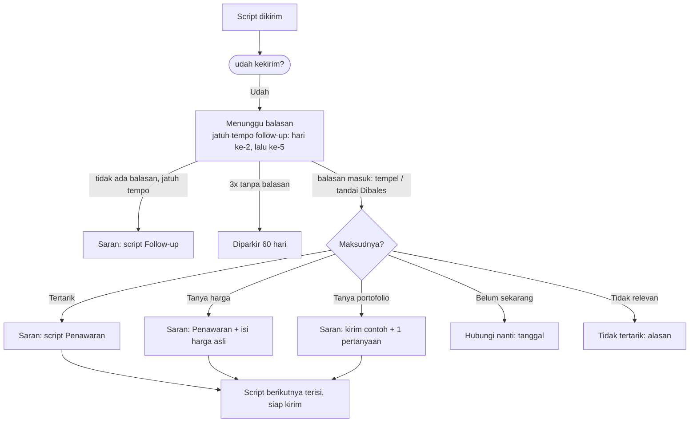

# Script Chat sebagai sistem interaksi

**Status:** usulan, belum dibangun. Menunggu keputusan owner (AMB-18 sampai AMB-21).

Sekarang Script adalah CRUD: judul, isi, tahap, brand, workflow, tipe bisnis, default, arsip. Script tidak tahu **untuk apa** ia dikirim, **jawaban apa** yang diharapkan, dan **apa yang terjadi** sesudahnya. Itu sebabnya setelah kirim, penjual harus menentukan semuanya sendiri: menandai hasil, memilih tahap berikutnya, memilih script berikutnya.

## 1. Pertanyaan yang harus dijawab setiap script

| Pertanyaan | Field (usulan) | Sekarang |
|---|---|---|
| Kapan dipakai? | `stage` (Intro, Follow-up, Gali kebutuhan, Penawaran, Closing, ETB) + `when` (kalimat situasi: "Prospek baru dari post Threads") | `stage` ada. `when` hanya ada di level tahap (`STAGES[].when`), bukan per script |
| Tujuannya apa? | `goal`: mulai percakapan · gali kebutuhan · kualifikasi · tangani keberatan · arahkan ke penawaran · tutup · rawat pelanggan lama | Tidak ada |
| Pakai variabel apa? | Dibaca dari isi: `{nama} {bisnis} {kebutuhan} {tawaran} {lokasi} {waktu} {post}` | Ada (`VARIABLES`). Variabel kosong menghapus kalimatnya (PRD-025 fase A) |
| Untuk siapa? | `workflow` (Leads / Hunting / Semua) · `brand` · `categories` · `channel` (WA / DM / balas post) | Ada, kecuali `channel` (PRD-024 langkah 5) |
| Setelah kirim, lalu apa? | `after`: tunggu balasan *N* hari, lalu follow-up (script tahap Follow-up) | Ada di level strategi Hunting (jeda 2/5 hari), bukan per script. Untuk Lead hanya ChatNote "Follow-up kapan?" |
| Jawaban apa yang diharapkan? | `expects[]`: tertarik · tanya harga · tanya portofolio · tanya jadwal · belum sekarang · tidak relevan · tidak membalas | Tidak ada |
| Lalu disarankan apa? | `next[intent]` → tahap dan script berikutnya | Tidak ada |

## 2. Satu script, sebagai perilaku

```
INTRO · "Cold DM — Kuliner"
──────────────────────────────────────────
Kapan        Prospek baru dari post Threads soal F&B
Tujuan       Mulai percakapan, tanpa jualan
Pesan        Halo {nama}! Aku liat postingan kamu "{kebutuhan}". …
Variabel     {nama} ✓  {kebutuhan} ✓ (dari post)  {bisnis} ✓
Pratinjau    Halo Dinda! Aku liat postingan kamu "ada rekomendasi fotografer …"
Setelah kirim
  ○ Tunggu balasan 2 hari, lalu Follow-up (tahap 2)
Kalau dia membalas …
  [Tertarik]          → Penawaran: "Dua pilihan paket"
  [Tanya harga]       → Penawaran: jawab dengan harga asli (wajib diisi)
  [Tanya portofolio]  → Gali kebutuhan: kirim contoh + 1 pertanyaan
  [Belum sekarang]    → Hubungi nanti (pilih tanggal), tanpa script
  [Tidak relevan]     → Tidak tertarik (alasan), stop
```

## 3. Alur sesudah kirim



**Siapa yang menentukan "maksudnya"?**
- Sekarang selalu penjual: tombol hasil, ditambah balasan yang ditempel.
- Usulannya: kalau balasan ditempel, mesin aturan yang **sudah ada** di Analisis Chat (`api/_intel/understand.py`: tanda mau beli, 7 jenis keberatan, pertanyaan terbuka) menebak maksudnya. Penjual mengonfirmasi dengan satu tap. Tidak ada AI, Rp 0 (AMB-19).

## 4. Script Editor sebagai spesifikasi perilaku

Urutan isian mengikuti pertanyaan di §1, bukan urutan field di database:

| Urutan | Isian | Perilaku |
|---|---|---|
| 1 | **Nama** | Diisi otomatis dari tahap + tujuan ("Intro · mulai percakapan"), bisa diganti |
| 2 | **Kapan dipakai** | Tahap (garis 1→6, seperti di daftar) + satu kalimat situasi |
| 3 | **Tujuan** | Satu pilihan (§1). Membatasi saran isi: tujuan "gali" mengingatkan "akhiri dengan satu pertanyaan" |
| 4 | **Untuk siapa** | Dipakai di · brand · tipe bisnis · saluran |
| 5 | **Pesan** | Teks + chip variabel. Variabel yang tidak punya sumber untuk *workflow* itu dinonaktifkan (`{post}` di Leads) |
| 6 | **Pratinjau** | Memakai orang yang sedang dibuka, atau contoh yang **ditandai "contoh"**. Menunjukkan kalimat mana yang hilang kalau variabelnya kosong |
| 7 | **Setelah kirim** | Tunggu *N* hari → follow-up. Bawaan dari tahap |
| 8 | **Kalau dia membalas** | Daftar maksud → tahap / script berikutnya. Bawaan dari tahap, bisa diubah per script |

**Contoh bawaan per tahap**, yang mengisi §1 untuk script lama tanpa field baru, supaya data lama tetap bekerja tanpa migrasi:

| Tahap | Tujuan bawaan | Setelah kirim | Kalau membalas |
|---|---|---|---|
| Intro | Mulai percakapan | Follow-up 2 hari | Tertarik → Penawaran · tanya harga → Penawaran · tanya contoh → Gali · belum → Nanti · tidak → Stop |
| Follow-up | Mengingatkan tanpa memaksa | Follow-up 5 hari, lalu parkir | sama dengan Intro |
| Gali kebutuhan | Tahu buat apa, berapa, kapan, budget | Tunggu jawaban | Jawaban lengkap → Penawaran · belum → Nanti |
| Penawaran | Dua pilihan + satu langkah | Follow-up 3 hari (seperti penawaran) | Setuju → Closing · nawar → Penawaran (opsi lebih kecil) · ragu → Closing (JOLT) |
| Closing | Mengunci jadwal / DP | Follow-up 1 hari | DP → Deal · belum → Nanti |
| ETB | Merawat pelanggan lama | — | Pesan lagi → Penawaran |

## 5. Hubungannya dengan rencana yang ada

- **PRD-024 (Script satu sistem):** `channel`, `tone`, `contexts`, `status`, dan brand sebagai entitas. Field `goal`, `when`, `after`, `expects`, `next` adalah tambahan untuk langkah 5 PRD-024.
- **PRD-025 (Otak Pesan):** "Pesan buat {nama}" memilih script. Dengan `expects` dan `next`, Otak Pesan juga tahu **script berikutnya** setelah balasan.
- **PRD-023 (Analisis Chat):** mesin pembaca maksud dipakai lagi untuk balasan yang ditempel.
