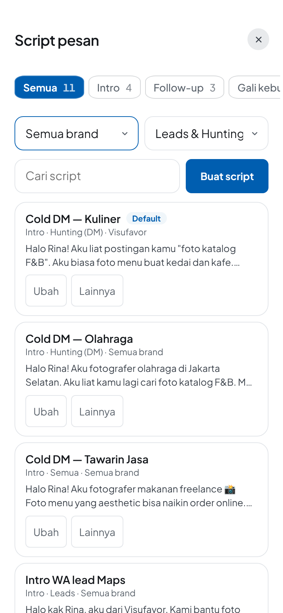
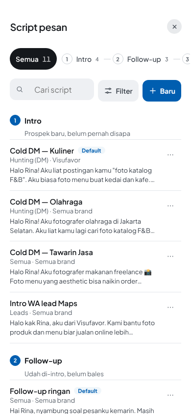
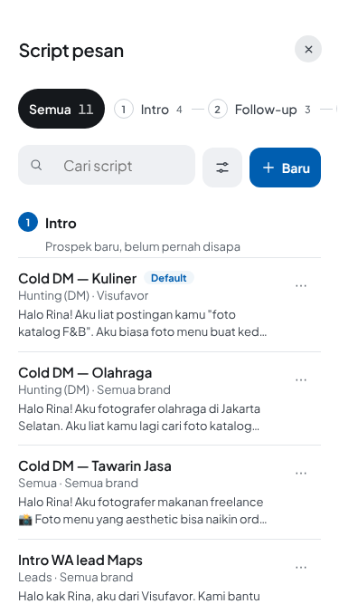
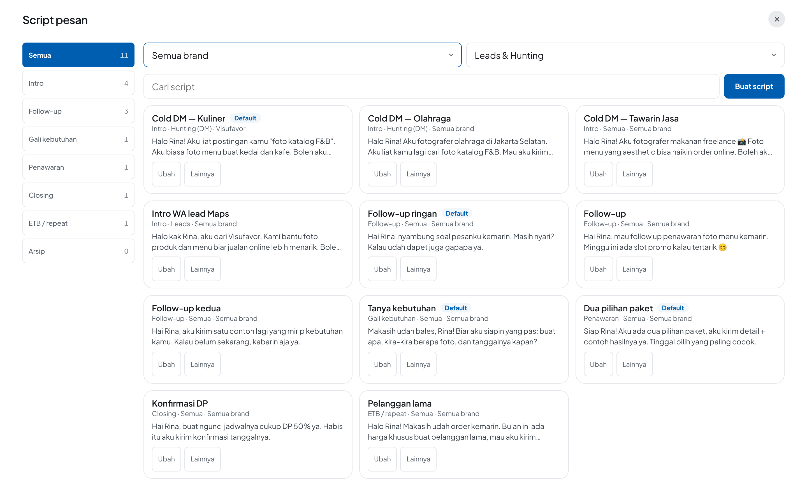
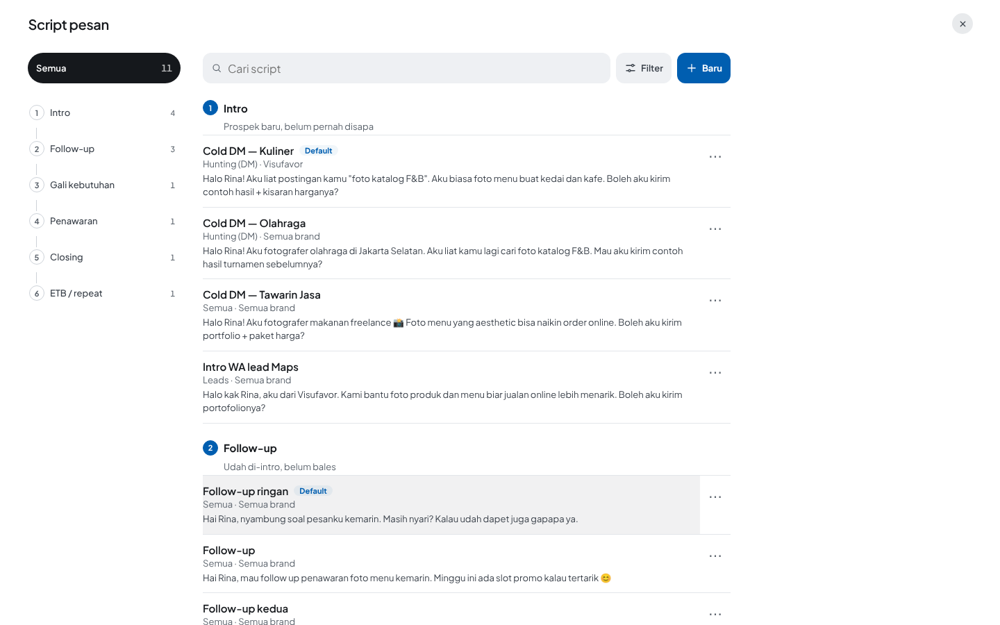
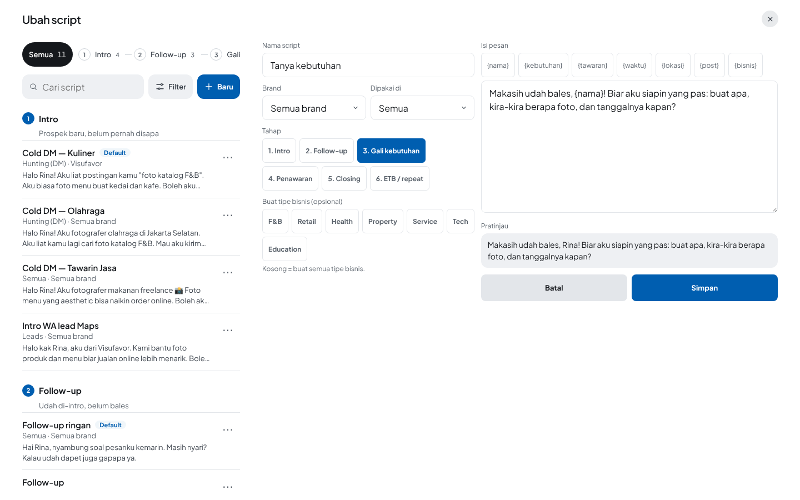

# Script pesan: audit UI/UX dan redesign (5 Nov 2026)

- **Diminta owner:** layarnya "generic, overly card-based, mirip template SaaS buatan AI".
- **Cara kerja:** skill `.claude/skills/salespal-ui-audit`, standar `docs/standards/design.md` dan `native.md`.
- **Layar:** Script pesan (`components/ScriptManager.tsx`). Dibuka dari Hunting (Tambah → Kelola script pesan / Script pesan baru) dan dari Pesan lead (Kelola).
- **Data contoh:** 9 script netral di 6 tahap, ditanam lewat flow `script pesan`.
- **Ukuran layar:** 390×844, 375×667, 1440×900.

| Sebelum, 390 | Sesudah, 390 | Sesudah, 375 |
|---|---|---|
|  |  |  |

| Sebelum, 1440 | Sesudah, 1440 | Sesudah, 1440, mengedit |
|---|---|---|
|  |  |  |

## 0. Yang ada sebelum diubah

**Data:** `pitchTemplates/{id}`, isinya `title`, `body`, `stage?`, `categories?`, `workflow?`, `brand?`, `isDefault?`, `archived?`.
- Script lama dibaca lewat `stageOf`, `workflowOf`, dan `brandOf`.
- Tidak ada field baru, tidak ada migrasi.

**Fungsi:** semuanya dipertahankan.

| Fungsi | Sebelum | Sesudah |
|---|---|---|
| Tahap | 8 chip setara: Semua, 6 tahap, Arsip | Garis tahap 1 → 6 plus Semua. Arsip pindah ke Filter |
| Brand, Dipakai di | 2 dropdown permanen di atas daftar | Filter (sheet), filter aktif tampil sebagai chip yang bisa dihapus |
| Cari | Input | Input dengan ikon, satu baris dengan Filter dan Baru |
| Buat | "Buat script" | "+ Baru" (nama aksesibel "Buat script") |
| Ubah | Tombol "Ubah" di setiap kartu | Tap barisnya |
| Duplikat, Jadikan default, Arsipkan | "Lainnya" membuka chip di dalam kartu, kartu jadi melar | ⋯ membuka sheet aksi |
| Balikin, Hapus | Sama, hanya untuk yang diarsipkan | Sama, di sheet aksi. Hapus = "Hapus permanen", merah, dengan konfirmasi |

## 1. Temuan audit

| # | Masalah | Kenapa ini masalah |
|---|---|---|
| A1 | **Setiap script dibungkus kartu** (border 1px, radius 16, padding 12/14) | design.md §2: daftar dipisah garis rambut, bukan kotak per baris. Sebelas kotak sama besar = tidak ada yang lebih penting. Layar HP cuma muat ±3,5 script |
| A2 | **"Ubah" dan "Lainnya" diulang di setiap kartu** (22 tombol untuk 11 script) | Aksi utama (buka script) jadi tombol kecil, padahal seluruh kartunya bisa jadi target. Tombol yang berulang menambah bising tanpa menambah pilihan |
| A3 | **"Lainnya" membuka chip di dalam kartu** | Kartunya melar, isi di bawahnya bergeser saat disentuh. Aksi yang merusak (Arsipkan, Hapus) muncul berdampingan dengan aksi biasa, tanpa jarak dan tanpa warna |
| A4 | **Tahap tampil sebagai 8 chip setara**, termasuk Semua dan Arsip | Siklus Intro → Follow-up → Gali → Penawaran → Closing → ETB tidak terbaca sebagai urutan. "Arsip" itu status, bukan tahap, tapi diletakkan sejajar |
| A5 | **Dua dropdown filter selalu di atas daftar** (2 × 44px + jarak) | Makan ±100px di HP untuk hal yang jarang diganti. "Leads & Hunting" sebagai nilai kosong itu ambigu (semua? atau dua-duanya?) |
| A6 | **Hierarki datar:** judul 15/600, meta 12, isi 13, chip 12 dengan radius 6 | Ukuran 12 dan 14 di luar token (`--fs-meta` = 13). Radius 6 di luar `--r-*`. Nama tahap di meta setiap baris diulang, padahal daftarnya sudah per tahap |
| A7 | **Desktop:** 3 kolom kartu yang sama tinggi, dan editor menggantikan daftar | Di laptop tidak ada master–detail, jadi untuk pindah script harus Batal → cari → Ubah. Kolom kartu membuat mata zig-zag; orang membaca script dari atas ke bawah |
| A8 | **Loading = "Belum ada script."** | `useSpaceCollection` tidak punya status muat, jadi orang dengan 30 script sempat melihat "Belum ada" sebelum datanya datang |
| A9 | **Tidak ada empty state untuk hasil cari atau filter** | "Ga ada script di sini." tidak menjelaskan bahwa yang menyembunyikan adalah filter, dan tidak ada jalan untuk menghapusnya |
| A10 | **Tidak ada konfirmasi sukses dan undo** | Arsipkan langsung hilang dari daftar, tanpa tanda dan tanpa Batal. Duplikat tidak bilang di mana salinannya |
| A11 | **Fokus awal jatuh ke dropdown Brand** | ModalA11y memfokuskan isian pertama, yaitu `<select>`. Di desktop muncul cincin fokus biru seolah sedang dipilih (lihat screenshot sebelum, 1440) |
| A12 | **Di 375px, tombol Hunting "+" dan "⌄" lebarnya 42 dan 36px** (temuan HIG flow baru) | Di bawah 44pt (native.md K1). Ini dipakai setiap kali membuka Script pesan dari Hunting |
| A13 | **Race di desktop:** baris lain bisa di-tap saat menyimpan, lalu app bertanya "Buang perubahan?" untuk ketikan yang sedang disimpan | Ketemu waktu flow desktop dijalankan dengan master–detail. Pesannya salah dan menakutkan |

## 2. Keputusan desain

1. **Baris, bukan kartu.**
   - Script = satu baris: judul 15/600, satu baris meta 13 (dipakai di · brand), dua baris pratinjau 13, garis rambut di bawahnya.
   - Seluruh baris adalah tombol *Ubah*. Hasilnya muat ±5 script per layar HP (sebelumnya 3,5). (A1, A2, A6)
2. **⋯ membuka sheet aksi** (`Sheet`, bottom sheet).
   - Urutannya: Ubah, Duplikat, Jadikan default (dengan keterangan "Dipakai otomatis di tahap ini"), Arsipkan ("Disembunyiin, angkanya tetap").
   - Untuk yang diarsipkan: Balikin, lalu Hapus permanen (merah, terakhir, dengan konfirmasi). (A3)
3. **Siklus terlihat sebagai siklus.**
   - Nomor 1–6 dalam lingkaran, disambung garis.
   - Di HP satu baris yang bisa di-scroll; di laptop rail vertikal dengan garis penyambung.
   - Pada tampilan "Semua", daftar dikelompokkan per tahap dengan judul (nomor + nama + "kapan dipakai").
   - Saat satu tahap dipilih, kalimat *kapan* dan *tip*-nya tampil di atas daftar. (A4)
4. **Filter di satu tempat.**
   - Brand, Dipakai di, dan Tampilkan (aktif/arsip) ada di sheet radio. Tombolnya menampilkan berapa yang aktif.
   - Filter aktif jadi chip yang bisa dihapus di bawah pencarian.
   - "Lihat N script" menunjukkan hasilnya sebelum sheet ditutup. (A4, A5, A9)
5. **Laptop = master–detail.**
   - Rail tahap ada di kiri. Daftar maksimal 760px; baris yang terlalu lebar susah dibaca.
   - Saat mengedit, daftar tetap di kiri (sticky, scroll sendiri) dan baris yang dibuka ditandai. Editor ada di kanan; di ≥ 1360px editornya sendiri terbagi dua. (A7)
6. **Status yang jujur.**
   - Loading: 3 baris kerangka (`aria-busy`). `useSpaceCollectionLive` mengembalikan `loading`, `ready`, atau `error`.
   - Kosong total: penjelasan satu kalimat, lalu "Pakai 6 contoh" (satu per tahap) atau "Tulis sendiri".
   - Tahap kosong: "Pakai contoh".
   - Hasil kosong: menyebut kata yang dicari, dengan "Hapus pencarian & filter".
   - Gagal: pesan koneksi.
   - Sukses: toast "Disalin / Diarsipkan / jadi default". Arsipkan bisa di-Batal selama 5 detik. (A8–A10)
7. **Fokus awal ke "Semua"** (`data-autofocus`, dihormati ModalA11y), bukan ke isian. Keyboard tetap mulai dari atas tanpa memunculkan picker. (A11)
8. **Token, bukan sistem baru.**
   - Semua ukuran pakai `--fs-*`, jarak `--sp-*`, sudut `--r-*`.
   - Ditambah dua token keadaan: `--state-press` (tekan, terang/gelap) dan `--state-on` (terpilih, = `--brand-tint`).
   - Biru brand hanya untuk satu aksi utama (Baru), tahap terpilih, dan badge.
9. **Split button Hunting minimal 44px** (A12). **Selama menyimpan, editor tidak dianggap "ada perubahan"** (A13).

## 3. Struktur

```
ScriptManager (Sheet full wide)
├─ ConfirmSheet "Buang perubahan?"          (ketikan belum disimpan)
├─ .sp-sm  [is-editing]
│  ├─ section.sp-sm-list "Daftar script"
│  │  ├─ nav.sp-life "Tahap percakapan"     Semua · ol 1..6 (dot, nama, jumlah)
│  │  ├─ .sp-sm-tools                       cari · Filter (badge) · + Baru
│  │  ├─ .sp-sm-active                      chip filter aktif (×)
│  │  ├─ .sp-sm-when                        kapan + tip tahap terpilih
│  │  ├─ loading | error | empty
│  │  └─ section.sp-sm-group × tahap        h3 (dot, nama, kapan) · ul.sp-sm-rows
│  │        └─ li.sp-sm-row                 button.sp-sm-main (Ubah) · button.sp-sm-more (⋯)
│  └─ section.sp-sm-detail                  ScriptEditor (key = id)
├─ Sheet {judul script}                      sheet aksi
├─ Sheet "Filter script"                     radio: Brand · Dipakai di · Tampilkan
└─ .sp-toast role=status                     pesan sukses + Batal
```

## 4. Interaksi

| Gerakan / tombol | HP | Laptop |
|---|---|---|
| Tap baris | Buka editor, daftar disembunyikan (posisi scroll diingat) | Buka editor di kanan, daftar tetap, baris ditandai |
| Tap baris lain saat ada ketikan | "Buang perubahan?" | Sama |
| ⋯ | Sheet aksi dari bawah | Sama (sheet di tengah bawah) |
| Back / Escape di editor | Kembali ke daftar | Tutup editor, daftar tetap |
| Back / Escape di sheet | Tutup sheet saja | Sama |
| ✕ | Keluar dari Script pesan (tanya dulu kalau ada ketikan) | Sama |
| Tab / Enter | Tahap → cari → Filter → Baru → baris → ⋯ | Sama. Enter pada baris membuka editor |
| Arsipkan | Toast "Diarsipkan" + Batal (5 detik) | Sama |

## 5. Hasil uji

Semua yang ditulis di sini sudah dijalankan.

| Cek | Hasil |
|---|---|
| Flow baru `script pesan`: 390×844, 375×667, 1440×900, `scrollWidth ≤ clientWidth` | ✅ lulus di ketiga ukuran (390 = 390, 375 = 375, 1440 = 1440) |
| Semua ⋯, Filter, dan Baru di dalam layar, di ketiga ukuran | ✅ |
| Audit HIG (44pt, 16px, axe) di ketiga ukuran | ✅ 0 temuan. Sebelum perbaikan A12: 2 temuan |
| Sheet aksi, sheet filter (pilih brand → baris brand lain hilang → chip × → kembali), pilih tahap (kalimat "kapan" muncul, tahap lain tidak tampil) | ✅ |
| Keyboard: fokus baris → Enter membuka editor → Escape kembali ke daftar | ✅ |
| Laptop: daftar tetap di samping editor, baris yang dibuka ditandai. HP 375: editor sendiri, Batal → daftar | ✅ |
| Flow `script management`: buat 3, Back/Escape/Buang, default, duplikat, arsip + Batal + arsip lagi, filter Arsip, Pesan lead tidak menawarkan yang diarsipkan | ✅ phone dan `DESKTOP=1` |
| Full suite `npm run test:flows` + `DESKTOP=1` | ✅ 33/33 dan 33/33, HIG 0 temuan |
| WebKit (iPhone 12, Safari) | belum dijalankan di sini, dijalankan CI `native` |
| Mode gelap (`data-theme=dark`, 390) | ✅ dicek dengan screenshot: [after-390-dark](script-pesan/after-390-dark.png). Teks dan garis memakai token gelap; pill Semua terbalik (terang di atas gelap) |
